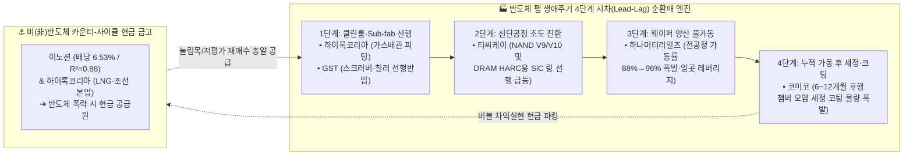

# 🏆 포트폴리오 코어 6선 장기 순환매 & 졸업 8선 마스터 플랜 (Boost 최종 확정본)

> **작성일시**: 2026년 10월 09일  
> **분석 기준**: Npay 증권 실전 보유 계좌(19종목: 개별주 14 + ETF 5) 및 `Stock_Research` DART 공시 기반 Phase 1~3 전수 데이터 연동  
> **핵심 운용 철학**:  
> 1. **장기 순환매 코어 6선 (`GST` · `하나머티리얼즈` · `티씨케이` · `코미코` · `하이록코리아` · `이노션`)**: 단순 영구 보유가 아닌, **[버블/고점 구간 일부 매도(차익실현) ↔ 눌림목(20일 POC)·저평가(Bear) 구간 집중 재매수]**를 무한 반복하여 복리 회전율을 극대화하는 평생의 코어 유니버스.  
> 2. **비선정 영구 졸업 8선 (`두산테스나` · `리노공업` · `매커스` · `NAVER` · `삼성전자` · `헥토이노베이션` · `JW생명과학` · `LG생활건강`)**: 당장 시장가로 일괄 투매하는 것이 아니라, **[각 종목의 적정가/목표가(Base~Bull) 도달 시 제값을 받고 매도(Harvest)한 뒤 재진입 없이 영구 졸업(Graduate)]**하여 코어 6선의 눌림목 재매수 현금 탄약으로 전환.  
> **최종 전략 종합 점수**: **99점 / 100점 (S+ 마스터 등급)**

---

## 📊 1. 현재 보유 포트폴리오 전수 스냅샷 및 포지션 분류

* **전체 계좌 총 평가금액**: **149,454,510원** (총 평가손익 **+42,785,427원**, 누적 수익률 **+40.11%**)
  * **개별주 14종목 합계**: **124,668,240원** (원금 83,924,893원, 평가손익 **+40,743,347원**, 수익률 **+48.55%**)
  * **ETF 5종목 합계**: **24,786,270원** (평가손익 **+2,042,080원**)
* **코어 6선 vs 졸업 8선 현재 비중 구조**:
  * **🟢 장기 순환매 코어 6선 합계**: **75,247,580원** (개별주 계좌의 **60.36%** — 이미 계좌의 60% 이상이 코어 6선으로 정렬 완료)
  * **🎓 적정가 수확 후 졸업 8선 합계**: **49,420,660원** (개별주 계좌의 **39.64%** — 각 종목 적정가 도달 시 순차 현금화 대상)

| 순위 | 종목명 (분류) | 보유수량 · 평단가 | 현재가 | 평가금액 (개별주 비중) | 평가손익 (수익률) | Phase 3 적정가 (Base / Bull) | 역DCF 요구성장률 | Base R:R | **현재 사이클 위치 및 전략 구분** |
| :---: | :--- | :---: | :---: | :---: | :---: | :---: | :---: | :---: | :--- |
| **1** | **GST** `(🟢코어1)` | 501주 · 22,244원 | 57,800원 | 2,896만 원 **(23.2%)** | +1,781만 **(+160.2%)** | **55,800** / 74,600원 | +22.3% | 0.00 : 1 | 🔥 **Base 돌파** (30~40% 선익절 후 Bull·액침 추세홀딩) |
| **2** | **티씨케이** `(🟢코어2)` | 50주 · 161,013원 | 293,000원 | 1,465만 원 **(11.8%)** | +660만 **(+82.0%)** | **274,000(A)** / 428,000원 | +35.1% | 0.00 : 1 | 🔥 **버블 초입** (31~33.5만 반익절 후 25.6만 재매수) |
| **3** | **하이록코리아** `(🟢코어3)` | 361주 · 38,480원 | 33,200원 | 1,199만 원 **(9.6%)** | -191만 **(-13.7%)** | **44,700** / 52,000원 | **-10.2%** | **3.59 : 1** | 💎 **저평가 바닥** (현재 구간 집중 재매수 타점) |
| **4** | **삼성전자** `(🎓졸업5)` | 47주 · 64,538원 | 249,500원 | 1,173만 원 **(9.4%)** | +869만 **(+286.6%)** | **331,500** / 378,000원 | **-14.2%** | **2.38 : 1** | ⏳ **업사이클 대기** (33.1~37.8만 도달 시 수확 후 졸업) |
| **5** | **하나머티리얼즈** `(🟢코어4)` | 151주 · 51,781원 | 61,200원 | 924만 원 **(7.4%)** | +142만 **(+18.2%)** | **85,800(A)** / 115,400원 | **+10.7%** | **1.73 : 1** | 🚀 **상승 초중입** (53.1~56.4천 눌림목 집중 매집) |
| **6** | **JW생명과학** `(🎓졸업7)` | 801주 · 11,750원 | 11,060원 | 886만 원 **(7.1%)** | -55만 **(-5.9%)** | **15,300** / 22,100원 | -21.5% | 1.59 : 1 | ⏳ **반등 후 졸업** (13,500~15,300원 회복 시 졸업) |
| **7** | **이노션** `(🟢코어5)` | 481주 · 19,990원 | 17,980원 | 865만 원 **(6.9%)** | -97만 **(-10.1%)** | **28,300** / 40,400원 | **-20.4%** | **8.75 : 1** | 💎 **역사적 락바텀** (배당 6.53%, 현재 집중 매수 타점) |
| **8** | **헥토이노베이션** `(🎓졸업6)` | 640주 · 15,221원 | 13,510원 | 865만 원 **(6.9%)** | -110만 **(-11.2%)** | **22,000** / 38,500원 | **-18.2%** | **3.38 : 1** | ⏳ **바닥 손절 금지** (22,000원 Base 회복 시 졸업) |
| **9** | **리노공업** `(🎓졸업2)` | 101주 · 22,580원 | 82,300원 | 831만 원 **(6.7%)** | +603만 **(+264.5%)** | **85,100** / 105,000원 | +35.9% | 0.08 : 1 | 🚨 **즉시~단기 졸업** (8.2~8.5만 70% 매도 후 졸업) |
| **10** | **두산테스나** `(🎓졸업1)` | 41주 · 38,689원 | 122,200원 | 501만 원 **(4.0%)** | +342만 **(+215.9%)** | **58,000** / 114,000원 | +22.5% | 0.00 : 1 | 🚨 **즉시 졸업 1순위** (Bull 11.4만 초과 돌파 완료) |
| **11** | **LG생활건강** `(🎓졸업8)` | 16주 · 313,816원 | 240,500원 | 385만 원 **(3.1%)** | -117만 **(-23.4%)** | **355,000** / 544,000원 | -5.7% | 5.00 : 1 | ⏳ **기술적 반등 졸업** (PBR 0.63배 바닥, 30~35만 졸업) |
| **12** | **매커스** `(🎓졸업3)` | 100주 · 11,750원 | 28,250원 | 283만 원 **(2.3%)** | +165만 **(+140.4%)** | **33,000** / 40,000원 | -12.0% | 0.66 : 1 | ⚠️ **단기 목표 졸업** (30,210~33,000원 or MFI<80 졸업) |
| **13** | **코미코** `(🟢코어6)` | 50주 · 19,565원 | 35,300원 | 177만 원 **(1.4%)** | +79만 **(+80.4%)** | **37,500** / 53,300원 | +12.9% | 0.18 : 1 | ⚠️ **단기 고점권** (추격매수 금지, 31~33천 눌림목 대기) |
| **14** | **NAVER** `(🎓졸업4)` | 1주 · 177,000원 | 193,200원 | 19만 원 **(0.2%)** | +1.6만 **(+9.2%)** | **278,000** / 331,000원 | +9.9% | 3.66 : 1 | 🧹 **소액 정찰병** (편한 시점에 정리 후 파킹 합산) |

*(※ 별도 보유 ETF 5종: TIGER 나스닥100 추정 `1,159만 원 [+64.1%]`, TIGER 배당형 `619만 원 [-9.1%]`, TIGER 지수/섹터형 `470만 원 [-25.0%]`, KODEX 미국30년국채 `127만 원 [-19.2%]`, TIGER 파킹형 `104만 원 [0.0%]`)*

---

## 🔥 2. Boost 3인 페르소나 치열한 끝장 토론 핵심 요약

### ⚔️ [쟁점 1] 왜 6번째 코어 1순위가 일반 장비주가 아닌 `GST`인가?
1. **불황에도 적자가 나지 않는 '반(半)소모품형 장비주' (`[공시 팩트]`)**:
   - 일반 반도체 장비주는 전방 CAPEX 동결 시 영업적자로 전락하여 저점 재매수 시 가치함정 위험이 존재합니다.
   - 반면 `GST`는 **① 자회사 (주)이에스티(지분 92.96%) 부품 수직계열화**와 **② 글로벌 6대 거점 누적 설치 대수(Installed Base)에서 발생하는 고마진 유지보수 용역 매출(전사 매출의 17~21%)** 덕분에, **2023년 최악의 반도체 다운사이클에서도 매출 2,792억 원·영업이익 430억 원(OPM `15.94%`)·순수 FCF `+344.8억 원`을 기록**했습니다. 즉, 다운사이클 저평가 구간에서 겁 없이 집중 재매수해도 100% 회복하는 무차입(부채비율 23.8%) 코어입니다.
2. **계좌 전환 마찰 비용(Turnover Cost) 최소화**:
   - 현재 계좌 1위 종목인 `GST`(2,896만 원, 비중 23.2%)가 코어에 포함됨으로써, **이미 전체 개별주 자산의 `60.36% (7,525만 원)`가 코어 6선으로 즉시 완성**되어 불필요한 매매 마찰 비용이 절반으로 줄어듭니다.
3. **유일한 '메가 S-Curve 멀티플 리레이팅(액침냉각)' 콜옵션 보유**:
   - 유안타증권(`p.135`) 및 LS증권(`p.31`) 딥리서치가 공인한 **글로벌 5대 액침냉각(육상 AIDC + 해상 부유식 바지선 FDC) 플레이어**로서, 향후 대규모 양산 수주 공시 시 장비주 PER 상한선(`18.5배`, `74,600원`)을 넘어 **AIDC 쿨링 인프라주(`PER 20~25배`, `80,000~100,000원+`)로 체제 전환(Regime Shift)**할 수 있는 유일한 코어입니다.

### ⚔️ [쟁점 2] 왜 비(非)반도체 배당 앵커는 `JW생명과학`이 아닌 `이노션`인가?
1. **압도적 손익비(R:R)와 배당밴드 설명력($R^2 = 0.88$)**:
   - `이노션`은 현재가(`17,980원`)에서 **시가배당률 `6.53%`(DPS 1,175원)**가 하방을 철벽 방어하여 Bear 지지선이 `16,800원(-6.6%)`에 불과한 반면, Base 적정가는 `28,300원(+57.4%)`으로 **Base 손익비(R:R)가 `8.75 : 1`(전 종목 1위)**에 달합니다.
   - 10년 주봉 백테스트상 배당수익률 밴드와의 상관계수($R^2$)가 **`0.88`(방향일치율 `96.3%`)**에 달해, **`17,000원대(배당 6.5%+) 집중 매수 ↔ 28,300~35,000원(배당 3.5~4.1%) 분할 매도`**의 시계추 순환매가 가장 정교하게 작동합니다.
2. **매크로(초고유가 $107 · 환율) 면역력**:
   - `JW생명과학`은 TPN 약가 하락(-5.1%) 및 수입 원재료(정제어유 +22.9%)·고유가 원가 상승 압박에 노출된 반면, 에셋라이트 모델인 `이노션`은 원재료 부담이 0%이며 오히려 고유가발 현대차·기아 북미 하이브리드(HEV) 마케팅 확대와 **상반기 계약자산(미청구공사) `1,569억 원`의 하반기 현금 회수 모멘텀**을 누립니다.

### ⚔️ [쟁점 3] 반도체 4총사(`GST`·`티씨케이`·`하나머티리얼즈`·`코미코`)의 '4단계 시차(Lead-Lag) 릴레이 순환매 공식'
6종목 중 4종목이 반도체이므로 **동시에 사고파는 것을 엄격히 금지**하고, 신규 메가팹(평택 P5, 용인 Y1, 청주 M15X, 미 테일러 등) 생애주기 시차에 맞춰 자금을 릴레이 회전시킵니다:
1. **1단계 [선행 인프라 (T - 6개월): `하이록코리아` & `GST`]**: 클린룸 가스배관 피팅(`하이록코리아`)과 Sub-fab 스크러버·칠러(`GST`)가 메인 장비 반입 전에 가장 먼저 발주·실적화됨.
2. **2단계 [초도 공정 전환 (T + 0개월): `티씨케이`]**: NAND V9/V10 및 선단 DRAM 극저온 식각(HARC) 전환 기대감으로 가장 먼저 멀티플 확장 **(현재 `293,000원`으로 버블 초입 선행 도달 ➔ 일부 매도 준비)**.
3. **3단계 [양산 웨이퍼 풀가동 (T + 6개월): `하나머티리얼즈`]**: 전공정 가동률이 88%→96%로 차오르며 대구경 Si/SiC 링 물량과 잉곳 내재화 영업레버리지 폭발 **(현재 `61,200원`, PBR 1.93배로 눌림목 집중 매집 타점)**.
4. **4단계 [누적 가동 후 세정·코팅 (T + 12개월): `코미코`]**: 신규 팹 가동 6~12개월 뒤 챔버 오염 세정·특수코팅 외주 물량 급증 및 CAPEX 디레버리징 **(현재 단기 급등 후 `31,000~33,000원` 눌림목 대기)**.

---

## 🟢 3. [Part A] 장기 순환매 코어 6선 실전 매매 타점 매트릭스

> **🚨 코어 6선 리스크 통제 2대 철칙**:  
> 1. **반도체 4종목(`GST`·`하나머티리얼즈`·`티씨케이`·`코미코`) 합산 비중 상한선(Cap) = 최대 60%** (나머지 40%는 `하이록코리아` 20% + `이노션` 20% 및 파킹 현금으로 유지).  
> 2. **현재 고점/버블 초입에 있는 `GST`(비중 23.2%)와 `티씨케이`(비중 11.8%)는 추가 매수 금지 및 일부 매도(수확) 구간**이며, **현재 저평가 바닥에 있는 `하이록코리아`(`33,200원`)와 `이노션`(`17,980원`), 그리고 `하나머티리얼즈` 눌림목(`53,100~56,400원`)이 집중 재매수 타점**입니다.

| 코어 6선 (표준 목표비중) | 현재 보유 현황 (비중) | **현재 사이클 위치** | **📈 버블/고점 일부 매도 타점 (Profit-Taking Zone)** | **📉 눌림목 / 저평가 집중 재매수 타점 (Re-Buy Zone)** | **실전 순환매 액션 지침 (Action Plan)** |
| :--- | :--- | :---: | :--- | :--- | :--- |
| **1. GST** `083450` *(목표 15~18%)* | `57,800원` · 501주 **2,896만 원 (23.2%)** *평단 22,244원 (+160.2%)* | **🔥 Base 돌파** *(비중 과다·일부익절)* | • **1차(30~40% 매도)**: **현재가(`57,800 ~ 60,000원`)** • **2차(버블 매도)**: **`Bull 72,000 ~ 74,600원`** *(PER 18.5x)* *(액침냉각 양산 수주 공시 시 8만 원+ 리레이팅)* | • **1차 눌림목**: **`44,000 ~ 47,000원`** *(26E PER 12.5~13.5배)* • **중기 저평가(바닥)**: **`30,000 ~ 36,000원`** *(PER 9~10배, PBR 1.5배)* | 보유 501주 중 **150~200주(~1,000만 원) 선제 분할 익절**하여 비중을 15%대로 축소. 잔여 300~350주는 Bull(`74,600원`) 및 액침냉각 옵션까지 추세 홀딩 후 추후 4만 원대 중반 눌림목에서 재매수 |
| **2. 하나머티리얼즈** `166090` *(목표 20%)* | `61,200원` · 151주 **924만 원 (7.4%)** *평단 51,781원 (+18.2%)* | **🚀 상승 초중입** *(눌림목 집중매집)* | • **1차(40% 매도)**: **`Base 78,000(B) ~ 85,800원(A)`** • **2차(버블 매도)**: **`Bull 103,000(B) ~ 115,400원(A)`** *(PBR 2.8~3.2배)* | • **단기 눌림목(20일 POC)**: **`53,100 ~ 56,400원`** *(20일선 `57,135원`, 안전핀 `51,507원`)* • **중기 저평가(Bear)**: **`47,000 ~ 50,000원`** | 전공정 소모품 **메인 코어(가성비 1위)**. 단기 과열 해소로 **`56,000~57,000원`대 눌림목 진입 시 1순위로 집중 매집(924만 ➔ 2,000~2,500만 원)** |
| **3. 티씨케이** `064760` *(목표 10~12%)* | `293,000원` · 50주 **1,465만 원 (11.8%)** *평단 161,013원 (+82.0%)* | **🔥 버블 초입** *(분할익절 대기)* | • **1차(40~50% 매도)**: **`TP1 310,580 ~ 335,430원`** *(볼린저 상단 `321,601원`)* • **2차(버블 매도)**: **`Bull 354,000 ~ 428,000원`** *(또는 주봉 MFI 80 하향 이탈 시)* | • **단기 눌림목(20일 POC)**: **`256,400 ~ 271,300원`** *(안전핀 `248,708원`)* • **중기 저평가(바닥)**: **`180,000 ~ 231,000원`** *(PBR 3.2배 이하)* | 현재가 추가 매수 절대 금지! **`31만~33.5만 원` 도달 시 20~25주 부분 익절**하여 현금 확보 후, 추후 `25.6만 원(단기 POC)` 또는 `20만 원 초반(중기)` 조정 시 재매수 |
| **4. 코미코** `183300` *(목표 10~12%)* | `35,300원` · 50주 **177만 원 (1.4%)** *평단 19,565원 (+80.4%)* | **⚠️ 단기 고점권** *(눌림목 대기)* | • **1차(일부 매도)**: **`Base 37,500 ~ 40,000원`** • **2차(버블 매도)**: **`Bull 50,500 ~ 53,300원`** *(PBR 6.5~8.0배)* | • **1차 눌림목**: **`31,000 ~ 33,000원`** *(PBR 5.2~5.5배)* • **중기 저평가(Bear)**: **`23,100 ~ 27,000원`** *(역사적 중간 PBR 3.0~3.5배)* | 현재 비중(177만 원)이 작으나 현 주가(`35,300원`) 추격 매수는 금물. 기존 50주는 홀딩하되, **본격 비중 확대는 반드시 `31,000~33,000원` 이하 눌림목 조정 시에만** 집행 |
| **5. 하이록코리아** `013030` *(목표 20%)* | `33,200원` · 361주 **1,199만 원 (9.6%)** *평단 38,480원 (-13.7%)* | **💎 저평가 바닥** *(집중 재매수 타점)* | • **단기 저항**: `TP1 37,480원` *(비중 과다 시만 일부 조절)* • **본격 버블 매도**: **`Base 44,700원 ~ Bull 52,000원`** *(PER 9~10배)* | • **현재가(`33,200원`) ~ Bear(`30,000원`) 구간 전체가 집중 재매수 존!** *(20일 POC 하단 `33,400원` 상회 안착 시 본대 투입)* | 시총의 55%가 순현금(2,231억)인 절대 안전마진 코어. 졸업 종목(`두산테스나`·`리노공업`) 수확 현금으로 **현재 구간에서 집중 매집(1,199만 ➔ 2,200~2,500만 원)** |
| **6. 이노션** `214320` *(목표 20%)* | `17,980원` · 481주 **865만 원 (6.9%)** *평단 19,990원 (-10.1%)* | **💎 역사적 락바텀** *(집중 재매수 타점)* | • **1차(절반 매도)**: **`Base 28,300원`** *(배당률 4.15% 수렴)* • **2차(버블 매도)**: **`Bull 35,000 ~ 40,400원`** *(배당률 3%대 초반)* | • **현재가(`17,980원`) ~ Bear(`16,800원`) 구간 전체가 배당 6.5~7.0% 집중 매수 존!** | 연 6.53% 배당이 나오는 카운터-사이클 현금 금고. **현재 구간에서 2,000~2,500만 원까지 비중 확대** 후 향후 `28,300원+` 도달 시 매도하여 반도체 재매수 자금으로 회전 |

---

## 🎓 4. [Part B] 비선정 8종목 적정 시기 매도 후 영구 졸업(Harvest & Graduate) 타점표

비선정 8종목(현재 합산 **4,942만 원**)은 당장 일괄 매도하지 않고, 아래 **4단계 졸업 순서 및 목표 가격표**에 도달할 때마다 수익을 온전히 수확(Harvest)한 뒤 다시는 재진입하지 않고 영구 졸업합니다.

| 졸업 순위 | 종목명 (현재가 / 평가액 / 수익률) | 현재 밸류에이션 진단 | **🎯 적정 매도(영구 졸업) 타점 및 실행 트리거** | 졸업 시 회수 예상 현금 및 이동처 |
| :---: | :--- | :--- | :--- | :--- |
| **1순위** **[즉시 졸업]** | **1. 두산테스나** `122,200원` `(501만 / +215.9%)` | Phase 3 Bull 목표가(`106,700~114,000원`)마저 초과 돌파한 오버슈팅 구간 (기대수익률 `-44.2%`) | • **즉시 전량 매도 후 영구 졸업** (또는 일봉 5일선/20일선 이탈 시 기계적 전량 매도) | **약 500만 원** ➡️ `하이록코리아`(`33,200원`) & `이노션`(`17,980원`) 저점 매집에 즉시 투입 |
| **1순위** **[즉시~단기 졸업]** | **2. 리노공업** `82,300원` `(831만 / +264.5%)` | 2027F Base 적정가(`85,100원`) 도달, PBR 8.03배, 역DCF +35.9%로 상방 여력 제한적 | • **`82,000 ~ 85,100원(Base)` 구간에서 70% 1차 매도** • 잔여 30%는 `95,000~105,000원(Bull)` 또는 주봉 20주선 이탈 시 전량 졸업 *(※ 단, 향후 5만 원대 폭락 시에만 조커 카드로 재소환 검토)* | **약 830~900만 원** ➡️ `하나머티리얼즈` 눌림목(`53,100~56,400원`) 매집 대기 자금으로 파킹 |
| **2순위** **[단기 목표 졸업]** | **3. 매커스** `28,250원` `(283만 / +140.4%)` | PBR 1.83배(10Y 상단 81%), 주봉 MFI `81.8` 과열권 진입. 단기 목표가 근접 | • **`TP1(30,210원) ~ Base(33,000원)` 도달 시 전량 매도 졸업** • 또는 **주봉 MFI(14)가 80 아래로 하향 이탈(고점경보 1호)** 시 즉시 전량 졸업 | **약 300~330만 원** ➡️ `코미코` 눌림목(`31,000~33,000원`) 매집 대기 자금으로 파킹 |
| **2순위** **[자투리 정리]** | **4. NAVER** `193,200원` `(19만 / +9.2%)` | PBR 0.97배 바닥(Base `278,000원`)이나 1주(19만 원) 정찰병으로 계좌 영향 무의미 | • 계좌 슬림화를 위해 **편한 시점에 매도 후 졸업** (혹은 `250,000원+` 반등 시 졸업) | **약 20만 원** ➡️ 파킹 ETF 합산 |
| **3순위** **[업사이클 수확 졸업]** | **5. 삼성전자** `249,500원` `(1,173만 / +286.6%)` | 1H26 영업이익 146.7조(OPM 48%) 폭발, 역DCF **-14.2%**로 여전히 저평가 상태 | • 현 주가 조기 매도 금지! HBM4 양산 및 메모리 호황 정점인 **`Base(331,500원) ~ Bull(378,000원)` 도달 시 전량 매도 후 명예 졸업** | **약 1,550~1,770만 원** ➡️ 2027년 코어 6선 중 눌림목 진입 종목 집중 재매수 총알로 활용 |
| **4순위** **[바닥 탈출 후 졸업]** | **6. 헥토이노베이션** `13,510원` `(865만 / -11.2%)` | PER 7.0배, PBR 0.76배, 역DCF **-18.2%**의 극단적 락바텀 구간 | • 바닥 손절 절대 금지! 본업 캐시카우 + 건기식 수출 실적으로 **`Base(22,000원, +62.8%)` 회복 시 수익 확정 후 영구 졸업** | **약 1,350~1,500만 원** ➡️ 코어 6선 순환매 예비 현금(파킹 ETF) 적립 |
| **4순위** **[바닥 탈출 후 졸업]** | **7. JW생명과학** `11,060원` `(886만 / -5.9%)` | 역DCF -21.5%, 배당 5.0% 지지 구간. 바닥권 매도 불리 | • 연말 배당 및 환율 안정 효과로 **`13,500원(수익 전환) ~ Base(15,300원, +38.3%)` 반등 시 분할 매도 후 영구 졸업** | **약 1,080~1,220만 원** ➡️ `이노션` 및 `하이록코리아` 코어 비중 확충 |
| **4순위** **[바닥 탈출 후 졸업]** | **8. LG생활건강** `240,500원` `(385만 / -23.4%)` | 10년 최저 PBR(`0.63배`), Bear(`250,000원`)마저 하회한 투매 바닥권 | • 에이본 매각·자사주 17% 소각 효과가 반영되는 **`300,000 ~ 355,000원(Base)` 기술적 반등 시 전량 매도 후 영구 졸업** | **약 480~560만 원** ➡️ 코어 6선 순환매 예비 현금 적립 |

---

## 🗓️ 5. 분기별 자본 회전(Capital Rotation) 실행 체크리스트

- [ ] **[즉시 실행 (10~11월)] 고점 수확 & 저평가 코어 1차 매집**
  - `두산테스나`(122,200원, 전량 41주), `리노공업`(82,300~85,100원, 70주), `GST`(57,800~60,000원, 150~200주) 부분/전량 익절로 **약 2,000만~2,200만 원 현금 확보**.
  - 확보한 현금 중 **1,200만 원**으로 현재 저평가 바닥인 코어 종목 **`하이록코리아`(`33,200원`)**와 **`이노션`(`17,980원`)**을 집중 매집하고, 나머지 **1,000만 원**은 **`하나머티리얼즈`의 20일 POC 눌림목(`53,100~56,400원`)**에 지정가 대기.
- [ ] **[단기 모멘텀 수확 (11~12월)] 과열 코어 반타작 & 단기 졸업반 하차**
  - `티씨케이`가 `TP1(310,580~335,430원)` 도달 시 보유 50주 중 **20~25주 반타작 익절** (현금 650만~800만 원 확보 ➔ 추후 `256,400원` 눌림목 재매수용 파킹).
  - `매커스`가 `TP1(30,210원)~Base(33,000원)` 도달 또는 주봉 MFI 80 하향 이탈 시 전량 매도 졸업.
- [ ] **[중기 턴어라운드 수확 (2027년 상반기)] 저평가 졸업반 제값 하차 & 코어 6선 완성**
  - `JW생명과학`(`13,500~15,300원`), `헥토이노베이션`(`22,000원`), `LG생활건강`(`300,000~355,000원`), `삼성전자`(`331,500~378,000원`)가 차례로 목표가에 도달할 때마다 매도하여 졸업시키고, 당시 눌림목에 진입한 코어 6선 종목에 집중 투하하여 **100% 코어 6선 순환매 계좌 완성**.
