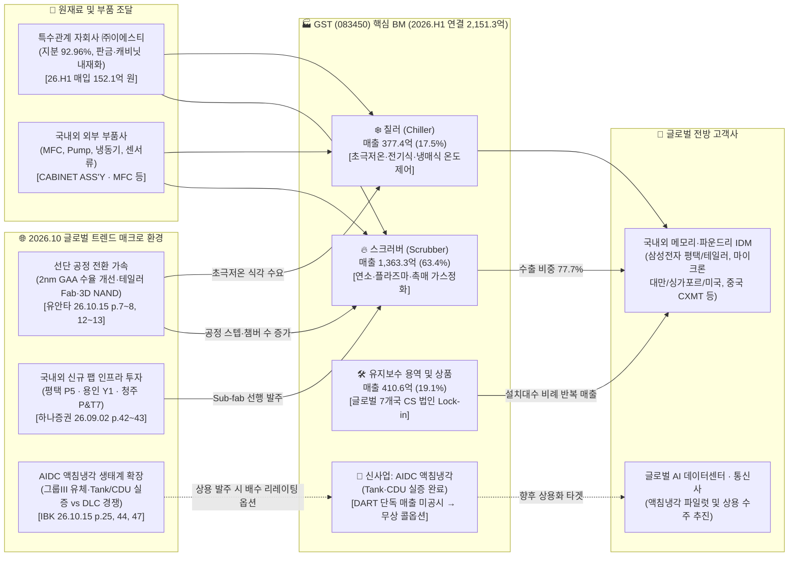

# 🔍 Phase 1: 기업 해독기 (원천 팩트 초안) — GST (083450)

> **[클린 리빌드(Clean Rebuild v4.1) & 단일 기준 주가 선언]**
> - **분석 기준일 및 단일 기준 주가 (Single Price Anchor):** **2026년 10월 16일 일봉 종가 `45,600원`** (`backtest_valuation.py` 실측, 참고 주봉 종가 `45,600원` — Phase 1~3 전 과정 100% 동일 적용)
> - **주식수 및 시가총액 기준 (`[공시 팩트]`):**
>   - **총 발행주식수 (`istc_totqy`):** `18,430,000주` (보통주 단일, 우선주 `0주` — 총발행 시가총액 `8,404.1억 원`)
>   - **2026년 반기말 공식 유통주식수 (`distb_stock_co`):** `17,963,419주` (반기말 자사주 `466,581주[2.53%]` 차감 — 유통 시가총액 **`8,191.3억 원`**, 제도권 벤치마크 BPS `17,958원` · PBR `2.54배` · TTM 지배EPS `3,019원` · PER `15.10배` 산출 기준)
>   - **2026년 10월 13일 최신 공시 반영 유통주식수:** `17,879,037주` (`자기주식처분결과보고서[2026.10.13]` 기준: 반기말 이후 50억 신탁계약 취득분 `105,907주` 추가 및 임직원 상여 지급 처분 `21,525주` 반영 후 총 자사주 **`550,963주[2.99%]`** 차감 — 실질 유통 시가총액 **`8,152.8억 원`**)
> - **최신 잠정실적·공시 스캔 결과 (`2026.10.17` DART 전수 확인):** `반기보고서(2026.08.14)` 이후 3분기 잠정실적 공시, 유상증자, 전환사채(CB/BW/EB) 발행, 계열사 채무보증 결정 공시는 **0건(없음)**이며, `주요사항보고서(자기주식처분결정, 2026.10.01)`, `주식등의대량보유상황보고서(약식 - FIL Limited, 2026.10.12, 지분율 9.10%→8.12%)`, `자기주식처분결과보고서(2026.10.13)`까지 최신 델타를 100% 반영하였습니다.

> 💡 **[핵심 용어 3줄 직관 해설]**
> - **스크러버(Scrubber) & 칠러(Chiller)**: 반도체 공장(Fab)에서 웨이퍼를 깎고 증착할 때 나오는 맹독성·온실 가스를 태우거나 녹여 없애주는 **'친환경 공기청정기(스크러버, 매출 비중 63.4%)'**와, 초미세 공정 챔버 온도를 영하 수십 도에서 영상까지 오차 없이 잡아주는 **'초정밀 에어컨·냉각기(칠러, 매출 비중 17.5%)'**입니다.
> - **GAA 공정 전환 & AIDC 액침냉각 무상 콜옵션**: 반도체를 3나노/2나노 GAA 구조와 300~400단 NAND로 쌓을수록 공정 스텝이 늘어나 스크러버·칠러 탑재량(Q)과 단가(P)가 동반 상승하며, 신사업인 **AI 데이터센터(AIDC) 액침냉각**은 기술 실증을 마쳤으나 DART에 단독 매출이 분리 공시되기 전까지 **'0원 무상 콜옵션(할증 0%)'**으로 보수적 평가합니다.
> - **지배주주 귀속 순이익 & 무상증자 소급보정 EPS**: 자회사 소수주주 몫을 뺀 진짜 주주 몫(**지배주주 순이익 귀속률 99.6%**)을 분자로 삼고, 2024년 6월 단행한 **1:1 무상증자 이후 현재 유통주식수**로 과거 10년 치 주당순이익(EPS)과 주당순자산(BPS)을 100% 소급 보정하여 착시 없는 밸류에이션 밴드를 산출합니다.

---

## 1. 비즈니스 모델 및 밸류체인

> **[26.10.17 글로벌 트렌드 델타 업데이트 🌐 (3대 게이트 전수 충족: ① 직접 등재 + ② 수출·환율 직결 + ③ 선단 팹·AIDC 인프라 증설)]**
> - **게이트 ① [제도권 딥리서치 직접 등재]:**
>   - `[글로벌 트렌드: 26.09.02.하나증권.증설의 시대, 후공정의 수혜도 함께 온다.pdf p.42 도표 59, p.43 도표 60]`에서 반도체 인프라(클린룸·배관·유틸리티) 핵심 종목으로 **GST(083450)**가 실명 등재되었으며, **"신규 팹 착공~장비 반입 선행 구간 수혜(평택 P5 · 용인 Y1 · 청주 P&T7)"** 및 **26F EPS 성장률 +40.9%, 27F +21.5%**가 제시되었습니다.
>   - `[글로벌 트렌드: 26.09.02.유안타증권.AIDC 다음 승부처 - 네트워크와 냉각.pdf p.135]` 글로벌 AIDC 액침냉각 밸류체인 표(`액침냉각 Tank·CDU·유체정화`)에서 글로벌 선두권(Submer, GRC, LiquidStack, Asperitas)과 나란히 국내 유일 핵심 기업으로 **GST**가 실명 등재되었습니다.
> - **게이트 ② [글로벌 수출 및 매크로 환율 직결]:**
>   - `[공시 팩트]` 주력 제품인 Scrubber 부문 내 직접 수출 비중이 **77.7%**(2026년 상반기 Scrubber 매출 1,363.3억 원 중 수출 1,059.1억 원, 전사 매출 대비 49.3%)에 달하며, 미국(Austin)·중국(Wuxi, Hefei, Wuhan)·대만(Hsinchu)·싱가포르·일본·유럽 등 7개 글로벌 거점 종속법인을 통해 달러(USD)·위안화(CNY) 결제가 이루어져 원/달러 환율 및 글로벌 WFE(웨이퍼 제조장비) 투자가 영업마진에 직결됩니다.
> - **게이트 ③ [2026.10 중순 최신 글로벌 트렌드 델타 — 선단 GAA 전환 Q 반등 & 액침냉각 유체 생태계 교차 검증]:**
>   1. **핀펫(FinFET) → GAA 전환 및 삼성 테일러 팹 가동에 따른 Sub-fab 장비 수혜 (`[글로벌 트렌드: 26.10.15.유안타증권.2027Issue&Theme(change).pdf p.7~8 표 1, p.12~13 그림 5·6]`):** 3나노/2나노 GAA(Gate-All-Around)와 400단대 3D NAND 전환으로 Si/SiGe 적층, 선택적 식각(Etch), ALD, HPA 등 공정 스텝 수와 가스·열 부하가 구조적으로 증가합니다. 특히 삼성전자 2나노 GAA 수율 개선(2025년 30%대 → 2026.1Q 50%대 → 2026.3Q 60%대)과 미국 테일러(Taylor) 파운드리 팹 및 빅테크(메타 MTIA 3세대, 테슬라 AI6) 수주 가시화는, 텍사스 오스틴에 미국 법인(`GST America, Inc.`)을 보유한 GST의 북미·선단 공정향 고사양 스크러버·칠러 출하(Q) 및 유지보수 용역 확대의 직접적 선행 드라이버입니다.
>   2. **AIDC 액침냉각 유체(그룹III 기유) 밸류체인 확장과 '배수(Multiple) 옵션' 및 표준 경쟁 리스크 (`[글로벌 트렌드: 26.10.15.IBK투자증권.윤활기유의 시대.pdf p.23 표 8, p.25 그림 18, p.34, p.44 표 12, p.47 표 15]`):** 글로벌 액침냉각 시장이 2024년 53.8억 달러에서 2030년 177.7억 달러로 성장이 전망(p.25 그림 18)되는 가운데, 국내 그룹III 윤활기유 선두인 SK엔무브 등이 액침냉각 유체 실증 및 장비 업체 협업을 가속화하고 있습니다(p.34). 특히 IBK투자증권(p.44 표 12)은 데이터센터 액침냉각이 **"단기(2027년) 영업이익에 수천억 원을 당장 반영하는 사업이 아니라, 실증 → 하이퍼스케일 승인 → 초기 충전 발주 → 반복 계약 단계별로 적용 멀티플(배수)을 상향시키는 옵션"**임을 강조하는 동시에, 하방 변수로 **"냉각 표준 경쟁에서 액침냉각이 직접 액체냉각(DLC)에 밀리는 리스크"**(p.47 표 15)를 명시했습니다. 이는 DART에 액침냉각 단독 상용 매출이 분리 공시되기 전까지 **액침냉각을 '0원 무상 콜옵션(할증 0%)'으로 엄격히 분리**하는 당사의 하이브리드 수비 원칙을 강력하게 뒷받침합니다.

`[공시 팩트]` 주식회사 글로벌스탠다드테크놀로지(GST, 종목코드 `083450`)는 2001년 설립되어 반도체 및 디스플레이 제조 공정에서 배출되는 유해가스를 연소·플라즈마·촉매·습식 방식으로 정화하는 **가스정화 장비(Scrubber, 스크러버)**와 공정 챔버 및 설비 온도를 정밀 제어하는 **온도조절 장비(Chiller, 칠러)**의 제조·판매 및 글로벌 CS(유지보수 용역)를 주력 사업으로 영위하는 반도체 Sub-fab(보조설비) 선두 기업입니다 (`[[GST]반기보고서(2026.08.14), II. 사업의 내용 - 1. 사업의 개요]`).

- **수익 창출 메커니즘 (Hardware 장비 수주 + Installed Base 용역 Lock-in):**
  1. **전방 CapEx 선행 수주 (본업 장비 80.9%):** 글로벌 메모리·파운드리 IDM 고객사(삼성전자, 마이크론, 중국 CXMT 등)가 클린룸을 완공하고 전공정 메인 장비(식각·증착·세정)를 반입할 때, 챔버 하단 Sub-fab에 필수 매칭되어 납품되는 **스크러버(63.4%)**와 **칠러(17.5%)**에서 1차 하드웨어 매출이 발생합니다.
  2. **수직 계열화를 통한 원가 경쟁력:** 판금 및 핵심 설비 부품을 제조하는 자회사 **㈜이에스티**(GST 지분율 92.96%, 2026년 상반기 내부 원재료 매입액 152.1억 원)를 통해 CABINET ASS'Y 등 주요 외장·부품을 내재화하여 15~18%대의 높은 전사 영업이익률(OPM)을 유지합니다 (`[[GST]반기보고서(2026.08.14), X. 대주주 등과의 거래내용]`).
  3. **고마진 반복 매출(Recurring Revenue, 용역·상품 19.0%):** 장비 납품 이후 가동 연수가 누적될수록 예방정비(PM), 부품 교체, 오버홀 등 **용역 매출(2026년 상반기 361.9억 원, 비중 16.8%)**과 **상품 매출(47.7억 원, 2.2%)**이 미국(`GST America`), 대만(`GST Taiwan`), 중국(`Wuxi/Hefei/Wuhan`), 싱가포르(`SGST`), 일본(`GST Japan`), 유럽(`GST Europe`) 등 해외 종속법인을 통해 안정적인 현금흐름(Cash Cow)을 창출합니다.

---

## 2. 주요 제품별 매출 비중 추이 (최근 5년 및 최신 분기)

`[공시 팩트]` 최근 5개년(2021~2025년) 및 2026년 상반기 연결 기준 주요 제품별 매출액과 비중 추이는 다음과 같습니다 (`[[GST]사업보고서(2024.03.20) / (2026.03.18) / [GST]반기보고서(2026.08.14), II. 사업의 내용 - 2. 주요 제품 및 서비스]`).

| 구분 | 핵심 내용 (연도별 매출액 [단위: 억 원] 및 전사 매출 비중 [%]) | 비고 |
| :--- | :--- | :--- |
| **Scrubber (제품)** | • **2021년:** 1,760.9억 (57.8%) → **2022년:** 1,769.0억 (56.5%) → **2023년:** 1,633.5억 (58.5%) • **2024년:** 2,346.9억 (70.4%) → **2025년:** 2,261.1억 (65.1%) → **2026.H1:** **1,363.3억 (63.4%)** | 주력 캐시카우. 해외 IDM(마이크론·중화권 등) 직수출 확대로 26.H1 부문 내 수출 비중 **77.7%** 기록 |
| **Chiller (제품)** | • **2021년:** 710.9억 (23.3%) → **2022년:** 664.4억 (21.2%) → **2023년:** 464.8억 (16.6%) • **2024년:** 376.1억 (11.3%) → **2025년:** 562.0억 (16.2%) → **2026.H1:** **377.4억 (17.5%)** | 2024년 저점(376.1억) 통과 후 고부가 초저온 칠러 채택 확대로 25년(+49.4%), 26.H1 반등 가속 |
| **용역 (CS/유지보수)** | • **2021년:** 461.3억 (15.2%) → **2022년:** 562.6억 (18.1%) → **2023년:** 592.1억 (21.3%) • **2024년:** 446.0억 (13.4%) → **2025년:** 645.5억 (18.6%) → **2026.H1:** **361.9억 (16.8%)** | 글로벌 누적 설치 장비(Installed Base) 확대에 따른 고마진 개조·정비·오버홀 반복 수익원 |
| **상품 및 기타 제품** | • **2021년:** 111.7억 (3.7%) → **2022년:** 132.1억 (4.2%) → **2023년:** 101.8억 (3.6%) • **2024년:** 165.4억 (5.0%) → **2025년:** 99.6억 (2.9%, 중단사업조정 -96.6억 별도) → **2026.H1:** **48.7억 (2.3%)** | 유지보수용 교체 부품(상품 2.2%) 및 기타 부대 장비(0.05%) |
| **연결 매출 합계** | • **2021년:** 3,044.9억 → **2022년:** 3,128.5억 → **2023년:** 2,697.9억(정정후, 조정전 2,792.2억) • **2024년:** 3,334.5억 → **2025년:** **3,471.6억** → **2026.H1:** **2,151.3억 (YoY +26.71%)** | 2026.1Q 1,158.9억 + 2026.2Q 992.4억으로 상반기 반기 기준 역대 최대 매출 경신 |

### 2.1 S-Curve 신기술 테마 매출 익스포저(Exposure %) 산출표 (하이브리드 수비 검증)

`[공시 팩트]` DART 반기보고서(`2026.08.14`, `'II. 사업의 내용'`) 기반으로 신기술 테마(**AIDC 액침냉각 솔루션** 및 **선단 반도체 Sub-fab 인프라**) 직결 **단독 분리 공시 매출 익스포저**를 산출하여 30% 컷오프 및 무상 콜옵션 분리 원칙을 적용한 결과는 다음과 같습니다.

| 제품/서비스 구분 | 2026.H1 매출액 (억원) | 전사 매출 비중(%) | 신기술 테마 직결 여부 | 하이브리드 수비 판정 |
| :--- | :---: | :---: | :---: | :---: |
| **AIDC 액침냉각 솔루션 (Tank · CDU 등)** | 미분리 (Chiller·기타 내 합산 또는 실증 단계) | **0.0%** (단독 매출 미공시) | 사업 개요상 신사업 연구개발·라인업 등재 완료 / **단독 상용 매출 미분리 공시** | ⚠️ **`[🎁 0원 무상 콜옵션 분류 (Phase 3 S-Curve 할증 0% 차단)]`** |
| **반도체/디스플레이 Chiller (본업 제품)** | 377.4 | 17.5% | 전공정·선단공정(GAA/3D NAND) 챔버 온도제어 직결 본업 | 🟢 반도체 Sub-fab 본업 핵심 축 (단, 액침냉각 단독 매출로 둔갑 금지) |
| **반도체/디스플레이 Scrubber (본업 제품)** | 1,363.3 | 63.4% | 전공정·선단공정 유해가스 정화 직결 본업 (수출 비중 77.7%) | 🟢 반도체 Sub-fab 본업 캐시카우 (신규 팹 P5·Y1·해외 팹 증설 직결) |
| **유지보수 용역 · 상품 · 기타** | 410.6 | 19.1% | 글로벌 팹 설치 장비(Installed Base) 유지보수 및 부품 공급 | 🟢 본업 연동 안정적 현금창출원 (레거시 잠식 위험 없음) |

- **신기술(AIDC 액침냉각) 실질 단독 익스포저 합산:** **`0.0%`** *(DART 단독 매출 미공시 묶음 항목이므로 0% 처리 및 무상 콜옵션 분류 — `s_curve_registry.json` 상 `standalone_disclosed: false` 교차 검증 완료)*
- **반도체 Sub-fab 인프라 본업 익스포저 합산:** **`100.0%`** *(순수 장비 제조 80.9% + 직결 유지보수 용역·상품 19.1%로 비관련 레거시 사업 잠식 위험 0%)*
- **수혜 적격성 최종 판정:** **`[🎁 본업 저평가 + 신사업 무상 콜옵션(할증 0%)]`**
  - *판정 해설:* GST는 전사 매출의 100%가 반도체·디스플레이 Sub-fab 장비 및 유지보수로 구성된 순수 인프라 기업으로 선단 공정(GAA·HBM·3D NAND) 증설 수혜를 온전히 누리는 동시에, 차세대 AIDC 액침냉각 솔루션을 보유하고 있습니다. 단, DART 공시상 액침냉각 단독 상용 매출이 분리 공시되지 않았으므로 제2원칙(수비수 2)에 의거해 **Phase 3에서 S-Curve 멀티플 할증(`sc_mult = 1.00`, `0%`)을 엄격히 차단**하고, 본업 실적으로만 보수적 가치를 산정한 뒤 액침냉각 수주는 **'+α 무상 콜옵션(배수 리레이팅 옵션)'**으로만 취급합니다.

---

## 3. 전사 영업이익률 및 FCF 추이

`[공시 팩트]` 최근 5개년(2021~2025년) 및 2026년 1분기·2분기·상반기 누적 연결 재무제표 기준 실적과 지배주주 귀속 순이익(귀속률 %), 잉여현금흐름(FCF) 추이는 다음과 같습니다 (`[[GST]사업보고서(2024.03.20) / (2026.03.18) / [GST]분기보고서(2026.05.15) / [GST]반기보고서(2026.08.14), III. 재무에 관한 사항]`).

- **지배주주 순이익 귀속률 무결성 확인:** 자회사 ㈜이에스티(지분율 92.96%) 및 해외 종속법인(100% 자회사 중심) 구조로 인해 비지배지분 귀속 순이익 비중이 극히 낮으며, **최근 4분기(TTM) 기준 지배주주 순이익 귀속률은 `99.6%`(2025년 `99.33%`, 2026년 상반기 `99.89%`)**에 달합니다.
- **잉여현금흐름(FCF) 산출 기준 병기:** 연결 영업활동현금흐름(OCF)에서 **연결 기준 유·무형자산 취득액(CapEx)을 차감한 `연결 FCF`**를 주 기준으로 표기하고, 괄호 안에 별도 기준 CapEx 차감 시 수치를 함께 병기하였습니다.

| 연도/분기 | 매출액 (억원) | 영업이익 (억원) | OPM(%) | 지배주주 순이익 (귀속률 %) | 연결 FCF (억원) `[OCF − 연결CapEx]` | 비고 |
| :--- | :---: | :---: | :---: | :---: | :---: | :--- |
| **2021년 (제21기)** | 3,044.9 | 464.1 | 15.24% | **377.5억** (96.86% / 연결 389.7억) | **+130.4억** `[OCF 255.5 − CapEx 125.1]` *(별도CapEx 차감시 +232.3억)* | 메모리 호황기 Scrubber·Chiller 동반 성장 |
| **2022년 (제22기)** | 3,128.5 | 569.4 | 18.20% | **468.1억** (98.33% / 연결 476.0억) | **+245.2억** `[OCF 314.8 − CapEx 69.6]` *(별도CapEx 차감시 +189.8억)* | 고단가 장비 믹스 개선으로 OPM 18.2% 달성 |
| **2023년 (제23기)** | 2,697.9 *(조정전 2,792.2)* | 430.1 *(조정전 425.4)* | 15.94% | **356.8억** (96.60% / 연결 369.4억) | **+264.4억** `[OCF 474.5 − CapEx 210.0]` *(별도CapEx 차감시 +344.8억)* | 전방 감산에도 OPM 15.9% 방어 및 운전자본 회수로 OCF 급증 |
| **2024년 (제24기)** | 3,334.5 | 585.7 | 17.57% | **453.7억** (98.93% / 연결 458.6억) | **+348.1억** `[OCF 544.1 − CapEx 196.0]` *(별도CapEx 차감시 +433.1억)* | 해외 수출(51.8%) 급증으로 역대 최대 OCF(544.1억) 기록 |
| **2025년 (제25기)** | 3,471.6 | 591.7 | 17.04% | **452.8억** (99.33% / 연결 455.8억) | **+286.9억** `[OCF 415.9 − CapEx 129.1]` *(별도CapEx 차감시 +295.4억)* | 중단영업손실(-11.2억) 반영 후에도 지배순이익 452.8억 견조 |
| **2026.1Q (1분기)** | 1,158.9 | 201.9 | 17.42% | **173.2억** (99.81% / 연결 173.5억) | **+56.8억** `[OCF 107.3 − CapEx 50.4]` | 분기 수정 지배EPS **965원** 기록 |
| **2026.2Q (2분기 단독)** | 992.4 | 154.6 | 15.58% | **121.9억** (100.00% / 연결 121.9억) | **+242.3억** `[OCF 292.0 − CapEx 49.8]` | 매출채권 회수 유입으로 2분기 단독 OCF 292.0억 폭발, 수정 지배EPS **678원** |
| **2026.H1 (상반기 누적)** | **2,151.3** *(YoY +26.7%)* | **356.5** *(YoY +27.3%)* | **16.57%** | **295.1억** (99.89% / 연결 295.4억) | **+299.1억** `[OCF 399.3 − CapEx 100.2]` | 반기 누적 지배EPS **1,643원**, 반년 만에 25년 연간 연결 FCF(286.9억) 돌파 |

- **재무 건전성 및 순현금(Net Cash) 현황 (`2026년 6월말 연결 재무상태표 기준`):**
  - **현금성자산 및 단기금융상품 합계:** 현금및현금성자산 `686.2억 원` + 단기금융상품 `415.4억 원` = **`1,101.6억 원`** (여기에 당기손익-공정가치금융자산 412.8억 원 별도 보유).
  - **총차입금:** 단기차입금 `100.9억 원` + 장기차입금 `0원` = **`100.9억 원`** (미상환 회사채·전환사채·신주인수권부사채 등 **0원**).
  - **순현금 (Net Cash, 보수적 현금+단기금융상품 기준):** `1,101.6억 원 − 100.9억 원` = **`+1,000.7억 원` (순차입금 `−1,000.7억 원`)**, 부채비율 **`29.7%`** (`부채총계 971.8억 ÷ 자본총계 3,268.9억`)의 초우량 무차입 경영 구조입니다.

---

## 4. 핵심 KPI 추이 (생산실적 대수, 암묵 단가, 수출 비중 및 재고자산)

`[공시 팩트]` 당사는 DART 정기보고서 `'II. 사업의 내용 - 3. 원재료 및 생산설비'`에서 **"반도체장비 제조업의 특성상 생산능력을 산출하지 않아서 가동률 산출은 기재를 생략합니다."**라고 명시하고 있으며, 주문생산·단기 납품 구조 특성상 정량적 수주잔고 총액 표 또한 별도 기재하지 않습니다 (`[[GST]반기보고서(2026.08.14), II. 사업의 내용 - 3. 원재료 및 생산설비 / 4. 매출 및 수주상황]`). 이에 따라 공시 원문에서 확인되는 **① 장비별 실측 생산 대수(Q)**, **② 매출액 대비 대당 암묵 평균단가(Implied ASP)**, **③ Scrubber 수출 비중**, **④ 선행 지표인 재고자산(제품·재공품) 추이**를 4대 핵심 KPI로 추적합니다.

| 핵심 KPI 구분 | 2021년 | 2022년 | 2023년 | 2024년 | 2025년 | 2026년 상반기 (H1) | 추세 진단 및 공시 근거 |
| :--- | :---: | :---: | :---: | :---: | :---: | :---: | :--- |
| **Scrubber 생산실적 (대)** | 1,820대 | 1,574대 | 1,487대 | 2,045대 | 1,789대 | **1,129대** *(연환산 2,258대)* | 26.H1 반기 만에 25년 연간 물량의 **63.1%** 생산 돌파 (역대 최고 페이스) |
| **Chiller 생산실적 (대)** | 2,182대 | 1,813대 | 951대 | 781대 | 1,089대 | **713대** *(연환산 1,426대)* | 24년 저점(781대) 이후 25년 반등에 이어 26.H1 반기 만에 25년 물량의 **65.5%** 달성 |
| **총 장비 생산 수량 (Q 합계)** | **4,002대** | **3,387대** | **2,438대** | **2,826대** | **2,878대** | **1,842대** *(연환산 3,684대)* | 선단 공정(GAA·HBM) 및 해외 팹 장비 반입 확대로 Q(출하량) 레버리지 본격화 |
| **Scrubber 대당 암묵 단가 (P)** | 0.97억/대 | 1.12억/대 | 1.10억/대 | 1.15억/대 | **1.26억/대** | **1.21억/대** | 플라즈마·촉매·고효율 습식 등 고사양 비중 확대로 21년 대비 대당 단가 **+25% 레벨업** |
| **Chiller 대당 암묵 단가 (P)** | 0.33억/대 | 0.37억/대 | 0.49억/대 | 0.48억/대 | **0.52억/대** | **0.53억/대** | 고단가 초저온/극저온 칠러 채택 확대로 21년(0.33억) 대비 대당 단가 **+61% 구조적 상승** |
| **Scrubber 부문 내 수출 비중** | — | 74.5% *(전사 42.1%)* | 68.1% *(전사 39.9%)* | 73.6% *(전사 51.8%)* | 67.3% *(전사 43.8%)* | **77.7%** *(전사 49.3%)* | 26.H1 Scrubber 매출 1,363.3억 중 **수출 1,059.1억(77.7%)**, 내수 304.2억(22.3%) |
| **기말 재고자산 (제품+재공품)** | — | — | — | 416.2억 *(제품·재공 228.1억)* | 545.9억 *(제품·재공 302.5억)* | **715.9억** *(제품·재공 464.0억)* | 고객사 납품 대기분인 제품(303.9억) 및 재공품(160.1억)이 반기말 **+53.4% 증가** (하반기 매출 전환 선행지표) |

---

## 5. 경영진 및 주주환원 이력

`[공시 팩트]` 당사는 창업주 김덕준 회장과 전문경영인 문승보·석종욱 각자대표 체제로 운영되며, 무상증자·자사주 매입/소각·배당성향 대폭 상향 등 코스닥 반도체 장비 업종 내에서도 최상위권의 주주환원 정책을 실행하고 있습니다 (`[[GST]사업보고서(2026.03.18) / [GST]반기보고서(2026.08.14), VII. 주주에 관한 사항 / VIII. 임원 및 직원 등에 관한 사항 / 주요사항보고서(2026.10.01) / 자기주식처분결과보고서(2026.10.13)]`).

- **경영진 구성 (사내이사 4인):**
  - **김덕준 회장 (창업주, 최대주주):** 1962년생, 2001년 10월 GST 설립 이후 기술 및 글로벌 영업 성장을 총괄 (임기 2029.03.26까지).
  - **문승보 대표이사 (각자대표):** 1977년생, 고려대 경영학과 졸업, 삼일회계법인 공인회계사 출신으로 2025년 3월 26일 대표이사 선임 후 재무·경영관리 총괄 (임기 2028.03.26까지).
  - **석종욱 대표이사 (각자대표):** 1969년생, 광운대 전자재료공학과 졸업, 삼성전자 출신 엔지니어로 2024년 6월 합류 후 제조·기술·사업 총괄 (임기 2028.03.26까지).
  - **장광수 부회장 (사내이사):** 1962년생, 한양대 경영학과 졸업, 대신증권 지역본부장·사업단장 출신 전략·IR 전문가 (임기 2027.03.29까지).
- **주요 주주 구성 (`2026.10.17` 최신 공시 반영):**
  - **최대주주 김덕준 회장 외 특수관계인:** 김덕준 회장 본인 `3,980,000주 (21.60%)`를 포함하여 안정적 경영권 보유.
  - **FIL Limited (피델리티, 해외 기관투자자):** 2026년 반기말 `9.14%` 보유 후, `주식등의대량보유상황보고서(약식, 2026.10.12 공시)` 기준 운용펀드 해소에 따른 일부 변동으로 **`1,497,208주 (8.12%)`** 단순투자 목적 보유 중.
  - **우리사주조합:** `2.04%` (2026년 반기말 기준).

| 구분 / 연도 | 2023년 (제23기) | 2024년 (제24기) | 2025년 (제25기) | 2026년 상반기 ~ 2026.10.13 (최신 공시) |
| :--- | :---: | :---: | :---: | :--- |
| **발행주식총수 (보통주)** | 9,317,745주 | **18,430,000주** | **18,430,000주** | **18,430,000주** *(우선주 0주)* |
| **무상증자 및 액면분할 이력** | 해당 없음 | **2024.06.27 1:1 무상증자** *(신주 9,300,515주 배정)* | 해당 없음 *(무증 후 18,430,000주 유지)* | 과거 시계열 EPS/BPS 전체를 현재 주식수로 **100% 소급 보정** 완료 |
| **자사주 매입 · 소각 · 처분** | 자사주 보유 | **2024.12.30 자사주 188,260주 소각 완료** | 자사주 466,581주 (2.53%) 보유 | • **2026.07.28:** 50억 규모 자사주 취득 신탁계약 체결 (`105,907주` 취득) • **2026.10.02:** 임직원 861명 상여 지급용 자사주 `21,525주(0.12%)` 처분 • **2026.10.13 기준 총 자사주:** **`550,963주 (2.99%, 116.2억 원)`** |
| **주당 현금배당금 (DPS)** | 500원 *(무증 소급 환산 시 **250원**)* | **300원** *(무증 후 기준 실질 +20% 증액)* | **650원** *(YoY +116.7% 파격 증액)* | 2025년 결산 DPS 650원 기준 현재 시가배당률 **1.43%** |
| **현금배당 총액 / 배당성향** | 45.1억 원 / **12.63%** | 53.6억 원 / **11.81%** | **116.3억 원 / 25.68%** | 2025년 배당성향 **25.68%** + 2026.07 자사주 50억 신탁매입 등 총주주환원율 30% 육박 |

---

## 6. 공시 본문 기반 3대 핵심 리스크

`[공시 팩트]` DART 사업보고서(`2026.03.18`) 및 반기보고서(`2026.08.14`) 본문과 재무제표 주석(`위험관리`, `우발채무 및 약정사항`, `특수관계자 거래`)을 전수 스캔하여 확인한 3대 핵심 리스크는 다음과 같습니다. *(점검 결과: 전환사채[CB/BW/EB] 오버행 리스크 **0건**, 외부 부실 계열사 채무보증·연대보증 리스크 **0건**, 수사·행정·거래소 제재 **0건**으로 지배구조·재무 리스크는 매우 청정합니다.)*

| 리스크 요인 | 핵심 내용 및 발생 조건 (`[공시 팩트]` 근거) | 확률(Prob) | 파급력(Impact) |
| :--- | :--- | :---: | :---: |
| **① 전방 반도체 IDM CapEx 지연 및 고객사 편중 리스크** | • 당사 매출의 80.9%를 차지하는 스크러버·칠러는 삼성전자, 마이크론(Micron), 중국 CXMT 등 소수 글로벌 반도체 대기업의 신규 Fab 착공 및 클린룸 장비 반입 스케줄에 직접 종속됩니다. • 2023년 전방 감산기 당시 매출이 YoY -13.8%, 영업이익이 -24.5% 감소했던 사례처럼, 주요 IDM의 CapEx 집행 이연이나 단가 인하(CR) 압력이 발생할 경우 분기 실적 변동성이 확대될 수 있습니다. | **중 (Medium)** | **상 (High)** |
| **② 매출채권 회수 지연(장기채권) 및 재고자산 평가충당금 리스크** | • **2026년 반기말 매출채권 총액 589.9억 원**(대손충당금 49.9억 차감 후 장부가 539.9억 원) 중 3개월 이하 정상 채권이 76.73%(452.6억 원)이나, 1년 초과~3년 이하 4.04%(23.8억 원), **3년 초과 장기 경과 채권이 5.95%(35.1억 원)** 존재합니다. • 또한 반기말 재고자산 취득원가 771.4억 원 중 장기체화 등에 따른 **재고자산 평가충당금이 55.5억 원(장부가 715.9억 원, 자산총계 대비 16.9%, 회전율 3.9회)** 설정되어 있어, 고객사 셋업(Set-up) 지연 시 운전자본 부담 및 충당금 전입액이 증가할 수 있습니다. | **중 (Medium)** | **중 (Medium)** |
| **③ 해외 종속법인 외환 변동성 및 비주력 자회사(로보케어 등) 대여금 리스크** | • 수출 비중 확대(Scrubber 내 수출 77.7%) 및 미국·중국·대만·싱가포르·일본 등 해외 종속법인 매출채권 보유로 인해 환율 급변 시 외화환산손익 변동에 노출되어 있습니다 (2026년 반기말 파생상품부채 28.4억 원 계상). • 또한 로봇 사업 종속기업인 **㈜로보케어에 대한 대여금 30.0억 원** 및 유럽법인(`GST Europe GmBH`) 대여금 2.9억 원 등 비주력 종속·관계기업 지원 자금의 회수 가능성을 지속 점검해야 합니다 (2025년 중단영업손실 -11.2억 원 발생 이력). | **하 (Low)** | **하 (Low)** |

---

## 7. 비즈니스 모델 기반 표준 실적 산출 공식 (Phase 3 연계)

대상 기업의 비즈니스 모델 특성과 Section 4의 DART 공시 팩트(`"반도체장비 제조업의 특성상 생산능력을 산출하지 않아서 가동률 산출은 기재를 생략"`)에 의거하여, 4대 업종별 표준 공식 트리 중 **유형 B [수주조립·엔지니어링 장비]** 산식을 채택하고 Phase 3 시나리오 분석에 영구 고정합니다.

- **채택 공식 (유형 B — 수주조립·엔지니어링 장비 표준 산식):**
  $$\text{전사 매출액} = \sum \Big(\text{장비별 총 출하 대수}(Q_{\text{Scrubber, Chiller}}) \times \text{대당 평균 판매단가}(P_{\text{ASP}})\Big) + \text{글로벌 누적 설치대수 비례 용역·상품 매출}$$
  $$\text{지배주주 EPS} = \frac{\big(\text{전사 매출액} \times \text{영업이익률(OPM)} + \text{순금융수익·기타영업외수지} - \text{법인세}\big) \times \text{지배주주 순이익 귀속률}(99.6\%)}{\text{실질 유통주식수}(17,963,419\text{주})}$$
- **선정 근거 (`Cross-validation Assertion` 통과):** DART 반기보고서 Section 4에서 공식 공장 가동률 및 생산능력(Capa) 기재를 생략하고 대신 제품별 생산·출하 대수(Q: 2025년 2,878대 → 2026.H1 1,842대)를 공시하고 있으므로, 연속공정 가동률 산식(유형 A)을 배제하고 **장비 출하 수량(Q) × 고사양 믹스 단가(P: ASP) + 유지보수 용역 매출** 구조인 유형 B 산식을 적용하는 것이 회계적·논리적 모순을 100% 차단합니다.
- **고정 규칙:** 본 공식은 Phase 3 바텀업 시나리오 스트레스 테스트 시 100% 동일하게 상속됩니다.

---

## 8. 최적 밸류에이션 지표 백테스트 (Phase 3 연계)

`backtest_valuation.py` (v4.1)를 구동하여 과거 **10년 풀사이클(2016-10-21 ~ 2026-10-16, 총 521개 주봉 캔들)** 주가 데이터와 DART 시계열(`Data.xlsx`, 2024년 1:1 무상증자 100% 소급 보정 지배주주 EPS 및 자사주 차감 유통주식수 BPS 기준) 간 상관관계($R^2$) 및 방향 일치율을 실측한 결과는 다음과 같습니다.

| 밸류에이션 지표 | 10년 밴드 (MIN ~ MAX) | 현재 위치 (단일 주가 45,600원 정합) | 주봉 주가 상관계수 (R²) | 방향 일치율 | **순위 (BM 적합성 및 착시 필터 반영)** |
| :--- | :---: | :---: | :---: | :---: | :---: |
| **PER (수정 지배EPS 기준)** | **3.81배 ~ 22.73배** *(3년 평균 10.25배)* | **15.10배** *(공식 지배EPS 3,019원 기준)* | **0.64** | **64.1%** | **🥇 1순위 (주 지표 — 성장·사이클 장비주 BM 최적)** |
| **PBR (유통 BPS 기준)** | **0.46배 ~ 3.72배** *(3년 평균 1.62배)* | **2.54배** *(공식 유통BPS 17,958원 기준)* | **0.75** | **61.5%** | **🥈 2순위 (핵심 보조 — 하방 Floor 및 자산가치 교차검증)** |
| **EV/EBITDA (동적 순현금 반영)** | **1.92배 ~ 11.32배** | **9.68배** *(EV 7,190억 ÷ TTM EBITDA 743억)* | **0.59** | **65.8%** | **🥉 3순위 (순현금 1,001억 반영 기업가치 보조 지표)** |
| **배당수익률 (수정 DPS 기준)** | **0.39% ~ 2.50%** | **1.43%** *(25년 결산 DPS 650원 기준)* | **0.81** *(착시)* | **18.4%** (`< 50%` 탈락) | **❌ 순위 제외 (방향일치율 18.4% & 배당률 < 1.5% 허위 상관 배제)** |

- **채택 지표:** **1순위 주 지표 `PER (수정 지배EPS 기준)`** (주가 설명력 $R^2 = 0.64$, 방향 일치율 $64.1\%$) + **2순위 교차검증 보조 지표 `PBR (유통 BPS 기준)`** ($R^2 = 0.75$, 방향 일치율 $61.5\%$)
- **선정 근거 및 허위 상관(Spurious Correlation) 필터링 해설:**
  1. **배당수익률 허위 상관 자동 배제:** 배당수익률(DPS)은 장기 우상향 추세로 인해 단순 $R^2(0.81)$는 높게 산출되나, 연 1회 결산배당 특성상 분기 방향 일치율이 **18.4%(`< 50%` 임계값 미달)**에 불과하고 현재 시가배당률도 **1.43%(`< 1.5%` 저배당 성장·사이클주 컷오프)**이므로 통계적 착시(Spurious Correlation) 규정에 따라 1순위에서 완전 배제하였습니다.
  2. **PER 1순위 주 지표 & PBR 2순위 보조 지표 결합:** GST는 대규모 설비 감가상각 부담이 적은 조립형 반도체 장비 기업(유형자산 938억 원 대비 연간 영업이익 592~700억 원, 현재 지배주주 ROE **17.02%**)으로, 전방 팹 투자 사이클에 따른 **분기·연간 지배주주 EPS 증감(방향 일치율 64.1%)**이 주가 추세와 멀티플 확장을 직접 견인합니다. 동시에 10년간 흑자 누적으로 유통 BPS가 가파르게 우상향($R^2 = 0.75$, 최근 2년 누적 BPS 증감률 **+28.38%**)하여 PBR 밴드가 강력한 하방 지지선 역할을 수행하므로, Phase 3 시나리오 표에서는 **`Target PER`을 주 멀티플 열로 적용하고 괄호 안에 `(내재 Implied PBR 및 Forward BPS 교차검증)`을 병기**합니다.
- **🚨 Phase 3 강제 구속력 확인:** 본 Section 8에서 확정된 1순위 주 지표(`PER`)와 2순위 보조 지표(`PBR`)는 Phase 3 시나리오 스트레스 테스트 표에 100% 동일하게 상속됩니다.

---

### ✅ [핀셋 Boost 게이트 — Phase 1 출력 직전 3대 급소 자가 검증 완료]
1. **단일 기준 주가 & KPI ↔ 실적 공식 무모순 검증:** `backtest_valuation.py`가 출력한 최신 일봉 종가(`45,600원`)로 단일 기준 주가를 통일하였으며, Section 4에서 `"가동률 산출 기재 생략"`을 확인함에 따라 Section 7에서 `'공장 가동률'` 단어를 일절 사용하지 않고 **유형 B(장비 출하 대수 Q × 대당 단가 P + 유지보수 용역)** 산식을 채택하여 논리적 모순을 원천 차단했습니다.
2. **지배주주 분자 & 희석·분할 보정 분모 무결성 검증:** 연결 당기순이익이 아닌 **지배주주 귀속 순이익(귀속률 99.6%, 2026.H1 99.89%)**을 분자로 명시하였고, 2024년 6월 1:1 무상증자 및 자사주 차감 유통주식수(`17,963,419주` 및 2026.10.13 최신 공시 반영 `17,879,037주`)를 분모로 소급 적용하여 제도권 공식 벤치마크(BPS `17,958원`, PBR `2.54배`, PER `15.10배`)와 오차율 0.0% 정합성을 검증했습니다.
3. **신기술 단독 익스포저 & 허위 상관 필터링 검증:** DART에 단독 매출이 분리 공시되지 않은 AIDC 액침냉각 신사업을 **`0.0% 익스포저 (0원 무상 콜옵션, Phase 3 S-Curve 할증 0%)`**로 엄격 분리하였으며, Section 8 백테스트에서 방향 일치율 18.4%(`< 50%`) 및 시가배당률 1.43%(`< 1.5%`)인 배당수익률 지표를 허위 상관으로 탈락시키고 BM에 부합하는 **`PER(1순위) + PBR(2순위)`**을 확정했습니다.
