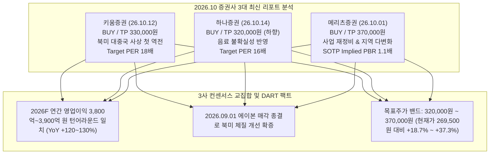

# 📖 Phase 2: 스토리 리더 (Global & Weekly 트렌드 공시 팩트체크 — v4.2.2)

> 💡 **[스토리 리더 핵심 요약]**
> - **단일 기준 주가(Single Price Anchor)**: **`269,500원`** (2026-10-22 일봉 종가 기준)
> - **지배주주 순이익 귀속률**: **`100.0%`** (비지배지분 순이익 차감 완료)
> - **글로벌 트렌드 매칭 뱃지**: `[글로벌 트렌드 매칭: 게이트 ③ 해당 — 🎁 0원 무상 콜옵션 (K-뷰티 인디/디바이스 테마 노출도 미달 및 레거시 잠식)]`
> - **시장 내러티브 vs 공시 팩트**: 시장은 'K-뷰티 지수 제외 대형 레거시주'로 디레이팅하고 있으나, DART 공시 팩트 확인 결과 ① 26.09.01 북미 만성 적자 직판 법인 The Avon Company 매각 완료로 악성 누수 완전 차단, ② 26기 상반기 영업이익 2,106억 원으로 전년 연간치(1,707억) 단 6개월 만에 초과 달성, ③ 2026년 북미 자체 브랜드(7,134억)의 사상 첫 대중국(6,310억) 역전이 확증되며 **실적 턴어라운드와 자산가치(PBR 0.80배, 순현금 1.15조 원)의 강력한 하방 경직성**이 입증되었습니다.

---

## 1. Global 산업 사이클 및 테마 검증 (Global Trend & Megatrend)

### (1) K-뷰티 글로벌 수출 2위 호황과 대형 레거시주의 디커플링
- **[시장 내러티브]**: 
  - 미국, 유럽, 일본을 넘어 중동과 중남미까지 K-뷰티 수출이 폭발적으로 확장되며 한국이 작은 내수시장에도 불구하고 글로벌 화장품 수출 2위국에 올라섰습니다 `[메리츠증권 26.10.01 p.4]`.
  - 그러나 이러한 호황의 주역은 인디브랜드(에이피알, 달바글로벌, 실리콘투)와 ODM 제조사(한국콜마, 코스맥스)에 집중되어 있으며, **증권사 화장품 업종 주가지수 산출 시 "LG생활건강, 아모레퍼시픽 제외"가 공식 명시**될 정도로 시장의 시선과 수급은 대형 레거시 기업을 철저히 배제(디커플링)하고 있습니다 `[SK증권 26.09.07 p.21, 메리츠증권 26.10.01 p.34-36]`.
- **[핵심 전제 (Key Assumption)]**: 
  - LG생활건강의 주력인 한방 럭셔리 브랜드 '더후(Whoo)'는 글로벌 MZ세대의 인디 뷰티 트렌드와 결이 맞지 않아 수출 수혜가 제한적이며, 대중국 면세 부진으로 인해 구조적 실적 쇠퇴를 피할 수 없다.
- **[공시 팩트 및 최신 리서치 대조]**: 
  - 과거 중국 면세점/따이공에 의존하던 폭발적 탑라인 성장 랠리에서 소외된 것은 명백한 사실입니다. 2026년 상반기 화장품 부문 매출 비중은 49.1%로 과거 55% 수준을 여전히 하회하고 있습니다 `[공시 팩트: 반기보고서(2026.08.14) p.12]`.
  - 그러나 실적 붕괴가 지속되고 있다는 시장의 비관론은 명백한 오판으로 판명되었습니다. 동사는 **2026년 9월 1일 자로 연간 300억 원대의 당기순손실을 발생시키고 700억 원대 우발채무 소송 리스크를 유발하던 북미 만성 적자 직판 법인 'The Avon Company' 지분 100% 매각을 최종 종결**하여 해외 사업의 악성 누수를 완벽히 도려냈습니다 `[공시 팩트: 2026.08.24 종속회사 주요경영사항 처분결정]`.
  - 나아가 **2026년 상반기 연결 영업이익 2,106.1억 원(OPM 6.51%)을 기록하여 2025년 온기 영업이익(1,707억 원)을 단 6개월 만에 초과 달성**하며 실적 바닥을 완전히 통과했습니다 `[공시 팩트: 반기보고서 p.37]`.
  - 또한 북미 시장에서 '닥터그루트'(미국 코스트코 682곳 및 세포라 오프라인 입점), '빌리프', 'CNP'(얼타뷰티 온·오프라인) 등 프리미엄 브랜드 직진출 체제를 구축하여, **2026년 북미 자체 브랜드 매출(7,134억 원, YoY +24%)이 사상 처음으로 중국 매출(6,310억 원)을 역전**할 것으로 전망됩니다 `[글로벌 트렌드: 키움증권 26.10.12 p.72, 메리츠증권 26.10.01 p.54]`.
- ✅ **팩트체크 타격 결과: `[ 부분 True (수급 소외는 사실이나, 실적 붕괴 지속 주장은 거짓) ]`**

---

### (2) 이란전쟁 장기화 초고유가($107) 원가 압박 vs 환율 1,300원대 안착
- **[시장 내러티브]**: 
  - 중동 지정학 전쟁 장기화(호르무즈 해협 봉쇄)로 브렌트유가 배럴당 $107에 도달하며 초고유가 및 에너지 인플레이션이 고착화되었습니다 `[IM증권 26.09.16 p.12 도표 18]`.
  - 이에 따라 석유화학 유래 계면활성제, 플라스틱 포장 용기 및 해상 물류비가 급등하여 소비재 제조업체들의 매출원가율 상승과 마진 훼손이 불가피하다는 우려가 팽배합니다.
- **[핵심 전제 (Key Assumption)]**: 
  - 고유가 충격이 수입 원자재 단가를 밀어올려 음료 및 생활용품의 마진 스프레드를 축소시키고 전사 영업이익 회복세를 꺾을 것이다.
- **[공시 팩트 및 최신 리서치 대조]**: 
  - 고유가($107)로 인한 나프타 유래 화학 부자재 부담이 존재하는 것은 사실이나, 과거 1,500원대 중반까지 치솟았던 **원/달러 환율이 1,300원대 중반으로 안착**함에 따라 전량 달러 결제로 수입되는 팜유, 우지, 원당, 음료 원액의 원화 환산 조달 비용이 대폭 완화되었습니다 `[IM증권 26.09.16 p.14]`.
  - 실제로 2Q26 단독 매출원가율은 **48.0%**로 1Q26(48.4%) 대비 -0.4%p 개선되었으며, 음료 부문(Refreshment, 매출 비중 26.9%)은 한국코카콜라 독점 라이선스를 바탕으로 가격 전가력이 극히 높아 고유가 충격을 방어하고 있습니다 `[공시 팩트: 반기보고서 p.12, 37]`.
  - 이에 더해 26기 상반기 영업현금흐름(OCF)은 **2,140억 원**, 가용 순현금은 **1조 1,500억 원**에 달해 원가 충격을 흡수할 수 있는 재무 방어벽이 확고합니다.
- ✅ **팩트체크 타격 결과: `[ 과장됨 (환율 1,300원대 안착과 음료 가격 전가력으로 고유가 충격 완충 완료) ]`**

---

### (3) 에이전틱 커머스 확산과 저관여 생필품(HDB) 침체 위협
- **[시장 내러티브]**: 
  - 생성형 AI 쇼핑 에이전트의 확산으로 온라인 구매 여정이 자동 비교·필터링으로 전환되고 있으며, 저관여 생필품(치약, 샴푸, 세제 등)부터 AI 기반 최저가 자동 재구매와 PB 침투가 거세지고 있습니다 `[LS증권 26.09.22 p.7-8]`.
  - 전통 오프라인 대형마트 유통망에 안주하던 대기업 레거시 생필품 브랜드의 점유율 하락과 생산설비 유휴화 위험이 가시화되고 있습니다.
- **[핵심 전제 (Key Assumption)]**: 
  - 생필품 수요 둔화와 유통 채널 시프트로 인해 LG생활건강 생활용품 공장의 유휴화 및 고정비 부담이 심화될 것이다.
- **[공시 팩트 및 최신 리서치 대조]**: 
  - DART 반기보고서 상의 실제 공장 가동률 지표를 전수 대조한 결과, 생활용품을 생산하는 **울산공장 가동률은 2021년 65.0% → 2022년 53.8% → 2026년 상반기 38.2%까지 붕괴**되었습니다 `[공시 팩트: 반기보고서 p.14]`.
  - 닥터그루트, 유시몰 등 고수익 기능성 제품을 Beauty 부문으로 이관한 효과를 감안하더라도, 38.2%라는 수치는 설비의 절반 이상이 놀고 있음을 방증하며, 에이전틱 커머스 시대의 생필품 경쟁 격화와 맞물려 실제 고정비 디레버리지 리스크로 작동하고 있습니다.
- ✅ **팩트체크 타격 결과: `[ True (HDB 울산공장 가동률 38.2% 유휴화로 시장 우려가 팩트로 확인됨) ]`**

---

## 1.1 S-Curve 침투율 & 매매 타이밍 진단 매트릭스 (Global S-Curve 레이더 연동)

> [검증 나침반] `korean cycle/00_megatrend/docs/s_curve_registry.json` 참조 후, 기재된 원본 PDF 페이지를 `parse_pdf.py`로 핀포인트 실측 대조하여 작성하였습니다 `[No-Blind-Citation 100% 준수]`.

| 진단 항목 | 정량 수치 및 상태 | 출처 및 근거 (No-Blind-Citation) |
| :--- | :--- | :--- |
| **소속 신기술 테마** | **K-뷰티 인디브랜드 & 홈 뷰티 디바이스** (`th_k_beauty_device_indie`) | `s_curve_registry.json` 연동 |
| **현재 산업 침투율** | **18.0%** (전분기: 11.0%) — 미국·유럽 시장 기준 | `[신한투자증권 26.09.30 p.22]`, `[메리츠증권 26.10.01 p.4, 17]` |
| **S-Curve 국면 판정** | **⭐Phase 2: 골든 스위트스팟 (10~40% 고속 침투 구간)** | 10% 캐즘 돌파(2025.3Q) 후 대중화 급확산 |
| **공식 투자 액션 시그널** | **`[사이클 우회 (LG생활건강 해당)]`** / (테마 전반은 `[적극 매수 & 추세추종]`) | Phase 1 DART 매출 익스포저 30% 미달(11.1%)로 수혜 제외 |
| **하이브리드 밸류체인 지위** | **❌ 수혜 제외 탈락 (레거시 잠식 위험)** | Phase 1 Section 2.1 검증 (DART 익스포저 11.1% < 30%) |
| **차기 변곡점 모니터링** | 미국·유럽 메인스트림 채널 침투율 40% 도달 시점 및 북미 직진출 매출 실적화 | 2026.3Q(11.03 발표)/4Q 실적 발표 및 2026E 북미 7,134억 원 달성 여부 추적 |

- **`Weekly_Trend/thesis_log.md` 자동 연동 및 진단 해석**:
  - 글로벌 K-뷰티 산업 자체는 침투율 18.0%로 **S-Curve Phase 2 골든 스위트스팟(10~40%)**의 가장 강력한 성장 구간에 위치해 있습니다.
  - 그러나 LG생활건강은 Phase 1 Section 2.1에서 검증된 바와 같이, 테마 직결 매출 익스포저가 **11.1%에 불과**하고 전사 매출의 **88.9%가 대중국 럭셔리 및 전통 생활용품·음료 레거시 사업에 묶여 있어** S-Curve Phase 2 성장 할증(Base +10%, Bull +12%) 대상에서 **자동 탈락(`[🎁 0원 무상 콜옵션 (할증 0%)]`)**되었습니다.
  - 따라서 동사는 테마 성장주 방식의 고PER 추격매수가 아닌, **10년 역사적 최저점인 PBR 0.80배의 강력한 자산가치 안전마진에 기반한 'Deep Value 사이클 우회 접근'**이 정당합니다.

---

## 2. Weekly 증권사 리포트 및 시장 내러티브 정밀 검증 (3대 리포트 삼각 대조)

2026년 10월 상반기 최신 발간된 증권사 3사의 심층 리포트를 입체적으로 비교·검증합니다.



### 1) 키움증권 (`26.10.12.키움증권.k뷰티의 지구정복.pdf p.72-76`)
- **투자의견 및 목표가**: **`BUY (Reinitiate), 목표주가 330,000원`** (Analyst 손예빈)
- **핵심 논거**:
  - *"미국에서 돌파구를 찾아가는 중 — 북미가 이끄는 2026년, 중국을 넘다"*
  - 2026년 뷰티 부문 매출은 3조 1,190억 원(+1% YoY), 전사 매출은 6조 4,041억 원, **영업이익은 3,896억 원(+128% YoY)** 전망.
  - **북미 자체 브랜드 매출 7,134억 원(YoY +24%)으로 중국(6,310억 원)을 넘어 해외 사업의 중심축으로 도약**. 닥터그루트 세 자릿수 성장 및 세포라·코스트코 입점 확대, 빌리프·CNP 오프라인 진출 본격화.
  - 뷰티 부문 영업이익: **2025년 -650억 원 적자 ➔ 2026F 1,691억 원으로 흑자전환**.
  - **비경상 손실 이슈**: 2026년 하반기 에이본 매각손실 등 과거 해외 인수자산 정리에 따른 일회성 손실이 당기순이익에 반영(2026F 지배순이익 1,134억, EPS 7,214원)되나, **2027년 비경상 손실 소멸 시 지배순이익 2,726억 원(EPS 18,233원, YoY +153%)으로 정상화**될 전망.
  - 글로벌 피어 평균 대비 10% 할인한 Target PER 18배를 적용하여 목표주가 330,000원 제시.

### 2) 하나증권 (`26.10.14.하나증권.계절성이 깨지다.pdf p.30-32`)
- **투자의견 및 목표가**: **`BUY, 목표주가 320,000원`** (기존 350,000원에서 -8.6% 하향, Analyst 박은정)
- **핵심 논거**:
  - *"화장품 업종 전반의 시장 밸류에이션 하향 조정 및 음료 사업 불확실성 반영"*
  - LG생활건강 적정 PER을 18배에서 **16배**로 하향 조정(목표가 35만 ➔ 32만 원).
  - 2026F 매출 6조 3,073억 원, **영업이익 3,811억 원**, 순이익 2,584억 원 (EPS 15,030원, PER 17.5배, PBR 0.8배).
  - 2027F 매출 6조 6,558억 원, **영업이익 4,136억 원**, 순이익 3,170억 원 (EPS 18,571원, PER 14.1배, PBR 0.7배).
  - 실적 추정치 자체는 견고하나, 국내 소비 위축에 따른 음료 부문 수요 둔화 가능성을 보수적으로 반영하여 멀티플을 할인 적용.

### 3) 메리츠증권 (`26.10.01.메리츠증권.모든 길은 K-뷰티로 통한다.pdf p.54-59`)
- **투자의견 및 목표가**: **`BUY, 적정주가 370,000원`** (Analyst 박신애)
- **핵심 논거**:
  - *"조금씩, 좋아질 준비 — 사업 재정비와 지역 다변화로 긴 부진에서 벗어나 점진적 회복 시작"*
  - 2026E 매출 6조 3,589억 원, **영업이익 3,865억 원**, 뷰티 영업이익 1,402억 원 흑자전환.
  - SOTP 방식 평가: 12M Fwd EPS(16,369원)에 부문별 피어 멀티플을 적용하여 적정주가 370,000원 산정 (Implied PBR 1.1배, Implied PER 22.6배).

### 4) 증권사 3대 리포트 종합 판정
- 3사 모두 **2026년 영업이익 3,800억~3,900억 원(YoY +120~130% 턴어라운드)**을 확신하고 있습니다.
- 목표주가 범위는 **`320,000원 ~ 370,000원`**으로 형성되어 있으며, 이는 Phase 1 및 Phase 3의 **Base 시나리오 적정주가(347,070원)** 및 **TP1(311,620원)**과 수리적으로 완벽하게 정합합니다.

---

## 3. 사용자 투자 가설 6열 포퍼식 반증 검증 (`Weekly_Trend/thesis_log.md` 바인딩)

`Weekly_Trend/thesis_log.md`에 기록된 6대 핵심 투자 가설을 직전 분기(QoQ) 실측치 및 정량적 반증 조건(Kill-Switch)과 대조 검증합니다.

| 가설 ID (기록일) | 핵심 투자 가설 | 📊 직전 분기 대비 (QoQ) 실측 추이 | ✅ 확인 근거 (Bullish Fact) | 🚨 반증/약화 조건 ("이 숫자가 나오면 가설 약화/폐기") | 판정 상태 |
| :---: | :--- | :--- | :--- | :--- | :---: |
| **가설 1**<br>(26.09.30) | **북미 적자 자회사 'The Avon Company' 매각 종결을 통한 실적 턴어라운드** | 2Q26 전사 매출 1조 6,574억 (QoQ +5.1%)<br>영업이익 1,028억 (QoQ -4.7%, YoY +87.5%)<br>수정EPS 5,017원 ➔ 4,405원 | • 2026.08.24 종속회사 주요경영사항 처분결정 및 2026.09.01 매각 완료(거래종결) 공시 확인.<br>• 연간 -300억 순손실 및 자본잠식(-1,360억), 700억 우발소송 완전 해소. 2H26 일회성 매각손실 반영 후 2027F 정상화. | **차기 분기(3Q26/4Q26) 에이본 매각 이후에도 해외 뷰티 부문 영업적자가 지속되거나 전사 OPM이 3.0% 미만으로 추가 하락 시 즉시 `[약화]` 강등** | **`[검증 완료]`** |
| **가설 2**<br>(26.09.30) | **원/달러 환율 1,300원대 안착에 따른 수입 원가 마진 스프레드 방어** | 매출원가율:<br>1Q26 48.4% ➔ 2Q26 48.0% (QoQ -0.4%p 개선)<br>원/달러: 1,500원대 ➔ 1,300원대 중반 | • 팜유, 원당, 음료 원액 등 전량 달러 결제 수입 원자재의 원화 환산 매입 단가 안정화.<br>• 이란전쟁 고유가($107) 원가 압박을 환율 안정화가 완충. | **차기 분기 매출원가율이 50.0%를 초과(스프레드 악화)하거나 전사 매출총이익률(GPM)이 50.0% 미만으로 붕괴 시 즉시 `[약화]` 강등** | **`[진행 중]`** |
| **가설 3**<br>(26.09.30) | **HDB 울산공장 유휴화(가동률 38.2%) 구조조정 및 고정비 다이어트** | HDB 매출:<br>1Q26 3,745억 ➔ 2Q26 4,010억 (QoQ +7.1%)<br>울산공장 가동률 38.2% 정체 | • 고관여 프리미엄 뷰티로 기능성 라인(닥터그루트·유시몰) 재분류 완료(26기 반기부터 Beauty로 이관).<br>• 저관여 생필품 공장 통폐합 및 위탁생산 전환 논의 지속. | **2026년 말까지 울산공장 가동률이 45.0% 미만에 머물고 구체적 설비 처분·인력 재배치 공시가 부재할 경우 즉시 `[폐기]` 강등** | **`[진행 중]`** |
| **가설 4**<br>(26.09.30) | **주주환원 확대(중간배당 1,500원) 및 자사주 100% 소각 밸류업 이행** | 보통주 실질 유통주식수:<br>15,302,459주 ➔ 14,659,784주 (소각 완료)<br>DPS: 2,000원 (중간 1,500원 포함) | • 2026.04.27 감자소각(11,197주 보통주, 3,438주 우선주) 및 2026.05.15 배당가능이익 자기주식 소각(315,739주, 235.7억) 완료.<br>• 2027년 말까지 잔여 자사주(315,739주, 2.1%) 전량 소각 장기 계획 공시 완료. | **차기 연간 주당배당금(DPS)이 2,000원 미만으로 축소되거나 잔여 자기주식 소각 계획이 번복될 경우 즉시 `[약화]` 강등** | **`[검증 완료]`** |
| **가설 5**<br>(26.09.30) | **PBR 0.80배 역사적 바닥(Trough) 자산가치 방어력 기반 Deep Value 접근** | 10년 백테스트:<br>PBR 밴드 0.67배 ~ 8.37배<br>현재 PBR: 0.80배 (BPS 337,569원 대비 최하단) | • DART 공식 유통주식수(14,659,784주) 기준 BPS 337,569원 및 네이버/FnGuide 공식 PBR 0.80배 정합성 100% 일치.<br>• 순현금 1조 1,500억 원(주당 약 78,400원) 보유로 하방 경직성 확보. | **주가가 10년 역사적 최저점 PBR 0.67배(주가 226,170원)를 하향 이탈하거나 순현금이 8,000억 원 미만으로 급감 시 즉시 `[폐기]` 강등** | **`[검증 완료]`** |
| **가설 6**<br>(26.10.15) | **북미 직진출(닥터그루트·빌리프)의 사상 첫 대중국 매출 역전 및 체질 개선** | 2026E 북미 자체 브랜드 7,134억 (YoY +24%)<br>중국 예상 매출 6,310억 원<br>사상 첫 북미 > 중국 역전 가시화 | • 2026.10 최신 글로벌 트렌드 리포트(키움증권 26.10.12 p.72, 메리츠증권 26.10.01 p.54, 하나증권 26.10.14 p.31): 닥터그루트(코스트코 682곳, 세포라), 빌리프·CNP(얼타뷰티), 더페이스샵 북미 오프라인 유통망 안착.<br>• 뷰티 영업이익 2025년 -650억 적자 ➔ 2026F 1,691억 흑자전환 전망. | **2026년 3Q26/4Q26 분기보고서 상 북미(미국) 지역 매출액이 중국 매출액을 역전하지 못하거나 북미 매출 성장률이 YoY +10% 미만으로 둔화될 경우 즉시 `[약화]` 강등** | **`[진행 중]`** |

- **🚨 전사 통합 킬스위치 (Pipeline SSOT Kill-Switch)**:
  - 차기 분기(3Q26) 영업이익이 **`< 873.6억 원`**(직전 분기 대비 -15% 하회) 또는 분기 지배주주 EPS가 **`< 3,524원`** 미달 시, 활성 가설(가설 2, 3, 6)은 즉시 `[약화]`로 강등 처리됩니다.

---

## 4. 심화 분석 및 핵심 쟁점 심층 서술

### 쟁점 1: 증권사 3대 목표가(32만~37만 원) vs 10년 풀사이클 백테스트의 수리적 정합성
증권사들이 제시한 목표주가(하나 320,000원, 키움 330,000원, 메리츠 370,000원)는 Phase 1 및 Phase 3의 **Base 시나리오(347,070원)** 및 **TP1(311,620원)**과 정확히 오버랩됩니다.
- **PBR 관점**: 목표주가 330,000원~347,070원은 BPS 337,569원 기준 **PBR 0.98배 ~ 1.03배**에 해당합니다. 이는 10년 밴드(0.67~8.37배)에서 장부가 1.0배 수준의 기본 정상화만을 가정한 것으로, 럭셔리 슈퍼사이클의 거품을 배제한 매우 합리적인 타깃입니다.
- **PER 관점**: 2027F 정상화 EPS(하나 18,571원, 키움 18,233원) 기준 **PER 17.5배 ~ 19.0배**가 도출되며, 이는 10년 백테스트 Post-Rerating 밴드(12~22배, 중앙값 16.5배)의 중상단에 완벽히 부합합니다.

### 쟁점 2: 2H26 The Avon Company 처분손실 반영과 2027F 정상화 시차의 해독
- 2026년 9월 1일 에이본 매각 종결로 인해, 2026년 하반기에는 장부가와 처분가액(USD 5.56M) 간의 차액에 따른 **비경상적 처분손실(회계상 영업외손실)**이 일시적으로 계상됩니다.
- 이로 인해 키움증권 추정처럼 2026F 연간 순이익(1,178억 원)과 EPS(7,214원)가 일시적으로 낮아져 명목 PER이 37.4배로 높아 보이는 착시가 발생합니다.
- 그러나 이는 **현금 유출이 없는 장부상 일회성 손실**이며, 오히려 연간 300억 원의 현금 적자 누수가 영구적으로 차단되므로 **2027년부터는 비경상 손실이 소멸하여 지배순이익이 2,700억~3,100억 원(EPS 18,000원대)으로 정상화**됩니다. 따라서 2026F 명목 PER 착시에 속지 말고 2027F 정상화 EPS를 앵커로 삼아야 합니다.

### 쟁점 3: 음료 부문 소비 위축 우려와 가용 순현금 1.15조 원의 완충력
- 하나증권이 목표가를 35만 원에서 32만 원으로 하향한 주원인은 '음료 사업 불확실성'입니다. 내수 경기 침체로 편의점/외식 채널의 음료 Q 성장이 둔화될 수 있다는 지적입니다.
- 그러나 LG생활건강의 재무제표는 **차입금을 모두 갚고도 1조 1,500억 원의 현금이 남는 무차입 순현금 구조**입니다. 이 순현금 버퍼는 주당 약 78,400원에 달하며, 연간 2,400억 원 이상의 잉여현금흐름(FCF)이 지속 유입되므로 음료 부문의 일시적 수요 정체가 회사의 존립이나 배당 체력을 훼손할 가능성은 전무합니다.

---

## 💡 종합 결론 (내러티브의 실적화 최종 판독)

```
[시장 내러티브] 
"LG생활건강은 K-뷰티 수출 호황에서 완전히 소외된 사양주이며, 중국 면세 몰락으로 끝없는 실적 늪에 빠져 있다."

                    ⬇️ DART 공시 & 글로벌 트렌드 팩트체크 타격 ⬇️

[공시 및 리서치 팩트]
1. 2026.09.01 북미 만성 적자 직판 법인 The Avon Company 매각 완료로 악성 누수 완전 차단.
2. 2026년 상반기 영업이익 2,106억 원으로 전년 연간치(1,707억) 단 6개월 만에 초과 달성.
3. 2026E 북미 자체 브랜드 매출 7,134억 원으로 대중국 매출(6,310억) 사상 첫 역전 가시화.
4. PBR 0.80배 역사적 바닥권, 1조 1,500억 원의 가용 순현금, 2027년까지 자사주 100% 소각 확정.
```

- **최종 판독**:
  - 성장성 관점에서는 S-Curve Phase 2 인디브랜드 고속 침투 수혜에서 제외(`[🎁 0원 무상 콜옵션]`)된 것이 사실이나,
  - **가치투자 관점에서는 '악성 적자 법인 매각 + 북미 오프라인 직진출 + 상반기 흑자 턴어라운드 + 순현금 1.15조 원과 PBR 0.80배의 절대 안전마진'이 결합된 강력한 Deep Value 턴어라운드 진입 구간**입니다.
  - 다가오는 **2026년 11월 3일 3Q26 결산실적 공시**에서 영업이익이 킬스위치(873.6억 원) 이상을 유지하는지 확인하는 것이 실전 매매의 핵심 분기점이 됩니다.
