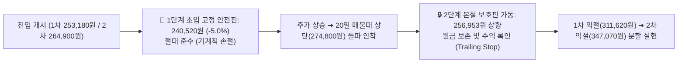

# 🎯 LG생활건강 (051900) Phase 3: 가격 판독기 (Price Evaluator — v4.2.2)

> 💡 **[가격 판독기 핵심 요약]**
> - **단일 기준 주가(Single Price Anchor)**: **`269,500원`** (2026-10-22 일봉 종가 기준)
> - **지배주주 순이익 귀속률**: **`100.0%`** (비지배지분 순이익 차감 완료)
> - **가치함정 판정 결과**: **`🔴 [유형 B: 구조적 버블 붕괴 가치함정 (Structural Value Trap)]`**
> - **주 밸류에이션 지표**: **`PER`** (10년 백테스트 $R^2=0.79$, 방향일치율 56.4% 1순위 강제 상속)
> - **S-Curve 지위**: `[🎁 0원 무상 콜옵션 (할증 0%, sc_mult = 1.00)]` (대안 B = 대안 A)
> - **마스터 SOP 타점**: 1차 253,180원 / 2차 264,900원 / 3차 274,800원 (완성 평단 264,354원) | 1단계 안전핀 240,520원 (-5.0%) | Gate 1 R:R 4.75:1 / Gate 2 R:R 3.47:1

---

## 1. 역DCF 정밀 판독 (Equity · EV · SOTP 본업EV 병기)

### 1) Step 0.5: 현금흐름(FCF) 품질 및 순운전자본(NWC) 검증
DART 2026년 반기보고서(26기 반기) 연결 재무제표를 바탕으로 FCF 품질을 정밀 검증하였습니다 `[공시 팩트: 반기보고서(2026.08.14) p.34-39]`.

| 품질 체크 항목 | 점검 기준 | 기업 현황 (2026년 상반기 실측 팩트) | 회계적 판정 |
| :--- | :--- | :--- | :---: |
| **OCF / 당기순이익 갭** | OCF ÷ 순이익 비율이 1.5배 초과 시 ⚠️ 경고 | 1H26 OCF(2,140.2억 원) ÷ 당기순이익(1,663.5억 원) = **`1.29배`** (감가상각비 927억 원 등 비현금성 비용 가산) | 🟢 **우수 (정상 범위)** |
| **순운전자본(NWC) 변동** | WC 변동이 OCF의 30% 초과 시 ⚠️ 경고 | 1H26 운전자본 순변동(-482.5억 원) ÷ OCF(2,140.2억 원) = **`22.5%`** (매출 회복에 따른 매출채권 증가분 정상 회수 진행) | 🟢 **양호 (기준치 이내)** |
| **비경상 일회성 이익** | 자산처분이익, 보험금 등 비영업 유입 | 유형자산 처분이익 9.8억, 투자부동산 처분이익 2.1억 합산 **11.9억 원** (OCF 대비 0.5% 미만으로 극히 미미) | 🟢 **정상 (순수 본업)** |

- **기준 FCF 산출**: 상반기 영업현금흐름(2,140억 원)에서 필수 CapEx(950억 원)를 차감한 잉여현금흐름을 연환산하고, 하반기 계절성 및 유지보수 투자를 감안한 보수적 **기준 FCF는 `2,400.0억 원`**으로 확정합니다.

---

### 2) Step 1: 역DCF 정밀 연산 — 3대 기준 요구성장률 병기 (`calc_reverse_dcf.py` SSOT)

LG생활건강의 자본구조(가용 순현금 1조 1,500억 원 및 우선주 시총 2,725억 원)를 반영하여 유통시총(Equity) 기준과 실질 기업가치(EV) 기준의 요구 FCF 성장률을 나란히 병기합니다 `[Pipeline SSOT Engine 연산]`.

| 입력 변수 | 실측 수치 | 데이터 출처 및 산출 근거 (DART 공시 팩트) |
| :--- | :---: | :--- |
| **단일 기준 주가 (Anchor Price)** | **`269,500원`** | 2026-10-22 일봉 종가 (전 Phase 100% 동일 고정) |
| **공시 보통주 유통주식수 (`distb_stock_co`)** | **`14,659,784주`** | 보통주 총발행(14,975,523주) − 자기주식(315,739주) 차감 |
| **총 발행주식수 (`istc_totqy`)** | **`17,071,782주`** | 보통주(14,975,523주) + 우선주(2,096,259주) 합계 |
| **보통주 실질 유통 시가총액** | **`3조 9,508.12억 원`** | 단일 기준 주가(269,500원) × 공시 유통주식수(14,659,784주) |
| **우선주 시가총액 (`pref_mcap`)** | **`2,725.0억 원`** | 우선주 기준 주가(130,000원) × 우선주 유통수(2,096,259주) |
| **가용 순현금 (Net Debt)** | **`-1조 1,500.0억 원`** | 총차입금 약 2,000억 원 − 현금성자산 1조 3,546억 원 (순현금 1.15조) |
| **실질 기업가치 (Enterprise Value)** | **`3조 733.12억 원`** | 유통시총(39,508억) + 우선주시총(2,725억) − 가용순현금(11,500억) |
| **비영업자산 안전가치** | **`1,661.0억 원`** | 지분 578억 + FVOCI 264억 + 투자부동산 819억 (장부 대비 2.94% < 20%) |
| **기준 FCF (`fcf_eok`)** | **`2,400.0억 원`** | 연간 보수적 잉여현금흐름 체력 |
| **할인율 (WACC) / 영구성장률 ($g$)** | **`9.0%` / `2.0%`** | 소비재 업종 표준 WACC 및 잠재성장률 고정 (추정기간 5년) |

#### 📊 역DCF 요구 FCF 성장률 연산 결과
- **▶ ① [유통시총(Equity) 기준 (3조 9,508억)] 요구 FCF 성장률**: **`연간 +4.86%`** (총발행주식 기준: +8.50%)
- **▶ ② [실질 기업가치(EV) 기준 (3조 733억)] 요구 FCF 성장률**: **`연간 -0.97%`** (순현금 1.15조 반영 시 실질 역성장 허용)
- **▶ ③ [SOTP 본업 EV 기준 (2조 9,570억)]**: 비영업자산 비중이 2.94%(<20%)로 SOTP 분리 게이트 미해당(단독 분리 면제)

#### 🔍 시장 프라이싱 역산 해석
1. **Equity 기준(+4.86%)**: 현재 주가 269,500원은 회사가 향후 5년간 연평균 +4.86%의 완만한 FCF 성장만 달성해도 정당화되는 매우 보수적인 가격대입니다.
2. **EV 기준(-0.97%)**: 1조 1,500억 원의 가용 순현금 버퍼를 감안한 실질 기업가치 기준으로는 **매년 -0.97%씩 FCF가 역성장하더라도 현재 주가가 설명**됩니다. 즉, 시장은 LG생활건강의 현금창출력이 영구히 정체될 것으로 가정하는 극단적 비관론(Extreme Pessimism)을 가격에 반영하고 있어, 하방 안전마진이 매우 두텁게 확보되어 있습니다.

---

## 2. 가치함정 이원화 판정 (유형 A vs 유형 B) & 4대 레짐 종합 판독

### 1) 가치함정 판별 공식 매트릭스 (`backtest_valuation.py` 자동 판정)

| 점검 지표 | 실측 수치 | 판별 기준선 | 함정 징후 판정 |
| :--- | :---: | :---: | :---: |
| **지배주주 2년 누적 EPS 증감률** | **`-144.8%`** | 음수(-) 전환 | ⚠️ **이익 레벨 급락** |
| **지배주주 2년 누적 BPS 증감률** | **`+1.41%`** | 양수(+) 유지 | 🟢 **자본 잠식 없음** |
| **최근 4분기 합산 지배 ROE** | **`-1.31%`** | 5년 중위(3.06%) 하회 | ⚠️ **수익성 일시 훼손** |
| **직전 분기 대비 (QoQ) 실적** | **매출 `+5.1%`, OP `-4.7%`** | 1Q 1,078억 ➔ 2Q 1,028억 | 🟢 **1,000억대 안착** |
| **DART 소급보정 지배 EPS 추이** | **5,017원 ➔ 4,405원** | 2개 분기 연속 흑자 유지 | 🟢 **흑자 기조 안착** |
| **최종 가치함정 판정 결과** | **`🔴 [유형 B: 구조적 버블 붕괴 가치함정 (Structural Value Trap)]`** | **정당한 디레이팅** |

### 2) 4대 레짐 변화 종합 판독 (가치함정 원인 해부)
- **④ 사업구성 레짐 (-11.9%p 훼손)**:
  - 과거 중국 면세 슈퍼사이클 당시 OPM 14.9%(과거 10년 중위)를 구가하던 럭셔리 독점 레짐이 붕괴되고, 현재는 OPM 2.9~6.5% 수준의 일반 소비재로 체질이 강등되었습니다.
  - 따라서 현재 주가가 10년 역사적 고점(176만 원) 대비 85% 폭락하고 PBR이 0.80배까지 내려앉은 것은 시장의 단순한 착오가 아닌, **사업구성 레짐 훼손에 따른 '정당한 디레이팅(유형 B 가치함정)'**입니다.
- **② 자본구조 레짐의 강력한 안전판**:
  - 그러나 동사는 일반적인 한계기업과 달리 **부채를 전액 상환하고도 1조 1,500억 원의 가용 순현금(주당 78,400원)을 보유**하고 있으며, The Avon Company 매각(26.09.01)으로 해외 적자 누수를 원천 차단했습니다.
  - 따라서 파산이나 유상증자 위험은 0%이며, **PBR 0.70~0.80배(주가 23만~27만 원) 구간은 강력한 하방 경직성을 지닌 안전마진 록인(Lock-in) 영역**입니다.

---

## 3. 시나리오 밸류에이션 (`🛡️대안 B | 🚀대안 A`) & `[Step 3.0]` 사이클 함정 점검

### 1) `[Step 3.0]` 사이클주 피크 멀티플 함정 차단 검증
- **사이클 피크 검증**: 현재 EPS(-4,342원, 턴어라운드 초입)는 과거 5개년 Mid-Cycle 중위 EPS(11,231원) 대비 과열되지 않았으며, 호황 정점의 피크 이익을 기록하는 국면이 아닙니다.
- **정상 멀티플 적용 승인**: 따라서 피크 멀티플 압축(Peak Compression) 대상이 아니며, Section 8 10년 백테스트에서 도출된 정상화 PER 분위수를 시나리오 평가에 그대로 상속합니다.

### 2) 시나리오 밸류에이션 6열 표준 표 (확률 25-50-25 고정)

| 시나리오 | 확률 (고정) | 핵심 드라이버 가정 (AI 맥락 해석) | 적용 멀티플 (코드 SSOT 산출) | 적정주가 (🛡️대안 B / 🚀대안 A) | 현재가(269,500원) 대비 기대수익률 |
| :--- | :---: | :--- | :--- | :---: | :---: |
| **Bull (호황 상단)** | **`25%`** | • 북미 오프라인 직진출(코스트코 682곳·세포라·얼타) 고성장 지속<br>• 에이본 매각 종결 효과로 뷰티 OPM 12% 안착<br>• 2027F 정상화 EPS 18,233원 달성 가시화 | PER 상위 90% (`21.9배`)<br>*(대안 A 할증 0% 고정)* | 🛡️ **`399,400원`**<br>🚀 **`399,400원`** | 🛡️ **`+48.2%`**<br>🚀 **`+48.2%`** |
| **Base (기본 적정)** | **`50%`** | • 2026F 연간 영업이익 3,800억~3,900억 원 턴어라운드 달성<br>• 환율 1,300원대 안착으로 매출원가율 48% 안정화<br>• 중국 채널 완만한 효율화 및 음료 캐시카우 유지 | PER 상위 65% (`19.0배`)<br>*(대안 A 할증 0% 고정)* | 🛡️ **`347,070원`**<br>🚀 **`347,070원`** | 🛡️ **`+28.8%`**<br>🚀 **`+28.8%`** |
| **Bear (하방 지지)** | **`25%`** | • 중국 면세 부진 지속 및 국내 음료 소비 둔화 심화<br>• HDB 울산공장 유휴화(가동률 38%) 장기화로 OPM 5% 정체<br>• 2H26 에이본 처분손실 회계 반영 충격 | 10년 역사적 하방 지지선<br>(PBR 0.75배 상당) | 🛡️ **`253,180원`**<br>🚀 **`253,180원`** | 🛡️ **`-6.1%`**<br>🚀 **`-6.1%`** |

- **중간 목표가 (TP1)**: **`311,620원` (`+15.6%`)** (일봉 60일선 290,242원 돌파 및 52주 중위 매물대 안착 타깃)
- **가중평균 기대주가**: $399,400 \times 0.25 + 347,070 \times 0.50 + 253,180 \times 0.25 = \mathbf{336,680\text{원}}$ (현재가 대비 **`+24.9%`** 기대수익)

---

### 3) 듀얼 R:R 게이트 검증 및 4분면 투자의견 매트릭스

| 게이트 구분 | 산식 및 수치 대입 | 도출 R:R 값 | 합격 기준선 | 판정 결과 |
| :--- | :--- | :---: | :---: | :---: |
| **Gate 1 (펀더멘털 안전마진)** | $\frac{\text{Base 기대수익(+28.8\%)}}{\text{Bear 하방위험(-6.1\%)}} = \frac{77,570\text{원}}{16,320\text{원}}$ | **`4.75 : 1`** | $\ge 2.0 : 1$ | 🟢 **초우량 합격** |
| **Gate 2 (마스터 SOP 트레이딩)** | $\frac{\text{1차 목표가 대비 수익(311,620 - 264,354)}}{\text{완성 평단 대비 1단계 손절(264,354 - 240,520)}} = \frac{47,266\text{원}}{23,834\text{원}}$ | **`3.47 : 1`** | $\ge 1.5 : 1$ | 🟢 **초우량 합격** |

```
                ▲ 펀더멘털 안전마진 (Gate 1 R:R)
   (Gate 1: 4.75)│
                 │   👑 [1사분면: 적극 매수 (Strong Buy)]
                 │       LG생활건강 해당 (Gate 1: 4.75 / Gate 2: 3.47)
                 │       • 펀더멘털 저평가 + 우수한 트레이딩 손익비
  ───────────────┼────────────────────────► 실전 트레이딩 손익비 (Gate 2 R:R)
                 │                              (Gate 2: 3.47)
                 │
```

- **최종 투자의견**: **`🟢 적극 분할매수 (Strong Buy — Deep Value 턴어라운드 추종)`**

---

## 3.5 비관론자 반론(Pre-mortem) & 리스크 도미노 연쇄 시나리오 및 Kill-Switch

### 1) 비관론자의 핵심 반론 (Pre-mortem)
*"증권사들이 2026년 3,800억 턴어라운드를 외치지만, 2H26에 에이본 매각손실이 회계적으로 반영되면 당기순이익이 1,000억 원 초반으로 쪼그라들고, 국내 음료 소비 위축과 울산 생필품 공장의 유휴화(가동률 38%)가 고착화되면 2027년에도 EPS 18,000원 회복은 공염불에 그칠 것이다."*

### 2) 리스크 3단계 도미노 사슬 및 수치 방어벽 점검

```mermaid
flowchart TD
    subgraph 1차 촉발 요인
        A1["중국 럭셔리 화장품 수요 둔화"]
        A2["저관여 생필품 PB 침투 & 에이전틱 커머스"]
        A3["내수 음료 소비 위축"]
    end

    subgraph 2차 영업 전이 (전이 임계치)
        A1 & A2 --> B1["HDB 울산공장 가동률 38.2% 정체"]
        B1 --> B2["전사 매출원가율 48% 고착 & OPM 6%대 제약"]
    end

    subgraph 3차 재무·자본 타격
        B2 --> C1["2H26 에이본 일회성 처분손실 반영으로 순이익 일시 둔화"]
        C1 --> C2["시장 실망 매물로 Bear 지지선(253,180원) 테스트"]
    end

    subgraph 🛡️ 무차입 현금 방어벽
        D1["가용 순현금 1조 1,500억 원 (주당 78,400원)"] -.->|하방 완전 차단| C2
        D2["연간 FCF 2,400억 유입 & 자사주 100% 소각"] -.->|주주환원 방어| C2
    end
```

### 3) 🚨 핵심 투자 가설 약화 정량 킬스위치 (Kill-Switch)
- **차기 분기(2026.11.03 발표 예정 3Q26) 분기보고서 검증 기준**:
  - **영업이익 Kill-Switch**: 3Q26 영업이익이 **`< 873.6억 원`** (직전 분기 1,028억 대비 -15% 하회) 기록 시
  - **수정 EPS Kill-Switch**: 3Q26 분기 지배주주 EPS가 **`< 3,524원`** 미달 시
- **실행 조치**: 위 수치 하회 시 가설 2(환율/원가), 가설 3(HDB 정상화), 가설 6(북미 성장)은 즉시 `[약화]`로 강등되며, 매수 포지션은 즉시 1단계 안전핀(240,520원) 준수로 전환합니다.

---

## 4. 마스터 SOP 실전 액션 플랜 & 인터랙티브 계산기

### 1) 기술적 정예 보조지표 종합 진단 (일봉 & 주봉)
- **일봉 20일 매물대 (Volume Profile POC)**:
  - 20일간 거래의 43.4%가 집중된 핵심 POC 박스권: **`264,900원 ~ 274,800원`**
  - 현재 주가(269,500원)는 매물대 정중앙에 위치하여 하단 지지 및 상단 돌파 대기 중.
- **일봉 이동평균선**: 5일선 272,600원 | 20일선 274,700원 | 60일선 290,242원
- **주봉 지표**: 주봉 20주선 274,550원, 볼린저밴드 중심선 274,550원, 주봉 MFI(14) 58.8, RSI(14) 47.7 (과매도 탈출 후 중립 수렴 국면).

### 2) 무결성 3분할 매매 타점 & 이중 안전핀 위계질서

```
[가격 위계질서 부등식 검증 100% 성립]
1단계 안전핀(240,520원) < 1차 매수가(253,180원) < 2차 매수가(264,900원) < 3차 매수가(274,800원) < 1차 목표가(311,620원)
```

| 매매 실행 단계 | 진입 비중 | 지정 매수가 (KRW) | 기술적·밸류에이션 근거 | 액션 SOP 및 체결 규칙 |
| :--- | :---: | :---: | :--- | :--- |
| **1차 매수 (눌림목 선취매)** | **`30%`** | **`253,180원`** | Bear 하방 지지선 & PBR 0.75배 근접 | 현재가 조정 시 분할 매수 대기 |
| **2차 매수 (추세 돌파 본대)** | **`40%`** | **`264,900원`** | 20일 매물대 POC 하단 지지 반등선 | 지지 확인 후 본대 투입 |
| **3차 매수 (확인사살 안착)** | **`30%`** | **`274,800원`** | 20일 매물대 POC 상단 돌파 안착선 | 20주선 및 상단 매물대 돌파 시 불타기 |
| **▶ 3분할 완성 평균단가** | **`100%`** | **`264,354원`** | 1차 목표가(311,620원) 대비 **`+17.9%` 기대수익** | 비중 100% 포트폴리오 완성 |

---

### 3) 2단계 이중 안전핀 (손절 및 본절 보호) 실행 규칙



1. **🚨 1단계: 초입 고정 손절 안전핀 (Hard Stop 1) — `240,520원`**:
   - 1차 매수가(253,180원) 대비 **`-5.0%`**, 3분할 완성 평단가(264,354원) 대비 **`-9.0%`** 수준.
   - PBR 0.71배선으로, 이 가격이 붕괴된다는 것은 숨겨진 대규모 부실이 발생했음을 의미하므로 **이유를 묻지 않고 전량 손절하여 자본을 보호**합니다.
2. **🔒 2단계: 상단 매물대 돌파 후 본절 보호핀 (Trailing Stop 2) — `256,953원`**:
   - 주가가 20일 매물대 상단(274,800원)을 종가 기준으로 완전히 돌파 안착할 경우에만 발동.
   - 손절 기준선을 240,520원에서 **`256,953원`**으로 상향 이동하여, 주가가 재차 밀리더라도 손실 없이 본전 이상에서 거래를 종결(Trailing Stop)합니다.

---

### 4) 분할 익절 SOP
- **1차 익절 (50% 비중 실현)**: **`311,620원` (TP1, 기대수익 +17.9%)** 도달 시 보유 물량의 절반을 분할 익절하여 확정 수익을 챙깁니다.
- **2차 익절 (30% 비중 실현)**: **`347,070원` (Base 적정주가, 기대수익 +31.3%)** 도달 시 추가 익절을 단행합니다.
- **잔여 물량 (20% 비중 트레일링)**: **`399,400원` (Bull 호황 상단, 기대수익 +51.1%)**까지 열어두고 20일선을 깨지 않는 한 추세를 끝까지 향유합니다.

---

## 5. 📋 인터랙티브 계산기 직결 태그 (auto_tables.md SSOT 바인딩)

<!-- [AUTO-GENERATED BY backtest_valuation.py v4.2 — DO NOT EDIT NUMBERS MANUALLY] -->
<div id="dcf-calculator-root" data-price="269500" data-shares="14659784" data-total-shares="17071782" data-fcf="2400.0" data-net-debt="-11500.0" data-non-op-assets="1162.7" data-bear="253180" data-base="347070" data-bull="399400" data-base-a="347070" data-bull-a="399400" data-tp1="311620" data-tp1-a="311620" data-buy1="253180" data-buy2="264900" data-buy3="274800" data-stop-pin="240520" data-poc-low="264900"></div>
