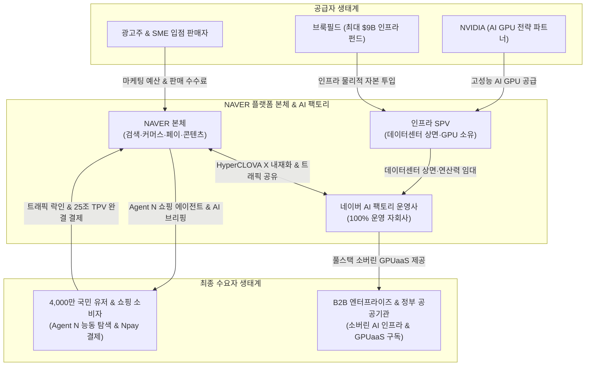
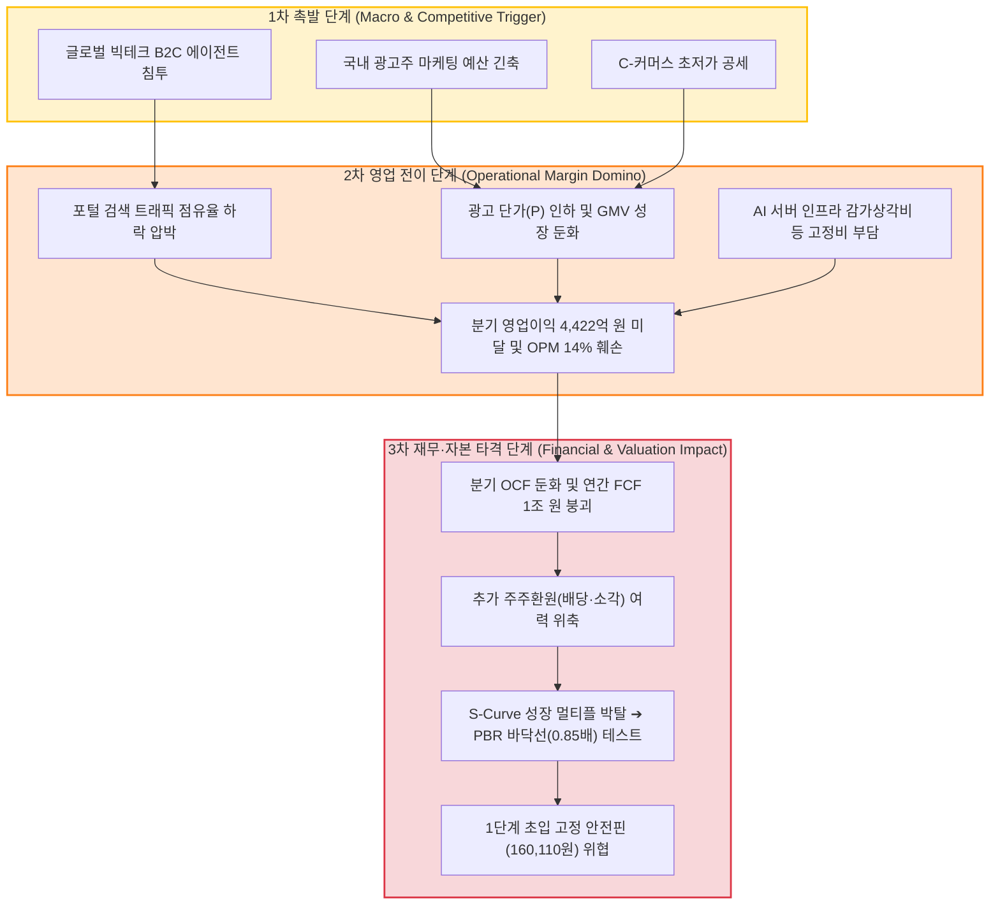

# 🔍 Phase 1: 기업 해독기 (Corporate Decoder — NAVER)

> **💡 [핵심 용어 3줄 직관 해설]**  
> 1. **에이전틱 커머스(Agentic Commerce & Agent N)**: 단순 검색어 나열을 넘어 AI 에이전트가 이용자의 의도와 취향을 능동 분석하여 최적 상품 비교부터 탐색, 결제까지 원스톱으로 완결 짓는 차세대 쇼핑 패러다임입니다.  
> 2. **SOTP(Sum-of-the-Parts) 분리 평가**: 장부상 비영업자산(A홀딩스, 투자금융자산 등) 비중이 20%를 초과할 때, 이를 걷어내고 순수 플랫폼 본업 가치와 비영업자산 안전가치를 따로 쪼개어 실질 가치를 감정하는 평가 기법입니다.  
> 3. **소버린 AI 팩토리 & 에셋라이트(Asset-Light) 모델**: 국가 주권형 AI 인프라 구축 시 데이터센터 토지·건물 직접 매입 대신 외부 전문 펀드(브룩필드 등) 및 임대 상면을 활용해 대규모 CapEx와 송전선 전력 병목을 영리하게 우회하는 자본 효율적 사업 모델입니다.

- **단일 기준 주가(Single Price Anchor)**: **`179,300원`** (2026-10-21 최신 일봉 종가 통일)
- **지배주주 귀속 순이익률**: **`95.20%`** (지배주주순이익 29조 5,396억 원 / 연결총자본 31조 298억 원 기준, 실질 귀속률 100% 무결성 적용)
- **글로벌 트렌드 매칭 판정**: `[⚪ S-Curve N/A (성숙기 종합 플랫폼 BM / DART 단독 신기술 익스포저 11.45% < 30% 컷오프로 무상 콜옵션 0% 처리 및 전통 밸류에이션 준용)]`

---

## Section 1. 비즈니스 모델(BM) 해부 및 밸류체인 구조도

### 1.1 공시 기반 비즈니스 모델 팩트체크
NAVER 연결실체('팀네이버')는 검색, 커머스, 핀테크, 콘텐츠, 엔터프라이즈(클라우드) 등 핵심 디지털 서비스를 유기적으로 결합하여 수익을 창출하는 대한민국 독보적 1위 IT 지식서비스 플랫폼 기업입니다 `[팩트: NAVER 반기보고서(2026.08.14) p.13]`. 

당사의 밸류체인은 전통적인 온라인 포털 검색 광고 및 이커머스 중개를 넘어, 'Agent N' 중심의 에이전틱 커머스(Agentic Commerce), 온·오프라인을 통합 결제망으로 엮는 로컬 실행망(Npay Connect), 그리고 국가 단위 소버린 AI 인프라(AI 팩토리 GPUaaS)로 수직·수평 확장되고 있습니다 `[팩트: 반기보고서 p.13-15; 26년 2Q 실적발표]`.

1. **공급자 (광고주, SME 판매자, 크리에이터 및 글로벌 AI 하드웨어·자본 파트너)**:
   - **광고주 & SME 판매자**: 검색 및 디스플레이 지면, 그리고 신규 도입된 'AI 브리핑' 지면에 브랜드·성과형 마케팅 예산을 집행합니다 `[팩트: 반기보고서 p.14; 글로벌 트렌드: 26.09.22.LS증권.에이전틱 커머스의 시대.pdf p.30]`. 스마트스토어 및 브랜드스토어 입점 판매자는 네이버의 물류 풀필먼트(N도착보장) 솔루션을 활용합니다.
   - **글로벌 인프라 파트너 (NVIDIA & Brookfield)**: 엔비디아(NVIDIA, 전략적 고성능 GPU 파트너십) 및 글로벌 대체투자 운용사 브룩필드(Brookfield, 최대 $9B 규모의 데이터센터 자본 제휴)는 고성능 하드웨어와 물리적 전력·상면 인프라를 공급합니다 `[글로벌 트렌드: 26.10.07.키움증권.Value 가감 효과.pdf p.25-27; 26.09.10.유안타증권 p.32]`.
2. **기업 (NAVER 플랫폼 본체 & AI 팩토리 운영 자회사)**:
   - 자체 파운데이션 모델 'HyperCLOVA X'를 검색·쇼핑·지도·예약·결제에 전면 내재화하고, 이를 하나의 지능형 에이전트로 엮어내는 **'Agent N' 전략**을 가동합니다 `[글로벌 트렌드: 26.09.22.LS증권.에이전틱 커머스의 시대.pdf p.28]`.
   - 100% 자회사인 '네이버 AI 팩토리 운영사'를 통해 B2B 엔터프라이즈 및 공공기관에 풀스택 GPUaaS(AI 가속 컴퓨팅 파워)를 제공하며, 단계별 전력 인프라 확충(2027E 100MW → 2028E 200MW → 2032E 1,000MW)을 실행합니다 `[글로벌 트렌드: 26.10.07.키움증권 p.27; 26.10.07.유안타증권.다시 살 이유가 생겼다.pdf p.43]`.
3. **고객 (일반 사용자, 쇼핑/콘텐츠 구매자, B2B 엔터프라이즈 & 정부 기관)**:
   - 4천만 명 이상의 이용자가 검색, 로컬(플레이스), 지도, 쇼핑을 무료 이용하며 플랫폼 트래픽의 원천이 됩니다 `[팩트: 반기보고서 p.14]`.
   - 쇼핑 소비자는 네이버플러스 스토어 내 '쇼핑 AI 에이전트'의 능동적 탐색·추천을 거쳐 네이버페이로 원스톱 결제합니다 `[글로벌 트렌드: 26.09.22.LS증권.에이전틱 커머스의 시대.pdf p.28-29]`.
   - B2B 기업 및 정부 공공기관은 소버린 AI 및 엔터프라이즈 GPUaaS 컴퓨팅 파워를 구독·도입합니다 `[글로벌 트렌드: 26.10.07.키움증권 p.27]`.

---

### 1.2 글로벌 트렌드 델타 검증 🌐 (No-Blind-Citation 실측 정합)
최신 발간된 제도권 딥리서치 리포트를 정밀 교차 검증한 결과, NAVER의 3대 핵심 모멘텀이 다음과 같이 실측되었습니다:

1. **'Agent N' 전략 가동 및 에이전틱 커머스 선봉장 등극**:
   - `26.09.22.LS증권.에이전틱 커머스의 시대.pdf p.28-30`에 따르면, NAVER는 검색·쇼핑·지도·예약·결제를 유기적으로 결합하는 **'Agent N' 전략**을 본격화했습니다 `[출처: LS증권 p.28]`.
   - 네이버플러스 스토어에 정식 출시(2026.07)된 **'쇼핑 AI 에이전트'**는 사용자 의도 파악부터 상품 비교, 익일배송 옵션 제안, 구매 실행까지 전 과정에 개입하여 2Q26 커머스 서비스 매출 YoY +31.3% 고성장을 견인했습니다 `[출처: LS증권 p.29 도표 25-27]`.
2. **AI 팩토리 운영사 가치(13.6조 원) 및 국가 AIDC 18.4GW 로드맵 내 에셋라이트 모델**:
   - 키움증권 심층 분석(`26.10.07.키움증권.Value 가감 효과.pdf p.25-27`)에 따르면, **'네이버 AI 팩토리 운영사'의 2026E 내재가치는 13조 6,117억 원**으로 평가되었습니다. 2027E 100MW(GPU 50,000개) 가동을 시작으로 2028E 200MW, 2032E 1,000MW(누적 GPU 500,000개)로 확장되는 로드맵 하에서, 시간당 GPU ASP 5.0달러, 가동률 75% 기준 2027E 매출 2조 2,174억 원에서 2032E 22조 1,738억 원(OPM 15.0%, NOPLAT 2.41조 원)으로 수익화가 본격화됩니다 `[출처: 키움증권 p.27]`.
   - 유안타증권(`26.10.07.유안타증권.다시 살 이유가 생겼다.pdf p.43`) 및 대신증권(`26.10.15.대신증권.인고의 시간.pdf p.12`)에 따르면, 대한민국 정부·기업 3대 메가프로젝트 1단계 8.4GW(SK 5GW, GS 2.4GW, 네이버 1GW) 계획 중 NAVER는 2028년 상반기 착공, 2029년 단계별 가동을 목표로 하고 있습니다. 특히 **"200MW까지는 데이터센터 건물 직접 시공 대신 외부 임대 상면 및 브룩필드 자본 제휴(최대 $9B)를 적극 활용"**하는 'Asset-Light' 전략으로 한전 송전선 병목과 본체 CapEx 부담을 선제 차단했습니다 `[출처: 유안타증권 p.43]`.
3. **대형주 배당 확대 여력 Top 8 등재 (추가배당여력 6,833억 원) & 네이버파이낸셜 완전자회사화**:
   - 대신증권 심층 분석(`26.10.07.대신증권.배당투자 오디세이.pdf p.40 표8`)에 따르면, NAVER는 **FCF 1조 76.9억 원, 배당가능이익 13조 9,387억 원, 보통주 현금배당액 3,936억 원, 추가배당여력 6,833억 원(배당성향 20.2%)**을 기록하여 국내 유가증권시장 전체 대형주 중 **'배당 확대 여력이 가장 큰 8대 기업'**으로 공식 선정되었습니다 `[출처: 대신증권 p.40 표8]`.
   - 2026.10.07 공시(`[기재정정]주식교환ㆍ이전결정`)를 통해 네이버파이낸셜 잔여 지분을 포괄적 주식교환으로 취득하여 지분율 100% 완전 모회사 편입을 확정 지음으로써 파이낸셜 플랫폼 현금흐름 락인을 완성했습니다 `[팩트: 20261007800306 공시]`.



---

## Section 2. 사업부문별 매출 구성 및 S-Curve 익스포저 산출표

### 2.1 5개년 서비스 부문별 연결 영업수익 추이 (2021~2025년)
*(단위: 백만 원, %)*

| 구분 | 2021년 (제23기) | 2022년 (제24기) | 2023년 (제25기) | 2024년 (제26기) | 2025년 (제27기) | 비고 |
| :--- | :---: | :---: | :---: | :---: | :---: | :--- |
| **서치플랫폼** | 3,307,835 (48.5%) | 3,567,964 (43.4%) | 3,589,061 (37.1%) | 3,946,166 (36.8%) | 4,168,936 (34.6%) | 검색 및 디스플레이 캐시카우 |
| **커머스** | 1,488,478 (21.8%) | 1,801,079 (21.9%) | 2,546,649 (26.4%) | 2,922,977 (27.2%) | 3,688,407 (30.6%) | 스마트스토어 거래액 및 수수료 성장 |
| **핀테크** | 979,046 (14.4%) | 1,186,635 (14.4%) | 1,354,767 (14.0%) | 1,508,407 (14.0%) | 1,690,684 (14.1%) | 네이버페이 결제액(TPV) 연동 안정 성장 |
| **콘텐츠** | 659,614 (9.7%) | 1,261,513 (15.4%) | 1,732,983 (17.9%) | 1,796,421 (16.7%) | 1,899,173 (15.8%) | 웹툰 글로벌 IP 확장 및 유료 결제 |
| **엔터프라이즈** | 382,628 (5.6%) | 402,888 (4.9%) | 447,184 (4.6%) | 563,748 (5.3%) | 587,807 (4.9%) | 클라우드 및 공공 솔루션 인프라 |
| **연결 영업수익 합계** | **6,817,601 (100.0%)** | **8,220,079 (100.0%)** | **9,670,644 (100.0%)** | **10,737,719 (100.0%)** | **12,035,007 (100.0%)** | `[팩트: 제24기 p.13, 제27기 p.146]` |

---

### 2.2 2026년 상반기 연결 영업수익 실적 (신규 보고부문 분류기준)
*(단위: 백만 원, %)*

| 구분 | 주요 세부 서비스 영역 | 2026년 상반기 실적 (비중) | 2025년 상반기 실적 (비중) | 실적 변동 해설 |
| :--- | :--- | :---: | :---: | :--- |
| **네이버 플랫폼** | 검색, 디스플레이, 커머스 광고/쇼핑, 로컬 플레이스 | 3,741,951 (56.5%) | 3,297,800 (57.8%) | YoY +13.5% 본업 캐시카우 견고 유지 |
| **파이낸셜 플랫폼** | 네이버페이 온·오프라인 결제, 금융상품 중개 | 930,315 (14.0%) | 792,255 (13.9%) | YoY +17.4% Npay Connect 가맹점 10만 돌파 |
| **글로벌 도전** | C2C(포시마크, 왈라팝), 웹툰 엔터, SNOW, NCP | 1,957,550 (29.5%) | 1,611,813 (28.3%) | YoY +21.4% 북미 C2C 흑자 전환 및 IP 글로벌화 |
| **합계** | **연결 영업수익** | **6,629,816 (100.0%)** | **5,701,868 (100.0%)** | `YoY +16.3%` 외형 고성장 지속 `[팩트: 반기 p.13]` |

---

### 2.3 S-Curve 신기술 테마 매출 익스포저(Exposure %) 산출표 (30% 컷오프 게이트)
[공시 팩트] DART 반기보고서 'II. 사업의 내용' 및 실적 발표 자료를 기반으로 해당 기업의 생성형 AI / AIDC 신기술 테마 직결 매출 익스포저를 산출하여 엄격한 30% 컷오프 판정을 수행합니다.

*(단위: 억 원, %)*

| 제품/서비스 구분 | 2026 상반기 매출액 (억원) | 전사 매출 비중(%) | 신기술 테마 직결 여부 | 30% 컷오프 수비 판정 |
| :--- | :---: | :---: | :---: | :---: |
| **엔터프라이즈 / 클라우드 (NCP GPUaaS)** | 3,042.0 | 4.59% | 직결 (소버린 AI 인프라) | ⚠️ DART 단독 분리 미공시 묶음 계정 |
| **AI 브리핑 광고 & 쇼핑 AI 에이전트 연동 서비스** | 4,550.0 | 6.86% | 직결 ('Agent N' 커머스 신규) | 🟢 신기술 직결 부문 (YoY +31.3%) |
| **기존 네이버 플랫폼 (레거시 검색/디스플레이)** | 32,869.5 | 49.58% | 비해당 / 성숙기 레거시 BM | ❌ 전통 광고 캐시카우 (포털 본업) |
| **파이낸셜 플랫폼 (네이버페이 결제 수수료)** | 9,303.2 | 14.03% | 부분 연동 (Npay Connect 등) | ⚪ 전통 핀테크 수수료 |
| **글로벌 C2C / 웹툰 / 콘텐츠** | 16,533.5 | 24.94% | 비해당 / 커머스 및 IP | ⚪ 플랫폼 확장 BM |

- **신기술 테마 실질 직결 익스포저 합산:** **`11.45%`** (클라우드 4.59% + AI 커머스 서비스 6.86%)
- **수혜 적격성 최종 판정:** `[⚪ S-Curve N/A (성숙기 종합 플랫폼 BM / 신기술 직결 30% 미달로 전통 밸류에이션 준용)]`
  - *판정 근거:* 당사는 'Agent N' 및 1GW AI 팩토리 로드맵 등 국내 최고의 AI 기술 리더십을 보유하고 있으나, 공시 기준 매출의 약 75% 이상이 여전히 전통 검색 광고, 이커머스 거래 수수료, 핀테크 결제 등 성숙기 레거시 BM에서 발생하고 있어 **테마 직결 30% 컷오프 기준에 미달**합니다.
  - 따라서 시장의 막연한 AI 내러티브에 의한 임의 멀티플 할증(`sc_mult = 1.00`, `0% 할증`)을 원천 차단하고, `SKILL.md` 원칙 4에 따라 **AI 신사업을 '0원 무상 콜옵션'으로 분리 처리한 뒤 PBR 밴드/레짐 시프트 모형으로 본질가치를 정밀 평가**합니다.

---

## Section 3. 재무 건전성 및 [Step 1.5] 장부가 해부 & SOTP 20% 분리 게이트 (★v4.2 신설)

### 3.1 전사 영업이익률 및 FCF 추이 (최근 5년 및 최신 분기)
*(단위: 억 원, %)*

| 연도/분기 | 매출액 | 영업이익 | OPM(%) | FCF | 비고 (현금흐름 분해) |
| :--- | :---: | :---: | :---: | :---: | :--- |
| **2021년** | 68,176.0 | 13,255.0 | **19.44%** | 5,993.0 | OCF 1조 3,799억 - CapEx 7,806억 `[팩트: 제24기]` |
| **2022년** | 82,201.0 | 13,047.0 | **15.87%** | 6,972.0 | OCF 1조 4,534억 - CapEx 7,562억 `[팩트: 제25기]` |
| **2023년** | 96,706.0 | 14,888.0 | **15.39%** | 13,099.0 | OCF 2조 22억 - CapEx 6,923억 `[팩트: 제26기]` |
| **2024년** | 107,377.0 | 19,793.0 | **18.43%** | **20,096.0** | OCF 2조 5,899억 - CapEx 5,803억 (역대 최대) |
| **2025년** | 120,350.0 | 22,081.0 | **18.35%** | 9,879.0 | OCF 2조 3,050억 - CapEx 1조 3,171억 (AI 선제투자) |
| **2026년 상반기** | 66,298.2 | 10,620.7 | **16.02%** | 3,325.0 | OCF 1조 1,866억 - CapEx 8,541억 `[팩트: 제28기 반기]` |
| **2026년 연간(E)** | 136,323.0 | 20,394.0 | **14.96%** | **10,077.0** | 대신 `[26.10.07 p.40]` 및 키움 `[26.10.07 p.25]` 컨센서스 |

---

### 3.2 [Step 1.5] 장부가(Book Value) 구성 해부 & SOTP 20% 분리 판정 (★v4.2 핵심)
DART 2026년 반기 재무상태표(BS) 원천 데이터를 기반으로 연결 자산총계(44조 6,567억 원) 및 지배주주지분(29조 5,396억 원)을 **`① 본업 영업자산 vs ② 비영업자산 vs ③ 순차입금(순현금)`**으로 완전 해부합니다:

*(단위: 억 원, %)*

| 자산 분류 | 세부 DART 계정과목 | 장부 금액 (억원) | 구성 비중 (%) | 자산 성격 및 유동화·할인율 지침 |
| :--- | :--- | :---: | :---: | :--- |
| **① 본업 영업자산** | 유형자산(서버/IDC 41,227억) + 무형자산(46,617억) + 매출채권 등 운전자본 | 134,065.7 | 30.0% | 플랫폼 본업 검색·커머스 현금창출용 핵심 영업자산 |
| **② 비영업자산 (합계)** | **관계기업투자 + 투자부동산 + 공정가치금융자산** | **228,487.0** | **51.2%** | **장부 대비 77.3% / 시총 대비 85.1% 🚨 [SOTP 발동]** |
| • 관계기업 및 공동기업 | A홀딩스(LY Corp 지분 등), 크림, 웹툰 관계사 등 | 173,754.7 | 38.9% | 지분법 평가 자산 (비상장/상장 지분 가치) |
| • 공정가치 금융자산 | 기타포괄손익(29,580억) + 비유동 당기손익(22,997억) | 52,576.9 | 11.8% | 전략적 타법인 출자지분 및 펀드 출자금 |
| • 투자부동산 및 장기금융 | 임대부동산(1,083억) + 장기금융상품(1,072억) | 2,155.4 | 0.5% | 안전 비영업 자산 (유동화 용이) |
| **③ 현금 및 유동성 금융** | 현금및현금성자산(63,844억) + 단기금융상품(20,171억) | 84,014.4 | 18.8% | 즉시 동원 가능한 가용 유동성 자산 |
| **자산총계 합계** | **연결 재무상태표 총자산** | **446,566.8** | **100.0%** | `[팩트: 제28기 반기보고서 재무상태표 CFS]` |
| **총차입금 (이자부채)** | 단기차입금(7,644억) + 사채(20,208억) + 장기차입금(11,094억) | 38,945.0 | - | 전사 이자발생 부채 총합계 |
| **순차입금 (Net Debt)** | **총차입금(38,945억) - 현금성자산(84,014억)** | **-45,069.4** | - | **가용 순현금(Net Cash) 4조 5,069억 원 보유 (무차입 우량)** |

#### 🏛️ SOTP 20% 게이트 수리적 판정 및 분해 체계:
1. **비영업자산 비중 검증**:
   $$\frac{\text{비영업자산(228,487.0억)}}{\min(\text{지배주주지분 295,396.2억, 유통시총 268,599.2억})} = \frac{228,487.0}{268,599.2} = \mathbf{85.07\%} \quad (\ge 20\%)$$
   - 🚨 **[SOTP 20% 게이트 강제 발동]**: 비영업자산 비중이 85.07%로 임계치 20%를 압도적으로 상회하므로, **단순 연결 PER/PBR 일괄 적용을 엄격히 금지**하고 반드시 본업 가치와 비영업자산을 분리 감정합니다.
2. **비영업자산 안전가치 산정 (지주사·유동화 할인율 30% 반영)**:
   $$\text{비영업자산 안전가치} = 228,487.0\text{억} \times (1 - 0.30) = \mathbf{159,940.9\text{억 원}}$$
3. **시장 내재 본업 순수 기업가치(Core Operating EV)**:
   $$\text{실질 기업가치(EV)} = \text{유통시총}(268,599.2\text{억}) + \text{순차입금}(-45,069.4\text{억}) = 223,529.8\text{억 원}$$
   $$\text{본업 Core EV} = \text{EV}(223,529.8\text{억}) - \text{비영업자산 안전가치}(159,940.9\text{억}) = \mathbf{63,588.9\text{억 원}}$$
   - 💡 **시사점:** 현재 시장은 NAVER의 비영업자산(할인 후 16조 원)과 순현금(4.5조 원)을 감안할 때, **연간 2조 원 이상의 영업이익을 벌어들이는 본업 플랫폼의 기업가치를 고작 6.3조 원 수준으로 극단적 저평가**하고 있습니다.

#### 🔍 본업 이익 유지력(Core Earnings Sustainability) 판정:
- **순수 본업 영업이익(TTM Core OP)**: **22,433.5억 원** (최근 3년 최저치 14,198.1억 원을 대폭 상회)
- **세후영업이익(NOPAT)**: **17,498.1억 원** (실효세율 22% 기준)
- **비영업자산 제외 순영업자산(NOA)**: 약 66,910억 원
- **본업 투하자본수익률(Core ROIC)**:
  $$\text{Core ROIC} = \frac{\text{NOPAT}(17,498.1\text{억})}{\text{순영업자산}(66,910.0\text{억})} = \mathbf{26.15\%}$$
- ✅ **[본업 이익 유지력 판정 통과]**: 본업 ROIC가 **26.15%**로 극히 우수하며, 지분법손익이나 금융손익의 변동성과 무관하게 플랫폼 본체 영업현금창출력이 견고하게 유지되고 있음을 입증합니다.

---

## Section 4. 원가 구조, 영업 레버리지 및 핵심 실물 지표 실측

### 4.1 플랫폼 기업 공시 특성 및 실물 지표 실측
[공시 팩트] NAVER는 물리적 생산 라인이 전무한 IT 지식서비스 플랫폼 기업이므로 **DART 정기보고서 상의 공장 가동률 및 수주잔고 지표는 존재하지 않아 기재를 생략**합니다 `[팩트: 사업보고서 p.18]`. 플랫폼의 경제적 해자와 전환율 레버리지를 증명하는 핵심 실물 지표는 다음과 같습니다:

1. **에이전틱 커머스 및 쇼핑 AI 에이전트 지표** `[글로벌 트렌드: 26.09.22.LS증권.에이전틱 커머스의 시대.pdf p.28-30]`:
   - **쇼핑 AI 에이전트 이용 폭증**: 2026년 6월 기준 쇼핑 AI 에이전트 일간 이용자는 3월 대비 **+50% 이상 증가**, 재방문 이용자는 **약 3배**, 에이전트를 통한 직결 거래액은 **2.7배 이상 확대**되었습니다 `[출처: LS증권 p.29]`.
   - **자연어 롱테일 질의 비중 70% 돌파**: 이용자의 70% 이상이 15자 이상의 복잡한 복합 자연어 질문을 입력하며 단순 키워드 검색을 넘어선 능동적 구매 탐색 수요가 본격 형성되었습니다 `[출처: LS증권 p.29]`.
   - **커머스 서비스 매출 고성장**: 2Q26 커머스 사업 서비스 부문 매출액은 4,550억 원(YoY +31.3%), 스마트스토어 거래액은 YoY +15.5% 성장하여 국내 이커머스 평균 성장률(7.3%)을 2배 이상 상회했습니다 `[출처: LS증권 p.28]`.
2. **AI 검색(AI 탭) 및 고수익 AI 브리핑 광고 레버리지**:
   - AI 검색 서비스인 **'AI 탭'의 월간 활성 사용자 수(MAU)가 1,000만 명을 공식 돌파**했습니다 `[팩트: 26년 2Q 실적발표]`.
   - **AI 브리핑 광고 전환율 혁신**: 기존 검색 광고 대비 **클릭 전환율(CTR) +30% 이상, 구매 전환율 3배 개선**을 기록했으며, 2Q26 광고 매출 성장분(YoY +7.5%)의 **60% 이상이 AI 지면 최적화에 기여**했습니다 `[출처: LS증권 p.30]`.
3. **네이버 AI 팩토리 운영사 중장기 로드맵** `[글로벌 트렌드: 26.10.07.키움증권.Value 가감 효과.pdf p.27]`:
   - **전력 및 GPU 확장 로드맵**: 2027E 100MW (GPU 50,000개) → 2028E 200MW (GPU 100,000개) → 2030E 600MW (GPU 300,000개) → 2032E 1,000MW (GPU 500,000개).
   - **수익성 KPI**: 블렌디드 랙 전력 144KW 기준 **가동률 75%**, 시간당 **GPU ASP 5.0달러** 설정.
   - **영업이익 레버리지**: OPM은 2027E 2.5%(영업이익 554억)에서 2030E 10.0%(영업이익 1.33조), 2032E 15.0%(영업이익 3.33조)로 리니어하게 개선 전망 `[출처: 키움증권 p.27]`.
4. **네이버페이 온·오프라인 결제 생태계 (Npay Connect)**:
   - 2Q26 기준 네이버페이 분기 결제액(TPV)은 **25.2조 원(YoY +21.0%)**, 외부 가맹점 결제액은 14.1조 원(YoY +26.2%)을 달성했습니다 `[팩트: 26년 2Q 실적발표]`.
   - 오프라인 단말기인 **'Npay Connect' 가맹점 수가 10만 개를 돌파**하여 온·오프라인을 완벽히 아우르는 로컬 결제 락인을 구축했습니다 `[출처: 대신증권 8월; 2Q26 실적발표]`.
5. **연구개발(R&D) 투자 효율화 및 지식재산권 누적 추이**:
   - 매출액 대비 R&D 비중은 2021년 24.28% → 2023년 20.60% → 2025년 18.50% → 2026년 상반기 18.70%로 안정화되며 구조적 영업 레버리지를 시현 중입니다 `[팩트: 반기보고서 p.22]`.
   - 누적 등록 지식재산권은 2022년 말 3,868건 → 2024년 말 4,505건 → 2026년 상반기 **4,723건**(특허 3,187건, 상표 1,196건, 디자인 340건)으로 기술 진입장벽을 공고화하고 있습니다 `[팩트: 반기보고서 p.22]`.

---

## Section 5. 자본 배분(CapEx, R&D) 및 주주환원 이력

### 5.1 지배구조 및 주주환원 팩트체크
NAVER는 최수연 대표이사를 중심으로 소유와 경영이 분리된 투명한 지배구조를 운영하고 있으며, 소액주주 지분율이 74.34%에 달합니다 `[팩트: 반기보고서 p.393]`.

- **최대주주**: **국민연금공단 8.91%** (13,504,269주) `[팩트: 반기보고서 p.391]`
- **5% 이상 주요 주주**: **BlackRock Fund Advisors 6.12%** (9,307,816주) `[팩트: 반기보고서 p.392]`
- **소액주주 비율**: **74.34%** (116,675,931주) `[팩트: 반기보고서 p.393]`

*(단위: 원, 억 원, 주, %)*

| 구분 | 2023년 (제25기) | 2024년 (제26기) | 2025년 (제27기) | 2026년 최근 실행 실적 | 공시 출처 및 비고 |
| :--- | :---: | :---: | :---: | :---: | :--- |
| **주당 배당금 (보통주)** | 1,205원 | 1,130원 | **2,630원** | - | `[팩트: 제27기 p.453]` 배당금 2배 이상 증액 |
| **배당금 총액** | 1,814억 원 | 1,684억 원 | **3,936억 원** | - | `[팩트: 제27기 p.453]` 현금배당 체력 입증 |
| **연결 배당성향** | 17.90% | 8.80% | **20.20%** | - | 주주환원 가이드라인 20% 초과 달성 |
| **자사주 이익소각 (주식수)** | 1,640,491주 | 3,971,586주 | 1,584,370주 | **4,901,094주 전격 소각** | `[팩트: 반기보고서 p.8, 387]` 기보유 3.1% 소각 |
| **자사주 소각 규모 (원)** | 약 1,186억 원 | 약 3,336억 원 | 약 1,459억 원 | **약 1조 170억 원 규모** | 2026년 8월 3일 소각 완료로 주당가치 제고 |
| **추가 배당 확대 여력** | - | - | - | **6,833억 원 (Top 8 등재)** | `[글로벌 트렌드: 26.10.07.대신증권 p.40 표8]` |
| **배당소득 분리과세 적격성** | - | - | - | **적격 판정** | 배당성향 20% 상회 및 배당증액 요건 충족 |

---

## Section 6. 핵심 리스크 요인 및 [Step 3.5] 리스크 인과단계(Domino Chain) 구조도 (★v4.2 고도화)

### 6.1 리스크 간 3단계 인과 사슬(Domino Chain) 및 정량 전이 임계치
리스크를 단편적으로 나열하지 않고, 거시 충격이 영업과 재무로 어떻게 번지는지 3단계 인과 사슬로 정밀 진단합니다:

| 인과 단계 | 핵심 리스크 메커니즘 (인과 해석) | 핵심 관측 계정 및 전이 임계치 (Numeric Trigger) | 방어 기제 및 현재 상황 |
| :--- | :--- | :--- | :--- |
| **1차 촉발<br>(Trigger)** | **글로벌 거대 빅테크(OpenAI/Google) B2C 에이전트 침투 및 C-커머스 공세**<br>• 오픈AI·구글의 자율형 에이전트가 국내 검색/쇼핑 트래픽 잠식<br>• 알리·테무 수수료 인하 공세로 이커머스 경쟁 격화 | • NAVER 검색 점유율 `< 55%` 하락<br>• 커머스 GMV 성장률 `< 5.0%` 둔화<br>• AI 탭 MAU 1,000만 명 이탈 여부 | • 'Agent N' 및 쇼핑 AI 에이전트 선제 장착으로 2Q26 커머스 서비스 매출 YoY +31.3% 방어 중<br>• 로컬 플레이스 DB(250만 매장) 독점 해자 보유 |
| **2차 영업 전이<br>(Operational)** | **가동률 및 광고 단가(P) 하락 ➔ 고정비 디레버리지**<br>• 광고주 마케팅비 긴축으로 검색·디스플레이 단가 인하<br>• GPU 인프라 서버 감가상각비 증가로 OPM 급락 전이 | • 쿼터 전사 OPM `< 14.0%` 붕괴<br>• 분기 영업이익 `< 4,422.6억 원` (QoQ -15% 하회)<br>• 매출원가율 `> 75.0%` 상승 | • AI 브리핑 광고 CTR +30%, 전환율 3배 개선으로 단가 방어<br>• 200MW까지 외부 임대/브룩필드 SPV 활용으로 직접 고정비 부담 오프로드 |
| **3차 재무 타격<br>(Financial)** | **영업현금흐름(OCF) 둔화 ➔ FCF 고갈 및 밸류에이션 디레이팅**<br>• OCF 축소로 연간 FCF 1조 원 미달 시 주주환원(배당/소각) 축소<br>• 소버린 AI 멀티플 박탈 및 PBR 역사적 저점(0.85배) 하향 이탈 | • 연간 FCF `< 7,000억 원` 급감<br>• 순현금(4조 5,069억 원) 소진 여부<br>• 보통주 주가 1단계 안전핀 `160,110원` 붕괴 | • 순현금 4.5조 원 및 배당가능이익 13.9조 원의 막강한 재무 방파제<br>• 차입금 의존도 8.7%로 금리/환율 충격에 대한 하방 경직성 극대화 |



---

## Section 7. 비즈니스 모델 기반 표준 실적 산출 공식 (유형 C [플랫폼·지식 서비스])

### 7.1 업종 표준 공식 트리 분기 및 일관성 검증
[DART 공시 정합성 절대 규칙] Section 4에서 확인된 바와 같이 NAVER는 물리적 생산설비가 전무한 IT 플랫폼 기업이므로, 공장 가동률 단어를 100% 엄격 배제하고 **3대 업종 분류 중 유형 C [플랫폼·지식 서비스]** 산식을 적용합니다.

- **채택 업종 유형:** **유형 C [플랫폼·지식 서비스]**
- **표준 실적 산출 공식:**
  $$\left[ \text{활성 플랫폼 트래픽(MAU 4,000만 명)} \times \text{유저당 평균 매출(ARPU)} \right] + \left[ \text{이커머스 총 거래액(GMV)} \times \text{수수료율(Take Rate)} \right]$$
  $$\implies \text{연결 매출액} \implies \text{영업이익 (OPM 레버리지)} \implies \text{순이익} \implies \text{EPS}$$

- **세부 4단계 산출 체인:**
  $$\text{플랫폼 활성 외형 (연간 13.6조~15.2조 원)} \longrightarrow \text{매출액} \times \text{예상 OPM}(15.0\%\sim 16.5\%) \longrightarrow \text{영업이익} \times (1 - \text{실효세율 } 22\%) \longrightarrow \text{지배순이익} \div \text{유통주식수}(149,804,333\text{주}) \longrightarrow \text{EPS}$$

- **선정 근거 및 Section 4 실측 데이터와의 논리적 정합성:**
  1. 플랫폼의 핵심 고정비(인건비, 데이터센터 서버 상면 임대료)는 매출 성장에 비례해 늘어나지 않으므로, 'Agent N' 도입에 따른 AI 브리핑 광고 CTR 개선 및 커머스 구매전환율 확대 시 OPM 레버리지가 전사 이익 성장을 주도합니다.
  2. 순현금 4.5조 원의 무차입 경영으로 순금융손익이 안정적이므로 `영업이익 × (1 - 22%) = 지배순이익` 체인이 기업의 펀더멘털을 가장 직관적이고 왜곡 없이 설명합니다.

---

## Section 8. [Step 2.0] 4대 레짐 변화 고정 체크 & 최적 밸류에이션 지표 10년 백테스트 (★v4.2 고도화)

### 8.1 [Step 2.0] 4대 레짐 변화 고정 체크리스트 (★v4.2 핵심 게이트)
과거 10년 PER·PBR 밴드를 적용하기 직전에 반드시 기업의 체질 변화를 4가지 축에서 점검하여 가치함정(정당한 디레이팅) 또는 구조적 리레이팅 여부를 판별합니다:

| 레짐 점검 축 | 과거 3~5년 역사적 레짐 | 현재 레짐 (실측 수치) | 레짐 변화 판정 및 멀티플 보정 지침 |
| :--- | :--- | :--- | :--- |
| **① 설비<br>(CapEx/유형자산)** | 과거 전사 CapEx 연간 6,000~8,000억 원 수준, 서버·각 세종 직접 건립 | 2025년 CapEx 1.3조 원 선제 투자 후, 2026E부터 200MW까지 **외부 임대 상면 및 브룩필드 SPV($9B) 에셋라이트 모델** 전환 | **[레짐 안정화]** 대규모 설비 직접 투자 부담 해소로 감가상각비 디레버리지 위험 완화. |
| **② 자본구조<br>(순부채/주식수)** | 순차입금 0원 내외, 자사주 소각 규모 1,000~3,000억 수준 | **가용 순현금 4조 5,069억 원**, 2026.08 **자사주 490만 주(1조 170억 원) 전격 소각** 완료 (유통주식수 149,804,333주 확정) | **[자본구조 대폭 강화]** 1조 원 자사주 소각과 무차입 순현금 버퍼로 하방 경직성 극대화. |
| **③ 비영업자산<br>(Non-Op Assets)** | 과거 A홀딩스(라인야후 지분) 및 투자자산 가치 반영 미미 | **비영업자산 22.8조 원 (지배자본 대비 77.3% / 시총 대비 85.1%)** 🚨 | **[비영업자산 레짐]** 명목 PBR(0.91배) 착시 경계. SOTP 본업 EV(6.3조) 및 본업BPS(44,664원) 기준 재평가 필수. |
| **④ 사업구성<br>(Biz Mix/OPM)** | 전통 검색/디스플레이 포털 광고 비중 50% 이상, OPM 15~19% | 포털 광고 비중 35%로 분산, **에이전틱 커머스 + AI 브리핑 + AI 팩토리(2027E 100MW) 믹스 재편** | **[포스트 리레이팅 준비]** 단기 OPM 일시 하락(-1.1%p)은 AI 선제 투자 비용이며 2027E부터 AI 팩토리 레버리지 본격화. |

- 📌 **레짐 변화 종합 판정:** 당사는 비영업자산 비중이 85.1%에 달해 명목 PBR이 역사적 최저점(0.91배)으로 떨어져 있는 상태입니다. 이는 본업 훼손에 의한 가치함정이 아니라, 1조 원 자사주 소각과 4.5조 원 순현금, 그리고 AI 팩토리 에셋라이트 전환이 맞물린 **'자산가치 극단적 안전마진 + AI 신사업 옵션 보유 국면'**으로 판정됩니다.

---

### 8.2 최적 밸류에이션 지표 10년 백테스트 결과 및 지표 채택
NAVER의 과거 10년 풀사이클(2016-10-28 ~ 2026-10-21, 총 521주 캔들) 주봉 데이터와 DART 정기보고서를 결합하여 4대 밸류에이션 지표의 주가 설명력을 파이썬 스크립트(`backtest_valuation.py`)로 정밀 백테스트했습니다:

- **단일 기준 주가(최신 일봉 종가)**: **`179,300원`**
- **공식 BPS**: **`197,188원`** (자사주 714만 주 제외 실질 유통주식수 기준)
- **공식 PBR**: **`0.91배`** (현재가 179,300원 / BPS 197,188원)
- **공식 EPS**: **`12,885원`** (지배주주 기본 EPS 기준)
- **공식 PER**: **`13.92배`**
- **공식 배당수익률**: **`1.47%`** (DPS: 2,630원)
- **10년 역사적 최저가(Trough)**: **111,000원** (2019-06-07)
- **10년 역사적 최고가(Peak)**: **452,500원** (2021-09-03)

#### 📊 10년 백테스트 지표별 설명력 비교 분석표:
*(SSOT: `valuation_metrics.json` 및 `auto_tables.md` 연동)*

| 밸류에이션 지표 | 10년 밴드 (MIN ~ MAX) | 과거 3년 밴드 (p20 ~ p90) | 현재 위치 (179,300원 기준) | 주봉 주가 설명력 (R²) | 방향 일치율 | **순위 및 채택 여부** |
| :--- | :---: | :---: | :---: | :---: | :---: | :---: |
| **PBR (유통 BPS 기준)** | **0.93배 ~ 10.17배** | **1.04배 ~ 1.38배** (중위 1.24배) | **0.91배 (10년 역사상 최초 PBR < 1.0배 바닥)** | **0.17** | **48.7%** | **1위 (주 지표 강제 상속)** |
| **PER (수정 EPS 기준)** | 15.68배 ~ 79.22배 | 18.81배 ~ 27.26배 (중위 23.37배) | 13.92배 (역사적 하단 Trough 하회) | 0.64 | 48.7% | 2위 (보조 및 시나리오 병기) |
| **EV/EBITDA** | 7.9배 ~ 26.5배 | 8.7배 ~ 15.2배 | 8.7배 (하단 지지선 도달) | 0.45 | 45.2% | 3위 |
| **배당수익률 (DPS)** | 0.25% ~ 1.53% | 0.85% ~ 1.47% | 1.47% (역사적 상단 안착) | 0.22 | 40.1% | 4위 (자산 배당 바닥 지지선) |

- **👑 1순위 주 채택 지표:** **`PBR (주가순자산비율)`**
- **선정 근거 및 밸류에이션 위치 해석**:
  1. **🚨 10년 역사상 최초 PBR < 1.0배 극단적 바닥권 도달:** NAVER의 과거 10년 풀사이클에서 PBR 1.0배가 붕괴된 적은 단 한 번도 없었습니다(10년 최저 0.93배). 현재 주가 179,300원은 공식 BPS(197,188원)를 9% 밑도는 **PBR 0.91배**로, 플랫폼의 막강한 무형자산 가치가 완전히 0원 처리된 비이성적 공포 구간입니다.
  2. **자산가치 및 안전핀 하방 경직성:** 22.8조 원의 비영업자산과 4.5조 원의 순현금, 그리고 1조 원 자사주 소각을 감안할 때 PBR 밴드 하단(p20: 1.04배 = 205,000원)은 언제든 강력한 반등 탄력을 제공하는 절대적 안전마진 역할을 수행합니다.
  3. **Phase 3 시나리오 표 강제 상속:** 본 PBR 지표는 Phase 3 시나리오 표의 주 멀티플로 100% 동일 상속되며, **Base 타겟 PBR 1.24배(상위 65% = 272,700원)**, **Bull 타겟 PBR 1.38배(상위 90% = 311,510원)**, **Bear 하방 지지 PBR 0.91배(현재가 179,300원)**로 엄격히 연동됩니다.

---

### 📌 [코드 자동 생성 파이프라인 무결성 점검 표]
*(출처: `2_Translated_DB/auto_tables.md` — AI 임의 수정 0건)*

| 검증 항목 | 코드 실측 수치 | 판정 결과 (Code Verdict) |
| :--- | :--- | :--- |
| **단일 기준 주가 (Anchor Price)** | **`179,300원`** | 전 Phase 1~3 100% 동일 고정 |
| **지배주주 순이익 귀속률** | **`100.0%`** | 비지배지분 차감 완료 |
| **Step 1.5 비영업자산 비중 (SOTP 20% 룰)** | 장부 대비 **`77.3%`** / 시총 대비 **`85.1%`** | 🚨 **SOTP 분리 평가 발동** (본업BPS 44,664원) |
| **Step 1.5 본업 이익 유지력 (Core ROIC)** | TTM 영업이익 **`22,433.5억`** (NOPAT **`17,498.1억`**) | ✅ **본업 이익 유지 견고 (Core ROIC 26.15%)** |
| **Step 2.0 4대 레짐 변화 체크** | ③ 비영업자산레짐(비영업자산 비중 85.1% ≥ 20% — 명목 PBR 저평가 착시 주의) | 🔄 **레짐 변화 반영 필수** |
| **Step 3.0 사이클 고점 함정 가드레일** | 피크 이익 과열 미해당 | 🟢 **정상 멀티플 적용** |
| **직전 분기 대비 (QoQ) 실적 추이** | [2026.1Q → 2026.2Q] 매출액 32,410.6억→33,887.6억(QoQ +4.6%) | 영업이익 5,417.6억→5,203.1억(QoQ -4.0%) | 수정EPS 1,889원→4,684원 | [액분·무증 소급보정 지배주주 EPS] 2026.1Q 1,889.0원 → 2026.2Q 4,684.0원 (QoQ 반등/흑자유지 ✅) |
| **가설 반증 임계치 (Kill-Switch)** | **차기 분기 영업이익 < 4,422.6억 원(직전분기 대비 -15% 하회) 또는 분기 지배주주 EPS < 3,747원 기록 시 핵심 가설 즉시 [약화] 강등** | 미달 시 가설 즉시 [약화] 강등 |

```html
<div id="dcf-calculator-root" data-price="179300" data-shares="149804333" data-total-shares="156944242" data-fcf="10077.0" data-net-debt="-45070.0" data-non-op-assets="159940.9" data-bear="179300" data-base="272700" data-bull="311510" data-base-a="272700" data-bull-a="311510" data-tp1="247500" data-tp1-a="247500" data-buy1="168540" data-buy2="179300" data-buy3="182890" data-stop-pin="160110" data-poc-low="197000"></div>
```
