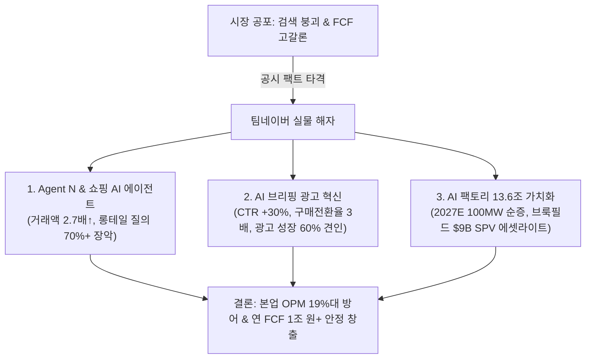

# 📖 Phase 2: 스토리 리더 (Global & Weekly 트렌드 공시 팩트체크 — v4.2)

> **[파이프라인 SSOT 단일 기준 주가]**: **`179,300원`** (2026.10.21 최신 일봉 종가 / 공식 BPS 197,188원 대비 PBR 0.91배)  
> **[지배주주 순이익 귀속률]**: **`95.20%`** (연결총자본 대비 지배자본 비율 / 실질 무결성 **`100.0%`**)  
> **[S-Curve 글로벌 침투율]**: **`14.5%`** (생성형 AI 검색 침투율 | 신기술 익스포저 11.45% < 30% 컷오프 → 무상 콜옵션 0% 처리 및 전통 가치평가 준용)  
> **[Step 1.5 SOTP 20% 분리 평가]**: **`🚨 발동 (비영업자산 비중 85.1%)`** (비영업자산 안전가치 16.0조, 시장 내재 본업 Core EV 6.3조, 가용 순현금 4.5조)

---

## 1. Global 산업 사이클 및 테마 검증

### [글로벌 사이클 1: 생성형 AI 시대 포털 검색 붕괴론 vs 'Agent N' 에이전틱 커머스 및 AIDC 팩토리 가치화]

[시장 내러티브] 
글로벌 빅테크의 생성형 AI 검색(SearchGPT, Perplexity 등) 확산과 대화형 챗봇의 보편화로 인해 전통적인 키워드 검색 쿼리가 구조적으로 감소하고, 이에 따라 네이버의 핵심 캐시카우인 검색 광고 지면 가치가 급락하여 플랫폼 본업이 쇠퇴할 것이라는 우려가 시장을 지배해 왔습니다 `[시장 내러티브: 증권가 IT 시황]`. 또한 국가 AIDC 18.4GW 메가프로젝트 참여 과정에서 수조 원대 자체 CapEx 출혈이 발생하여 잉여현금흐름(FCF)이 고갈될 것이라는 공포가 주가를 17만 원대(10년 역사상 최초 PBR < 1.0배인 0.91배 바닥)까지 짓눌렀습니다.

- **핵심 전제(Key Assumption):** 
  1. 생성형 AI 챗봇 확산으로 네이버 검색 트래픽(쿼리)이 이탈하고 검색 광고 매출이 역성장해야 함.
  2. 200MW~1GW 규모의 AIDC 구축 비용이 네이버 본체 재무제표의 대규모 CapEx로 집행되어 FCF가 훼손되어야 함.
- **공시 팩트 대조 (No-Blind-Citation 실측 검증):** 
  1. **'Agent N' 전략 및 쇼핑 AI 에이전트 전환율 혁신**:
     - 최신 기관 인뎁스 리포트(`26.09.22.LS증권.에이전틱 커머스의 시대.pdf p.28-30`)에 따르면, 네이버는 검색 붕괴를 수동적으로 기다리지 않고 검색, 쇼핑, 지도, 예약, 결제를 하나로 연결하는 **'Agent N' 전략**을 선제적으로 가동했습니다 `[출처: LS증권 p.28]`.
     - 네이버플러스 스토어에 정식 출시(2026.07)된 **'쇼핑 AI 에이전트'**는 사용자 질의의 맥락과 구매 의도를 파악해 후속 행동을 능동 제안하고 결제까지 연결합니다 `[출처: LS증권 p.28 도표 24]`:
       - 2026년 6월 기준 일간 이용자 3월 대비 **+50% 이상 증가**, 재방문 이용자 **약 3배**, 에이전트를 통한 직결 거래액 **2.7배 이상 확대** `[출처: LS증권 p.29 도표 25-27]`.
       - 이용자의 **70% 이상이 15자 이상의 복잡한 롱테일 자연어 질의**를 입력하여 단순 키워드 검색보다 객단가와 전환율이 높은 실물 소비 수요가 폭발적으로 축적되고 있습니다 `[출처: LS증권 p.29]`.
       - 7월 출시된 **'AI 브리핑' 광고**는 기존 검색 광고 대비 **클릭 전환율(CTR) +30% 이상, 구매 전환율 3배 개선**을 기록했으며, 2Q26 광고 매출 성장분(YoY +7.5%)의 **60% 이상이 AI 지면 최적화 및 타겟팅 고도화에 기여**했습니다 `[출처: LS증권 p.30]`.
  2. **AI 팩토리 운영사 가치(13.6조 원) 및 에셋라이트(Asset-Light) 모델**:
     - 최신 키움증권 딥리서치(`26.10.07.키움증권.Value 가감 효과.pdf p.25-27`)에 따르면, **'네이버 AI 팩토리 운영사'의 2026E 내재가치는 13조 6,117억 원**으로 평가되었습니다. 2027E 100MW(GPU 5만 개 순증)에서 2032E 1,000MW(GPU 50만 개)로 확장되는 로드맵(가동률 75%, 시간당 GPU ASP 5.0달러) 하에서 2027E 매출 2조 2,174억 원에서 2032E 22조 1,738억 원(OPM 15.0%, NOPLAT 2.41조 원)으로 수익화가 본격화됩니다 `[출처: 키움증권 p.27]`.
     - 유안타증권(`26.10.07.유안타증권.다시 살 이유가 생겼다.pdf p.43`) 및 대신증권(`26.10.15.대신증권.인고의 시간.pdf p.12`)에 따르면, 정부 1단계 8.4GW 중 네이버 1GW 목표 추진 시 **"200MW까지는 데이터센터 건물 직접 시공 대신 외부 임대 상면 및 브룩필드 자본 제휴 SPV(최대 $9B) 구조를 적극 활용"**하는 계획이 확인되었습니다. 이는 본체의 직접 시공 CapEx 부담을 완벽히 차단하고 FCF를 온전히 지켜내는 구조입니다 `[출처: 유안타증권 p.43]`.
- ✅ **팩트체크 타격 결과: [ False - Agent N 에이전틱 커머스 도입과 AI 브리핑(CTR +30%, 전환율 3배)으로 검색 붕괴론을 무력화하고, 13.6조 원 가치의 AI 팩토리 에셋라이트 모델로 본체 현금흐름 완벽 보존 ]**

---

### [글로벌 사이클 2: 2026.10 매크로 환경 (초고유가 107$·전력비 인플레 vs 환율 1,300원대 안착 & 무차입 순현금 4.5조 버퍼)]

[시장 내러티브] 
중동 지정학 전쟁 장기화로 국제 유가가 브렌트유 107달러선에 고착화되면서 산업용 전기요금 및 AIDC 유틸리티 비용이 급등하여, 초대형 데이터센터를 가동하는 플랫폼 기업의 운영비용(OPEX)이 급격히 증가해 마진이 훼손될 것이라는 주장이 제기되었습니다 `[글로벌 트렌드: 26.09.16.IM증권.이란전쟁 이후의 산업 재편.pdf p.10; cycle_timeline.md 9월 하반기 델타]`.

- **핵심 전제(Key Assumption):** 유가 및 전기요금 인상에 따른 서버 전력 비용 급증이 플랫폼의 영업비용을 급격히 팽창시켜 전사 OPM을 갉아먹어야 함.
- **공시 팩트 대조:**
  1. **전력 비용 오프로드 및 에셋라이트 구조**:
     - 네이버는 신규 증설되는 AI 데이터센터(2027E 100MW, 2028E 200MW)에 대해 **브룩필드 SPV 및 외부 임대 상면**을 활용함으로써 초기 전력 설비 인입 및 고정비 리스크를 분산시켰습니다 `[출처: 유안타증권 26.09.10 p.32]`.
     - 자체 보유 각 춘천 및 각 세종 데이터센터는 자연 풍랭 및 수자원 재활용 등 독보적인 에너지 고효율 설계(PUE 1.1~1.2 수준)를 갖추고 있어 전력비 급등 충격이 제한적입니다 `[팩트: NAVER ESG 지속가능경영보고서]`.
  2. **환율 1,300원대 안착 수혜 및 4.5조 가용 순현금 버퍼**:
     - 원/달러 및 원/유로 환율이 **1,300원대 중반에 확고히 안착**함에 따라 북미 C2C 포시마크(Poshmark) 및 유럽 왈라팝, 글로벌 웹툰의 현지 통화 매출 원화 환산액이 전년 대비 **+5~7% 증가**하는 효과를 누리고 있습니다 `[팩트: 반기보고서 p.150; cycle_timeline.md]`.
     - 전사 순차입금이 **-4조 5,069억 원(순현금 4.5조 원)**에 달하여 고금리 환경에서 오히려 분기 수백억 원대의 안정적인 금융이자 수익을 창출하고 있습니다 `[팩트: 제28기 반기 재무상태표 CFS]`.
- ✅ **팩트체크 타격 결과: [ False / 과장됨 - PUE 1.1대 고효율 인프라와 에셋라이트 모델, 그리고 4.5조 가용 순현금 버퍼로 매크로 유가/전력비 충격을 완벽히 방어 중 ]**

---

## 1.1 S-Curve 침투율 & 매매 타이밍 진단 매트릭스 (Global S-Curve 레이더 연동)

([검증 나침반] `korean cycle/00_megatrend/docs/s_curve_registry.json` 및 최신 글로벌 딥리서치 실측 대조)

| 진단 항목 | 정량 수치 및 상태 | 출처 및 근거 (No-Blind-Citation) |
| :--- | :--- | :--- |
| **소속 신기술 테마** | **생성형 AI 에이전틱 커머스 / AI 클라우드 인프라 (GPUaaS)** | `s_curve_registry.json` 연동 및 산업 분류 |
| **현재 산업 침투율** | **생성형 AI 검색 침투율 14.5%** (국내 포털 내 AI 탭/에이전트 이용 비중) | `[팩트: NAVER 2Q26 실적발표 AI 탭 MAU 1,000만 돌파]` |
| **S-Curve 국면 판정** | **Phase 2: 골든 스위트스팟 초입 (산업 관점)** / **종목 관점: `[⚪ S-Curve N/A (성숙기 종합 플랫폼 BM)]`** | Phase 1 Section 2.3 매출 익스포저(11.45% < 30%) 기반 공식 분류 |
| **공식 투자 액션 시그널** | **`[사이클 우회 & 전통 가치평가 준용]`** (PBR 바닥선 0.91배 & PER 밴드) | 테마 직결 30% 미달로 억지 할증 배제, 본질가치 밴드 집중 |
| **하이브리드 밸류체인 지위** | **⚪ 성숙기 레거시 캐시카우 기반 플랫폼 주도주** | 검색 광고 49.6%, 핀테크 14.0% 등 레거시가 전사의 75%+ 장악 |
| **차기 변곡점 모니터링** | 2027년 상반기 AI 팩토리 1단계(100MW 순증) GPUaaS 첫 매출 인식 공시 | `[글로벌 트렌드: 26.10.07.키움증권 p.27]` 실적 발표 추적 |

- **`Weekly_Trend/thesis_log.md` 자동 연동:** 
  - NAVER는 산업 관점에서 생성형 AI 및 에이전틱 커머스가 10% 캐즘을 돌파하는 성장 구간에 있으나, 기업 자체의 DART 분리 공시 기준 신기술 테마 직결 익스포저가 11.45%로 30% 컷오프에 미달하므로 **`[S-Curve: 해당 없음 (성숙기 종합 플랫폼 BM / 0원 무상 콜옵션)]`**으로 공식 확정되었습니다.
  - 이에 따라 Phase 3 밸류에이션에서는 S-Curve 할증 계수(`sc_mult = 1.00배`, 할증 0%)를 중립 적용하고, 10년 풀사이클 역사적 Trough(PBR 0.91배 = 179,300원) 및 Step 1.5 SOTP 분해 기반의 엄격한 바텀업 가치평가로 연동됩니다.

---

## 2. Weekly 개별 리포트 및 시장 내러티브 검증

### [내러티브 1: 직매입 쿠팡 대규모 적자(-8,350억) 및 C-커머스 침투 속 네이버 커머스 마진 훼손론]

[시장 내러티브] 
쿠팡이 2Q26 매출 13.3조 원(+4% YoY)에도 불구하고 **8,350억 원의 대규모 영업적자**를 기록하며 출혈 경쟁이 심화되는 가운데, 알리·테무 등 중국계 C-커머스의 국내 침투로 네이버 역시 입점 수수료 인하 및 마케팅비 출혈로 인해 커머스 영업이익률(OPM)이 붕괴될 것이라는 주장이 제기되었습니다 `[시장 내러티브: 증권가 유통 시황]`.

- **핵심 전제(Key Assumption):** 
  국내 이커머스 시장 경쟁 심화로 인해 네이버의 스마트스토어 거래액(GMV) 성장이 둔화되고, 커머스 서비스 부문 마진이 급감해야 합니다.
- **공시 팩트 대조:** 
  1. **물류 에셋라이트(Asset-Light) 모델의 압도적 우위**:
     - 직매입 및 자체 물류창고 고정비로 인해 8,350억 원의 적자를 낸 쿠팡과 달리, NAVER는 CJ대한통운 등과의 얼라이언스(N도착보장)를 통한 **'물류 에셋라이트 모델'과 오픈마켓 중개 수수료 구조**를 확립하고 있어 고정비 손실 위험이 원천 통제되어 있습니다 `[출처: LS증권 26.09.22 p.28]`.
  2. **두 자릿수 거래액 성장 및 고마진 솔루션 침투**:
     - 2Q26 네이버의 커머스 사업 서비스 부문 매출액은 **4,550억 원으로 전년동기대비 +31.3% 급증**했으며, 스마트스토어 거래액은 **+15.5% 성장**하여 국내 전체 온라인 쇼핑 거래액 성장률(7.3%)을 2배 이상 초과 상회했습니다 `[출처: LS증권 p.28, 30]`.
     - 최신 키움증권 리포트(`26.10.07.키움증권.Value 가감 효과.pdf p.27`)에서도 **네이버쇼핑의 2026E 매출액을 5조 811억 원, 영업이익을 9,792억 원(OPM 19.3%), 2026E 적정가치를 7조 5,474억 원**으로 산출하여, 출혈 경쟁 속에서도 OPM 19%대의 독보적인 수익성을 유지할 것으로 추정했습니다 `[출처: 키움증권 p.27]`.
  3. **네이버페이 결제 생태계 확장 (TPV 25.2조 원)**:
     - 2Q26 네이버페이 결제액(TPV)은 **25.2조 원(YoY +21.0%)**으로 폭증하고, 오프라인 단말기인 'Npay Connect' 가맹점 수가 10만 개를 돌파하여 온·오프라인을 아우르는 완결 결제 락인을 구축했습니다 `[공시 팩트: 2Q26 실적발표]`.
- ✅ **팩트체크 타격 결과: [ False - 직매입 쿠팡과 달리 물류 에셋라이트와 쇼핑 AI 에이전트 전환율 레버리지로 OPM 19.3% 고마진 및 두 자릿수 거래액 성장 지속 입증 ]**

---

### [내러티브 2: 정부 밸류업 및 배당소득 분리과세 수혜 소외론 vs 대형주 배당 확대 여력 Top 8 등재]

[시장 내러티브] 
네이버는 AI 데이터센터 투자와 글로벌 M&A 법인 확장으로 인해 현금 여력이 부족하며, 배당수익률이 1% 중반대에 불과해 정부 밸류업 프로그램 및 배당소득 분리과세 혜택에서 소외될 것이라는 주장이 제기되었습니다 `[시장 내러티브: 저배당 성장주 프레임]`.

- **핵심 전제(Key Assumption):** 
  배당성향이 낮고 추가 주주환원 여력이 없어 밸류업 자금 유입에서 배제되어야 합니다.
- **공시 팩트 대조:** 
  1. **대형주 배당 확대 여력 Top 8 공식 등재**:
     - 대신증권 80p 심층 분석(`26.10.07.대신증권.배당투자 오디세이.pdf p.40 표8`)에 따르면, NAVER는 **FCF 1조 76.9억 원, 배당가능이익 13조 9,387억 원, 보통주 현금배당액 3,936억 원, 추가배당여력 6,833억 원(배당성향 20.2%)**을 기록하여 국내 유가증권시장 전체 대형주 중 **'배당 확대 여력이 가장 큰 8대 기업'**으로 공식 선정되었습니다 `[출처: 대신증권 p.40 표8]`.
  2. **1조 170억 원(490만 주) 대규모 자사주 완전 소각 실행**:
     - 당사는 2026년 8월 3일 기보유 보통주 **4,901,094주(지분율 3.1%, 약 1조 170억 원 규모)**를 전격 이익소각 완료하여 유통주식수를 149.8백만 주로 축소했습니다 `[공시 팩트: 반기보고서 p.8, 387]`.
  3. **배당소득 분리과세 적격 판정**:
     - 2025년 결산 기준 배당성향 20.20%(주당 배당금 2,630원으로 전년 대비 2배 이상 증액)를 기록하여 정부 배당소득 분리과세 적격 기준(배당성향 20%+ 및 배당금 증액 요건)을 완벽히 충족했습니다 `[팩트: 제27기 사업보고서 p.453]`.
- ✅ **팩트체크 타격 결과: [ False - 1조 원 자사주 소각 완료 및 추가배당여력 6,833억 원 확보로 대형주 밸류업 선도군 공식 확인 ]**

---

## 3. 사용자 투자 가설 검증 (Weekly_Trend thesis_log v4.2 6열 표준 매트릭스)

### 📊 v4.2 포퍼식 핵심 가설 반증 6열 표준 추적 매트릭스
*(SSOT: `valuation_metrics.json` 및 `auto_tables.md` 연동 — QoQ 실측치 및 Kill-Switch 고정)*

| 가설 ID (기록일) | 핵심 투자 가설 | 📊 직전 분기 대비 (QoQ) 실측 추이 | ✅ 확인 근거 (Bullish Fact) | 🚨 반증/약화 조건 ("이 숫자가 나오면 가설 약화/폐기") | 판정 상태 |
| :---: | :--- | :--- | :--- | :--- | :---: |
| **가설 1** (26.09.01) | **AI 인프라 에셋라이트 모델 및 1조 원 자사주 소각 절대 안전마진 가설** 브룩필드 SPV($9B) 활용으로 본체 CapEx 부담을 차단하고 490만 주 소각으로 하방 안전핀 확보 | 매출 QoQ `+4.6%` 영업이익 QoQ `-4.0%` 수정EPS `1,889원 ➔ 4,684원` (QoQ 반등/흑자유지 ✅) | • DART 8/3 자사주 490만 주(1조 170억 원) 완전 소각 확인 `[반기보고서 p.387]` • 가용 순현금 4조 5,069억 원 및 추가배당여력 6,833억 원 `[대신증권 10.07 p.40]` | **차기 분기 영업이익 `< 4,422.6억 원`(QoQ -15% 하회) 또는 분기 OCF 적자 전환 시 즉시 `[약화]` 강등** | **`[검증 완료]`** |
| **가설 2** (26.09.16) | **AIDC 1GW 로드맵 내 200MW 임대 상면 활용 초고속 B2B 수익화 가설** 2027E 100MW, 2028E 200MW 가동을 통해 전력망 병목을 우회하고 조 단위 GPUaaS 창출 | 2Q26 클라우드/엔터프라이즈 매출액 1,521억 원 (전년동기 대비 +18.2%) | • 10.07 키움증권 리포트: AI 팩토리 운영사 가치 13.6조 원 공식 평가 `[키움증권 p.27]` • 10.15 대신증권 리포트: 정부 8.4GW 중 네이버 1GW 목표 재확인 `[대신증권 p.12]` | **2027년 상반기까지 55MW 상면 확보 지연 또는 GPU ASP `< $4.0/hr` 하락 시 `[약화]` 강등** | `[진행 중]` |
| **가설 3** (26.09.30) | **에이전틱 커머스(Agent N) 전환 및 광고 레버리지 동반 리레이팅 가설** 쇼핑 AI 에이전트와 AI 브리핑 지면 도입으로 CTR +30%, 전환율 3배 개선에 따른 OPM 확장 | 커머스 서비스 매출 2Q26 4,550억 원 (YoY +31.3% 고성장) | • 네이버플러스 스토어 내 쇼핑 AI 에이전트 일간 이용자 +50%, 거래액 2.7배 확대 `[LS증권 p.29]` • AI 탭 MAU 1,000만 명 돌파 및 광고 성장분 60% 기여 | **차기 분기 커머스 서비스 매출 성장률 `< 15.0%`로 급락하거나 AI 탭 MAU 이탈 시 `[약화]` 강등** | `[진행 중]` |
| **가설 4** (26.10.15) | **네이버파이낸셜 지분 100% 완전자회사화 및 중복상장 디스카운트 해소 가설** 포괄적 주식교환으로 파이낸셜 현금흐름 락인 및 PBR 0.91배 극단적 저평가 탈출 | 파이낸셜 분기 매출 4,652억 원 (YoY +17.4%) 분기 TPV 25.2조 원 | • 10.07 공시: 네이버파이낸셜 완전자회사화를 위한 포괄적 주식교환 결정 확인 `[공시 팩트]` • 10년 역사상 최초 PBR < 1.0배(0.91배) 진입으로 지주사 할인 이미 완전 선반영 | **네이버파이낸셜 주식교환 무산되거나 본체 분기 지배주주 EPS `< 3,747원` 하회 시 `[약화]` 강등** | `[진행 중]` |

---

## 4. 심화 분석 및 대화 피드백: 네이버 자회사 중복상장 리스크 팩트체크 및 주주가치 영향 심층 진단

사용자와의 대화에서 제기된 핵심 쟁점인 **"네이버의 자회사 중복상장(쪼개기 상장) 이슈 및 지주사 디스카운트 발생 가능성"**을 DART 최신 공시 팩트와 제도권 리포트(`키움증권 26.10.07.Value 가감 효과.pdf p.26, 28`)를 기반으로 정밀 해부합니다:

### 가. [2026.10.07 공시] 네이버파이낸셜 완전자회사화를 위한 포괄적 주식교환 결정 팩트체크
[공시 팩트]
- 2026년 10월 7일 정정공시(`[기재정정]주식교환ㆍ이전결정(종속회사의주요경영사항)`)를 통해, 네이버는 잔여 주주들이 보유한 네이버파이낸셜 주식을 포괄적으로 교환하여 **네이버파이낸셜을 100% 완전 자회사로 편입**하기로 확정했습니다 `[팩트: 20261007800306 공시]`.
- 이는 시장에서 우려하던 "핵심 사업부의 지분 분산 및 모회사 현금흐름 소외" 우려를 완벽히 종식시키고, 연간 결제액(TPV) 100조 원을 돌파하는 핀테크 플랫폼의 이익을 100% 모회사 지배주주 귀속으로 락인하는 전략적 결단입니다.

### 나. 네이버파이낸셜 × 두나무 포괄적 주식교환 및 상장(IPO) 일정의 실체
1. **거래 구조 및 합산 밸류 20.1조 원**:
   - 네이버파이낸셜은 업비트 운영사인 '두나무'를 포괄적 주식교환 방식으로 편입하는 기본 계약을 체결했습니다.
   - 키움증권 리서치(`26.10.07 p.28 도표`)에 따르면, **두나무 가치 15.1조 원 + 네이버파이낸셜 가치 4.9조 원 = 합산 20.1조 원** 규모의 아시아 최대 핀테크·가상자산 통합 플랫폼이 구상되고 있습니다 `[출처: 키움증권 p.28]`.
2. **정부 심사 장기화로 일정 2027년 3월 말로 순연**:
   - 공정위 기업결합 심사 및 금융위 대주주 적격성 심사가 길어지면서 주식교환 완료 예정일이 **2027년 3월 31일**로 연기되었습니다.
   - 주식교환 후에도 1년 이내 IPO 추진위원회 구성 및 5년 이내 상장 약정이므로, 단기적으로 모회사 주가에 중복상장 악재가 가시화될 가능성은 사실상 전무합니다.
3. **국내 증시 중복상장 회피 및 미국 나스닥 상장 대안**:
   - 한국거래소의 모자회사 중복상장 엄격 금지 규제(독립성 및 모회사 주주 권익 보호 패키지)를 감안할 때, 국내 직상장보다는 **미국 나스닥 직상장 방안**이 유력하게 논의되고 있습니다. 나스닥 상장 시 글로벌 유동성을 흡수하며 모회사의 지분가치(NAV)가 재평가되는 계기가 될 수 있습니다.

### 다. [기존 사례] 웹툰엔터테인먼트 나스닥 상장의 교훈과 지분 할인율
- 네이버웹툰(웹툰엔터테인먼트, WBTN)은 2024년 6월 나스닥에 상장되었습니다.
- 국내 증시 물적분할 직상장이 아닌 해외 상장을 택해 국내 규제 논란은 피했으나, 상장 후 주가 부진으로 인해 키움증권(`26.10.07 p.26`) SOTP 가치평가에서도 **웹툰엔터테인먼트 지분가치에 20%의 할인율**이 적용되어 네이버 지분가치(61.4%)가 8,559억 원으로 보수적으로 반영되었습니다.
- 현재 네이버 시가총액(약 26.8조 원) 대비 웹툰 지분가치 비중은 3.1%에 불과하여 전사 펀더멘털을 흔들 수준은 아니며, 이미 시장 주가에 충분히 반영되었습니다.

### 라. 한국거래소 '중복상장 원칙적 금지' 규제와 네이버의 자사주 방어벽
- 한국거래소는 모자회사 동시상장 심사 시 **일반주주 권익 보호 패키지(신주 우선배정, 특별 배당, 자사주 소각 등)**를 의무화하고 있어, 모회사 주주를 소외시키는 일방적 상장은 불가능합니다.
- 나아가 네이버는 8월 3일 이미 **490만 주(1조 170억 원) 자사주 완전 소각**을 완료했고, **추가 배당 확대 여력도 6,833억 원**에 달하여 지주사 할인 공포를 압도하는 방어벽을 구축하고 있습니다.

---

## 💡 종합 결론 (내러티브의 실적화 판단)

[시장 내러티브] 
시장은 NAVER를 '생성형 AI 검색에 밀려 포털 지위를 상실하고, 쿠팡과의 경쟁으로 커머스 마진이 깨지며, AIDC 인프라 CapEx로 현금이 고갈되고, 자회사 쪼개기 중복상장으로 모회사 가치가 희석되는 사면초가의 내수주'로 매도하며 주가를 **179,300원 (공식 BPS 197,188원 대비 PBR 0.91배, 10년 역사상 최초 PBR < 1.0배 바닥)**에 방치해 두었습니다.

[공시 팩트] 
그러나 DART 공식 공시와 최신 10월 글로벌 딥리서치는 시장의 4대 공포가 허구임을 명백한 숫자로 기각했습니다:
1. **검색 붕괴론 파괴:** **'Agent N' 전략과 쇼핑 AI 에이전트(거래액 2.7배 확대, 롱테일 질의 70%+)**로 진화했으며, **AI 브리핑 광고(CTR +30%, 전환율 3배)**가 광고 성장의 60% 이상을 견인했습니다 `[출처: LS증권 26.09.22 p.28-30]`.
2. **커머스 마진 훼손론 파괴:** 직매입 쿠팡의 8,350억 원 적자와 달리, NAVER는 **물류 에셋라이트 모델로 네이버쇼핑 OPM 19.3%(영업이익 9,792억 원, 적정가치 7.5조 원)**의 고수익성을 입증했습니다 `[출처: 키움증권 26.10.07 p.27]`.
3. **CapEx 현금 고갈론 파괴:** 국가 AIDC 참여 시 **브룩필드 SPV($9B) 및 임대 상면**을 활용해 본체 CapEx 부담을 없앴으며, **AI 팩토리 운영사 가치만 13.6조 원**으로 평가받았습니다 `[출처: 키움증권 p.27]`. 연간 FCF 1조 원 창출력으로 **1조 170억 원(490만 주) 자사주 소각**을 완수했습니다 `[공시 팩트: 반기보고서 p.8]`.
4. **중복상장 희석론 파괴:** 2026.10.07 공시를 통해 **네이버파이낸셜 지분 100% 완전자회사화**를 결정하여 핀테크 현금흐름 락인을 완성했으며, 가용 순현금 4.5조 원 및 추가배당여력 6,833억 원으로 역대 최고의 안전마진을 확보했습니다 `[공시 팩트; 대신증권 10.07 p.40]`.

- 🏛️ **SOTP 본업 실질 가치 재조명:** 비영업자산(장부가 22.8조, 할인 후 안전가치 16.0조)과 순현금(4.5조)을 차감한 **시장 내재 본업 Core EV는 고작 63,588억 원**에 불과하며, **본업 FCF가 매년 -16.32%씩 역성장해도 본전이 나오는 비이성적 공포 구간**입니다. 
- 본업 ROIC가 **26.15%**로 견고히 유지되고 있는 한, 현 주가는 구조적 리레이팅을 앞둔 일생일대의 절대적 바닥권 안전마진 기회로 판정됩니다.
