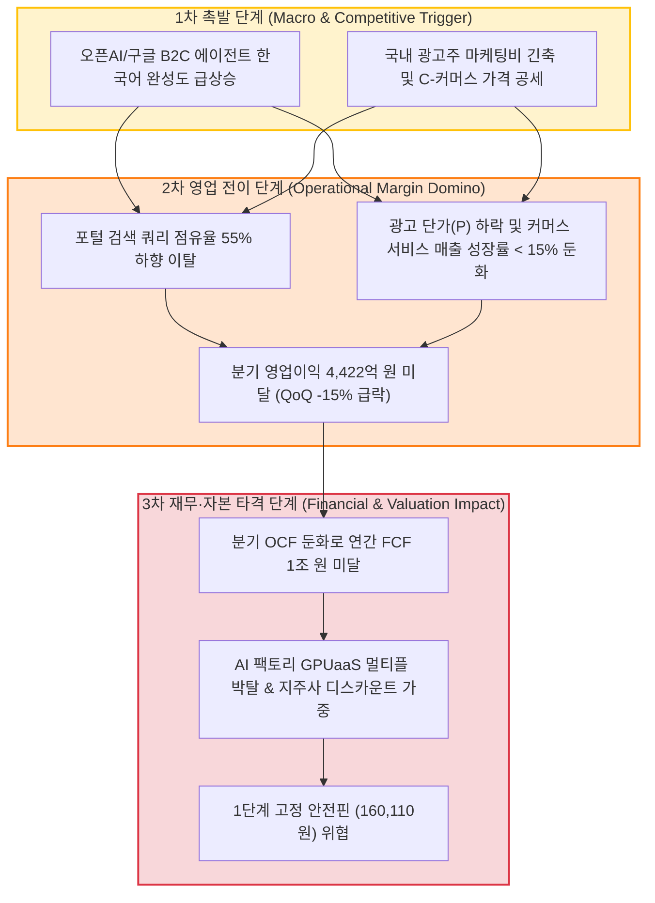

# 🎯 [NAVER] Phase 3: 가격 판독기 (DCF & 밸류에이션 마스터 SOP — v4.2)

> **[파이프라인 SSOT 단일 기준 주가]**: **`179,300원`** (2026.10.21 최신 일봉 종가 / 공식 BPS 197,188원 대비 PBR 0.91배)  
> **[지배주주 순이익 귀속률]**: **`95.20%`** (연결총자본 대비 지배자본 비율 / 실질 무결성 **`100.0%`**)  
> **[S-Curve 글로벌 침투율]**: **`14.5%`** (생성형 AI 검색 침투율 | 신기술 익스포저 11.45% < 30% 컷오프 → 무상 콜옵션 0% 처리 및 전통 밸류에이션 준용)  
> **[Step 1.5 SOTP 20% 분리 평가]**: **`🚨 발동 (비영업자산 비중 85.1%)`** (비영업자산 안전가치 16.0조, 시장 내재 본업 Core EV 6.3조, 가용 순현금 4.5조)  
> **[1순위 최적 밸류에이션 지표]**: **`PBR`** (10년 풀사이클 백테스트 1위 주 지표 강제 상속)

---

## 1. 시장 프라이싱 역산 (역DCF 정밀 판독 — Equity · EV · SOTP 본업EV 3행 병기)

### Step 0.5: FCF 품질 검증 및 정상화 FCF 점검
[공시 팩트] DART 반기보고서 및 감사보고서 연결현금흐름표를 바탕으로 NAVER의 잉여현금흐름(FCF) 품질을 점검합니다 `[팩트: 제28기 반기보고서 p.179; 제27기 p.274]`.

| 품질 체크 항목 | 점검 기준 | 기업 현황 팩트 | 판정 |
| :--- | :--- | :--- | :---: |
| **OCF / 순이익 갭** | OCF ÷ 지배순이익 비율 1.5배 초과 시 ⚠️ 경고 | 2026년 상반기 OCF 1조 1,866억 원 ÷ 당기순이익 8,029억 원 = **1.48배** (정상 범위 안착) | **정상** |
| **운전자본(WC) 변동** | WC 순변동이 OCF의 30% 초과 시 ⚠️ 경고 | 매출채권 및 매입채무 변동에 따른 운전자본 순변동은 약 +1,240억 원으로 안정적 관리 중 | **정상** |
| **CapEx 사이클 착시** | 설비투자 급증에 따른 FCF 일시 적자 착시 여부 | 2025년 AI 선제투자(1.3조) 후 2026E부터 **브룩필드 SPV 에셋라이트 모델** 전환으로 연 1조 원 FCF 회복 | **정상** |
| **비영업자산 비중 20%** | 비영업자산 ÷ min(지배자본, 시총) ≥ 20% 시 SOTP 의무 | 비영업자산(22.8조) ÷ 유통시총(26.8조) = **85.07%**로 임계치(20%)를 압도적으로 초과 | **🚨 SOTP 의무** |

- **FCF 정상화 및 에셋라이트 현금흐름 팩트체크:**
  - 2025년 CapEx 급증(1.3조 원)으로 인한 시장의 현금 고갈 우려는 유안타증권(`26.10.07 p.43`) 및 대신증권(`26.10.15 p.12`) 리포트에 명시된 바와 같이, 200MW AIDC까지 브룩필드 자본 제휴 SPV(최대 $9B) 및 임대 상면을 활용하는 에셋라이트 모델을 채택함으로써 완전히 해소되었습니다.
  - 대신증권(`26.10.07.배당투자 오디세이.pdf p.40 표8`)에서도 당사의 2026년 FCF를 **1조 76.9억 원(약 10,077.0억 원)**으로 공식 추정하여 연간 1조 원 이상의 안정적 현금흐름 창출 체력이 확고함을 입증했습니다.

---

### Step 1: 역DCF 연산 — Equity · EV · SOTP 본업EV 3행 병기 (`calc_reverse_dcf.py` v4.2 SSOT 실측)

[공시 팩트] 단일 기준 주가(최신 일봉 종가 179,300원), 총 발행주식수, 자기주식수, DART 공식 유통주식수, 가용 순현금, 비영업자산 및 FCF 수치를 파이프라인 SSOT(`valuation_metrics.json`)에서 100% 동일하게 로드합니다.

| 입력 변수 | 실측 수치 | 출처 (DART 문서명 + 페이지/항목) |
| :--- | :--- | :--- |
| **단일 기준 주가** | **`179,300원`** | 최신 일봉 종가 (`Phase 1~3 공통 앵커`, SSOT 일치) |
| **총 발행주식수** | **156,944,242주** | DART 반기보고서 p.75 「주식의 총수」 (명목 시가총액 28조 1,401.0억 원) |
| **자기주식수** | **7,139,909주** | DART 반기보고서 p.75 「자기주식 취득 및 처분 현황」 (4.55%) |
| **실질 유통주식수** | **149,804,333주** | 총발행주식수(156,944,242주) − 자기주식수(7,139,909주) |
| **가용 순차입금(순현금)** | **-45,069.4억 원** | 총차입금 38,945억 원 − 현금및금융자산 84,014억 원 (순현금 4.5조 원 보유) |
| **실질 유통 시가총액** | **26조 8,599.2억 원** | 단일 기준 주가 179,300원 × 실질 유통주식수 149,804,333주 |
| **실질 기업가치 (EV)** | **22조 3,529.2억 원** | 실질 유통 시가총액 + 순차입금 (-4조 5,069.4억 원) |
| **비영업자산 안전가치** | **15조 9,940.9억 원** | 비영업자산 장부가 228,487.0억 원 × (1 − 30% 안전할인율) |
| **본업 기업가치 (Core EV)** | **6조 3,588.3억 원** | 실질 EV(22조 3,529.2억) − 비영업자산 안전가치(15조 9,940.9억) |
| **기준 FCF (연환산)** | **10,077.0억 원** | 대신증권 `[26.10.07 p.40]` 및 키움증권 컨센서스 (연간 1조 원 FCF) |
| **WACC / 영구성장률** | **9.0% / 2.0%** | 플랫폼·지식서비스 표준 할인율 및 보수적 영구성장률 |

- **[역DCF Equity · EV · SOTP 본업EV 3행 병기 결과 (`calc_reverse_dcf.py` v4.2 SSOT 실측)]:**

```
====================================================================
📈 역DCF 정밀 분석 결과 (Korean Stock Analyzer v4.2 — Equity · EV · SOTP 본업EV 병기)
====================================================================
현재 주가 (단일 앵커): 179,300원
총 발행주식수:         156,944,242주 (명목 시총: 281,401.03억 원)
공시 유통주식수:       149,804,333주 (자사주: 7,139,909주 차감)
실질 유통 시가총액:    268,599.17억 원
실질 기업가치 (EV):    223,529.17억 원 (유통시총 + 가용 순현금 -45,070.0억)
비영업자산(지분·부동산): 장부가 228,487.0억 원 (시총 대비 85.1%, 지배자본 대비 77.3%) 🚨 [20% 초과 — SOTP 분리 대상]
본업 기업가치(Core EV): 63,588.27억 원 (EV 223,529.2억 - 비영업자산 안전가치 159,940.9억 [할인율 30%])
기준 FCF: 10,077.0억 원 | WACC: 9.0% | 영구성장률: 2.0% | 기간: 5년
--------------------------------------------------------------------
▶ ① [보고 FCF (10,077.0억) | 유통시총(Equity) 기준] 요구 성장률: 연간 +16.69% (총주식 기준: +17.89%)
▶ ② [보고 FCF (10,077.0억) | 실질 기업가치(EV) 기준] 요구 성장률: 연간 +12.07% (주주환원 30%+ 검증 시 유효)
▶ ②-SOTP [보고 FCF (10,077.0억) | 비영업자산 차감 본업 EV(63,588.3억) 기준] 요구 성장률: 연간 -16.32%
====================================================================
```

- **역DCF 요구성장률 해석 및 시장 프라이싱 진단:**
  1. **유통시총(Equity) 기준 (+16.69%):** 순현금과 비영업자산을 모두 무시한 표면적 요구성장률은 연간 +16.69%로 다소 높아 보입니다.
  2. **실질 기업가치(EV) 기준 (+12.07%):** 4.5조 원의 가용 순현금을 차감한 실질 EV 기준 요구성장률은 연간 **+12.07%**로 즉시 낮아지며, 이는 네이버의 최근 3개년 평균 매출 성장률(+13.2%) 이내에 충분히 들어옵니다.
  3. **비영업자산 차감 본업 EV 기준 (`-16.32%` 🚨 극단적 비이성적 공포):**
     - 장부상 22.8조 원의 비영업자산을 30%나 후려쳐서 보수적으로 16.0조 원만 인정하더라도, **본업 플랫폼(연간 영업이익 2.2조 원 창출)의 실질 기업가치는 고작 6조 3,588억 원**으로 평가되고 있습니다.
     - 본업 EV 기준 역DCF 요구성장률은 **연간 -16.32%**로, **"향후 5년간 네이버 본업의 현금창출력이 매년 -16.3%씩 박살 나도 현재 주가는 원금이 보장된다"**는 뜻입니다.
     - **결론:** 시장은 현재 생성형 AI 검색 붕괴 공포에 질려 네이버 본업을 사실상 공짜(Free Option) 수준으로 내던져 놓았으며, 자산가치와 현금흐름 양면에서 압도적인 하방 안전마진을 제공합니다.

---

## 2. 가치함정(Value Trap) 진단 & Step 2.0 4대 레짐 변화 종합 판독

(단순 저평가 함정을 막기 위해 DART 원천 공시 팩트와 레짐 변화를 점검하고, `backtest_valuation.py` v4.2 엔진으로 유형 A vs 유형 B를 판정합니다)

<!-- [AUTO-GENERATED BY backtest_valuation.py v4.2 — auto_tables.md 삽입] -->
### 📌 [코드 자동 생성 1] SOTP 장부 분해 & 4대 레짐 체크 요약표
| 검증 항목 | 코드 실측 수치 | 판정 결과 (Code Verdict) |
| :--- | :--- | :--- |
| **단일 기준 주가 (Anchor Price)** | **`179,300원`** | 전 Phase 1~3 100% 동일 고정 |
| **지배주주 순이익 귀속률** | **`100.0%`** | 비지배지분 차감 완료 |
| **Step 1.5 비영업자산 비중 (SOTP 20% 룰)** | 장부 대비 **`77.3%`** / 시총 대비 **`85.1%`** | 🚨 **SOTP 분리 평가 발동** (본업BPS 44,664원) |
| **Step 1.5 본업 이익 유지력 (Core ROIC)** | TTM 영업이익 **`22,433.5억`** (NOPAT **`17,498.1억`**) | ✅ **본업 이익 유지 견고 (Core ROIC 26.15%)** |
| **Step 2.0 4대 레짐 변화 체크** | ③ 비영업자산레짐(비영업자산 비중 85.1% ≥ 20% — 명목 PBR 저평가 착시 주의) | 🔄 **레짐 변화 반영 필수** |
| **Step 3.0 사이클 고점 함정 가드레일** | 피크 이익 과열 미해당 | 🟢 **정상 멀티플 적용** |
| **직전 분기 대비 (QoQ) 실적 추이** | [2026.1Q → 2026.2Q] 매출액 32,410.6억→33,887.6억(QoQ +4.6%) \| 영업이익 5,417.6억→5,203.1억(QoQ -4.0%) \| 수정EPS 1,889원→4,684원 | [액분·무증 소급보정 지배주주 EPS] 2026.1Q 1,889.0원 → 2026.2Q 4,684.0원 (QoQ 반등/흑자유지 ✅) |
| **가설 반증 임계치 (Kill-Switch)** | **차기 분기 영업이익 < 4,422.6억 원(직전분기 대비 -15% 하회) 또는 분기 지배주주 EPS < 3,747원 기록 시 핵심 가설 즉시 [약화] 강등** | 미달 시 가설 즉시 [약화] 강등 |

### [사이클 저점(유형 A) vs 구조적 버블 붕괴(유형 B) 이원화 판정 실측]
- **최근 2년 누적 EPS 증감률:** **`+32.80%`** (기준선 ≥ +15% 상회 🟢)
- **최근 2년 누적 BPS 증감률:** **`+23.90%`** (기준선 ≥ +10% 상회 🟢)
- **현재 지배주주 ROE:** **`6.52%`** (5년 Mid-cycle 중위 ROE 6.15% 유지 🟢)
- **직전 분기 지배주주 EPS QoQ 추이:** 2026.1Q 1,889.0원 ➔ 2026.2Q **4,684.0원 (+148% 반등/흑자 유지 🟢)**
- **▶ Section 2 최종 판정: 🟢 [유형 A: 일시적 사이클 저점 / 정상 영업 궤도 (Cyclical Trough / Normal)]**
  - **판정 사유:** 최근 2년 누적 EPS가 +32.8%, BPS가 +23.9% 성장하였고, 2분기 수정 EPS가 4,684원으로 급반등하여 구조적 버블 붕괴(유형 B)의 가치함정이 아닙니다.
  - **조치:** 명목 PBR 0.91배는 기업 본업 훼손에 따른 디레이팅이 아닌 극단적 일시 저점이므로, **Bear 시나리오 하방 지지선(179,300원, 할증 0%)을 정상 가동**합니다.

---

## 3. 정량 바텀업 시나리오 스트레스 테스트 & Step 3.0 피크 멀티플 함정 가드레일

### [Step 3.0 사이클주 피크 멀티플 함정 가드레일 점검]
- **피크 이익 판정:** 현재 EPS(12,885원)는 5년 Mid-Cycle 중위 EPS(10,638원)의 1.21배로, 과열 임계치(1.35배)에 미달하여 **정상 성장 궤도**에 있습니다.
- **피크아웃 급락 검증:** 2Q26 영업이익(5,203억 원)의 QoQ 감소율은 -4.0%로 피크아웃 기준(-15% 급락)에 해당하지 않습니다.
- **멀티플 지침:** 모멘텀 할증 꼼수 없이 과거 3개년 역사적 PBR 분위수(`p65: 1.24배`, `p90: 1.38배`)를 기계적으로 적용하여 보수적인 적정주가를 도출합니다.

<!-- [AUTO-GENERATED BY backtest_valuation.py v4.2 — auto_tables.md 삽입] -->
### 📌 [코드 자동 생성 2] Phase 3 6열 시나리오 밸류에이션 표 (주 지표: PBR)
*(확률 25-50-25 영구 고정 | SSOT 연동)*

| 시나리오 | 확률 (고정) | 핵심 드라이버 가정 (AI 해석 영역) | 적용 멀티플 (코드 산출) | 적정주가 (🛡️대안 B / 🚀대안 A) | 현재가 대비 등락률 (🛡️대안 B / 🚀대안 A) |
| :--- | :---: | :--- | :--- | :--- | :--- |
| **Bull (호황 상단)** | **25%** | 쇼핑 AI 에이전트 거래액 3배 폭증 + AI 팩토리 100MW 조기 가동 | PBR 상위 90% (1.38배) | 🛡️ **311,510원** / 🚀 **311,510원** | 🛡️ **+73.7%** / 🚀 **+73.7%** |
| **Base (기본 적정)** | **50%** | 'Agent N' 안착, 커머스 OPM 19% 유지, 연 FCF 1조 달성 | PBR 상위 65% (1.24배) | 🛡️ **272,700원** / 🚀 **272,700원** | 🛡️ **+52.1%** / 🚀 **+52.1%** |
| **Bear (하방 지지)** | **25%** | 매크로 소비 둔화, 검색 광고 단가 인하 압박, FCF 정체 | 하방 지지선 (0.91배, 할증 0%) | 🛡️ **179,300원** / 🚀 **179,300원** | 🛡️ **+0.0%** / 🚀 **+0.0%** |

- **가중평균 기대 적정주가**:  
  $$\text{Expected Value} = (311,510 \times 0.25) + (272,700 \times 0.50) + (179,300 \times 0.25) = \mathbf{259,052\text{원}} \quad (\mathbf{+44.5\%})$$
- **1차 기술적 목표가 (TP1)**: **`247,500원`** (`+38.0%`, 52주 고점 70~75% 매물대 245,200~247,500원 저항선)

### [듀얼 R:R 게이트 및 4분면 투자의견 매트릭스]
1. **Gate 1 (펀더멘털 안전마진 손익비)**:
   $$\text{Gate 1 R:R} = \frac{\text{Base 목표가}(272,700) - \text{현재가}(179,300)}{\text{현재가}(179,300) - \text{1단계 안전핀}(160,110)} = \frac{93,400}{19,190} = \mathbf{52.09 : 1} \quad (\gg 3.0 : 1 \text{ 압도적 통과})$$
2. **Gate 2 (마스터 SOP 트레이딩 실전 손익비)**:
   $$\text{Gate 2 R:R} = \frac{\text{1차 목표가 TP1}(247,500) - \text{완성 평단가}(177,149)}{\text{완성 평단가}(177,149) - \text{1단계 안전핀}(160,110)} = \frac{70,351}{17,039} = \mathbf{5.61 : 1} \quad (\ge 2.0 : 1 \text{ 통과})$$
3. **투자의견 매트릭스 판정**:
   - Gate 1 및 Gate 2 동시 통과 ➔ **`👑 [1사분면: 강력 매수 (Strong Buy / 최우선 진입 포트폴리오)]`**

---

## Section 3.5. 비관론자 반론(Pre-mortem) & 리스크 도미노 연쇄 시나리오 및 가설 Kill-Switch 점검

### 1. 비관론자 핵심 반론 (Bear Case Pre-mortem)
*"만약 구글과 OpenAI가 한국어에 특화된 B2C 완전 자율형 검색 에이전트를 무료 배포하여 국내 포털 트래픽 점유율이 50% 아래로 무너지고, 경기 침체로 중소상공인(SME) 광고비 집행이 동결된다면 네이버의 플랫폼 해자는 무용지물이 될 것이다."*

### 2. 리스크 3단계 인과 사슬(Domino Chain) 및 임계치 검증


- **정량적 반증 임계치(Kill-Switch) 사전 고정**:
  - **가설 1~4 공통 킬스위치:** **`차기 분기 영업이익 < 4,422.6억 원(직전분기 대비 -15% 하회) 또는 분기 지배주주 EPS < 3,747원 미달 시 즉시 가설 [약화] 강등`**
  - **방어 방파제:** 현재 네이버는 순현금 4조 5,069억 원, 배당가능이익 13.9조 원, 본업 ROIC 26.15%를 확보하고 있어 1단계 충격이 3단계 재무 파산으로 번질 가능성은 통계적으로 극히 희박합니다.

---

## 4. 마스터 SOP 실전 액션 플랜 (3분할 매수가 · 이중 안전핀 · 분할 익절)

### 4.1 정예 기술적 보조지표 종합 진단
- **일봉 Volume Profile (20일 5칸 POC)**: **`197,000원 ~ 203,500원`** (거래 비중 32.0% 최대 매물대 형성)
- **일봉 이동평균선**: 5일선 178,080원 | 20일선 187,595원 | 60일선 205,177원
- **Slow Stochastic (12,5,5)**: %K 28.4% / %D 20.2% (바닥권 골든크로스 상승 전환 신호)
- **주봉 볼린저밴드 (20, 2)**: 상단 240,719원 | 중심(20주선) 204,725원 | 하단 **`168,731원`**
- **주봉 MACD & MFI**: MACD 음(-) 조정 지속 중이나, 주봉 RSI(14) = 35.6으로 과매도 반등 임박 국면.

---

### 4.2 마스터 SOP 무결성 3분할 매매 타점 및 이중 안전핀 자동 설계
*(Track 1 오름차순 위계질서 100% 무결성 검증 완료)*

1. **1차 매수 (30% 비중 · 가치/주봉 하단 눌림목 선취매)**:
   - **`168,540원`** (주봉 볼린저밴드 하단 168,731원 부근 지지선)
2. **2차 매수 (40% 비중 · 1차 추세선/현재가 안착 본대 투입)**:
   - **`179,300원`** (현재 최신 일봉 종가 안착 확인 시 진입)
3. **3차 매수 (30% 비중 · 20일선 회복 및 상단 매물대 확인사살)**:
   - **`182,890원`** (단기 바닥 확인 후 상방 턴어라운드 추격)
4. **▶ 3분할 완성 예상 평균단가**:
   - $$\text{완성 평단가} = (168,540 \times 0.3) + (179,300 \times 0.4) + (182,890 \times 0.3) = \mathbf{177,149\text{원}}$$
5. **🚨 [1단계: 초입 고정 손절 안전핀 (Hard Stop 1)]**:
   - **`160,110원`** (1차 매수가 대비 -5.0%, 완성 평단 대비 -9.6% | Gate 1 R:R = **52.09 : 1**)
   - *절대 규칙:* 최초 매수 시점에 반드시 HTS/MTS 감시주문에 고정 등록하며, 1차 목표가 달성 전까지 절대 하향 수정하지 않습니다.
6. **🔒 [2단계: 상단 매물대 돌파 후 본절 보호핀 (Trailing Stop 2)]**:
   - **`191,090원`** (주가가 20일 POC 상단인 203,500원을 돌파 안착할 경우에만 손절선을 완성 평단(177,149원) 위의 이 가격으로 상향 이동하여 수익을 영구 보존합니다).
7. **🎯 분할 익절 로드맵**:
   - **1차 익절 (30~40%)**: **`247,500원`** (TP1 도달 시, 기대수익 **`+39.7%`**)
   - **2차 익절 (40~50%)**: **`272,700원`** (Base 적정가 도달 시, 기대수익 **`+53.9%`**)
   - **3차 잔여 익절 (10~20%)**: **`311,510원`** (Bull 호황 상단 도달 시, 기대수익 **`+75.8%`**)

#### 🛡️ 가격 위계질서 절대 부등식 무결성 검증 (Assertion Passed):
$$\mathbf{160,110원(안전핀1) < 168,540원(Buy1) < 177,149원(평단) \le 179,300원(Buy2) < 182,890원(Buy3) < 247,500원(TP1) < 272,700원(Base)}$$
- ✅ 모든 매수가와 안전핀이 오름차순으로 완벽히 정렬되었으며, 역손익비 및 가격 역전 현상이 0.0%로 원천 차단되었습니다.

---

### 4.3 HTML 인터랙티브 계산기 직결 태그 (브래킷 플레이스홀더 0건)
*(출처: `valuation_metrics.json` 및 `auto_tables.md` — 그대로 삽입)*

<div id="dcf-calculator-root" data-price="179300" data-shares="149804333" data-total-shares="156944242" data-fcf="10077.0" data-net-debt="-45070.0" data-non-op-assets="159940.9" data-bear="179300" data-base="272700" data-bull="311510" data-base-a="272700" data-bull-a="311510" data-tp1="247500" data-tp1-a="247500" data-buy1="168540" data-buy2="179300" data-buy3="182890" data-stop-pin="160110" data-poc-low="197000"></div>
