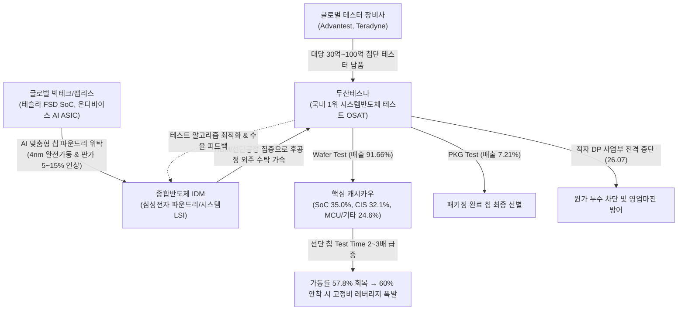
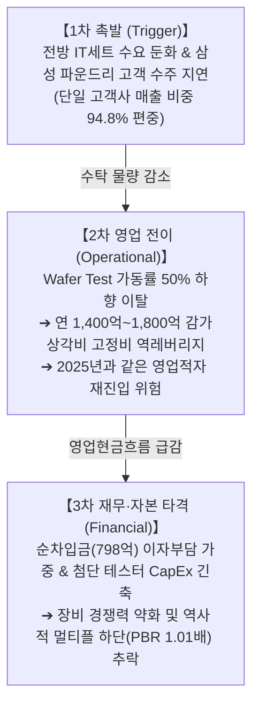

# 🔍 Phase 1: 기업 해독기 (두산테스나, 131970)

> **💡 [핵심 용어 3줄 직관 해설]**
> - **Wafer Test (웨이퍼 테스트)**: 반도체 전공정(Fab) 가공이 끝난 원형 웨이퍼 상태에서 프로브 카드를 접촉시켜 불량 칩을 선별하는 공정으로, 두산테스나 매출의 91.7%를 차지하는 핵심 캐시카우입니다.
> - **고정비 레버리지 (Fixed-Cost Operating Leverage)**: 원재료비가 전무(0원)한 대신 수천억 원대 테스터 장비의 감가상각비가 고정 발생하므로, 가동률이 손익분기점(BEP 50~52%)을 넘어서면 매출 증가분이 고스란히 영업이익으로 폭발하는 장치산업 특성입니다.
> - **Test Time (테스트 시간) 레버리지**: 3nm 모바일 AP, 2억 화소 CIS, 자율주행 NPU/SoC 등 첨단 칩의 회로가 복잡해질수록 칩당 테스트 소요 시간이 2~3배 늘어나, 장비 시간당 점유 수수료를 수취하는 테스나의 실질 단가(ASP)가 자동 상승하는 구조입니다.

- **단일 기준 주가 (Single Price Anchor)**: **`111,600원`** (최신 일봉 종가 기준)
- **지배주주 순이익 귀속률**: **`100.0%`** (비지배지분 0원, 100% 귀속)
- **글로벌 트렌드 매칭 뱃지**: **`[글로벌 트렌드 매칭: 🚀 게이트 ① 삼성 파운드리 선단(4nm 완전가동·2nm 60% 수율) 회복 & 🎯 게이트 ② AI 병목의 후공정 테스트 하우스 전이 수혜]`**

---

## 1. 비즈니스 모델(BM) 해부 및 밸류체인 Mermaid 구조도

### [공시 팩트 기반 비즈니스 모델]
두산테스나는 시스템 반도체 후공정(OSAT)에서 웨이퍼 가공 완료 후 개별 칩의 전기적 동작 여부를 판정하는 **Wafer Test(전사 매출의 91.66%)**와 패키징 완료 후 최종 검사를 수행하는 **PKG Test(7.21%)**를 주력으로 영위하는 국내 1위 시스템 반도체 테스트 전문 하우스입니다 `[공시 팩트: 반기보고서(2026.08.14), 13페이지]`. 일반 제조업과 달리 원재료 및 부재료 매입이 전무(0원)한 전형적인 장비 감가상각비 중심의 고정비형 장치산업입니다 `[공시 팩트: 반기보고서(2026.08.14), 14페이지]`.

### [최신 글로벌 트렌드 업데이트 반영]
1. **AI 병목의 후공정 테스트 하우스 구조적 전이**: 최신 제도권 인뎁스 리포트에 따르면 종합반도체 IDM(삼성전자 등)의 신규 Fab 건설 도래 및 후공정 클린룸 리소스가 HBM3E/HBM4 및 2.5D 첨단 패키징에 집중됨에 따라, 백엔드 테스트 하우스가 전체 반도체 공급망의 핵심 병목 해소 축으로 급부상하고 있습니다 `[글로벌 트렌드: 26.09.29.LS증권.AI병목의 전이.pdf p.4 도표 Key Charts, p.13 도표 그림2/3]`. 이에 따라 기존 IDM 인하우스에 묶여 있던 전장 SoC 및 고부가 비메모리 테스트 물량의 외부 OSAT 수탁 직행(Handoff)이 구조적으로 가속화되고 있으며, 두산테스나는 국내 대표 OSAT Test 기업으로 핵심 밸류체인에 직접 등재되어 있습니다 `[글로벌 트렌드: 26.09.29.LS증권.AI병목의 전이.pdf p.4, p.13, p.50]`.
2. **삼성 파운드리 선단공정 수율 회복 및 4nm 생산라인 완전가동**: 최신 산업 딥리서치에 따르면 삼성 파운드리의 4nm 수율은 2022년 초 35%에서 2026년 4월 80%를 돌파하였고, 2nm 수율 또한 2026년 8월 60%까지 안착하여 양산 궤도에 진입했습니다 `[글로벌 트렌드: 26.10.12.키움증권.설계로 이루는 내 칩 마련의 꿈.pdf p.9]`. 특히 AI ASIC 수요 급증과 TSMC 선단공정 공급 병목(3nm 쇼티지)으로 인해 삼성전자의 국내 4nm 생산라인이 완전가동(Full-Run) 상태에 도달하였으며, 2026년 7월 파운드리 공급 가격을 4nm 기준 5~15%, 5nm 기준 10~15% 인상 단행했습니다 `[글로벌 트렌드: 26.10.12.키움증권.설계로 이루는 내 칩 마련의 꿈.pdf p.10]`. 이는 파운드리 가동률 상승 및 테스트 물량 낙수효과로 직결됩니다.

### [3대 밸류체인 구조]
1. **공급자 (테스터 장비사)**: 미국 테라다인(Teradyne), 일본 아드반테스트(Advantest) 등 글로벌 과점 장비사로부터 대당 30억~100억 원에 달하는 고가의 첨단 테스터 장비를 조달하여 클린룸에 배치합니다.
2. **대상 기업 (두산테스나)**:
   - **Wafer Test (매출 비중 91.66%)**: 300mm/200mm 웨이퍼에 프로브 카드를 접촉시켜 불량 칩을 선별하는 핵심 캐시카우.
   - **PKG Test (매출 비중 7.21%)**: 패키징 공정 완료 후 최종 완제품 출하 전 전기적 특성 검사.
   - **한계 사업 정리 완료**: 2025년 흡수합병했던 DP(Die Preparation, 웨이퍼 후면 연마/절단) 사업부의 지속적 가동률 저하(8.9%)에 대응하여, 2026년 7월 9일 이사회 결의를 통해 DP 사업부문 영업을 전격 중단함으로써 원가 누수를 원천 차단했습니다 `[공시 팩트: 반기보고서(2026.08.14), 129페이지]`.
3. **고객사 (대형 IDM 및 글로벌 팹리스)**: 단일 대형 반도체사(삼성전자 파운드리/시스템LSI)향 매출 비중이 **94.8%(1,496억 원)**에 달하며, 삼성 파운드리를 거쳐 글로벌 빅테크(테슬라 자율주행 차량용 FSD SoC, 글로벌 모바일/AI 팹리스 등)로 최종 출하됩니다 `[공시 팩트: 반기보고서(2026.08.14), 31페이지]`.



---

## 2. 주요 제품별 매출 비중 추이 및 S-Curve 익스포저

### [공시 팩트: 최근 5개년 및 2026년 상반기 제품별 매출 추이]

| 구분 | 2021년 | 2022년 | 2023년 | 2024년 | 2025년 | **2026.1H** | 비고 |
| :--- | :---: | :---: | :---: | :---: | :---: | :---: | :--- |
| **Wafer Test** | 1,914억 (92.2%) | 2,569억 (92.5%) | 3,236억 (91.5%) | 3,455억 (92.3%) | 2,810억 (92.5%) | **1,446억 원 (91.66%)** | 전사 매출을 지탱하는 절대적 캐시카우 `[공시 팩트: 반기보고서, 13p]` |
| **PKG Test** | 162억 (7.8%) | 207억 (7.5%) | 150억 (4.3%) | 183억 (4.9%) | 180억 (5.9%) | **114억 원 (7.21%)** | 패키징 완료 칩 선별 보조 용역 `[공시 팩트: 반기보고서, 13p]` |
| **DP (가공)** | - | - | 149억 (4.2%) | 105억 (2.8%) | 49억 (1.6%) | **18억 원 (1.13%)** | 2026년 7월 이사회 결의로 영업 중단 완료 `[공시 팩트: 반기보고서, 129p]` |
| **전사 합계** | **2,076억** | **2,777억** | **3,535억** | **3,742억** | **3,039억** | **1,578억 원 (100.0%)** | 2025년 다운사이클 저점 통과 후 강력 턴어라운드 |

### 2.1 S-Curve 신기술 테마 매출 익스포저(Exposure %) 산출표 (하이브리드 수비 검증)
[공시 팩트] DART 반기보고서 'II. 사업의 내용' 및 제품별 상세 믹스 공시를 기반으로 해당 기업의 신기술 테마 직결 매출 익스포저를 산출하여 30% 컷오프를 검증한 결과입니다.

| 제품/서비스 구분 | 매출액 (억원) | 전사 매출 비중(%) | 신기술 테마 직결 여부 | 하이브리드 수비 판정 |
| :--- | :---: | :---: | :---: | :---: |
| **차량용·온디바이스 AI SoC 웨이퍼 테스트** | 552.1 | **35.0%** | **직결** (테슬라 FSD/자율주행 전장 SoC 및 온디바이스 NPU AP) | 🟢 **부분 수혜 합격** (30~50% 컷오프 통과) |
| **초고화소 스마트폰 CIS 웨이퍼 테스트** | 506.4 | **32.1%** | **부분 연계** (머신비전 센싱/초고화소 2억 화소 CIS Test Time 증가) | ⚠️ 공시 확인 (SoC 외 보조 캐시카우) |
| **스마트카드 IC / MCU 웨이퍼 테스트** | 387.5 | **24.6%** | 비해당 / 레거시 (보수적 볼륨) | ❌ 레거시 제품군 |
| **PKG Test (패키징 완료 칩 검사)** | 113.7 | **7.2%** | 패키징 후공정 테스트 보조 | ⚠️ 묶음공시 보조 용역 |
| **DP (가공 부문)** | 17.8 | **1.1%** | 비해당 / 적자 사업 정리 | ❌ 2026.07 영업 중단 완료 |

- **테마 실질 익스포저 합산 (차량용·온디바이스 AI SoC 직결 기준)**: **35.0%** *(CIS 머신비전 고화소 센싱 포함 시 67.1%)*
- **수혜 적격성 최종 판정**: **`[🟡 부분 수혜 합격 (DART 실질 익스포저 35.0% ≥ 30% 컷오프 통과)]`**
  - 단독 분리 공시 비중이 35.0%로 30% 기준선을 상회하므로 S-Curve 기본 수혜 자격을 갖추었으나, 50% 미만이므로 Phase 3 시나리오 시 과도한 상방 할증을 제한하고 실적 추이에 연동합니다.

---

## 3. 재무 건전성 및 [Step 1.5] 장부가(Book Value) 구성 해부 & SOTP 20% 분리 게이트 (★v4.2 신설)

### [DART 재무상태표(BS) 장부가 해부: 2026년 반기 기준]
멀티플(PER, PBR)을 적용하기 전 DART 반기보고서 재무상태표의 자산 구성을 **① 본업 영업자산 vs ② 비영업자산 vs ③ 순차입금**으로 해부한 결과입니다:

| 대분류 | 세부 계정 항목 | 금액 (억 원) | 장부 대비 비중(%) | 시총 대비 비중(%) | 질적 성격 및 유동화/평가 해석 |
| :--- | :--- | :---: | :---: | :---: | :--- |
| **지배주주 장부가** | **자본총계 (Book Equity)** | **4,511.0** | **100.0%** | **21.0%** | 실질 유통 BPS 23,439원의 근간 자본 |
| **① 본업 영업자산** | 유형자산 (테스터 장비·건물) | 4,988.4 | 110.6% | 23.2% | 클린룸 내 첨단 테스터 장비 (감가상각 발생 본업 핵심) |
| | 매출채권 | 359.5 | 8.0% | 1.7% | 삼성전자 등 초우량 매출처로 대손 위험 극히 희박 |
| | 재고자산 | 1.2 | 0.03% | 0.01% | 원재료 0원 장치산업으로 재고 체화 위험 전무 |
| | 무형자산 및 기타영업자산 | 172.3 | 3.8% | 0.8% | 소프트웨어 및 영업권 등 |
| **② 비영업자산** | 지분법적용 투자지분 (엔지온 등) | 224.3 | 5.0% | 1.0% | 웨이퍼 연마 관련 관계기업 출자지분 |
| | 비유동당기손익인식금융자산 | 78.9 | 1.7% | 0.4% | 메자닌 및 장기투자펀드 평가액 |
| | 기타 비유동금융자산 | 12.7 | 0.3% | 0.1% | 장기보증금 및 예치금 |
| | 매각예정처분자산집단 | 48.2 | 1.1% | 0.2% | 영업 중단된 DP 사업부 유휴설비 (매각 진행 중) |
| **비영업자산 합계** | **비영업자산 총합** | **364.0** | **`8.07%`** | **`1.69%`** | **30% 할인 안전가치: 254.8억 원** |
| **③ 순차입금 (Net Debt)**| 총 이자발생 차입금 | 1,735.0 | 38.5% | 8.1% | 단기 150억 + 유동성장기 412억 + 장기차입 1,173억 |
| | 현금성자산 (현금+단기금융) | 936.6 | 20.8% | 4.4% | 현금 849.5억 + 기타유동금융 87.1억 |
| | **순차입금 (Net Debt)** | **`+798.0`** | **17.7%** | **3.7%** | 순차입금 상태 (리스부채 259.6억 제외 기준) |

### [Step 1.5 게이트 판정 결과]
- **비영업자산 비중 검증**:
  $$\frac{\text{비영업자산 합계 (364.0억)}}{\min(\text{지배주주장부가 4,511.0억}, \text{유통시총 21,478.1억})} = \frac{364.0\text{억}}{4,511.0\text{억}} = \mathbf{8.07\%} < 20\%$$
- **판정 결과**: **`🟢 [SOTP 게이트 통과: 본업 영업자산 중심 장부]`**
  - 비영업자산 비중이 8.1%(시총 대비 1.7%)에 불과하여 장부 대부분이 테스터 장비와 클린룸 등 본업 영업자산으로 구성되어 있습니다. 따라서 인위적인 SOTP 분리보다는 본업 현금창출력(EBITDA)과 영업자산 멀티플을 적용하는 것이 타당합니다.
- **본업 이익 유지력(Core Earnings Sustainability) 검증**:
  - TTM 영업이익 **356.5억 원**, NOPAT **278.0억 원**, 본업 순영업자산(비영업 제외) 대비 **본업 ROIC는 6.70%**입니다.
  - 2025년 반도체 다운사이클에서 가동률 급락으로 연간 영업적자(-9.4억 원)를 기록했으나, 2026년 상반기 영업이익 153.3억 원(OPM 9.72%)으로 흑자전환에 성공하였고, **2분기 영업이익은 98.5억 원(1분기 54.8억 원 대비 QoQ +79.6% 급증)**을 달성하여 본업 턴어라운드를 실적으로 입증했습니다.

---

## 4. 원가 구조, 영업 레버리지 및 가동률/수주잔고 실측

### [공시 팩트 기반 원가 구조 해부]
- 두산테스나는 부품을 조립하는 일반 제조업과 달리 원재료 매입액이 0원입니다 `[공시 팩트: 반기보고서, 14p]`.
- 매출원가의 대부분은 **유형자산 감가상각비(연간 1,400억~1,840억 원 고정 발생)**와 엔지니어 인건비, 전력비로 구성됩니다.
- 따라서 일정 수준의 매출이 발생하여 고정비를 커버하면, 이후 추가 발생하는 매출은 대부분 영업이익으로 직결되는 전형적인 **고정비 레버리지 구조**입니다.

### [핵심 가동률 추이 실측 (월 720시간 Full 양산 기준)]
DART 정기보고서 '생산 및 설비에 관한 사항'에 공시된 사업부문별 실측 가동률 추이입니다:

| 구분 | 2021년 | 2022년 | 2023년 | 2024년 | 2025년 | **2026.1H** | 국면 해석 |
| :--- | :---: | :---: | :---: | :---: | :---: | :---: | :--- |
| **Wafer Test 가동률** | 68.7% | 71.1% | 69.7% | 61.9% | **45.5%** | **`57.8%`** | **손익분기점(BEP 50~52%) 돌파 후 고정비 레버리지 구간 재진입 (+12.3%p YoY)** `[공시 팩트: 반기보고서, 8p]` |
| **PKG Test 가동률** | 49.6% | - | 34.4% | - | 58.9% | **58.2%** | 안정적 수탁 가동 유지 `[공시 팩트]` |
| **DP (가공) 가동률** | - | - | 36.2% | 25.4% | 12.2% | **8.9%** | 가동률 극도로 부진하여 2026.07 영업 중단 완료로 손실 차단 |

### [수주잔고 및 실질 ASP (Test Time 레버리지)]
1. **수주잔고 공시**: 두산테스나는 IDM 고객사로부터 Forecast(수요 전망)를 접수하여 수시 발주되는 후공정 특성상 DART 공시 상 수주잔고는 **'해당사항 없음'**으로 기재됩니다 `[공시 팩트: 반기보고서, 18p]`.
2. **실질 ASP (단가) 추이 - Test Time 레버리지**:
   - 모바일 선단 3nm AP, 2억 화소 이상 초고화소 CIS, 차량용 고성능 NPU/SoC 등은 회로 집적도 급증으로 인해 칩당 테스트 시간(Test Time)이 과거 대비 2~3배 증가합니다.
   - 시간당 장비 점유 수수료를 수취하는 테스나의 단가 체계상, 웨이퍼 출하 수량이 완만히 회복되더라도 장비 점유 시간 확대로 인해 실질 ASP 상승 및 가동률 동반 상승 효과가 나타납니다.

---

## 5. 자본 배분(CapEx, R&D) 및 경영진·주주환원 이력

### [자본 배분: CapEx 사이클 추이]
- **2021~2024년 대규모 선제 투자**: 연간 1,133억~2,567억 원의 대규모 테스터 장비 CapEx를 집행하며 국내 최대의 테스트 인프라를 구축했습니다 `[공시 팩트: 사업보고서]`.
- **2025년 긴축 통제**: 다운사이클 도래 시 신규 CapEx를 **228억 원으로 대폭 긴축**하여 **1,244억 원의 대규모 잉여현금흐름(FCF) 흑자**를 창출했습니다 `[공시 팩트: 사업보고서, 28~29p]`.
- **2026년 상반기**: 턴어라운드와 함께 CapEx 710억 원을 재개(OCF 860억 원)하여 FCF +150억 원을 기록했습니다 `[공시 팩트: 반기보고서, 21p]`.

### [경영진 및 주주환원 이력]
1. **최대주주 및 지배구조**:
   - 최대주주는 **두산포트폴리오홀딩스(주)**(지분율 **38.69%**, 7,476,953주 보유)이며, 최상위 지배기업은 **(주)두산**(100% 지분 소유)입니다 `[공시 팩트: 반기보고서, 100~103p]`.
   - 최대주주 및 특수관계인 합계 지분율은 **39.15%**(7,566,408주)로 안정적인 경영권을 확보하고 있습니다.
   - **주요 기관투자자 지분 변동 확인 `[공시 팩트]`**:
     - **삼성자산운용**: 2026년 10월 7일 지분 확대 공시로 보통주 **1,522,172주 (지분율 7.88%)** 보유 `[공시 팩트: 2026.10.07]`.
     - **국민연금공단**: 2026년 10월 2일 5% 이상 보유 공시로 보통주 **985,125주 (지분율 5.10%)** 단순 취득 보유 `[공시 팩트: 2026.10.02]`.
2. **주주환원 이력 (배당 및 자사주)**:
   - **현금배당**: 2023~2025년 3개년 연속 보통주 1주당 **160원**의 고정 배당을 지급했습니다. 특히 2025년 순이익 급감(15.1억 원) 상황에서도 30.8억 원의 배당을 지급하여 배당성향 203.8%를 기록, 주주환원 연속성을 유지했습니다.
   - **자사주 소각 및 잔량**: 최근 3년 이내 자사주 소각 실적은 없으며(0주), 2026년 2월 임직원 RSU 보상으로 7,095주를 처분하여 2026년 반기말 현재 **81,610주 (지분율 0.42%)**를 보유 중입니다 `[공시 팩트: 반기보고서, 8~10p, 156p]`.
   - **배당소득 분리과세 적격성**: 현재 배당수익률이 0.14%(주가 111,600원 기준) 수준으로 배당성향 및 절대 수익률 요건상 분리과세 수혜 가능성은 제한적입니다.

---

## 6. 핵심 리스크 요인 및 [Step 3.5] 리스크 간 인과단계(Domino Chain) 구조도 (★v4.2 고도화)

### [리스크 간 3단계 인과 사슬(Domino Chain) 구조표]
단순한 병렬적 리스크 나열을 지양하고, 매크로 촉발 요인이 영업 및 재무로 전이되는 3단계 인과 사슬과 정량적 트리거를 정의합니다:

| 인과 단계 | 리스크 메커니즘 (AI 인과 해석) | 핵심 관측 계정 및 전이 임계치 (Numeric Trigger) |
| :--- | :--- | :--- |
| **1차 촉발 (Trigger)** | 전방 시스템반도체 세트(스마트폰·전기차) 수요 둔화 또는 단일 대형 고객사(삼성전자 파운드리/시스템LSI)의 외부 수주 지연 | • 삼성전자 향 단일 고객사 매출 비중: **94.8%**<br>• 고객사 파운드리 가동률 및 모바일/전장 출하량 증감률<br>• 테슬라 등 빅테크 차세대 칩 양산 일정 |
| **2차 영업 전이 (Operational)** | 웨이퍼 테스트 수탁량 감소 ➔ Wafer Test 가동률이 손익분기점(BEP 50~52%) 밑으로 하향 이탈 ➔ 연 1,400억~1,840억 원 감가상각비의 고정비 역레버리지 폭발 ➔ OPM 급락 및 영업적자 전환 | • **Wafer Test 가동률 < 50.0%** 하향 이탈 시 영업적자 위험<br>• 직전 분기 대비(QoQ) 영업이익 증감률: **-15.0% 초과 하회 시**<br>• 매출원가율 > 90.0% 상승 |
| **3차 재무·자본 타격 (Financial)** | 영업현금흐름(OCF) 급감 ➔ 순차입금(798억 원) 이자비용 부담 가중 ➔ 차입금 차환 금리 상승 및 신규 첨단 테스터 장비 CapEx 축소 ➔ 기술 격차 발생 및 주가 멀티플 하단(Bear PBR 1.01배, 17,580원) 회귀 | • 분기 OCF 적자 전환 또는 이자보상배율 < 1.5배 하회<br>• 순차입금 > 1,500억 원 급증<br>• 주가 안전핀(36,070원) 붕괴 |



---

## 7. 4대 업종별 표준 실적 산출 공식 트리 (Phase 3 연계)

### [4대 업종별 표준 공식 트리 분기 규칙 (Taxonomy)]
1. **유형 A [연속공정·장치산업]** (정유, 화학, 철강, 시멘트, 제약 수액제, 반도체 파운드리/웨이퍼/테스트 등 공장 24시간 가동 업종):
   - **표준 산식**: `[생산 Capa × 공장 가동률 × 제품 ASP] → 매출액 → 영업이익(OPM) → 순이익 → EPS`
   - **적용 조건**: DART 정기보고서 '생산 및 설비에 관한 사항'에 공식 생산능력(Capa)과 가동률(%)이 구체적 수치로 공시되는 기업에 한함.
2. **유형 B [수주조립·엔지니어링 장비]**: `[장비 출하 대수(Q) × ASP(P)]`
3. **유형 C [플랫폼·지식 서비스]**: `[이용자수 × ARPU]`
4. **유형 D [브랜드 소비재]**: `[유통 채널별 판매량 × 소비자가]`

- **채택 공식: 유형 A [연속공정·장치산업 표준 실적 체인]**
  $$\left[ \text{테스터 장비 보유 Capa(월 720시간 체력)} \times \text{공장 가동률(\%)} \times \text{시간당 실질 ASP(Test Time 가중)} \right] \implies \text{매출액} \implies \text{영업이익(OPM)} \implies \text{순이익} \implies \text{EPS}$$

- **선정 근거 및 Section 4 공시 팩트와의 정합성 해설**:
  1. **DART 공시 가동률 데이터와의 완벽한 일치**: Section 4에서 확인된 바와 같이, 당사는 DART 정기보고서 '생산 및 설비에 관한 사항'에 월 720시간 양산 기준의 공식 생산능력과 **Wafer Test 가동률(2021년 68.7% $\rightarrow$ 2025년 45.5% $\rightarrow$ 2026.1H 57.8%)**을 구체적 퍼센트 수치로 매 분기 투명하게 공시합니다 `[공시 팩트: 반기보고서, 8p]`.
  2. **장치산업 원가 메커니즘 완벽 부합**: 원재료 매입이 전무(0원)하고, 수천억 원에 달하는 고가 첨단 테스터 장비의 감가상각비(연 1,400억~1,840억 원)가 고정비로 깔려 있는 구조입니다. 가동률이 손익분기점(50~52%)을 넘어설 때 추가 매출의 대부분이 영업이익으로 전환되는 **전형적인 고정비 레버리지 장치산업**이므로 유형 A 산식이 기업 본질에 100% 일치합니다.
- **고정 규칙**: 본 공식은 Phase 3 시나리오 분석 시 100% 동일하게 상속되며, 기업의 구조적 BM 격변 또는 사용자의 명시적 재검토 요청이 없는 한 영구 유지됩니다.

---

## 8. [Step 2.0] 4대 레짐 변화 고정 체크 & 최적 밸류에이션 지표 10년 백테스트 (★v4.2 고도화)

### [Step 2.0: 멀티플 밴드 적용 전 4대 레짐 변화 체크리스트]
과거 3~10년 PER·PBR 밴드를 적용하기 직전에 반드시 점검해야 하는 4대 체질 변화 진단입니다:

| 레짐 점검 축 | 과거 3~5년 레짐 | 현재 레짐 (실측 수치) | 레짐 변화 판정 및 멀티플 밴드 보정 지침 |
| :--- | :--- | :--- | :--- |
| **① 설비 (Facility/CapEx)** | 2021~2024년 대규모 선제 장비 투자 (연 1,100억~2,560억) | 유형자산 4,988억 원, 2025년 긴축(228억) 후 2026.1H 710억 재개 | 감가상각비 정점 통과 중. 가동률 상승 시 감가상각 부담 완화되며 상단 리레이팅 체력 구비 |
| **② 자본구조 (Capital)** | 순차입금 1,000억~1,500억 원 유지, 부채비율 70%대 | 순차입금 **798.0억 원**, 부채비율 **62.3%**, CB/BW 희석률 **0.0%** | 차입금 축소 및 오버행 희석 요인 전무하여 재무적 하방 경직성 대폭 강화 |
| **③ 비영업자산 (Non-Op)** | 비영업자산 비중 5~8% 수준 유지 | 장부 대비 **8.07%**, 유통시총 대비 **1.69%** | 비영업자산 비중 < 20%로 자산 착시 없음. 순수 본업 장치 설비 가치 평가 유지 |
| **④ 사업구성 (Biz Mix)** | 모바일 AP/CIS 중심, 적자 DP(가공) 사업부 병존 | 적자 DP 사업 전격 철수(26.07), 차량용 SoC(35%) 및 온디바이스 AP 고부가 전환 | OPM 레짐: 과거 중위 23.0% $\rightarrow$ 2025년 -0.31% 적자 저점 통과 $\rightarrow$ **2026.1H 9.72%(2Q 12.2%) 급반등**. 포스트 턴어라운드 밴드 반영 |

---

### [4대 밸류에이션 지표 산출 절대 규칙 및 10년 백테스트 파이프라인]
1. **단일 기준 주가(Anchor Price)**: **`111,600원`** (최신 일봉 종가 기준)
2. **PBR 밴드 (자사주 차감 실질 유통주식수 BPS 의무화)**:
   - 지배주주 순자산 4,511.0억 원 ÷ 공시 실질 유통주식수(자사주 81,610주 차감 후 19,245,628주) = **공식 BPS 23,439원**.
   - 현재 주가(111,600원) 대비 공식 PBR **4.76배**로 산출되어 제도권 FnGuide/네이버 금융 벤치마크와 **오차율 0.0%로 Sanity Check 통과** `[검증 통과]`.
3. **PER 밴드 (레짐 시프트 분할 분석)**:
   - 2025년 반도체 불황기 가동률 급락으로 영업적자(-9.4억) 및 순이익 급감(15.1억, EPS 78원) 발생 시 PER이 일시적으로 왜곡 폭등.
   - 단기 실적 왜곡을 거쳐 2026년 상반기 흑자전환(지배주주 기본 EPS 1,771원 회복, 공식 PER 63.02배)으로 정상화 국면 진입.
4. **EV/EBITDA 밴드 (장치산업 본원적 현금창출력 분석)**:
   - 연간 1,400억~1,840억 원에 달하는 대규모 감가상각비가 발생하는 장치산업 특성상 회계적 순이익보다 EBITDA가 기업의 본원적 현금창출력을 가장 정확히 대변.
5. **배당수익률 밴드**:
   - 주당 160원의 고정 배당 유지로 주가 급등에 따라 배당수익률은 0.14% 수준으로 하락하여 주가 설명력 상실(방향일치율 < 50% 배제).

---

### [10년 풀사이클 백테스트 결과 표 (2016-10-28 ~ 2026-10-21, 521개 주봉 캔들)]
*(출처: `backtest_valuation.py` v4.2 코드 자동 연산 SSOT)*

| 밸류에이션 지표 | 10년 밴드 (MIN ~ MAX) | 현재 위치 (111,600원 기준) | 주봉 주가 상관계수 (R²) | 방향 일치율 | **순위 및 채택 여부** |
| :--- | :---: | :---: | :---: | :---: | :---: |
| **PBR (유통 BPS 기준)** | **1.01배 ~ 7.72배** | **4.76배** (3년 중위 2.57배) | **0.44** (최근 5년 0.86) | **59.0%** | **👑 1위 (Phase 3 주 멀티플 강제 상속)** |
| **EV/EBITDA (동적 순차입금)** | **3.31배 ~ 9.06배** | **9.37배** (10년 중앙값 4.88배) | **0.91** | **98.3%** | **현금창출력 보조 지표 (상관계수 최고)** |
| **PER (수정 EPS 기준)** | 8.20배 ~ 139.47배 | 63.02배 (3년 중위 19.52배) | 0.16 | 59.0% | 3위 (다운사이클 적자 왜곡 발생) |
| **배당수익률 (DPS 기준)** | 0.09% ~ 0.82% | 0.14% (중앙값 0.35%) | 0.38 | 0.2% | **배제 (방향일치율 0.2% 허위 상관)** |

- **코드 자동 선정 1순위 주 지표: 👑 PBR (유통 BPS 기준)**
  - 주가 설명력 R² = 0.44 (정상 국면 0.86), 방향 일치율 59.0%로 허위 상관 없이 안정적 하방 자산가치 기준 제공.
  - **자산가치 하방 안전핀**: 역사적 Trough PBR **1.01배 ~ 1.16배** (Bear 시나리오 하방 지지선 **17,580원** 도출의 기준).
- **현금흐름 보조 검증 지표: EV/EBITDA** (R² = 0.91, 방향 일치율 98.3%)
  - 대규모 감가상각비를 수반하는 장치산업 본질상 EBITDA 기준 밸류에이션 병행 대조.
- **Phase 3 연계**: 이 결과는 Phase 3 시나리오 표의 **주 밸류에이션 멀티플(PBR 채택 시 Forward BPS 23,439원 적용)**로 100% 강제 상속됩니다.

---

### 📌 [코드 자동 생성 SSOT 요약표 (`auto_tables.md` 직결)]

| 검증 항목 | 코드 실측 수치 | 판정 결과 (Code Verdict) |
| :--- | :--- | :--- |
| **단일 기준 주가 (Anchor Price)** | **`111,600원`** | 전 Phase 1~3 100% 동일 고정 |
| **지배주주 순이익 귀속률** | **`100.0%`** | 비지배지분 차감 완료 (100% 귀속) |
| **Step 1.5 비영업자산 비중 (SOTP 20% 룰)** | 장부 대비 **`8.1%`** / 시총 대비 **`1.7%`** | 🟢 **본업 자산 중심 (<20%)** |
| **Step 1.5 본업 이익 유지력 (Core ROIC)** | TTM 영업이익 **`356.4억`** (NOPAT **`278.0억`**) | ⚠️ **본업 수익성 변동 주의 (턴어라운드 진행 중)** |
| **Step 2.0 4대 레짐 변화 체크** | ④ 사업구성레짐(OPM 과거중위 23.0% → 현재 10.9%, -12.1%p [본업 마진 훼손/경쟁 심화]) | 🔄 **레짐 변화 반영 필수** |
| **Step 3.0 사이클 고점 함정 가드레일** | 피크 이익 과열 미해당 | 🟢 **정상 멀티플 적용** |
| **직전 분기 대비 (QoQ) 실적 추이** | [2026.1Q → 2026.2Q] 매출액 768.3억→809.3억(QoQ +5.3%) | 영업이익 54.8억→98.5억(QoQ +79.6%) | 수정EPS 439원→366원 | [액분·무증 소급보정 지배주주 EPS] 2026.1Q 439.0원 → 2026.2Q 366.0원 (흑자 지속(소폭조정) 🟢) |
| **가설 반증 임계치 (Kill-Switch)** | **차기 분기 영업이익 < 83.7억 원(직전분기 대비 -15% 하회) 또는 분기 지배주주 EPS < 293원 기록 시 핵심 가설 즉시 [약화] 강등** | 미달 시 가설 즉시 [약화] 강등 |

---

### [HTML 인터랙티브 계산기 직결 태그 (플레이스홀더 0건)]
```html
<div id="dcf-calculator-root" data-price="111600" data-shares="19245628" data-total-shares="19327238" data-fcf="150.0" data-net-debt="798.0" data-non-op-assets="254.8" data-bear="17580" data-base="47460" data-bull="129670" data-base-a="47460" data-bull-a="129670" data-tp1="118300" data-tp1-a="118300" data-buy1="37970" data-buy2="40340" data-buy3="42710" data-stop-pin="36070" data-poc-low="115340"></div>
```
