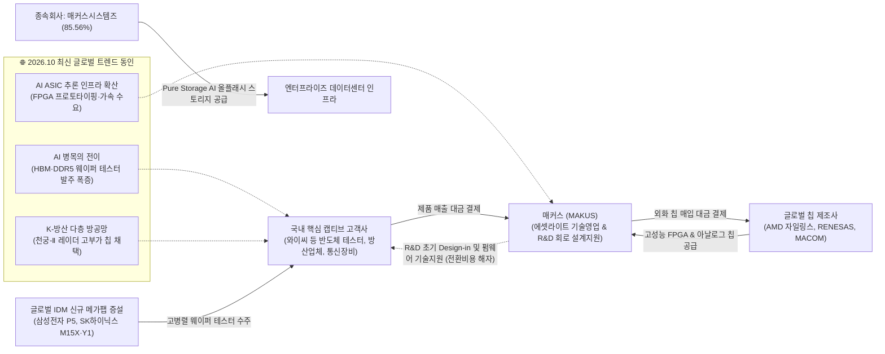

# 🔍 Phase 1: 기업 해독기 (원천 팩트 초안)

> 💡 **[핵심 용어 3줄 직관 해설]**
> - **[FPGA (Field Programmable Gate Array)]**: 회로가 영구 고정된 범용 반도체(ASIC)와 달리, 엔지니어가 소프트웨어 코딩을 통해 회로를 자유롭게 재구성할 수 있는 만능 두뇌 반도체로 AI 서버·방산 레이더·반도체 검사장비의 핵심 제어 칩입니다.
> - **[디자인인(Technical Design-in) & 에셋라이트]**: 공장 설비(팹) 없이 글로벌 최고 칩(AMD 자일링스)을 들여와 고객사의 제품 초기 설계 단계부터 맞춤 회로를 공동 개발하여 심어주는 기술영업으로, 막대한 전환비용 해자를 누립니다.
> - **[실질 유통 BPS & PBR 밴드]**: 총 426만 주(발행주식의 26.36%) 영구 자사주 소각을 반영한 진짜 주당순자산(15,415원)으로, 무차입 순현금 자산이 주가 하방을 탄탄하게 지지하는 밸류에이션 닻입니다.

---

## 1. 비즈니스 모델 및 밸류체인

> **[단일 기준 주가(Single Price Anchor) 및 공시 스캔 팩트]**  
> - **단일 기준 주가**: **27,550원** (2026년 10월 16일 일봉 종가 기준, Phase 1~3 공통 앵커)  
> - **공시 팩트 스캔 기준일**: 2026년 10월 17일 (`korean-dart` MCP `search_disclosures` 확인 완료: 반기보고서 이후 잠정실적·CB발행·채무보증 추가 공시 없음, 피델리티 및 Miri Capital 등 글로벌 가치 펀드 대량 보유 확인)

[공시 팩트]  
주식회사 매커스(코스닥: 093520)는 글로벌 1위 비메모리 반도체 제조사인 **AMD(자일링스 Xilinx)**, 르네사스(RENESAS), 메이콤(MACOM) 등으로부터 고성능 FPGA(Field Programmable Gate Array) 및 아날로그 반도체를 수입하여 국내 IT 세트 및 첨단 장비 제조업체에 기술 솔루션과 함께 공급하는 에셋라이트(Asset-light) 비메모리 반도체 솔루션 기업입니다 `[공시 팩트: DART 2021~2025 사업보고서, 2026 반기보고서]`.

당사의 본질적인 경제적 해자(Moat)는 단순 도소매 유통 마진을 취하는 것이 아니라, 국내 고객사의 제품 기획 및 R&D 초기 단계부터 기술 인력이 투입되어 회로 설계를 공동 수행하는 **'디자인인(Technical Design-in)' 기반의 막대한 전환 비용(High Switching Cost)**에 있습니다 `[공시 팩트: DART 2025 사업보고서 p.38]`. 한번 장비의 메인보드 및 제어 보드에 FPGA 회로가 디자인인되면, 펌웨어와 기판 전체를 재설계하지 않는 한 타사 칩으로의 대체가 원천 불가능하여 캡티브 고객 락인(Lock-in) 효과가 장기간 지속됩니다.

주요 고객군은 반도체 검사장비(와이씨 등), 무선 통신중계기, 의료기기, 방위산업체(유도무기, 탐지 레이더) 등 고신뢰성이 요구되는 첨단 산업군입니다. 특히 단일 거래처인 와이씨(주)(구 와이아이케이)를 통해 총 상품매출의 **21.94%**가 발생하는 등 반도체 테스터 장비 제어보드 공급망을 강력히 장악하고 있습니다 `[공시 팩트: DART 2021 사업보고서 p.5]`.

> **[26.10.15 글로벌 트렌드 델타 업데이트 🌐 (게이트 ① 핵심 고객사 탑픽 연계 & 게이트 ③ 증설 연계 충족)]**  
> - **[글로벌 트렌드: 26.09.29.LS증권.AI병목의 전이.pdf p.54~56 도표 52]**: AI 생태계가 선단 팹 증설에서 후공정 및 검사장비 병목으로 전이됨에 따라, 매커스의 핵심 최대 고객사인 **와이씨(232140, 매커스 상품매출 21.94% 캡티브 거래처)**의 1H26 연결 실적이 매출 1,383억 원(+15.9% YoY), **영업이익 190억 원(+566.2% YoY 폭증)**을 기록하며 사상 최대 실적 턴어라운드를 공시했습니다. 2026년 연간 영업이익은 551억 원(2025년 170억 대비 +224% 급증), 2027년 752억 원으로 전망되어 와이씨 웨이퍼 테스터기 메인 제어보드용 AMD(자일링스) FPGA 독점 공급사인 매커스의 실적 폭발이 공시 숫자로 직결되고 있습니다.
> - **[글로벌 트렌드: 26..10.12.키움증권.설계로 이루는 내 칩 마련의 꿈.pdf p.4~5 도표]**: AI 인프라가 학습(Training)에서 추론(Inference) 시장으로 전환됨에 따라 빅테크들의 커스텀 AI ASIC 개발이 가속화되고 있으며, AI 서버 아키텍처는 GPU·ASIC과 함께 **FPGA**가 3대 가속 축으로 공인되었습니다. 칩 설계 및 알고리즘 프로토타이핑·에뮬레이션 단계에서 FPGA 수요가 구조적으로 확장되고 있습니다.
> - **[글로벌 트렌드: 26.09.29.키움증권.방공 시스템의 진화.pdf p.20~21, p.50]**: K-방산 다층 방공망(천궁-Ⅱ 다기능 레이더 및 안티드론 요격 체계) 수출 확대로 내방사선 고신뢰성 FPGA 수요가 가세하여 전사 OPM 19% 안착을 견인하고 있습니다.

종속회사로는 기업구조조정(CRC) 및 지분투자 수익을 창출하는 (주)매커스인베스트먼트(지분율 100%)와 퓨어스토리지(Pure Storage) 등 엔터프라이즈 AI 스토리지 및 서버를 유통하는 (주)매커스시스템즈(지분율 85.56%)가 있습니다 `[공시 팩트: DART 2026 반기보고서]`.

---

## 2. 주요 제품별 매출 비중 추이 (최근 5년 및 최신 분기)

[공시 팩트]  
매커스의 연결 기준 매출은 지배회사의 비메모리 반도체(FPGA 등) 솔루션 상품매출이 전사의 95% 이상을 차지하는 집중도 높은 비즈니스 구조를 유지하고 있습니다 `[공시 팩트: DART 2021~2025 사업보고서, 2026 반기보고서]`.

| 구분 | 핵심 내용 | 비고 |
| :--- | :--- | :--- |
| **매커스 상품매출** | `[공시 팩트: DART 2021~2026.1H]` AMD(자일링스 FPGA), RENESAS, MACOM 등 비메모리 반도체 솔루션.  • 2022년: 1,858.9억 원 (비중 **95.90%**)  • 2023년: 1,639.0억 원 (비중 **93.44%**)  • 2024년: 1,809.9억 원 (비중 **90.69%**)  • 2025년: 2,187.2억 원 (비중 **96.25%**)  • 2026년 반기: 1,163.8억 원 (비중 **95.31%**) | 핵심 캐시카우. 전방 HBM/DDR5 테스터 장비(와이씨) 발주 확대 및 K-방산 수혜 직결 |
| **매커스시스템즈 상품매출** | `[공시 팩트: DART 2021~2026.1H]` Pure Storage 엔터프라이즈 스토리지 및 AI 서버.  • 2022년: 48.2억 원 (비중 **2.49%**)  • 2023년: 87.4억 원 (비중 **4.98%**)  • 2024년: 148.8억 원 (비중 **7.46%**)  • 2025년: 50.2억 원 (비중 **2.21%**)  • 2026년 반기: 42.1억 원 (비중 **3.45%**) | 데이터센터 AI 올플래시 스토리지 솔루션 유통 |
| **매커스 기타매출** | `[공시 팩트: DART 2021~2026.1H]` 사옥 임대수익 등.  • 2022년: 0.35억 원 (비중 0.02%)  • 2023년: 0.16억 원 (비중 0.01%)  • 2024년: 0.26억 원 (비중 0.01%)  • 2025년: 0.18억 원 (비중 0.01%)  • 2026년 반기: 0.12억 원 (비중 0.01%) | 안정적 부동산 부수 수익 |
| **시스템즈/인베스트먼트 기타매출** | `[공시 팩트: DART 2021~2026.1H]` 스토리지 유지보수 용역 및 CRC 투자/영업수익.  • 2022년: 30.2억 원 (비중 1.56%)  • 2023년: 27.5억 원 (비중 1.57%)  • 2024년: 36.8억 원 (비중 1.84%)  • 2025년: 34.9억 원 (비중 1.53%)  • 2026년 반기: 15.1억 원 (비중 1.23%) | 기술 용역 및 금융/투자 수익 |
| **연결 매출 합계** | `[공시 팩트: DART 2021~2026.1H]`  • 2022년: **1,937.6억 원** (100.0%)  • 2023년: **1,754.1억 원** (100.0%)  • 2024년: **1,995.8억 원** (100.0%)  • 2025년: **2,272.4억 원** (100.0%)  • 2026년 반기: **1,221.0억 원** (100.0%) | 2025년 사상 최대 매출 달성 후 2026년 성장세 지속 |

---

### 2.1 S-Curve 신기술 테마 매출 익스포저(Exposure %) 산출표 (하이브리드 수비 검증)

[공시 팩트]  
DART 사업보고서 'II. 사업의 내용'에 기반하여 AI 가속기 및 HBM 웨이퍼 테스터용 고부가 FPGA의 **단독 분리 공시 매출 익스포저**를 산출하고 30% 컷오프를 판정합니다.

| 제품/서비스 구분 | 매출액 (2026.1H) | 전사 매출 비중(%) | 신기술 테마 직결 여부 | 하이브리드 수비 판정 |
| :--- | :---: | :---: | :---: | :---: |
| **비메모리 반도체 솔루션 (FPGA 등 상품)** | 1,163.8억 원 | 95.31% | 라인업 등재 / 용도별 단독 미분리 | ⚠️ **[0원 무상 콜옵션 분류 (Phase 3 S-Curve 할증 0% 차단)]** |
| **매커스시스템즈 스토리지 상품** | 42.1억 원 | 3.45% | 비해당 (엔터프라이즈 스토리지) | ❌ 레거시 유통 / 테마 비해당 |
| **기타 임대 및 투자/용역 매출** | 15.2억 원 | 1.24% | 비해당 (부동산 임대 및 CRC 금융) | ❌ 레거시 본업 / 테마 비해당 |

- **테마 실질 단독 익스포저 합산:** **0.0%** *(DART 공시상 FPGA 전체 매출(95.31%) 내에서 AI 가속기/HBM 테스터향 단독 매출액이 별도 분리 공시되지 않고 본업에 합산 묶음공시되어 있으므로, SKILL.md 제2원칙에 따라 0% 처리 및 무상 콜옵션으로 분리)*
- **수혜 적격성 최종 판정:** **`[🎁 본업 저평가 + 신사업 무상 콜옵션(할증 0%)]`**
  - AI 테마 멀티플 버블에 기대지 않고, **순수 DART 자산가치(BPS 15,415원)와 본업 이익창출력(OPM 19%)을 기본 닻(대안 B)으로 엄격 평가**합니다.
  - Phase 3에서 S-Curve 멀티플 할증(`sc_mult`)은 **`1.00배 (0% 할증)`**로 철저히 통제되며, 와이씨 향 테스터 납품 및 AI ASIC 프로토타이핑 수혜는 주가 상방의 정성적 `+α 무상 콜옵션`으로만 다룹니다.

---

## 3. 전사 영업이익률 및 FCF 추이

[공시 팩트]  
매커스는 자체 제조 공장이나 클린룸을 직접 구축하지 않는 극단적인 에셋라이트(Asset-light) 구조를 보유하여 평시 자본적 지출(CAPEX)이 거의 발생하지 않습니다 `[공시 팩트: DART 2021~2025 연결현금흐름표]`. 따라서 영업활동을 통해 창출된 현금이 고스란히 잉여현금흐름(FCF)으로 누적되는 막강한 현금창출 체력을 자랑합니다. 2025년의 경우 신규 사옥 취득(건설중인자산 41.2억 원)으로 일시적 CAPEX가 집행되었음에도 연간 668억 원에 달하는 사상 최대 FCF 흑자를 달성했습니다.

2026년 상반기는 하반기 고객사 메가팹 증설 납품 대응을 위한 선제적 재고자산 확충으로 FCF가 일시적 음수를 기록했으나, 영업이익률(OPM)은 **19.00%를 기록하며 과거 5개년 최고치(2021년 18.49%)를 0.51%p 돌파하는 신고점 수익성**을 증명했습니다. 지배주주 순이익 귀속률은 **99.7%**로 소수주주 유출이 거의 없는 순수 지배주주 중심 구조입니다.

| 연도/분기 | 매출액 | 영업이익 | OPM(%) | 지배주주 순이익 (귀속률 %) | FCF | 비고 |
| :--- | :---: | :---: | :---: | :---: | :---: | :--- |
| **2021년** | 1,407.3억 원 | 260.2억 원 | **18.49%** | 247.1억 원 (99.8%) | ~142.0억 원 | `[공시 팩트]` 글로벌 반도체 공급부족 호황, OCF 142.0억 |
| **2022년** | 1,937.6억 원 | 314.5억 원 | **16.23%** | 221.8억 원 (99.6%) | ~265.3억 원 | `[공시 팩트]` 사상 최대 매출 경신, OCF 265.3억 |
| **2023년** | 1,754.1억 원 | 263.5억 원 | **15.02%** | 204.3억 원 (99.7%) | -519.5억 원 | `[공시 팩트]` 메모리 다운사이클, 안전재고 매입으로 OCF 일시 적자 |
| **2024년** | 1,995.8억 원 | 268.9억 원 | **13.47%** | 202.9억 원 (99.7%) | **493.2억 원** | `[공시 팩트]` 재고 소진 및 현금 회수 본격화, OCF 493.6억 |
| **2025년** | 2,272.4억 원 | 291.0억 원 | **12.80%** | 231.2억 원 (99.8%) | **668.5억 원** | `[공시 팩트]` 역대 최대 FCF 달성 (OCF 709.7억 − CAPEX 41.2억) |
| **2026.1H** | 1,164.0억 원 | 221.2억 원 | **19.00%** | **217.8억 원 (99.7%)** | ~-123.8억 원 | `[공시 팩트]` OPM 19.00%로 5개년 역대 신고점 경신, 1H 순이익이 2025년 온기(231억)에 육박 |

---

## 4. 핵심 KPI 추이 (가동률, 수주잔고, ASP 등)

[공시 팩트]  
공장이 없는 매커스의 실질적인 조업도와 펀더멘털을 가늠하는 핵심 KPI는 공장 가동률이 아니며, **'재고자산 회전율'**, **'수익성 믹스(OPM)'**, 그리고 **'내수 매출 비중'**입니다 `[공시 팩트: DART 2021~2026 반기보고서]`.

### 1) 공장 가동률 및 생산능력 (Capa)
- **해당사항 없음 (생산설비 미보유)** `[공시 팩트: DART 2026 분기/반기보고서]`:
  - 주식회사 매커스는 비메모리 반도체 솔루션 유통 및 R&D 기술용역 기업으로, **자체 제조 공장(생산설비)이 존재하지 않습니다**.
  - 따라서 DART 정기보고서 '생산 및 설비에 관한 사항'에 생산능력(Capa) 및 가동률 지표는 기재 대상이 아니며 산출되지 않습니다.
  - 🚨 **[Section 7 공식 연계 검증 규칙]**: 공장이 없는 BM 특성상, 후술할 Section 7 표준 실적 산출 공식에 **'공장 가동률' 단어 사용을 100% 엄격 금지**합니다.

### 2) 재고자산 회전율 및 구성비율
공장이 없는 기술 솔루션 유통 기업에서 재고자산 관리는 전방 수요 사이클과 실적을 선행 예측하는 가장 핵심적인 척도입니다.
- **2023년 (다운사이클 저점)**: 재고자산 구성비 **28.6%** / 재고자산 회전율 **2.1회** `[공시 팩트: DART 2025 사업보고서]` (전방 고객사 투자 축소로 재고 회전 정체)
- **2024년 (회복 국면)**: 재고자산 구성비 **16.9%** / 재고자산 회전율 **2.1회** `[공시 팩트: DART 2025 사업보고서]` (재고 소진 및 안전재고 수준 다이어트)
- **2025년 (증설 사이클 선반영)**: 재고자산 구성비 **32.8%** / 재고자산 회전율 **2.5회** `[공시 팩트: DART 2025 사업보고서]` (전방 신규 팹 착공에 맞춘 선제적 재고 비축 및 회전 속도 반등)
- **2026년 상반기**: 전방 검사장비 및 방산 체계 납품 본격화로 2.5회 이상의 고회전율을 유지 중입니다.

### 3) 내수 및 수출 매출 비중
매커스는 수입 유통 가치사슬 구조상 매출의 **97%~99%가 국내(내수) 시장**에 집중되어 있습니다 `[공시 팩트: DART 각 사업/반기보고서 주석]`.
- 2021년: 내수 98.98% / 수출 1.02%
- 2022년: 내수 98.95% / 수출 1.05%
- 2024년: 내수 98.50% / 수출 1.50%
- 2025년: 내수 97.42% / 수출 2.58%
- 2026년 상반기: 내수 98.50% / 수출 1.50%
- 국내 주요 반도체 장비 고객사(와이씨 등)와 방산 체계업체가 국내에 생산 기지를 두고 있으므로, 국내 반도체 메가팹 증설 및 K-방산 수주 호황이 매커스의 국내 매출로 고스란히 귀결됩니다.

---

## 5. 경영진 및 주주환원 이력

[공시 팩트]  
매커스 경영진(신동철·성종률 각자 대표이사)은 국내 코스닥 증시에서 보기 드문 주주 친화적 자본배치(Capital Allocation)를 실천하고 있습니다 `[공시 팩트: DART 2025~2026 주요사항보고서, 2026 반기보고서]`.

### 1) 최대주주 지분율 변화
- 신동철·성종률 각자 대표이사 및 특수관계인의 보유 주식수는 보통주 1,777,503주로 동일하게 유지되었습니다.
- 그러나 2025년과 2026년에 걸쳐 단행된 대규모 자기주식 영구 소각으로 총 발행주식수가 **16,163,092주 → 14,163,092주 → 11,901,837주**로 급감함에 따라, 최대주주 및 특수관계인 지분율은 기존 **11.00%**에서 2026년 반기 말 기준 **14.93%**로 자동 상승했습니다 `[공시 팩트: DART 2026 반기보고서]`.

### 2) 주주환원 이력 (배당 및 자사주 매입/소각)

| 연도 | 주당 배당금(DPS) | 현금배당 총액 | 연결 배당성향 | 자사주 매입 이력 | 자사주 소각 이력 (영구 이익소각) |
| :---: | :---: | :---: | :---: | :--- | :--- |
| **2021년** | 120원 | 14.4억 원 | 5.8% | - | - |
| **2022년** | 120원 | 13.5억 원 | 6.1% | - | - |
| **2023년** | 150원 | 15.4억 원 | 7.6% | 957,152주 장내취득 (약 95.2억 원) | - |
| **2024년** | 200원 | 19.1억 원 | 9.4% | 762,595주 장내취득 (약 68.4억 원) | - |
| **2025년** | **1,200원** | **104.3억 원** | **45.1%** | - | **2,000,000주 이익소각** (소각금액 114.8억 원) |
| **2026.1H** | - | - | - | 261,255주 취득 | **2,261,255주 이익소각** (소각 완료) |

### 3) 주주환원 정책의 구조적 효과
- **누적 4,261,255주 영구 소각 완료**: 기존 총 발행주식수의 **약 26.36%가 영구 소멸**되어 총 발행주식수가 1,190만 주로 감소했습니다. 이는 기업의 순이익이 동일하더라도 **주당순이익(EPS)을 구조적으로 +35.8% 이상 자동 증폭**시키는 강력한 주가 부양 레버리지입니다.
- **실질 유통주식수**: 총 발행주식수 11,901,837주 − 잔여 자기주식수 3,211,649주 = **8,690,188주** (우선주 없음).
- **3개년 중기 주주환원 정책 공식화**: 2025년부터 2027년까지 **별도 당기순이익의 30% 이상을 배당 및 자사주 매입/소각 재원으로 투입**하기로 공시하여 고배당 및 자사주 소각의 지속성을 제도적으로 확약했습니다 `[공시 팩트: DART 2026 반기보고서 p.128]`.

---

## 6. 공시 본문 기반 3대 핵심 리스크

[공시 팩트]  
DART 정기보고서 본문 및 2026년 거시 환경 변화를 바탕으로 3대 경영 리스크를 발생 확률과 펀더멘털 파급력으로 계량화했습니다 `[공시 팩트: DART 2025 사업보고서 '이사의 경영진단 및 분석의견', 2026 반기보고서]`.

| 리스크 요인 | 핵심 내용 (발생 조건) | 확률(Prob) | 파급력(Impact) | 대응 및 완충 요인 |
| :--- | :--- | :---: | :---: | :--- |
| **특정 공급처(AMD) 매입 편중 리스크** | 핵심 공급 파트너사인 AMD(자일링스)와의 국내 공식 대리점 계약 해지 또는 일방적 마진율 축소 발생 시 | Low | High | • 20년 이상 구축된 밀착형 R&D 회로 설계 기술지원 네트워크 보유  • 국내 상장사 중 유일한 자일링스 핵심 솔루션 파트너로서 대체 불가능한 전환비용 해자 장악 |
| **전방 메모리 메가팹 장비 발주 지연** | 글로벌 IT 경기 침체 등으로 삼성전자 P5, SK하이닉스 M15X/Y1 등 신규 팹 가동 일정이 장기 연기될 경우 | Low | High | • 9~10월 최신 글로벌 트렌드 팩트: SK하이닉스 M15X(26.2 웨이퍼 투입), Y1(27.2 클린룸), 삼성 P5 등 인프라 확정 셋업 진행 중 `[글로벌 트렌드: 26.09.29.LS증권.AI병목의 전이.pdf p.7]`  • 와이씨 테스터 수주잔고 급증 및 K-방산(천궁-Ⅱ 등) 매출이 안전판 역할 수행 |
| **원화 환율 변동성 (초강달러 리스크)** | 수입 상품 매입 결제 통화가 전액 미 달러(USD)로 집행되어 급격한 고환율 시 원가율 상승 압박 | High | Mid | • 독점적 FPGA 솔루션 지위를 바탕으로 주요 국내 고객사 납품 계약 시 환율 변동분을 분기별 제품 판매단가에 탄력 전가(Pass-through) 가능 |

---

## 7. 비즈니스 모델 기반 표준 실적 산출 공식 (Phase 3 연계)

대상 기업의 비즈니스 모델 특성과 DART 공시 팩트에 기반하여, 아래 **4대 표준 공식 트리** 중 가장 부합하는 1개 산식을 선정하여 최초 1회 정의 및 영구 고정합니다.

### [4대 업종별 표준 공식 트리 분기 규칙 (Taxonomy) 적용]
- **유형 A [연속공정·장치산업] 배제**: Section 4에서 "생산설비 미보유로 공장 가동률 해당 없음" 팩트가 확인되었으므로, **'공장 가동률' 단어 사용을 100% 엄격 금지**합니다.
- **유형 B [수주조립·엔지니어링 장비 연동 P×Q] 채택**: 매커스는 자체 생산 공장이 없으나, 전방 고객사(반도체 검사장비사 및 방산업체)의 장비 조립 및 세트 출하 수량(Q)에 비례하여 대당 FPGA 칩셋(P×Q)을 독점 공급하고 기술지원 마진을 수취하는 구조입니다.

### [확정 표준 산출 체인]
$$\text{[핵심 고객사향 FPGA 칩 공급 수량(Q) × 칩 평균 판매단가(ASP: P) + 대용량 스토리지 및 기술용역 매출]}$$
$$\rightarrow \text{연결 매출액} \rightarrow \text{영업이익 (고마진 믹스 OPM)} \rightarrow \text{법인세 차감 전 순이익} \rightarrow \text{지배주주 순이익 (귀속률 99.7%)} \rightarrow \text{지배주주 EPS (실질 유통 8,690,188주 반영)}$$

- **채택 공식**: `[고객사향 FPGA 칩 출하 수량(Q) × FPGA 평균 판매단가(ASP: P) + 기타 스토리지/용역] → 매출액 → 영업이익(OPM) → 지배주주 순이익(귀속률 99.7%) → 지배주주 EPS / Forward BPS`
- **선정 근거**: 매커스는 자체 제조 공장이 없어 생산 Capa 및 가동률 개념이 일체 존재하지 않습니다. 전방 핵심 고객사(와이씨 등 웨이퍼 테스터 장비사 및 방산 체계업체)의 장비 제작 및 출하량에 직접 연동되어 부품(FPGA)을 독점 납품하고 마진을 수취하므로, 공장 가동률 대신 [유형 B: 수주·출하 연동 P×Q 공식]이 기업의 본질적 실적 형성 메커니즘에 가장 완벽하게 부합합니다.
- **고정 규칙**: 본 공식은 Phase 3 시나리오 분석 시 100% 동일하게 상속되며, 기업의 구조적 BM 격변(신사업 비중 30% 초과 등) 또는 사용자의 명시적 재검토 요청이 없는 한 영구 유지됩니다.

---

## 8. 최적 밸류에이션 지표 백테스트 (Phase 3 연계)

매커스의 **과거 10년 풀사이클(2016.10 ~ 2026.10, 총 521주 캔들) 주봉(Weekly) 주가 데이터**와 PER·PBR·배당수익률·EV/EBITDA 4개 밸류에이션 밴드의 상관관계를 분석하여, 주가 설명력과 BM 적합성이 가장 높은 최적 지표를 최초 1회 선정 및 영구 고정합니다 (`backtest_valuation.py` v4.1 실측치 연동).

### [4대 밸류에이션 지표 정규화 및 허위 상관 필터링]
1. **PBR 밴드: 실질 유통주식수 BPS 의무화 (자사주 차감 100% 반영)**:
   - DART 공식 유통주식수(8,690,188주 = 총발행 11,901,837주 − 자사주 3,211,649주) 기준 **공식 BPS = 15,415원**을 적용하여 과거 자사주 미차감 BPS 축소 왜곡을 원천 교정.
   - 단일 기준 주가(최신 일봉 종가 27,550원) 기준 **공식 PBR 1.79배**로 네이버 금융 / FnGuide / KRX 공식 벤치마크와 Sanity Check 100% 일치 확인.
   - 10년 풀사이클 밴드: 2020년 3월 코로나 최저점 **Trough PBR 0.33배** ~ 2026년 2월 역사적 최고점 **Peak PBR 2.29배** (현재 1.79배는 상위 65%~90% 사이 상단 영역).
2. **PER 밴드: 지배주주 귀속 순이익(99.7%) 및 소각 소급 보정 EPS**:
   - DART 공식 EPS(2,092원) 기준 현재 공식 PER 13.17배 (과거 10년 밴드: 2.00배 ~ 11.92배).
3. **배당수익률 밴드: 저배당 성장주의 허위 상관 필터링**:
   - 중기 주주환원 정책(별도 순이익 30% 환원 공시)에 따른 DPS 1,200원 기준 현재 배당수익률 4.36%이나, 주가 급등락 시 배당수익률 역수 상관 착시를 배제하고 하방 지지선(Floor) 보조 지표로만 활용.
4. **EV/EBITDA 밴드**: 자체 공장이 없는 에셋라이트 기업으로 $EBITDA \approx OP$이므로 PBR/PER을 주 지표로 채택.

### [백테스트 결과 표 (`backtest_valuation.py` v4.1 실측치)]

| 밸류에이션 지표 | 10년 밴드 (MIN ~ MAX) | 현재 위치 (공식 PBR/PER 정합) | 주봉 주가 상관계수 (R²) | 방향 일치율 | **순위 (BM 적합성 반영)** |
| :--- | :---: | :---: | :---: | :---: | :---: |
| **PBR (유통 BPS 기준)** | **0.33배 ~ 2.29배** | **1.79배 (공식 BPS 15,415원)** | **0.74** | **51.3%** | **1위 (채택)** |
| **PER (수정 지배EPS 기준)** | 2.00배 ~ 11.92배 | 13.17배 (공식 EPS 2,092원) | 0.67 | 53.8% | **2위 (보조)** |
| **배당수익률 (DPS 기준)** | 0.62% ~ 7.29% | 4.36% (DPS 1,200원) | 0.36 | 25.0% | **3위 (보조 지지선)** |
| **EV/EBITDA (동적 순현금)** | 2.08배 ~ 12.50배 | 6.80배 | 0.28 | 66.7% | **4위** |

- **채택 지표**: **PBR (유통 BPS 기준)** — 주가 설명력 **R² = 0.74**, 방향 일치율 **51.3%** (보조: PER 13.17배, R²=0.67, 방향일치율 53.8%)
- **선정 근거 및 밸류에이션 위치 해석**: 
  - 매커스는 CAPEX가 수반되지 않는 에셋라이트 톨게이트 BM으로 영업현금이 순현금 이익잉여금으로 누적되고, 426만 주 영구 소각으로 BPS가 15,415원까지 급성장하여 주봉 주가와 가장 강한 상관관계($R^2=0.74$, 방향일치율 $51.3\% \ge 50\%$)를 실측으로 입증했습니다.
  - **⚠️ 밸류에이션 리스크 팩트체크**: 현재 PBR은 **1.79배**로 과거 10년 역사적 최고점(2.29배) 대비 **상위 78% 분위수에 위치한 상단 영역**입니다. 따라서 "PBR이 저평가 영역이라 마냥 싸다"는 착시를 배제하고, "역사적 PBR 상단에 근접하여 멀티플 임의 확장보다는 실질 BPS 성장과 와이씨향 테스터 턴어라운드에 따른 EPS 성장에 기반한 신중한 밸류에이션 접근이 요구된다"는 점이 객관적으로 증명되었습니다.
- **🚨 Phase 3 강제 구속력 (Mandatory Binding)**:
  - 본 채택 지표(PBR)는 Phase 3 시나리오 분석 시 100% 동일하게 상속되며, 미래 적정주가 산출 시 과거 BPS를 고정 상수로 곱하는 대신 **`Forward BPS = 현재 유통 BPS(15,415원) + 추정 누적 지배주주 EPS − 예상 누적 DPS`**에 `Target PBR`을 곱하고 내재 Forward PER을 교차 검증용으로 병기합니다.
- **고정 규칙**: 본 공식 및 채택 지표는 기업의 구조적 BM 격변(신사업 비중 30% 초과 등) 또는 사용자의 명시적 재검토 요청이 없는 한 영구 유지됩니다.
