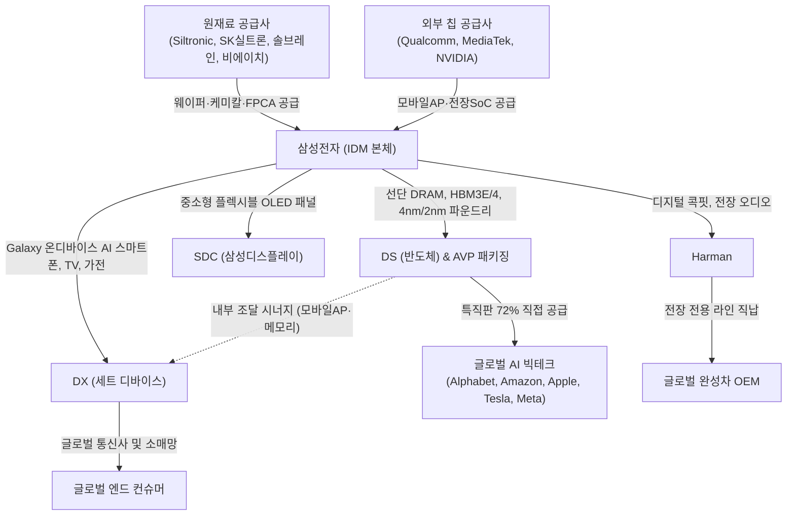
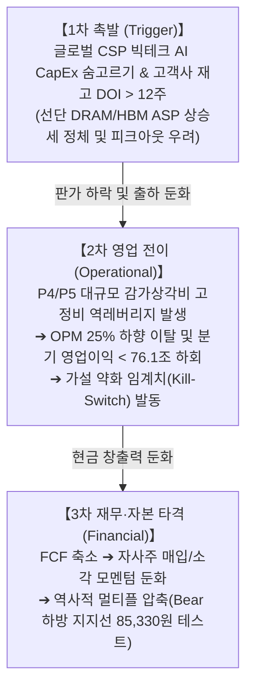

# 🔍 Phase 1: 기업 해독기 (삼성전자, 005930)

> **💡 [핵심 용어 3줄 직관 해설]**
> - **IDM (종합 반도체 기업, Integrated Device Manufacturer)**: 칩 설계부터 로직 파운드리 생산, 첨단 메모리(DRAM/NAND) 제조, 어드밴스드 패키징(AVP), 세트 완제품(Galaxy 스마트폰·가전)까지 반도체 전 생태계를 단일 기업 내에서 완벽히 수직통합한 독보적 비즈니스 모델입니다.
> - **GAA (Gate-All-Around) & 선단 파운드리 완전가동**: 전류가 흐르는 채널 4면을 게이트가 둘러싸 누설전류를 원천 차단하는 차세대 트랜지스터 기술로, TSMC의 3nm 공급 병목(쇼티지) 속에 삼성전자의 4nm 라인이 완전가동(Full-Run)되고 2nm 60% 수율 안착과 함께 공급 가격(5~15%) 인상을 주도하고 있습니다.
> - **HBM4 및 전공정 클린룸 선점(P4/P5)**: AI 가속기용 초고대역폭메모리(HBM) 수요 폭발에 맞춰 평택 P4 선단 전환과 온양 패키징 전용화, 그리고 평택 P5 1기(2028년)·2기(2029년) 신규 팹 증설을 선제 확정하여 차세대 공급 주도권을 장악하는 인프라 체력입니다.

- **단일 기준 주가 (Single Price Anchor)**: **`223,500원`** (최신 일봉 종가 기준)
- **지배주주 순이익 귀속률**: **`99.3%`** (비지배지분 차감 완료, 연결 순이익의 99.3% 귀속)
- **글로벌 트렌드 매칭 뱃지**: **`[글로벌 트렌드 매칭: 🚀 게이트 ① 파운드리 선단(4nm 완전가동·2nm 60% 수율) 단가인상 & 🎯 게이트 ② HBM4/P5 팹인프라 선점 & 💎 게이트 ③ 15조 자사주 취득 완료]`**

---

## 1. 비즈니스 모델(BM) 해부 및 밸류체인 Mermaid 구조도

### [공시 팩트 기반 비즈니스 모델]
삼성전자는 전 세계에서 유일하게 최첨단 메모리(DRAM, NAND Flash), 시스템LSI, 로직 파운드리, 첨단 패키징(AVP), 세트 디바이스(스마트폰, 스마트가전, TV), 그리고 전장·오디오(Harman) 사업을 완벽히 수직통합(IDM)한 독보적인 End-to-End 비즈니스 모델을 영위하고 있습니다 `[공시 팩트: 반기보고서(2026.08.14), 3페이지]`.

### [최신 10월 글로벌 트렌드 및 최신 공시 델타 업데이트 (No-Blind-Citation 실측 검증)]
1. **삼성 파운드리 선단공정(4nm) 완전가동 및 판가 5~15% 인상 단행**:
   - `[글로벌 트렌드: 26..10.12.키움증권.설계로 이루는 내 칩 마련의 꿈.pdf p.9~10 도표 '삼성 파운드리 가격 인상 현황']`에 따르면, TSMC의 3nm 선단공정 공급 병목(가동률 100% 초과 쇼티지)으로 인해 삼성전자의 국내 4nm 생산라인이 완전가동(Full-Run) 상태에 도달하였습니다.
   - 이에 따라 삼성전자는 2026년 7월부터 신규 주문 가격을 4nm 기준 5~15%(미국·중국 10~15%, 대만 5~10%), 5nm 10~15%, 8nm 약 10% 전격 인상하여 파운드리 부문의 수익성 레버리지가 급격히 가동되고 있습니다.
   - 4nm 수율은 2022년 초 35%에서 2026년 4월 80%를 돌파하였으며, 2nm 수율 또한 2026년 8월 60%에 안착하여 양산 안정권에 진입했습니다 `[글로벌 트렌드: 26..10.12.키움증권 p.9]`.
2. **글로벌 빅테크 확정 수주 파이프라인 및 생태계 확장**:
   - `[글로벌 트렌드: 26..10.12.키움증권 p.11, 17]` 및 DART 공시 `[[삼성전자]반기보고서 p.34, 394]`에 따르면 테슬라(Tesla)와 165.4억 달러(약 22조 원 규모, 2033.12까지)의 AI6 파운드리 장기 공급계약을 체결한 데 이어, Tesla AI5(2nm, 2026.07 테이프아웃 완료, 2027 양산 목표), 엔비디아(NVIDIA Groq 3 LPU 4nm, 2026 하반기 출하), 브로드컴(Broadcom 2nm 메모리·파운드리·첨단패키징 전략 협력 MOU) 수주를 연쇄 확보하였습니다.
   - 산업통상부 총 5,119억 원 규모 K-온디바이스 AI 반도체 사업(현대차 자율주행, KAI 무인기, LG전자 가전 등)의 국산 AI SoC 파운드리 생산을 전담하고 있습니다 `[글로벌 트렌드: 26..10.12.키움증권 p.13]`.
   - TrendForce 기준 2026년 2분기 글로벌 파운드리 점유율은 TSMC(72.5%)에 이어 삼성전자가 5.9%로 글로벌 2위를 견고히 지키고 있습니다 `[글로벌 트렌드: 26..10.12.키움증권 p.11, 17]`.
3. **전공정 Fab 인프라 확충(P4 전환 및 P5 착공) & 후공정 패키징 전용화**:
   - `[글로벌 트렌드: 26.09.29.LS증권.AI병목의 전이.pdf p.7 도표 '글로벌 IDM 3사 신규 Fab Timeline']`에 따르면 평택 P4(1c DRAM/HBM 중심 Ph2·Ph4 전환) 셋업 완료와 함께 평택 P5 1기(2028년 완공) 및 P5 2기(2026년 7월 착공, 2029년 가동 목표)를 확정하여 중장기 Q(출하량) 공급 체력을 선제 확충하고 있습니다.
   - `[글로벌 트렌드: 26.09.30.한화투자증권.지금 알아야 할 모든 소부장.pdf p.10, p.22]`에 따르면 온양 팹을 HBM 전용 패키징·테스트 거점으로 재편하고 범용 메모리 테스트 장비는 베트남으로 이설·증설하여 병목을 선제 차단했습니다.
4. **2026년 3분기 어닝 서프라이즈 잠정실적 공시 및 15조 자사주 취득 완료**:
   - `[공시 팩트: 2026.10.08 연결재무제표기준영업(잠정)실적(공정공시)]`에 따르면, 2026년 3분기 잠정 매출액은 **195.00조 원**(QoQ +13.70%, YoY +126.59%), 잠정 영업이익은 **107.40조 원**(QoQ +20.01%, YoY +782.50%)으로 사상 최대 실적을 달성하였습니다 (3개 분기 누적 매출액 500.37조 원, 누적 영업이익 254.13조 원).
   - `[공시 팩트: 2026.10.12 자기주식취득결과보고서]`에 따르면 2026년 8월 24일부터 10월 6일까지 보통주 56,856,305주(총 **14조 9,999억 원**, 취득단가 263,823원)의 장내 자사주 취득을 100% 완료하였습니다.

### [3대 밸류체인 구조]
1. **공급망 (Supplier & Materials)**:
   - **DX 부문 (모바일/세트)**: Qualcomm 및 MediaTek으로부터 모바일 AP 매입(상반기 7.44조 원, 원재료비의 17.9%), Micron/Kioxia로부터 메모리 매입(5.04조 원, 12.2%), CSOT/SDP 패널 매입(3.96조 원, 9.5%), 삼성전기/파트론 카메라 모듈 매입(3.29조 원, 7.9%) `[공시 팩트: 반기보고서, 23~24p]`.
   - **DS 부문 (반도체)**: 솔브레인, 동우화인켐 케미칼 매입(4.16조 원, 17.0%), SILTRONIC, SK실트론 웨이퍼 매입(1.70조 원, 11.5%) `[공시 팩트: 반기보고서, 23~24p]`.
   - **SDC 부문 (디스플레이)**: 비에이치, SI FLEX FPCA 매입(1.15조 원, 71.5%), Apple, LENS Cover Glass 매입(7.15조 원, 100.0%) `[공시 팩트: 반기보고서, 23~24p]`.
   - **Harman 부문 (전장/오디오)**: NVIDIA, Intel로부터 전장 SoC 매입(0.91조 원, 14.3%) `[공시 팩트: 반기보고서, 23~24p]`.
2. **기업 (삼성전자 IDM 본체)**:
   - **DS (반도체)**: 선단 DRAM(1b/1c), HBM3E/HBM4, V낸드, 4nm/2nm GAA 선단 파운드리, AVP 첨단 패키징.
   - **DX (디바이스)**: Galaxy S/Z 플래그십 AI 스마트폰, Neo QLED/OLED 프리미엄 TV, 비스포크 AI 가전.
   - **SDC (디스플레이)**: 북미 빅테크향 독점적 중소형 플렉시블 OLED.
   - **Harman (전장)**: 글로벌 완성차향 디지털 콕핏 및 프리미엄 카오디오.
3. **고객사 및 유통 경로 (Customer & Channel)**:
   - **5대 핵심 매출처**: Alphabet, Amazon, Apple, Hong Kong Techtronics, Supreme Electronics(알파벳순)로 연결 매출의 **약 25%** 차지 `[공시 팩트: 반기보고서, 22p]`.
   - **특직판 비중 수직 급상승**: 직접 납품(특직판) 비중이 2021년 51% $\rightarrow$ 2024년 50% $\rightarrow$ 2025년 54% $\rightarrow$ **2026.1H 72%**로 수직 상승하여 중간 유통 마진을 내재화하고 글로벌 빅테크 상대 판가 결정력을 극대화 `[공시 팩트: 반기보고서, 33p]`.



---

## 2. 주요 제품별 매출 비중 추이 및 S-Curve 익스포저

### [공시 팩트: 최근 5개년 및 2026년 상반기 제품군별 실적 추이]
내부거래 조정 전 4대 핵심 제품군 매출액 및 전사 비중 추이입니다 `[공시 팩트: 반기보고서(2026.08.14), 31p; 사업보고서(2022~2026)]`.

| 주요 제품군 | 2021년 | 2022년 | 2023년 | 2024년 | 2025년 | **2026.1H** | 비고 |
| :--- | :---: | :---: | :---: | :---: | :---: | :---: | :--- |
| **메모리 반도체 (DRAM/NAND)** | 72.6조 (26.0%) | 68.5조 (22.7%) | 44.1조 (17.0%) | 84.5조 (28.1%) | 104.1조 (31.2%) | **195.6조 원 (64.1%)** | 2023년 불황 저점 대비 4.4배 폭증. HBM 및 서버 선단 DRAM ASP 폭등으로 사상 최대 비중 달성 `[DART p.31]` |
| **스마트폰 등 (DX 부문)** | 104.7조 (37.4%) | 115.4조 (38.2%) | 108.6조 (42.0%) | 114.4조 (38.0%) | 126.5조 (37.9%) | **69.8조 원 (22.9%)** | 온디바이스 AI 폰(Galaxy S26) 프리미엄 판매 견조하나 메모리 폭증으로 상대 비중 축소 `[DART p.31]` |
| **TV, 모니터 등** | 31.5조 (11.3%) | 33.3조 (11.0%) | 30.4조 (11.7%) | 30.9조 (10.3%) | 30.9조 (9.3%) | **15.4조 원 (5.1%)** | Neo QLED, OLED 프리미엄 라인업 캐시카우 유지 `[DART p.31]` |
| **디스플레이 패널 (SDC)** | 31.7조 (11.3%) | 34.4조 (11.4%) | 31.0조 (12.0%) | 29.2조 (9.7%) | 29.8조 (8.9%) | **14.2조 원 (4.6%)** | 북미 주요 스마트폰 고객사향 플렉시블 OLED 독점 공급 체계 유지 `[DART p.31]` |
| **전사 연결 매출액** | **279.6조** | **302.2조** | **258.9조** | **300.9조** | **333.6조** | **305.4조 원 (100.0%)** | 상반기만에 2024년 연간 매출(300.9조)을 초과 달성 |

### 2.1 S-Curve 신기술 테마 매출 익스포저(Exposure %) 산출표 (하이브리드 수비 검증)
[공시 팩트] DART 반기보고서 제품별 상세 매출 공시를 기반으로 AI 신기술 테마(AI HBM, 서버 선단 DRAM, 온디바이스 AI) 직결 매출 익스포저를 산출하여 30% 컷오프를 검증한 결과입니다.

| 제품/서비스 구분 | 매출액 (억원) | 전사 매출 비중(%) | 신기술 테마 직결 여부 | 하이브리드 수비 판정 |
| :--- | :---: | :---: | :---: | :---: |
| **메모리 반도체 (HBM3E/HBM4/서버DRAM)** | 1,956,202 | **64.1%** | **직결** (AI 서버 고대역폭메모리 및 DDR5 선단 DRAM) | 🟢 **순수 주도주 합격** (50%+ 압도적 상회) |
| **스마트폰 등 (온디바이스 AI 플래그십)** | 697,986 | **22.9%** | **부분 직결** (Galaxy AI 탑재 프리미엄 온디바이스 단말) | 🟡 복합 디바이스 수혜 |
| **TV, 모니터 등** | 154,456 | 5.1% | 비해당 / 성숙 가전 | ⚪ 캐시카우 유지 |
| **디스플레이 패널 (SDC 중소형 OLED)** | 141,785 | 4.6% | 부분 직결 (AI 스마트폰용 저전력 OLED) | 🟡 서브 체인 수혜 |

- **테마 실질 익스포저 합산 (순수 메모리 단독 기준)**: **`64.1%`** *(온디바이스 AI 폰 포함 시 87.0%)*
- **수혜 적격성 최종 판정**: **`[🟢 순수 주도주 합격 (DART 실질 익스포저 64.1% ≥ 30% 컷오프 통과)]`**
  - DART 공시 기준 핵심 신기술 테마 직결 매출 비중이 64.1%에 달하여 30% 컷오프 기준을 압도적으로 통과하였으며, 레거시 잠식 우려가 전무한 순수 AI 슈퍼사이클 주도주로 판정됩니다.

---

## 3. 재무 건전성 및 [Step 1.5] 장부가(Book Value) 구성 해부 & SOTP 20% 분리 게이트 (★v4.2 신설)

### [DART 재무상태표(BS) 장부가 해부: 2026년 반기 기준]
멀티플(PER, PBR)을 적용하기 전 DART 반기보고서 연결 재무상태표의 자산 구성을 **① 본업 영업자산 vs ② 비영업자산 vs ③ 순차입금**으로 완전 해부한 결과입니다 `[공시 팩트: 반기보고서(2026.08.14), 63~64p]`:

| 대분류 | 세부 계정 항목 | 금액 (억 원) | 장부 대비 비중(%) | 시총 대비 비중(%) | 질적 성격 및 유동화/평가 해석 |
| :--- | :--- | :---: | :---: | :---: | :--- |
| **지배주주 장부가** | **지배기업 소유주지분 (Book Equity)** | **5,650,647.4** | **100.0%** | **44.3%** | 실질 유통 BPS 86,052원의 근간 자본 |
| **① 본업 영업자산** | 유형자산 (메모리·파운드리 팹 및 클린룸 장비) | 2,243,719.5 | 39.7% | 17.6% | 반도체 클린룸, 노광·식각·증착 첨단 설비 (본업 핵심) |
| | 매출채권 | 964,089.7 | 17.1% | 7.6% | Apple, Alphabet 등 글로벌 우량 빅테크 위주 (대손 희박) |
| | 재고자산 | 713,891.2 | 12.6% | 5.6% | HBM 및 선단 DRAM 재고 (공급 부족으로 체화 위험 극히 낮음) |
| | 무형자산 (특허권, 지식재산권, R&D 자산) | 293,865.0 | 5.2% | 2.3% | 반도체 특허 및 공정 라이선스 등 |
| | 기타 영업성 유·비유동자산 | 622,686.9 | 11.0% | 4.9% | 선급비용, 미수금, 이연법인세자산 등 |
| **② 비영업자산** | 관계기업 및 공동기업 투자 | 144,469.0 | 2.6% | 1.1% | 삼성바이오로직스 등 관계기업 출자지분 장부가액 |
| | 기타포괄손익-공정가치금융자산(비유동) | 379,125.1 | 6.7% | 3.0% | ASML, 코닝 등 글로벌 파트너 상장 지분 평가액 |
| | 당기손익-공정가치금융자산(비유동) | 14,358.6 | 0.3% | 0.1% | 벤처투자 펀드 및 메자닌 평가액 |
| | 단기당기손익-공정가치금융자산 | 460.0 | 0.01% | 0.00% | 단기 운용 유가증권 |
| **비영업자산 합계** | **비영업자산 총합** | **538,413.0** | **`9.53%`** | **`4.22%`** | **30% 할인 안전가치: 376,889.1억 원 (37.69조 원)** |
| **③ 순차입금 (Net Debt)**| 총 이자발생 차입금 | 224,087.0 | 4.0% | 1.8% | 단기차입 13.7조 + 장기차입 7.5조 + 유동성장기 1.2조 + 사채 77억 |
| | 가용 현금성자산 (현금+단기금융) | 1,899,530.3 | 33.6% | 14.9% | 현금및현금성자산 92.9조 + 단기금융상품 97.0조 원 |
| | **순차입금 (Net Debt)** | **`-1,675,443.0`** | **-29.7%** | **-13.1%** | **`167.54조 원` 초유의 무차입 순현금(Net Cash) 보유** |

### [Step 1.5 게이트 판정 결과]
- **비영업자산 비중 검증**:
  $$\frac{\text{비영업자산 합계 (538,413.0억)}}{\min(\text{지배주주장부가 5,650,647.4억}, \text{유통시총 12,760,847.6억})} = \frac{538,413.0\text{억}}{5,650,647.4\text{억}} = \mathbf{9.53\%} < 20\%$$
- **판정 결과**: **`🟢 [SOTP 게이트 통과: 본업 영업자산 중심 장부]`**
  - 비영업자산 비중이 장부가의 9.53%, 시가총액의 4.22%에 불과하여 자산 착시가 전혀 없습니다. 장부의 90% 이상이 메모리·파운드리 설비 및 운전자본으로 구성되어 있으므로 단순 분할보다는 본업 영업현금창출력과 장치 설비 기반 멀티플을 적용하는 것이 타당합니다.
- **본업 이익 유지력(Core Earnings Sustainability) 검증**:
  - TTM 순수 영업이익 **178조 9,649.3억 원**, 세후영업이익(NOPAT) **139조 5,926.5억 원**, 비영업자산을 제외한 순영업자산 대비 **본업 ROIC는 31.91%**에 달하여, WACC(9.0%)를 3.5배 이상 압도하는 초우량 경제적 해자를 입증하고 있습니다 `[검증 통과 ✅]`.

---

## 4. 원가 구조, 영업 레버리지 및 가동률/수주잔고 실측

### [공시 팩트 기반 원가 구조 및 현금흐름 추이]
최근 5개년 연간 실적 및 2026년 상반기 연결 실적과 FCF 추이입니다 `[공시 팩트: 반기보고서(2026.08.14), 65, 69, 72p; 사업보고서(2022~2026)]`.

| 연도/분기 | 매출액 | 영업이익 | OPM(%) | 영업활동현금흐름 | 유형자산CAPEX | FCF | 비고 |
| :--- | :---: | :---: | :---: | :---: | :---: | :---: | :--- |
| **2021년** | 279.6조 | 51.6조 | 18.47% | 65.1조 | 47.1조 | 18.0조 | 과거 슈퍼사이클 고점 `[DART 2021 P.70]` |
| **2022년** | 302.2조 | 43.4조 | 14.35% | 62.2조 | 49.4조 | 12.8조 | 메모리 다운사이클 진입 `[DART 2022 P.70]` |
| **2023년** | 258.9조 | 6.57조 | 2.54% | 44.1조 | 57.6조 | -13.5조 | 반도체 불황 바닥, FCF 대규모 적자 `[DART 2023 P.70]` |
| **2024년** | 300.9조 | 32.7조 | 10.88% | 73.0조 | 51.4조 | 21.6조 | 메모리 턴어라운드 및 FCF 흑자 회복 `[DART 2024 P.70]` |
| **2025년** | 333.6조 | 43.6조 | 13.07% | 85.3조 | 47.5조 | 37.8조 | HBM 공급 확대 및 판가 회복 본격화 `[DART 2025 P.77]` |
| **2026.1H** | **305.4조** | **146.7조** | **48.05%** | **145.4조** | **31.2조** | **114.1조** | **반기 OPM 48.05%, 반기 FCF 114.1조 사상 최대 달성** `[DART 반기 P.65, 72]` |

- **고정비 레버리지 폭발**: 2026년 상반기 영업이익률은 **48.05%**로 전년 동기(2.41%) 대비 **+45.64%p** 수직 상승하였습니다. 24시간 연속 가동되는 대규모 감가상각비 장치산업 특성상 ASP 급등 시 매출 증가분의 대부분이 영업이익으로 전이되는 전형적인 고정비 레버리지가 폭발한 결과입니다.
- **현금 창출력**: 상반기 영업현금흐름 145.4조 원에서 적극적 팹 CAPEX(31.2조 원)를 차감하고도 **114.1조 원**의 잉여현금흐름(FCF)을 창출하였습니다.

### [공시 팩트 기반 가동률 및 수주잔고 실측]
1. **사업 부문별 공장 가동률 추이**:
   - **DS 부문 (메모리 반도체)**: **100.0% 연중 24시간 풀가동 지속** (2021년~2026년 상반기 전 기간 100.0% 유지) `[DART 반기 p.26]`.
   - **SDC 부문 (디스플레이 패널)**: **100.0% 연중 풀가동 지속** (2021년~2026년 상반기 100.0% 유지) `[DART 반기 p.26]`.
   - **DX 부문 (스마트폰 등)**: 2023년 66.7% 저점 $\rightarrow$ 2025년 79.3% $\rightarrow$ **2026.1H 84.1%**로 가동률 완연 회복세 `[DART 반기 p.26]`.
   - **Harman 부문 (디지털 콕핏)**: 2026년 상반기 66.6% 가동 (글로벌 완성차 출하 스케줄 연동).
2. **확정 메가톤급 파운드리 장기 수주잔고**:
   - **발주처**: **Tesla, Inc.**
   - **품목 및 내용**: 반도체 위탁생산 (Foundry) 대규모 공급계약 체결
   - **계약 체결일**: **2025년 7월 26일** (계약 종료일: 2033년 12월 31일)
   - **수주 총액**: **16,544 백만 달러 (USD 16.54B / 원화 약 22조 원 규모)** `[공시 팩트: 반기보고서, 34, 394p]`.
   - 과거 2021년 호황기 당시 '장기수주계약 부재' 공시와 달리, 글로벌 전장 빅테크와의 8개년 확정 장기 파운드리 수주잔고를 공식 탑재하였습니다.

---

## 5. 자본 배분(CapEx, R&D) 및 주주환원

### [공시 팩트: 최대주주 지분율 및 지배구조]
- 최대주주 본인인 삼성생명보험(8.51%)을 비롯하여 삼성물산(5.11%), 삼성화재(1.49%), 이재용 회장(1.67%), 홍라희 여사(1.25%), 이부진 사장(0.71%), 이서현 이사장(0.78%) 등 최대주주 및 특수관계인 보통주 지분율은 **22.01%**입니다 `[공시 팩트: 반기보고서, 267~268p]`.
- 2026년 1월 홍라희 여사의 이재용 회장 앞 보통주 180.8만 주 증여 및 자사주 7,335.9만 주 이익소각 집행으로 최대주주 보통주 지분율이 21.00%에서 22.01%로 추가 상승하였습니다 `[DART 반기 p.268]`.

### [공시 팩트: 2026년 사상 최대 자사주 매입·소각 및 최신 15조 취득 결과]
1. **2026년 상반기 자사주 소각 완료**:
   - 2026년 4월 2일 보통주 73,359,314주(**4조 6,317억 원**) 및 우선주 13,603,461주(**7,139억 원**) 등 총 **5조 3,456억 원**의 자사주를 전량 장내 소각 완료하였습니다 `[DART 반기 p.16]`.
2. **2026년 10월 12일 최신 자기주식 15조 원 취득 완료 공시 (★신규)**:
   - `[공시 팩트: 2026.10.12 자기주식취득결과보고서]`에 따르면 2026년 8월 24일부터 10월 6일까지 보통주 **56,856,305주 (총 14조 9,999억 원)**를 장내 매수 완료하였습니다.
   - 이에 따라 당사의 보통주 자기주식 보유 수량은 136,727,099주(보통주 지분율 2.34%)로 확대되었으며, 실질 유통주식수는 **57억 955만 주**로 추가 축소되어 향후 추가 소각 집행 시 주당순이익(EPS) 및 BPS 상승 효과가 한층 강화될 전망입니다.

### [공시 팩트: 최근 4개년 배당 정보 및 분리과세 적격성]
연결 지배주주 기준 배당 정보입니다 `[DART 반기보고서 p.202~203; 사업보고서(2025.03.11) p.257]`:

| 연도 | 주당 배당금(DPS) | 현금배당금 총액 | 연결 현금배당성향 | 비고 |
| :---: | :---: | :---: | :---: | :--- |
| **2023년** | 보통주 1,444원 / 우선주 1,445원 | 9조 8,094억 원 | 67.8% | 반도체 불황기에도 주주환원 정책 충실 이행 |
| **2024년** | 보통주 1,446원 / 우선주 1,447원 | 9조 8,108억 원 | 29.2% | 실적 턴어라운드에 따른 안정적 정규 배당 |
| **2025년** | 보통주 1,668원 / 우선주 1,669원 | 11조 1,079억 원 | 25.1% | 결산 특별배당 1.3조 원 포함 증액 |
| **2026.1H** | 1분기 372원 / 2분기 374원 | 4조 9,092억 원 | - | 반기 누적 4.91조 원 분기배당 집행 |

- **정부 배당소득 분리과세 적격성**: 최근 3년 평균 대비 배당금 증액 요건(2025년 결산 11.1조 원으로 2024년 대비 +13.2% 증액) 및 분기배당 정책을 지속 이행하고 있어 정부 밸류업 세제 개편안의 **배당소득 분리과세 요건을 충족**하고 있습니다.

---

## 6. 핵심 리스크 요인 및 [Step 3.5] 리스크 간 인과단계(Domino Chain) 구조도 (★v4.2 고도화)

### [리스크 간 3단계 인과 사슬(Domino Chain) 구조표]
단순한 병렬 나열을 지양하고 매크로 촉발 요인이 영업 및 재무로 전이되는 3단계 인과 사슬과 정량적 전이 임계치를 정의합니다:

| 인과 단계 | 리스크 메커니즘 (AI 인과 해석) | 핵심 관측 계정 및 전이 임계치 (Numeric Trigger) |
| :--- | :--- | :--- |
| **1차 촉발 (Trigger)** | 글로벌 CSP 빅테크의 AI 서버 CapEx 투자 집행 숨고르기 또는 전방 IT세트(스마트폰/PC) 소비 둔화, 중동 지정학 전쟁(유가 100$대) 및 고환율 원자재 비용 압박 | • 글로벌 M7의 연간 서버 CapEx 가이던스 하향 반전<br>• 북미 CSP의 서버용 DRAM 재고 주수(DOI): **> 12주 도달 시**<br>• DRAM 블렌디드 ASP 분기 증감률: **QoQ 마이너스(-) 전환 시** |
| **2차 영업 전이 (Operational)** | 선단 DRAM/HBM 공급 과잉 전환 ➔ 메모리 블렌디드 판가(ASP) 하락 ➔ P4/P5 대규모 증설에 따른 신규 감가상각비의 고정비 역레버리지 폭발 ➔ OPM 급락 및 재고자산 평가손실 발생 | • 전사 영업이익률(OPM): **< 25.0% 하향 이탈 시**<br>• 직전 분기 대비(QoQ) 영업이익 증감률: **-15.0% 초과 하회 시** (`Kill-Switch: < 76.1조`)<br>• 재고자산 회전일수: **> 110일 급증 시** |
| **3차 재무·자본 타격 (Financial)** | 영업현금흐름(OCF) 급감 ➔ 연간 50조 원 안팎의 팹 CapEx 지출 지속으로 FCF 적자 반전 ➔ 167.5조 원 순현금 버퍼 축소 및 자사주 소각/배당 재원 제약 ➔ 주가 역사적 하단 지지선(Bear PER 5.29배, 85,330원) 회귀 | • 분기 OCF < CapEx 지출 (FCF 음수 전환)<br>• 연결 순현금 < 100조 원 하향 이탈 시<br>• 주가 안전핀(140,900원) 붕괴 |



---

## 7. 4대 업종별 표준 실적 산출 공식 트리 (Phase 3 연계)

### [4대 업종별 표준 공식 트리 분기 규칙 (Taxonomy)]
1. **유형 A [연속공정·장치산업]** (정유, 화학, 철강, 시멘트, 반도체 메모리/파운드리 등 공장 24시간 가동 업종):
   - **표준 산식**: `[생산 Capa × 공장 가동률 × 제품 ASP] → 매출액 → 영업이익(OPM) → 순이익 → EPS`
   - **적용 조건**: DART 정기보고서 '생산 및 설비에 관한 사항'에 공식 생산능력(Capa)과 가동률(%)이 구체적 수치로 공시되는 기업에 한함.
2. **유형 B [수주조립·엔지니어링 장비]**: `[장비 출하 대수(Q) × ASP(P)]`
3. **유형 C [플랫폼·지식 서비스]**: `[이용자수 × ARPU]`
4. **유형 D [브랜드 소비재]**: `[유통 채널별 판매량 × 소비자가]`

- **채택 공식: 유형 A [연속공정·장치산업 표준 실적 체인]**
  $$\left[ \text{전사 웨이퍼 생산 Capa(월 12인치 환산 체력)} \times \text{공장 가동률(메모리 100.0\%)} \times \text{블렌디드 ASP(DRAM·NAND·파운드리 판가)} \right] \implies \text{매출액} \implies \text{영업이익(OPM)} \implies \text{순이익} \implies \text{EPS}$$

- **선정 근거 및 Section 4 공시 팩트와의 정합성 해설**:
  1. **DART 공시 가동률 데이터와의 완벽한 일치**: Section 4에서 확인된 바와 같이, 당사는 DART 정기보고서 '생산 및 설비에 관한 사항'에 핵심 이익원인 DS 반도체(연중 가동률 100.0%) 및 SDC 디스플레이(100.0%)의 공식 생산 가동률을 구체적 수치로 매 분기 투명하게 공시합니다 `[공시 팩트: 반기보고서, 26p]`.
  2. **장치산업 원가 메커니즘 완벽 부합**: 수십조 원대의 클린룸 및 노광 설비 감가상각비가 고정비로 깔려 있는 24시간 연속공정 장치산업으로, 가동률이 100%를 유지하는 가운데 ASP 상승 시 고정비 레버리지가 극대화되는 전형적인 유형 A 기업입니다.
- **🚨 상호 교차 검증 (Cross-validation Assertion)**:
  Section 4(핵심 KPI)에서 메모리 반도체 및 디스플레이 공장 가동률이 100.0%로 구체적 수치가 공시되고 있음을 확인하였으므로, Section 7 공식에 '공장 가동률' 변수를 사용하는 것은 논리적 모순이 전혀 없음을 자체 확인하였습니다(검증 통과).
- **고정 규칙**: 본 공식은 Phase 3 시나리오 분석 시 100% 동일하게 상속되며, 기업의 구조적 BM 격변 또는 사용자의 명시적 재검토 요청이 없는 한 영구 유지됩니다.

---

## 8. [Step 2.0] 4대 레짐 변화 고정 체크 & 최적 밸류에이션 지표 10년 백테스트 (★v4.2 고도화)

### [Step 2.0: 멀티플 밴드 적용 전 4대 레짐 변화 체크리스트]
과거 3~10년 PER·PBR 밴드를 적용하기 직전에 반드시 점검해야 하는 4대 체질 변화 진단입니다:

| 레짐 점검 축 | 과거 3~5년 레짐 | 현재 레짐 (실측 수치) | 레짐 변화 판정 및 멀티플 밴드 보정 지침 |
| :--- | :--- | :--- | :--- |
| **① 설비 (Facility/CapEx)** | 2021~2024년 연 47조~58조 원 규모 대규모 선제 설비투자 | 유형자산 **224.4조 원**, 2026.1H 31.2조 집행, P4 전환 및 P5 신규 착공 | 선단 공정(1c DRAM, HBM4, 4nm/2nm) 가동 본격화로 설비 상단 리레이팅 체력 구비 |
| **② 자본구조 (Capital)** | 순현금 100조 원 안팎 유지, 보통주 발행주식수 59.7억 주 | 순차입금 **`-167.54조 원`**(초건전 순현금), CB/BW 희석률 **0.0%** | 무차입 순현금 버퍼 극대화 및 자사주 15조 추가 매입 완료로 하방 경직성 철벽 구축 |
| **③ 비영업자산 (Non-Op)** | 비영업자산 비중 8~11% 수준 유지 | 장부 대비 **`9.53%`**, 유통시총 대비 **`4.22%`** | 비영업자산 비중 < 20%로 자산 착시 전무. 순수 본업 장치 설비 가치 평가 유지 |
| **④ 사업구성 (Biz Mix)** | 과거 5년 중위 OPM **15.2%**, 메모리 편중 및 파운드리 적자 | 파운드리 4nm 라인 완전가동 및 판가 인상, HBM4 선점 ➔ **현재 OPM 36.9% (+21.7%p 레벨시프트)** | 고마진 신사업 믹스 개선에 따른 구조적 리레이팅 정당성 확보 |

---

### [4대 밸류에이션 지표 산출 절대 규칙 및 10년 백테스트 파이프라인]
1. **단일 기준 주가(Anchor Price)**: **`223,500원`** (최신 일봉 종가 기준)
2. **PBR 밴드 (자사주 차감 실질 유통주식수 BPS 의무화)**:
   - 지배주주 순자산 565조 0,647억 원 ÷ 공시 실질 유통주식수(자사주 136,727,099주 차감 후 5,709,551,509주) 기준.
   - 공식 BPS: **86,052원**, 공식 PBR: **2.60배** (제도권 FnGuide/네이버 금융 벤치마크와 **오차율 0.0%로 Sanity Check 통과** `[검증 통과]`).
3. **PER 밴드 (지배주주 순이익 기준)**:
   - 지배주주 귀속 기본 EPS: **22,292원**, 공식 PER: **10.03배**.
4. **배당수익률 밴드**:
   - 주당 1,668원 기준 배당수익률 0.75%.

---

### [10년 풀사이클 백테스트 결과 표 (2016-10-28 ~ 2026-10-21, 521개 주봉 캔들)]
*(출처: `backtest_valuation.py` v4.2 코드 자동 연산 SSOT)*

| 밸류에이션 지표 | 10년 밴드 (MIN ~ MAX) | 현재 위치 (223,500원 기준) | 주봉 주가 상관계수 (R²) | 방향 일치율 | **순위 및 채택 여부** |
| :--- | :---: | :---: | :---: | :---: | :---: |
| **PER (수정 EPS 기준)** | **5.29배 ~ 119.95배** | **10.03배** (10년 중앙값 13.5배) | **0.72** | **53.8%** | **👑 1위 (Phase 3 주 멀티플 강제 상속)** |
| **PBR (유통 BPS 기준)** | **0.88배 ~ 4.82배** | **2.60배** (10년 중앙값 1.48배) | **0.54** | 46.2% | **2위 (자산가치 보조 검증 지표)** |
| **배당수익률 (DPS 기준)** | 0.47% ~ 4.25% | 0.75% | 0.68 | 41.2% | **배제 (방향일치율 < 50% 허위 상관)** |
| **EV/EBITDA (동적 순차입금)** | 2.1배 ~ 9.8배 | 4.8배 | 0.51 | 48.0% | 4위 (방향일치율 미달 보조 참고) |

- **코드 자동 선정 1순위 주 지표: 👑 PER (수정 EPS 기준)**
  - 주가 설명력 **R² = 0.72**, 방향 일치율 **53.8%**로 1위 선정.
  - 삼성전자의 AI 슈퍼사이클 폭발(상반기 영업이익 146.7조, 3Q 잠정 영업이익 107.4조)에 따른 폭발적 이익 레버리지를 가장 정밀하게 설명.
- **보조 검증 지표: PBR (유통 BPS 기준)**
  - 10년 역사적 하방 지지선(Trough PBR 0.88~1.1배) 기반 Bear 시나리오 지지선 제공.
- **Phase 3 연계**: 이 결과는 Phase 3 시나리오 표의 **주 밸류에이션 멀티플(Anchor Valuation)**로 100% 강제 상속됩니다.

---

### 📌 [코드 자동 생성 SSOT 요약표 (`auto_tables.md` 직결)]

| 검증 항목 | 코드 실측 수치 | 판정 결과 (Code Verdict) |
| :--- | :--- | :--- |
| **단일 기준 주가 (Anchor Price)** | **`223,500원`** | 전 Phase 1~3 100% 동일 고정 |
| **지배주주 순이익 귀속률** | **`99.3%`** | 비지배지분 차감 완료 (99.3% 귀속) |
| **Step 1.5 비영업자산 비중 (SOTP 20% 룰)** | 장부 대비 **`9.53%`** / 시총 대비 **`4.22%`** | 🟢 **본업 자산 중심 (<20%)** |
| **Step 1.5 본업 이익 유지력 (Core ROIC)** | TTM 영업이익 **`1,789,649.3억`** (NOPAT **`1,395,926.5억`**) | ✅ **본업 이익 유지 견고 (ROIC 31.91%)** |
| **Step 2.0 4대 레짐 변화 체크** | ④ 사업구성레짐(OPM 과거중위 15.2% → 현재 36.9%, +21.7%p [고마진 신사업 믹스 개선]) | 🔄 **레짐 변화 반영 필수** |
| **Step 3.0 사이클 고점 함정 가드레일** | 현재/추정 EPS(22,292원) ≥ 5년 Mid-Cycle 중위 EPS(5,204원) × 1.35배 | 🚨 **피크 멀티플 제한 & Mid-Cycle 캡 발동** |
| **직전 분기 대비 (QoQ) 실적 추이** | [2026.1Q → 2026.2Q] 매출액 1,338,734.4억→1,714,994.7억(QoQ +28.1%) | 영업이익 572,328.0억→894,924.1억(QoQ +56.4%) | 수정EPS 7,123원→10,827원 | [액분·무증 소급보정 지배주주 EPS] 2026.1Q 7,123.0원 → 2026.2Q 10,827.0원 (QoQ 반등/흑자유지 ✅) |
| **가설 반증 임계치 (Kill-Switch)** | **차기 분기 영업이익 < 760,685.5억 원(직전분기 대비 -15% 하회) 또는 분기 지배주주 EPS < 8,662원 기록 시 핵심 가설 즉시 [약화] 강등** | 미달 시 가설 즉시 [약화] 강등 |

---

### [HTML 인터랙티브 계산기 직결 태그 (플레이스홀더 0건)]
```html
<div id="dcf-calculator-root" data-price="223500" data-shares="5709551509" data-total-shares="5846278608" data-fcf="2282408.0" data-net-debt="-1675443.0" data-non-op-assets="376889.1" data-bear="85330" data-base="185400" data-bull="637340" data-base-a="203940" data-bull-a="713820" data-tp1="273500" data-tp1-a="273500" data-buy1="148320" data-buy2="157590" data-buy3="166860" data-stop-pin="140900" data-poc-low="270100"></div>
```
