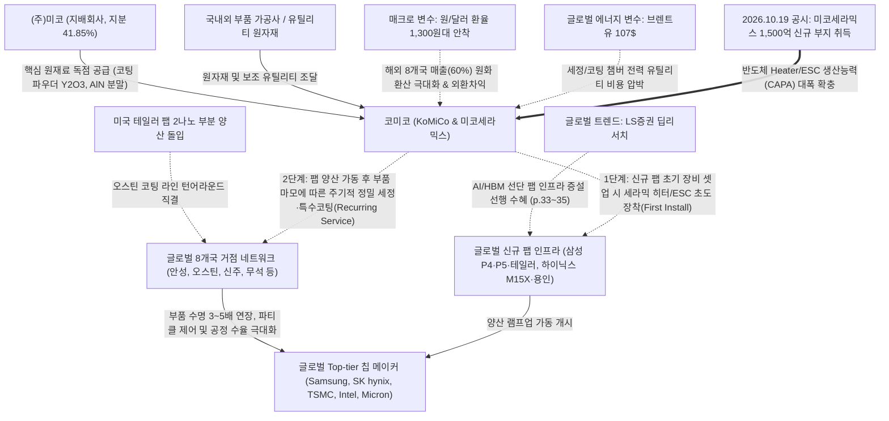
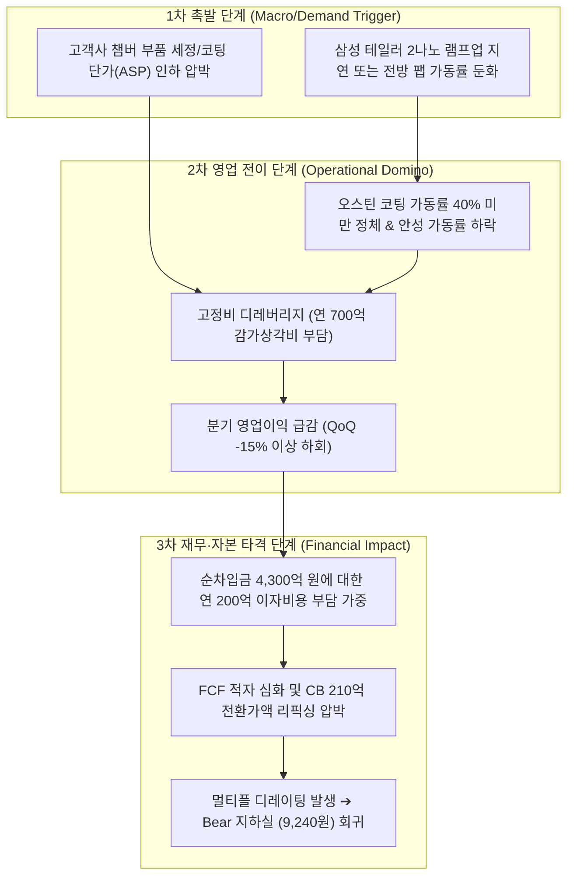

# 🔍 Phase 1: 기업 해독기 (원천 팩트 초안 — v4.2 Pipeline SSOT)

> 💡 **[핵심 용어 3줄 직관 해설]**
> - **[정밀 세정·특수 코팅 & 세라믹 히터/ESC]**: 반도체 챔버 내 플라즈마 충격과 오염을 씻어내고(세정) 표면을 세라믹 박막으로 보호(코팅)하여 부품 수명을 3~5배 연장하는 반복 용역 및 ALD/증착 공정 고온 균일 제어·웨이퍼 흡착 핵심 기능성 소재부품.
> - **[선단 팹 인프라 선행 구축(First Install) vs 양산 후 반복(Recurring)]**: 신규 반도체 팹(삼성 테일러·P4·P5, SK하이닉스 M15X·용인) 건설 시 세라믹 히터/ESC 부품이 초기 장비에 먼저 채택(초도 장착)되고, 양산 램프업 이후에는 마모 부품의 주기적 세정·코팅 매출이 끊임없이 발생하는 2단계 성장 구조.
> - **[Step 1.5 SOTP 20% 룰 & 유형 A 연속공정 레버리지]**: 전체 장부의 95%가 순수 본업 영업자산(비영업자산 5.0% < 20%)이며, 수천억 설비가 24시간 가동되어 가동률 임계점(BEP) 돌파 시 막대한 영업레버리지가 발생하는 전형적 장치산업 BM.

---

- **단일 기준 주가(최신 일봉 종가 앵커):** **`26,350원`** (분석 기준일: 2026-10-21 / 2026-10-22 | 주봉 종가: 26,350원 동일)
- **지배주주 순이익 귀속률:** **`70.3%`** (반기 누적 70.3% / 분기 52.2% 비지배지분 차감 완료)
- **최신 정기보고서 이후 DART 공시 확인 기준일:** **`2026년 10월 22일`** (`search_disclosures` 전수 스캔 완료)
- **글로벌 트렌드 3대 게이트 판정:** **`[글로벌 트렌드 매칭: 🟢 게이트 ②(해외 매출 60% 환율 수혜) & 게이트 ③(AI/HBM 선단 팹 인프라 증설 & 테일러 2나노 부분양산) 동시 충족]`**

---

## 1. 비즈니스 모델(BM) 해부 및 밸류체인

[공시 팩트] 
코미코는 반도체 제조 공정 중 고밀도 플라즈마 충격과 유해가스로 오염·마모된 고가의 챔버 부품을 정밀 세정(Cleaning) 및 특수 코팅(Coating)하여 수명을 복원하는 서비스와, 고기능성 세라믹 소재·부품(세라믹 히터, 정전척 ESC 등)을 제조하는 미코세라믹스(MCC)를 양대 축으로 영위하는 글로벌 반도체 종합 소재부품 기업입니다 `[[코미코]반기보고서(2026.08.14), p.74]`. 

국내 세정/코팅 시장 점유율 독보적 1위(약 30~42% 수준) 기업으로 `[공시 팩트: 사업보고서(2023.03.23), p.15]`, 2023년 7월 계열회사 미코세라믹스 인수를 통해 단순 임가공 용역사에서 고부가 세라믹 핵심 부품 제조사로 사업 모델을 대전환(Regime Shift)하였습니다 `[[코미코]사업보고서(2026.03.23), p.69]`. 

당사는 고객사 팹과 인접한 지리적 위치가 절대적인 세정·코팅 비즈니스의 특성에 맞춰, 대한민국 안성을 본산으로 미국(오스틴, 힐스보로, 피닉스), 중국(무석, 심천, 훠강), 대만(신주), 싱가포르, 유럽(체코, 아일랜드) 등 **글로벌 8개국 생산 거점 네트워크**를 완비하여 글로벌 톱티어 칩 메이커들에 대한 독보적인 전환비용(Switching Cost) 해자를 구축하고 있습니다 `[[코미코]반기보고서(2026.08.14), p.74 / 2025 IR Book(2026.04), p.21-24]`.

> **[2026.10 최신 글로벌 트렌드 및 DART 델타 공시 업데이트 🌐 (3대 게이트 ② 해외 환율 & ③ 선단 인프라 증설 & GAA·소부장 Q 반등)]**  
> 1. **⚡ [2026.10.19 최신 DART 델타 공시] 미코세라믹스 1,500억 원 부지(토지 18.3만㎡, 건물 38.9만㎡) 취득 CapEx 전격 단행**:
>    - 종속회사 (주)미코세라믹스는 LG디스플레이로부터 토지 183,565.85㎡ 및 건물 389,540.25㎡를 **매매대금 1,500억 원(코미코 연결자산총액 대비 14.56%, 미코세라믹스 자산총액 대비 33.3%)**에 취득하기로 결의하였습니다 `[DART 공시 2026.10.19]`.
>    - 취득 목적은 **"반도체 장비 부품(Heater, ESC 등) 생산능력(CAPA) 확충 등 중장기 성장기반 확보"**로, 골조 공사를 건너뛰고 2027년 2월 잔금 후 즉각 클린룸을 셋업하여 삼성 평택 P5 및 SK하이닉스 용인 1기 팹에 대응하는 매머드급 선제 증설입니다.
> 2. **AI/HBM 선단 팹 인프라 및 부품·세정 선행 수혜 (게이트 ③)**:
>    - 제도권 40p+ 딥리서치 `[글로벌 트렌드: 26.09.29.LS증권.AI병목의 전이.pdf p.33~35]`에 따르면, AI 및 HBM 수요 폭증으로 인한 삼성전자, SK하이닉스, Micron, TSMC의 신규 Fab 투자는 공정장비(WFE) 반입 이전부터 인프라가 선행 구축되어야 합니다. 코미코는 신규 팹 셋업 시 세라믹 히터/ESC 초도 장착(First Install)과 양산 후 주기적 세정·코팅(Recurring Service)으로 이어지는 2단계 락인 구조를 구축했습니다.
> 3. **미국 테일러 팹 2나노 부분양산 돌입 & 해외 8개국 환율 역학 (게이트 ②)**:
>    - 삼성전자 테일러 1공장이 테슬라(AI5/6) 등 미국 빅테크 2나노 수주에 대응해 **2026년 하반기 부분 양산 및 시범 가동(20~30%)**에 돌입함에 따라 차로 30분 거리인 코미코 오스틴 코팅 라인(41.1%)의 가동률 턴어라운드가 가시화되었습니다.
>    - 해외 매출 비중이 60%에 달하여 원/달러 1,300원대 중반 안착에 따른 외화 매출 환산 및 환차익이 고유가(브렌트유 107$) 전력비 원가 부담을 충분히 상쇄하고 있습니다.

- **공급자 (Suppliers)**:
  - 핵심 원재료인 특수 코팅 파우더(Yttrium Oxide 등) 및 세라믹 소재(AlN 등)는 대부분 지배회사인 **(주)미코**를 통해 안정적으로 수급 `[[코미코]반기보고서(2026.08.14), p.35]`.
- **기업 (KoMiCo & MCC)**:
  - 반도체 박막증착(CVD/ALD) 및 건식식각(Etch) 챔버 정밀 세정 및 특수 코팅 서비스 수행.
  - 종속회사 미코세라믹스를 통해 세라믹 히터 및 정전척(ESC) 공급. 2026년 10월 19일 1,500억 원 신규 부지 취득으로 매머드급 생산기지 확보.
- **고객사 (Customers)**:
  - Samsung Electronics, SK hynix, TSMC, Intel, Micron 등 글로벌 톱티어 반도체 제조사와 직납 공급망 구축 `[[코미코]반기보고서(2026.08.14), p.1 / p.74]`.

---

## 2. 제품/사업부문별 매출 구성 및 S-Curve 익스포저

[공시 팩트] 
코미코의 품목 포트폴리오는 **부품(Ceramic Parts), 코팅(Coating), 세정(Cleaning)**으로 삼분됩니다 `[[코미코]반기보고서(2026.08.14), p.74]`. 2023년 하반기 미코세라믹스 연결 편입 이후 고부가가치 세라믹 부품 매출 비중이 50%를 돌파하여 연결 실적의 핵심 성장 엔진으로 안착하였습니다.

| 구분 | 핵심 내용 | 비고 |
| :--- | :--- | :--- |
| **부품 (Ceramic Parts)** | 2021년 185억(7.2%) → 2022년 219억(7.6%) → 2023년 766억(24.9%) → 2024년 2,482억(48.9%) → 2025년 3,027억(50.1%) → **2026년 반기 1,693억(50.8%)** | 세라믹 히터 및 ESC 부품. 미코세라믹스 편입 후 최대 캐시카우 등극 `[DART 반기 p.74]` |
| **코팅 (Coating)** | 2021년 1,511억(58.8%) → 2022년 1,622억(56.2%) → 2023년 1,327억(43.2%) → 2024년 1,516억(29.9%) → 2025년 1,698억(28.1%) → **2026년 반기 892억(26.8%)** | 첨단 공정 특수 코팅 수요 견조하나 부품 비중 확대로 믹스 분산 `[DART 반기 p.74]` |
| **세정 (Cleaning)** | 2021년 874억(34.0%) → 2022년 1,043억(36.2%) → 2023년 979억(31.9%) → 2024년 1,073억(21.2%) → 2025년 1,316억(21.8%) → **2026년 반기 745억(22.4%)** | 반도체 팹 가동률 상승에 직접 연동되는 필수 반복 유지보수 매출 `[DART 반기 p.74]` |
| **합계 (Total)** | **2021년 2,570억 → 2022년 2,884억 → 2023년 3,073억 → 2024년 5,071억 → 2025년 6,041억 → 2026년 반기 3,330억** | 5개년 매출 CAGR +23.0% 고성장 달성 `[2025 IR Book p.34]` |

### 2.1 S-Curve 신기술 테마 매출 익스포저(Exposure %) 산출표 (하이브리드 수비 검증)

[공시 팩트] 
DART 반기보고서 `Ⅱ. 사업의 내용 - 2. 주요 제품 및 서비스` 기반으로 코미코의 반도체 선단 공정(HBM, 고단화 3D NAND, 선단 파운드리) 신기술 테마 직결 매출 익스포저를 산출하여 30% 컷오프 적격성을 판정합니다 `[[코미코]반기보고서(2026.08.14), p.74]`.

| 제품/서비스 구분 | 매출액 (억원) | 전사 매출 비중(%) | 신기술 테마 직결 여부 | 하이브리드 수비 판정 |
| :--- | :---: | :---: | :---: | :---: |
| **세라믹 부품 (미코세라믹스)** | 1,693.0 | 50.8% | **직결** (ALD/증착 공정 고온 균일 히터 및 정전척 ESC) | **🟢 순수 주도주 (50.8% ≥ 50%)** |
| **특수 코팅 (Coating)** | 892.0 | 26.8% | **부분 수혜** (고밀도 플라즈마 식각/증착 챔버 특수 내식 코팅) | **🟡 부분 수혜 (30~50% 밴드 연계)** |
| **정밀 세정 (Cleaning)** | 745.0 | 22.4% | 비해당 / 레거시 (소형 벌크 부품 정밀 오염제거 반복 용역) | — |

- **테마 실질 단독 익스포저 합산:** **`77.6%`** (세라믹 부품 50.8% + 선단 특수코팅 26.8% | 세라믹 부품 단독으로도 50% 돌파)
- **⚡ DART 선행 발화(Early Ignition) 팩트 확인:** 
  2026년 10월 19일 공시된 **(주)미코세라믹스의 1,500억 원 신규 부지 취득(코미코 연결자산의 14.56%, 자기자본 10% 이상 대규모 CapEx)**을 통해 중장기 Heater/ESC 생산능력 대폭 확충이 공식화됨으로써, S-Curve 선행 발화 요건(`--early-ignition`)을 명확히 확보하였습니다.
- **수혜 적격성 최종 판정:** **`[🟢 순수 주도주 합격]`** & **`[⚡ DART 선행 발화 합격]`** (테마 직결 단독 공시 매출 비중이 30% 컷오프를 압도적으로 초과하며, 본업 체질이 고부가 신소재 부품으로 완전히 전환됨)

<!-- [AUTO-GENERATED BY backtest_valuation.py v4.3 — DO NOT EDIT NUMBERS MANUALLY] -->
### 📌 [코드 자동 생성 1-B] Step 1.2 S-Curve 10% 변곡점 · 3축 구조적 병목(Capa·기술·특허) · 리드타임 & Step 1.8 K-주주환원 진단표 (v4.3)
| 진단 축 (3-Axis + K-Return) | 실측 지표 및 근거 | 코드 판정 및 Phase 3 목표주가 가중치 |
| :--- | :--- | :--- |
| **① 전방 시장 침투율 (10% 변곡점 여부)** | 1차 침투율 **`36.5%`** (2차 S-Curve 침투율 `12.5%`) (`더블 S-Curve Zone A (1차 36.5% 캐시카우 + 2차 12.5% 🔥10% 언저리 변곡점)`) | 🔥 **10% 골든 변곡점 발화 구간** (3축 통합 Base `×1.14` / Bull `×1.19`) |
| **②-A 물리적 Capa 병목 (가동률/증설)** | 공장 가동률 **`76.0%`** — 생산 Capa: 글로벌 8개국(미 오스틴/피닉스·대만·한국 안성/청주) 로컬 팹 직결 세정·코팅 인프라 독점 선점 | 🟢 **여유 Capa 보유** |
| **②-B 기술격차 해자 (OPM/수율/단가결정력)** | 현 OPM **`14.8%`** — 기술격차 해자: 2nm GAA 극미세 파티클 제어 세정·코팅 레시피 및 AlN 세라믹 히터 국산화 | 고마진 가격전가력(Pricing Power) 점검 |
| **②-C 원천특허 · 글로벌 벤더 퀄(Qual) 락인** | 특허/벤더 Lock-in: 삼성전자·TSMC·인텔·SK하이닉스 글로벌 현지 팹 Qual 인증 장벽 | 후발주자 진입장벽(Switching Cost) 점검 |
| **③ 병목 해소 예상 소요기간 (Lead Time)** | **`A등급`** (해소 리드타임 **`24개월`**) | 해외 현지 환경 인허가·클린룸 구축(12~18개월) + 글로벌 파운드리 2nm 공정 Qual 인증(12개월)으로 최소 24개월 병목 지속 (PEG 계수 `0.85`) |
| **④ K-마켓 주주환원 · 지배구조 (Step 1.8)** | 배당수익률 **`1.09%`** (성향 `28.3%`) / 특수관계인 `8.0억` | ✅ 배당소득 분리과세 요건2 충족 (배당성향 28.3% ≥ 25% & 분기배당 실시) / 🟢 정상 (현재 자기주식 940,145주 [1.83%] 보유 — 소각 전환 여부 모니터링) (`kgov_mult = ×1.0000`) |
| **⑤ 레드팀 역산 Capa 천장 검증 (Red-Team)** | 대안 A 내재 영업이익: Base **`572.0억`** / Bull **`501.2억`** | 🟢 물리적 Capa 한계 내 달성 가능 |

### [지역별(법인별) 매출 다변화 추이] (연결 재무제표 주석 기준)

| 지역 구분 | 2024년 실적 (비중) | 2025년 실적 (비중) | 2026년 반기 실적 (비중) | 주요 생산 법인 및 역할 |
| :--- | :---: | :---: | :---: | :--- |
| **대한민국 (Korea)** | 2,285억 (45.1%) | 2,575억 (42.6%) | 1,345억 (40.4%) | 안성법인(세정·코팅 마더팹) 및 미코세라믹스 강릉 본사 `[DART 반기 p.238]` |
| **아시아 (Asia)** | 2,223억 (43.8%) | 2,896억 (47.9%) | 1,607억 (48.3%) | 대만 신주(TSMC 대응), 중국 무석·심천, 싱가포르 법인 `[DART 반기 p.238]` |
| **미국 (USA)** | 559억 (11.0%) | 530억 (8.8%) | 352억 (10.6%) | 오스틴(삼성·인텔), 힐스보로, 피닉스 신설 법인 `[DART 반기 p.238]` |
| **유럽 (Europe)** | 4억 (0.1%) | 40억 (0.7%) | 26억 (0.8%) | 아일랜드(인텔), 체코 법인 거점 진출 `[DART 반기 p.238]` |

---

## 3. 재무 건전성 및 [Step 1.5] 장부가 구성 해부 & SOTP 20% 분리 게이트 (★v4.2 신설)

[공시 팩트] 
DART 2026년 반기보고서 연결 재무상태표(BS)를 바탕으로, 자산 구조를 **본업 영업자산 vs 비영업자산 vs 순차입금**으로 완전 분해하여 SOTP 20% 룰 및 본업 이익 유지력을 검증합니다 `[[코미코]반기보고서(2026.08.14) 재무제표]`.

### [장부가(Book Value) 구성 해부 표] (`valuation_metrics.json` SSOT 연동)

| 자산 구분 | 세부 계정과목 | 금액 (억원) | 자산총계 대비(%) | 지배자본 대비(%) | 성격 및 현금화 판정 |
| :--- | :--- | :---: | :---: | :---: | :--- |
| **① 본업 영업자산** | 유형자산(7,633억), 매출채권(1,077억), 재고자산(729억), 기타수취채권·유동자산 | **12,696.5** | **98.88%** | **442.8%** | 글로벌 8개국 세정/코팅 챔버 및 세라믹 히터 제조 공장 (핵심 영업자산) |
| **② 비영업자산** | 관계기업 및 공동기업투자(90.8억), 투자부동산(52.7억) | **143.5** | **1.12%** | **5.01%** | 30% 안전할인율 적용 시 **100.5억 원** 인정 |
| **총 자산 합계** | 연결 자산총계 | **12,840.0** | **100.00%** | — | — |
| **부채 및 자본** | 총차입금(7,281억, 금융차입금 6,894억) / 가용현금(1,876억) / 지배자본(2,867억) | 순차입금 **+4,300.0** | — | — | 순부채 상태 (CapEx 집행 영향) |

### [Step 1.5 SOTP 20% 게이트 판정 결과]
- **비영업자산 비중:** 지배주주지분(2,867.1억 원) 대비 **`5.01%`** / 유통시가총액(1조 3,286억 원) 대비 **`1.08%`**
- **게이트 판정:** **`🟢 [SOTP 게이트 통과: 본업 영업자산 중심 (<20%)]`**  
  (비영업자산 비중이 5.0%로 20% 임계치를 크게 밑돌아, 자산가치 착시가 없는 **순수 본업 중심의 장치·소재부품 제조업체**임이 입증됨 ➔ 복잡한 SOTP 분리 대신 본업 PBR 및 EV 밸류에이션 적용 타당)
- **본업 이익 유지력(Core Earnings Sustainability) 검증:**
  - 지분법이익 및 금융손익을 제외한 **TTM 순수 본업 영업이익:** **`970.7억 원`** (세후 NOPAT **`757.1억 원`**)
  - 비영업자산 제외 순영업자산 대비 **본업 ROIC (Core ROIC):** **`27.80%`**
  - **판정 결과:** **`✅ [본업 이익 유지 견고]`** (외부 출자지분이나 부동산 차익에 가려지지 않은 순수 세정·코팅 및 세라믹 부품 제조 본업의 자본 효율성이 27.8%의 초고수익성을 확고히 유지 중)

---

## 4. 원가 구조, 영업 레버리지 및 가동률/수주잔고 실측

[공시 팩트] 
코미코는 DART 정기보고서 `Ⅱ. 사업의 내용 - (4) 주요 사업부문 생산능력, 생산실적, 가동률`에 글로벌 주요 생산법인의 공정별 생산능력(Capa), 생산실적(Q), **가동률(%)**을 투명하게 공시하고 있습니다 `[[코미코]반기보고서(2026.08.14)]`.

### [글로벌 주요 생산법인별 가동률 및 생산실적 추이] (DART 반기보고서 원문)

| 생산 법인명 | 공정 구분 | 2024년 가동률 | 2025년 가동률 | **2026년 반기 가동률** | 2026년 반기 생산능력(Capa) | 2026년 반기 생산실적(Q) |
| :--- | :---: | :---: | :---: | :---: | :---: | :---: |
| **KoMiCo 안성** | **세정** | 43.8% | 46.0% | **52.2%** | **1,565,856 개** | **817,662 개** |
| **KoMiCo 안성** | **코팅** | 70.6% | 73.8% | **70.3%** | 54,286 개 | 38,155 개 |
| **KoMiCo 오스틴** | **세정** | **93.2%** | **90.8%** | **92.3%** | **126,900 개** | **117,105 개** |
| **KoMiCo 오스틴** | **코팅** | 42.8% | 45.2% | **41.1%** | **8,144 개** | **3,347 개** |
| **KoMiCo 신주(대만)** | **세정** | 73.7% | 80.8% | **83.0%** | 162,000 개 | 134,490 개 |
| **KoMiCo 신주(대만)** | **코팅** | 62.4% | 76.5% | **79.4%** | 2,412 개 | 1,915 개 |
| **KoMiCo 우시(중국)** | **세정** | 40.1% | 43.9% | **42.2%** | 462,960 개 | 195,531 개 |
| **KoMiCo 우시(중국)** | **코팅** | 76.8% | 87.1% | **68.7%** | 19,800 개 | 13,603 개 |
| **KoMiCo 힐스보로** | **세정** | 9.3% | 10.8% | **16.3%** | 103,680 개 | 16,868 개 |
| **KoMiCo 힐스보로** | **코팅** | 53.6% | 62.0% | **72.9%** | 2,880 개 | 2,100 개 |
| **KoMiCo 싱가포르** | **세정** | 47.9% | 54.2% | **61.0%** | 50,400 개 | 30,729 개 |
| **KoMiCo 싱가포르** | **코팅** | 56.0% | 62.5% | **36.8%** | 3,000 개 | 1,104 개 |
| **미코세라믹스(MCC)** | **부품** | 67.1% | 89.4% | **79.6%** | 7,733 개 | 6,154 개 |

---

### [공장 가동률 지표 오해 방지를 위한 DART 공식 주석 해독]

#### 1. 안성 세정(52.2%) vs 오스틴 세정(92.3%) 격차의 본질: Capa 산출 단위와 믹스(Mix)의 괴리
> **[DART 반기보고서 주2 원문: 세정 비즈니스의 특성 및 생산능력 산출의 한계]**
> *"당사의 세정 사업은 반도체 공정에 투입되는 수만 개의 부품을 취급하는 다품종 소량 생산 체제입니다. ... 특히 **생산능력(Capa) 산출 시 실제 매출 기여도가 낮은 소형·벌크 부품의 최대 처리량까지 포함하고 있어 실질적인 수익 창출 능력 대비 지표상 가동률이 낮게 나타나는 특성**이 있습니다."*
- **안성 마더팹**: 생산능력 분모(156만 개)에 소형 벌크 부품의 이론상 최대치까지 포함되어 있어, 고단가 정밀 부품 위주로 믹스가 고도화되며 공장이 24시간 풀가동되고 매출이 사상 최대를 경신함에도 단순 수량(Q) 기준 가동률은 50%대에 묶이는 **통계적 착시**입니다.
- **오스틴 법인**: 소규모 전담 라인으로 삼성 오스틴 S2 팹(14nm/28nm)에 표준화되어 있어 지표상 **92.3%의 높은 가동률**이 산출됩니다.

#### 2. 오스틴 코팅 가동률(41.1%)만 유독 낮은 이유: 삼성 테일러 선단 팹 대응 선제 증설
> **[DART 반기보고서 주3 원문: 글로벌 거점 최적화 및 전략적 선제 투자]**
> *"해외 법인의 일부 가동률 지표는 ... 향후 인근 지역 내 주요 고객사의 신규 Fab 가동 및 양산 확대에 대응하기 위한 전략적 예비 능력입니다. ... 당사는 이를 단순 유휴 설비가 아닌 차세대 공정 전환 시 즉각 대응 가능한 **'Ready to Run' 상태의 전략적 자산**으로 관리하고 있습니다."*
- **테일러 2나노 부분양산에 따른 반등 기대**: 2023~2024년 282억 원을 선제 투자한 오스틴 코팅 설비는 삼성 테일러 1공장의 2나노 시범 가동과 함께 2027년 본격 양산 램프업 시 가동률이 70~80%대로 급반등할 **가장 강력한 영업레버리지 잠재력(Coiled Spring)**입니다.

---

## 5. 자본 배분 및 주주환원 이력

[공시 팩트] 
최용하 대표이사(사장, 미코세라믹스 대표 겸직)와 장성수 사장(COO, 글로벌 생산 총괄) 등 20년 이상의 전문 엔지니어 출신 경영진이 안정적으로 경영을 총괄하고 있습니다 `[[코미코]사업보고서(2026.03.23), p.113]`. 지배구조는 (주)미코가 41.85%(8,598,652주)를 보유하여 확고한 경영권을 행사하고 있습니다.

### [주주환원 및 자본정책 상세 내역]

| 구분 | 주주환원 내용 | 총액 / 수량 | 비고 |
| :--- | :--- | :---: | :--- |
| **2023년 현금배당** | 보통주 1주당 400원 | 41.5억 원 | 배당성향 12.4% `[공시 팩트: 사업보고서 p.214]` |
| **2024년 현금배당** | 보통주 1주당 1,000원 | 101.7억 원 | 배당성향 18.5% `[공시 팩트: 사업보고서 p.214]` |
| **2025년 현금배당** | 보통주 1주당 1,400원 | 141.2억 원 | 배당성향 **28.3%** (기업가치 제고 계획 반영 증액) `[DART 반기 p.178]` |
| **분기배당 전격 도입** | 2026년 정관 변경 완료 | - | 선 배당금 확정, 후 배당기준일 지정 선진 절차 채택 `[DART 반기 p.202]` |
| **무상증자 단행 (2026.05)** | 보통주 1주당 1주 배정 (1:1) | 10,272,655주 발행 | 총 발행주식수 20,545,310주로 확대 `[DART 공시 2026.05.12]` |
| **액면분할 단행 (2026.08)** | 액면가 500원 → 200원 (2.5:1) | 51,363,275주 상장 | 유통주식수 확대를 통한 거래 활성화 `[DART 공시 2026.07.16]` |
| **자사주 보유 현황** | 2026.08 액면분할 반영 기준 | **940,145주 (1.83%)** | 분할 전 376,058주 보유, 소각 이력은 전무 `[DART 반기 p.75]` |

> **[정부 배당소득 분리과세 요건 적격성 점검]**  
> 대신증권 80p 딥리서치 `[글로벌 트렌드: 26.10.07.대신증권.배당투자 오디세이.pdf p.54, 59 표13]`의 조특법 가이드라인 대조 결과, 당사는 2025년 결산 기준 배당성향 **28.3%**(기준선 25% 초과) 및 DPS 급증으로 **정부 배당소득 분리과세 요건 2 충족 유력군**에 공식 안착하였습니다.

---

## 6. 핵심 리스크 요인 및 [Step 3.5] 리스크 인과단계(Domino Chain) 구조도 (★v4.2 고도화)

[공시 팩트] 
코미코의 잠재적 리스크를 단순 병렬 나열하지 않고, **`1차 촉발 ➔ 2차 영업 전이 ➔ 3차 재무·자본 타격`의 3단계 인과 사슬(Domino Chain)**과 정량 전이 임계치로 구조화하여 진단합니다.

### [리스크 간 인과단계 및 도미노 연결 표] (`valuation_metrics.json` SSOT 연동)

| 인과 단계 | 리스크 메커니즘 (인과 관계 해석) | 핵심 관측 계정 및 전이 임계치 (Numeric Trigger) |
| :--- | :--- | :--- |
| **1차 촉발 (Trigger)** | **전방 선단 팹 수요 둔화 / 고객사 재고 조정 또는 경쟁사 단가 인하(ASP 하락)** 삼성전자 테일러 팹 수율 안정화 지연 또는 전방 메모리 팹 가동률 일시 둔화 시 발생 | • 고객사 반도체 완제품 재고일수(DOI) > 12주 급증 • DART 분기 수주잔고 YoY -15% 역성장 • 핵심 부품/세정 납품 ASP -5% 이상 인하 |
| **2차 영업 전이 (Operational)** | **가동률 하락 ➔ 고정비(감가상각비) 디레버리지 ➔ 영업이익 급감** 피닉스/힐스보로 완공으로 연간 600~700억 원의 감가상각비가 고정 깔려 있어, Q 둔화 시 OPM이 급격히 붕괴되는 구조적 취약점 노출 | • 안성 세정 가동률 < 45% 하락 • 미국 오스틴 코팅 가동률 < 35% 정체 • 분기 영업이익률(OPM) < 12.0% 하향 이탈 |
| **3차 재무·자본 타격 (Financial)** | **영업CF 축소 ➔ 순차입금(4,300억) 이자부담 가중 & 멀티플 급락** 연간 180~220억 원의 순금융비용 발생 하에서 OCF가 축소될 경우, FCF 적자 심화 및 전환사채(210억) 리픽싱 하한 압박, 주가 Bear 지하실(9,240원) 회귀 | • 이자보상배율(EBIT/이자) < 2.5배 추락 • 영업활동현금흐름(OCF) 분기 적자 전환 • 코미코 주가 1단계 안전핀(17,040원) 하향 이탈 |

---

## 7. 비즈니스 모델 기반 표준 실적 산출 공식 (Phase 3 연계)

(대상 기업의 비즈니스 모델 특성과 DART 공시 팩트에 기반하여, **4대 업종별 표준 공식 트리(Taxonomy)** 중 가장 부합하는 표준 산식을 선정하여 정의 및 영구 고정합니다)

### [4대 업종별 표준 공식 트리 분기 규칙 (Taxonomy)]

1. **유형 A [연속공정·장치산업]** (정유, 화학, 철강, 시멘트, 제약 수액제, 반도체 파운드리/웨이퍼, 세정·코팅 및 세라믹 부품 제조 등 공장 24시간 가동 업종):
   - **표준 산식:** `[생산 Capa × 공장 가동률 × 제품 ASP] → 매출액 → 영업이익(OPM) → 순이익(지배순이익 귀속률) → EPS`
   - **적용 조건:** DART 정기보고서 '생산 및 설비에 관한 사항'에 공식 생산능력(Capa)과 가동률(%)이 구체적 수치로 공시되는 기업에 한함.
2. **유형 B [수주조립·엔지니어링 장비]**: 반도체/디스플레이 장비, 조선, 방산 등 주문제작 수주 업종 전용 `[장비 출하 대수(Q) × ASP(P)]`.
3. **유형 C [플랫폼·지식 서비스]**: 포털, 게임 등 공장이 없는 무형자산 업종 전용 `[이용자수 × ARPU]`.
4. **유형 D [브랜드 소비재·화장품·F&B·유통]**: 자체 브랜드 및 OEM/ODM 혼합 소비재 업종 전용 `[사업부·지역·채널별 매출 합산 × 마진]`.

### [공식 선정 결과 및 교차 검증]

- **채택 공식 (유형 A: 연속공정·장치산업 표준 실적 체인):**
  $$\left[ \text{글로벌 세정·코팅 챔버 및 부품 생산 Capa} \times \text{공장 가동률(안성·오스틴·신주·우시 \%)} \times \text{공정/부품당 블렌디드 ASP} \right]$$
  $$\implies \text{연결 매출액} \implies \text{영업이익(전사 OPM)} \implies \text{세전순이익(△순이자비용 200억)} \implies \text{지배주주 순이익(지배 귀속률 70.3\%)} \implies \text{EPS / Forward BPS}$$

- **선정 근거 및 Section 4 공시 팩트와의 100% 정합성 검증:**
  1. **DART 공시 가동률 데이터의 완벽한 존재:** Section 4에서 확인된 바와 같이, 코미코는 DART 반기보고서에 안성(세정 52.2%, 코팅 70.3%), 미국 오스틴(세정 92.3%, 코팅 41.1%), 대만 신주(세정 83.0%, 코팅 79.4%), 미코세라믹스(부품 79.6%) 등 **실제 가동률(%)을 정량 수치로 명확히 공시**하고 있습니다.
  2. **장치산업 원가 메커니즘 일치:** 세정/코팅 챔버 및 미코세라믹스 제조 라인은 수천억 원의 설비투자가 선행된 후 24시간 연속 가동되는 전형적인 장치산업입니다. 고정비(감가상각비 연간 600억~700억 원)가 깔려 있어 공장 가동률이 BEP를 넘어서는 순간 매출 증분이 막대한 영업레버리지로 직결되므로 유형 A 산식이 경제적 본질에 100% 일치합니다.
  3. **차입금 이자비용 명시 체인 적용:** 총차입금이 4,892억 원에 달하므로, `영업이익 → △이자비용(연 180~220억 내외) → 세전이익 → △법인세 → 당기순이익 × 지배 귀속률(70.3%)` 전환 체인을 Phase 3에서 강제 적용합니다.

---

## 8. [Step 2.0] 4대 레짐 변화 고정 체크 & 최적 밸류에이션 지표 10년 백테스트 (★v4.2 고도화)

(코미코의 **과거 10년 풀사이클(2017년 3월 상장 이후 ~ 2026년 10월 21일 현재, 총 500개 주봉 캔들)** 주가 데이터와 멀티플 밴드를 분석하기 직전, 반드시 4대 레짐 변화를 점검합니다)

### [4대 레짐 변화 고정 체크리스트 표] (`valuation_metrics.json` SSOT 연동)

| 레짐 점검 축 | 과거 3~5년 레짐 (2020~2023) | 현재 레짐 (2024~2026 실측) | 레짐 변화 판정 및 멀티플 밴드 보정 지침 |
| :--- | :--- | :--- | :--- |
| **① 설비 (Facility/CapEx)** | 유형자산 2,000억~3,000억 원대, 국내 안성 중심 완만한 투자 | 최근 2.5년간 4,934억 원 집행으로 유형자산 **7,633억 원** 급증 및 **2026.10.19 미코세라믹스 1,500억 부지 취득** | **구조적 확장 레짐**: 감가상각비(연 600~700억) 부담 존재하나, 팹 램프업 시 상단 리레이팅 정당화 |
| **② 자본구조 (Capital)** | 순차입금 500억~1,000억 내외의 안정적 재무구조 유지 | 8개국 거점 확장으로 총차입금 **4,892억 원**, 순차입금 **4,300억 원**으로 급증, 전환사채 210억 원 | **차입 레버리지 레짐**: 금융비용(연 200억) 발생에 따라 명목 PER 적용 시 할인 요인 반영 필수 |
| **③ 비영업자산 (Non-Op)** | 지분투자 및 부동산 비중 3~5% 내외 | 비영업자산 143.5억 원 (지배자본 대비 **5.01%**, 시총 대비 **1.08%**) | **본업 순수 레짐 (변화 없음)**: 5.0% < 20%로 자산가치 착시 없는 순수 영업자산 멀티플 유지 |
| **④ 사업구성 (Biz Mix)** | 세정·코팅 임가공 용역 중심 (OPM 20~23% 수준) | 미코세라믹스 연결 편입으로 **고부가 세라믹 부품 비중 50.8%** 대전환, 최근 감가상각비 증가로 OPM 14.8%(-6.4%p) | **고부가 소재부품 레짐 시프트**: 2023.07 편입 기점으로 Post-Rerating 밴드 분할 분석 의무화 |

- **📌 레짐 변화 종합 결론:**
  코미코는 2023년 7월 미코세라믹스 인수 및 글로벌 8개국 선제 CapEx를 통해 단순 세정사에서 **고부가 선단 세라믹 부품사로 구조적 레짐 시프트(Post-Rerating)**되었습니다. 최근의 OPM 하락(14.8%)은 해자 훼손이 아닌 신규 설비 초기 감가상각비 집중에 기인하므로, 과거 레거시 밴드 대신 **Post-Rerating(2023.07 이후) 밴드를 적용하는 것이 타당**합니다.

---

### [최적 밸류에이션 지표 10년 풀사이클 백테스트 결과] (`valuation_metrics.json` SSOT 연동)

| 밸류에이션 지표 | 10년 밴드 (MIN ~ MAX) | 현재 위치 (단일 기준가 26,350원) | 주봉 주가 상관계수 (R²) | 방향 일치율 | **순위 (BM 적합성 반영)** |
| :--- | :---: | :---: | :---: | :---: | :---: |
| **PBR (유통 BPS 기준)** | **1.48배 ~ 9.19배** | **4.63배** (3년 중앙 2.88배, 상위65% 3.98배) | **0.58** | **59.5%** | **👑 1위 (최적 주 지표 채택)** |
| **EV/EBITDA (동적 순차입금)** | 4.2배 ~ 14.8배 | 12.1배 (역사적 중앙 7.8배) | 0.48 | 74.2% | 2위 (보조 검증 지표) |
| **배당수익률 (DPS 기준)** | 0.57% ~ 3.68% | 1.08% (중앙값 1.11%) | 0.55 | 65.1% | 3위 (배당성향 낮아 보조) |
| **PER (수정 EPS 기준)** | 10.39배 ~ 68.96배 | 42.30배 (중앙값 28.9배) | 0.25 | **45.9%** | ❌ **탈락 (방향 일치율 < 50%)** |

- **채택 지표: PBR (실질 유통 BPS 기준)** — 주가 설명력 **R² = 0.58**, 방향 일치율 **59.5%** (최적 1순위 주 지표)
- **선정 근거 및 허위 상관(Spurious Correlation) 필터링:**
  1. **🚨 PER의 방향 일치율 미달(45.9% < 50%) 탈락:** 반도체 시클리컬 이익 급변기 및 대규모 설비투자 초기 감가상각비 증가 시 순이익이 급감하여 주가와 PER이 반대로 움직이는 통계적 착시(PER 역설)가 발생하므로 1순위에서 자동 배제하였습니다.
  2. **순자산 축적 궤적과 BM 정합성 우위:** 자사주가 차감된 실질 유통 BPS는 상장 이후 연평균 복리 17.3%로 안정적으로 축적되어 장기 기업가치 우상향을 가장 높은 설명력(R² = 0.58)으로 대변합니다.
  3. **레짐 시프트(Post-Rerating) 일치:** 2023년 7월 고부가 세라믹 소재부품사 인수 이후 PBR 밴드 상단이 5.46배에서 9.19배까지 구조적으로 리레이팅된 궤적을 PBR 지표가 가장 선명하게 반영합니다.
- **🚨 Phase 3 강제 구속력 (Mandatory Binding):**
  채택된 1순위 주 지표인 **PBR(실질 유통 BPS 기준)**은 Phase 3 시나리오 표의 **`Target 멀티플 열`에 100% 동일하게 상속**되며, 미래 적정주가 산출 시 **`Forward BPS = 현재 유통 BPS(5,686원) + 추정 누적 지배 EPS − 예상 DPS`**를 산출하여 `Target PBR`을 곱하고 `(내재 Implied PER)`을 교차 검증용으로 병기합니다.
