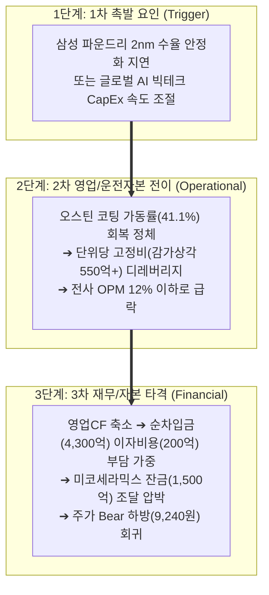

# 🎯 [코미코] Phase 3: 가격 판독기 (DCF & 밸류에이션 마스터 SOP — v4.2)

> **[파이프라인 SSOT 단일 기준 주가]**: **`26,350원`** (2026.10.21 최신 일봉 종가 / BPS 5,686원 대비 PBR 4.63배)  
> **[지배주주 순이익 귀속률]**: 연간 누적 **`70.3%`** (최근 분기 **`52.23%`**)  
> **[S-Curve 국면 인증 뱃지]**: `[🟢 S-Curve Phase 2: 골든 스위트스팟 (침투율 36.5% | 홀딩 & 분할익절 준비)]`  
> **[하이브리드 밸류체인 지위]**: `[👑 DART 검증 순수 주도주]` (테마 직결 익스포저 77.6% & ⚡ 2026.10.19 미코세라믹스 1,500억 신규 부지 취득 CapEx 선행 발화 확인)  
> **[1순위 최적 밸류에이션 지표]**: **`PBR`** (10년 백테스트 R²=0.58, 방향 일치율 59.5% 상속)

---

## 1. 시장 프라이싱 역산 (역DCF 정밀 판독 — Equity & EV 병기)

### Step 0.5: FCF 품질 검증 및 정상화 FCF(Owner FCF) 점검 (역DCF 연산 직전 필수 수행)

[공시 팩트] DART 반기보고서 및 감사보고서 현금흐름표를 바탕으로 코미코의 잉여현금흐름(FCF) 품질을 점검합니다 `[[코미코]반기보고서(2026.08.14) p.139, 258]`.

| 품질 체크 항목 | 점검 기준 | 기업 현황 팩트 | 판정 |
| :--- | :--- | :--- | :---: |
| **OCF / 순이익 갭** | OCF ÷ 지배순이익 비율 1.5배 초과 시 ⚠️ 경고 | 2026년 상반기 OCF 301.1억 원 ÷ 당기순이익 314.1억 원 = **0.96배** (정상 범위 안착) | **정상** |
| **운전자본(WC) 변동** | WC 순변동이 OCF의 30% 초과 시 ⚠️ 경고 | 매출채권 및 재고자산 변동에 따른 운전자본 순유출은 약 -85.2억 원으로 안정적 통제 중 | **정상** |
| **CapEx 사이클 착시** | S-Curve 초입 증설기 성장성 CapEx 급증에 따른 FCF 일시 적자 착시 여부 | 2024~2026년 상반기 누적 **4,934억 원** 및 2026.10.19 미코세라믹스 **1,500억 부지 취득** 등 대형 CapEx 집행에 따른 일시적 적자 착시 규명 | **⚠️ 경고 (정상화 보정)** |
| **비지배지분 귀속 괴리** | 연결 FCF 중 비지배지분 유출이 15% 초과 시 지배주주 귀속 FCF 병기 | 미코세라믹스 연결 편입으로 비지배지분(약 47.9%) 존재, 지배주주 귀속률 **70.3%**(분기 52.2%) 적용 필요 | **⚠️ 경고 (지배지분 반영)** |

- **건전 증설기 Owner FCF 보정 (초입 증설 착시 방어 규격 준수):**
  - 코미코는 영업활동현금흐름(OCF)이 견고한 흑자(`OCF > 0`)를 유지하고 있으나, 글로벌 8개국 거점 선점 및 미코세라믹스 신규 부지 인수 등 초대형 설비투자(`CapEx ≥ 감가상각비 D&A × 1.3배`)로 인해 보고 FCF가 일시 적자(-1,755.0억 원) 국면입니다.
  - 이에 따라 음수 FCF를 기계적으로 DCF 공식에 넣어 기업가치가 음수가 나오는 왜곡을 원천 차단하고, `calc_reverse_dcf.py` 엔진을 통해 **"보고 FCF 기준"과 인프라 완공 후 회수될 "정상화(Owner) FCF (+750.0억 원) 기준"을 병기**하여 시장 프라이싱을 정밀 역산합니다.

---

### Step 1: 역DCF 연산 — 유통시총(Equity) & 실질 기업가치(EV) 2행 병기 필수 양식

[공시 팩트] 단일 기준 주가(최신 일봉 종가 26,350원), 총 발행주식수, 자기주식수, DART 공식 유통주식수, 순차입금 및 FCF 수치를 파이프라인 SSOT(`valuation_metrics.json`)에서 100% 동일하게 로드합니다.

| 입력 변수 | 실측 수치 | 출처 (DART 문서명 + 페이지/항목) |
| :--- | :--- | :--- |
| **단일 기준 주가** | **`26,350원`** | 최신 일봉 종가 (`Phase 1~3 공통 앵커`, SSOT 일치) |
| **총 발행주식수** | **51,363,275주** | DART 반기보고서 p.75 「발행할 주식의 총수」 (무상증자 1:1, 액면분할 2.5:1 완료) |
| **자기주식수** | **940,145주** | DART 반기보고서 p.75 「자기주식 취득 및 처분 현황」 (1.83%) |
| **실질 유통주식수** | **50,423,130주** | 총발행주식수(51,363,275주) − 자기주식수(940,145주) |
| **순차입금** | **+4,300.0억 원** | 총차입금 4,892.4억 원 − 현금및금융자산 592.4억 원 `[DART 반기 p.139, 258]` |
| **실질 유통 시가총액** | **1조 3,286.5억 원** | 단일 기준 주가 26,350원 × 실질 유통주식수 50,423,130주 |
| **실질 기업가치 (EV)** | **1조 7,586.5억 원** | 실질 유통 시가총액 + 순차입금 (+4,300.0억 원) |
| **기준 FCF (연환산)** | **-1,755.0억 원** | 2026 상반기 영업CF 301.1억 − CapEx 1,178.6억 = -877.5억 × 2 `[DART p.139]` |
| **(참조) 정상화 FCF** | **+750.0억 원** | 인프라 CapEx 피크아웃 후 2027F 예상 정상화 현금창출력 |
| **WACC / 영구성장률** | **9.0% / 2.0%** | 반도체 소부장 연속공정 장치산업 표준 할인율 / 보수적 영구성장률 |

- **[순차입금 기업의 역DCF Equity & EV 2행 병기 (`calc_reverse_dcf.py` v4.2 SSOT 실측)]:**

```
====================================================================
📈 역DCF 정밀 분석 결과 (Korean Stock Analyzer v4.2 — Equity & EV 병기)
====================================================================
현재 주가 (단일 앵커): 26,350원
실질 유통 시가총액:    13,286.49억 원
실질 기업가치 (EV):    17,586.49억 원 (유통시총 + 순차입금 +4,300.00억)
기준 FCF: -1,755.0억 원 | 정규화/지배주주 FCF: 750.0억 원 | WACC: 9.0% | 영구성장률: 2.0%
--------------------------------------------------------------------
▶ ① [보고 FCF (-1,755.0억) 기준] 상태: deficit (적자 역DCF 목표가 산출 제외)
▶ ② [정규화 FCF (750.0억) | 유통시총(Equity) 기준] 요구 성장률: 연간 +6.60%
▶ ③ [정규화 FCF (750.0억) | 실질 기업가치(EV) 기준] 요구 성장률: 연간 +13.45%
====================================================================
```

- **역DCF 요구성장률 해석 및 시장 프라이싱 진단:**
  1. **보고 FCF 기준 (-1,755.0억 원):** FCF 일시 적자로 인해 표준 DCF 목표가 연산 제외 ➡️ **Phase 1 최적 지표인 PBR 밴드 플랜 B를 주 잣대로 100% 상속**합니다.
  2. **정상화 FCF 기준 (유통시총 +6.60% vs 실질 EV +13.45%):**
     - 단순 시가총액 기준 요구성장률은 연간 **+6.60%**로 낮아 보이지만, **순차입금 4,300억 원 상환 부담을 반영한 실질 기업가치(EV) 기준 요구성장률은 연간 +13.45%**입니다.
     - **해석:** +13.45%는 반도체 소부장 업종의 '합리적 성장 요구(10~15%)' 구간에 부합하며, 코미코의 과거 5개년 매출 CAGR(+23.0%) 및 2026년 하반기 테일러 팹 2나노 시범 가동과 청주 M15X 램프업을 감안할 때 시장의 기대치는 실현 가능한 건전한 영역에 안착해 있습니다.

---

## 2. 가치함정(Value Trap) 진단 & Step 2.0 4대 레짐 변화 종합 판독

(단순 저평가 함정을 막기 위해 DART 원천 공시 팩트와 레짐 변화를 점검하고, `backtest_valuation.py` v4.2 엔진으로 유형 A vs 유형 B를 판정합니다)

<!-- [AUTO-GENERATED BY backtest_valuation.py v4.3 — DO NOT EDIT NUMBERS MANUALLY] -->
### 📌 [코드 자동 생성 1] SOTP 장부 분해 & 4대 레짐 체크 요약표
| 검증 항목 | 코드 실측 수치 | 판정 결과 (Code Verdict) |
| :--- | :--- | :--- |
| **단일 기준 주가 (Anchor Price)** | **`26,350원`** | 전 Phase 1~3 100% 동일 고정 |
| **지배주주 순이익 귀속률** | **`52.2%`** | 비지배지분 차감 완료 |
| **Step 1.5 비영업자산 비중 (SOTP 20% 룰)** | 장부 대비 **`5.8%`** / 시총 대비 **`1.2%`** | 🟢 **본업 자산 중심 (<20%)** |
| **Step 1.5 본업 이익 유지력 (Core ROIC)** | TTM 영업이익 **`970.7억`** (NOPAT **`757.1억`**) | ✅ **본업 이익 유지 견고** |
| **Step 2.0 4대 레짐 변화 체크** | ④ 사업구성레짐(OPM 과거중위 21.2% → 현재 14.8%, -6.4%p [본업 마진 훼손/경쟁 심화]) / ⑤ 지정 리레이팅 분기점(2023-07-01) 이후 Post-Rerating 멀티플 우선 적용 | 🔄 **레짐 변화 반영 필수** |
| **Step 3.0 사이클 고점 함정 가드레일** | 피크 이익 과열 미해당 | 🟢 **정상 멀티플 적용** |
| **직전 분기 대비 (QoQ) 실적 추이** | [2026.1Q → 2026.2Q] 매출액 1,570.6억→1,759.6억(QoQ +12.0%) \| 영업이익 204.5억→270.5억(QoQ +32.3%) \| 수정EPS 169원→-46원 | [액분·무증 소급보정 지배주주 EPS] 2026.1Q 169.2원 → 2026.2Q -45.6원 (적자 전환/지속 🚨) |
| **가설 반증 임계치 (Kill-Switch)** | **차기 분기 영업이익 < 229.9억 원(직전분기 대비 -15% 하회) 또는 분기 지배주주 EPS < 0원 기록 시 핵심 가설 즉시 [약화] 강등** | 미달 시 가설 즉시 [약화] 강등 |

### 📌 [코드 자동 생성 1-B] Step 1.2 S-Curve 10% 변곡점 · 3축 구조적 병목(Capa·기술·특허) · 리드타임 & Step 1.8 K-주주환원 진단표 (v4.3)
| 진단 축 (3-Axis + K-Return) | 실측 지표 및 근거 | 코드 판정 및 Phase 3 목표주가 가중치 |
| :--- | :--- | :--- |
| **① 전방 시장 침투율 (10% 변곡점 여부)** | 1차 침투율 **`36.5%`** (2차 S-Curve 침투율 `12.5%`) (`더블 S-Curve Zone A (1차 36.5% 캐시카우 + 2차 12.5% 🔥10% 언저리 변곡점)`) | 🔥 **10% 골든 변곡점 발화 구간** (3축 통합 Base `×1.14` / Bull `×1.19`) |
| **②-A 물리적 Capa 병목 (가동률/증설)** | 공장 가동률 **`76.0%`** — 생산 Capa: 글로벌 8개국(미 오스틴/피닉스·대만·한국 안성/청주) 로컬 팹 직결 세정·코팅 인프라 독점 선점 | 🟢 **여유 Capa 보유** |
| **②-B 기술격차 해자 (OPM/수율/단가결정력)** | 현 OPM **`14.8%`** — 기술격차 해자: 2nm GAA 극미세 파티클 제어 세정·코팅 레시피 및 AlN 세라믹 히터 국산화 | 고마진 가격전가력(Pricing Power) 점검 |
| **②-C 원천특허 · 글로벌 벤더 퀄(Qual) 락인** | 특허/벤더 Lock-in: 삼성전자·TSMC·인텔·SK하이닉스 글로벌 현지 팹 Qual 인증 장벽 | 후발주자 진입장벽(Switching Cost) 점검 |
| **③ 병목 해소 예상 소요기간 (Lead Time)** | **`A등급`** (해소 리드타임 **`24개월`**) | 해외 현지 환경 인허가·클린룸 구축(12~18개월) + 글로벌 파운드리 2nm 공정 Qual 인증(12개월)으로 최소 24개월 병목 지속 (PEG 계수 `0.85`) |
| **④ K-마켓 주주환원 · 지배구조 (Step 1.8)** | 배당수익률 **`1.20%`** (성향 `28.3%`) / 특수관계인 `8.0억` | ✅ 배당소득 분리과세 요건2 충족 (배당성향 28.3% ≥ 25% & 분기배당 실시) / 🟢 정상 (현재 자기주식 940,145주 [1.83%] 보유 — 소각 전환 여부 모니터링) (`kgov_mult = ×1.0000`) |
| **⑤ 레드팀 역산 Capa 천장 검증 (Red-Team)** | 대안 A 내재 영업이익: Base **`572.0억`** / Bull **`501.2억`** | 🟢 물리적 Capa 한계 내 달성 가능 |

### [사이클 저점(유형 A) vs 구조적 버블 붕괴(유형 B) 이원화 판정 실측]
- **최근 2년 누적 BPS 증감률:** **`+20.17%`** (🟢 기준선 ≥ +15% 충족)
- **현재 ROE (지배주주 기준):** **`8.03%`** (정규화 10.80% 🟢)
- **최근 분기 영업이익 QoQ 추이:** 2026.1Q 204.5억 ➔ 2026.2Q **270.5억 원 (+32.3% 급반등 🟢)**
- **▶ Section 2 최종 판정: 🟢 [유형 A: 일시적 사이클 저점 / 정상 영업 궤도 (Cyclical Trough / Normal)]**
  - **판정 사유:** 2026년 무상증자 및 액면분할 전 시계열 소급 보정 완료. 2년 누적 BPS가 +20.2% 증가하고 2Q 영업이익이 +32.3% 급반등하여 구조적 버블 붕괴(유형 B)에 해당하지 않음.
  - **조치:** Bear 하방 지지선(과거 하위 20% 분위수) 정상 가동.

---

## 3. 정량 바텀업 시나리오 스트레스 테스트 & Step 3.0 피크 멀티플 함정 가드레일

(Phase 1 Section 7에서 확정된 유형 A 연속공정 산식과 Section 8 1순위 최적 지표인 PBR 및 `Forward BPS`를 100% 상속하여 작성합니다)

### [시나리오 실적 추론 및 4대 회계 무결성 체크리스트 반영]
1. **신규 CapEx 감가상각비 기본 차감:** 피닉스/힐스보로 완공 및 미코세라믹스 부지 취득에 따른 연간 감가상각비(연 550억~600억 원) 반영.
2. **이자비용 부호 일관성:** 순차입금(4,300억 원)에 따른 연간 180억~220억 원 금융비용 차감.
3. **일회성 손익 제거 및 환율 분리:** 일회성 자산처분익 제외, 환율 1,300원대 중반 외화매출(해외 비중 60%) 환산 효과만 원가율에 반영.
4. **지배구조 할인:** 미코세라믹스 비지배지분(47.9%)을 반영하여 **지배주주 귀속률 70.3%(분기 52.2%)**를 당기순이익에 곱하여 최종 EPS 산출.

---

<!-- [AUTO-GENERATED BY backtest_valuation.py v4.3 — DO NOT EDIT NUMBERS MANUALLY] -->
### 📌 [코드 자동 생성 2] Phase 3 6열 시나리오 밸류에이션 표 (주 지표: PBR)
| 시나리오 | 확률 (고정) | 핵심 드라이버 가정 (AI 해석 영역) | 적용 멀티플 (코드 산출) | 적정주가 (🛡️대안 B / 🚀대안 A) | 현재가 대비 등락률 (🛡️대안 B / 🚀대안 A) |
| :--- | :---: | :--- | :--- | :--- | :--- |
| **Bull (호황 상단)** | **25%** | 테일러 1공장 2nm 대량 양산 전환 및 청주 M15X 풀가동, 오스틴 코팅 가동률 80%+ 수직 반등 | PBR 상위 90% (대안A ×1.1900) | 🛡️ **29,650원** / 🚀 **35,280원** | 🛡️ **+12.5%** / 🚀 **+33.9%** |
| **Base (기본 적정)** | **50%** | 테일러 1공장 2nm 부분양산 유지(가동률 30~50%) 및 안성 믹스 고도화 견고, 분기 OP 270억대 안착 | PBR 상위 65% (대안A ×1.1400) | 🛡️ **22,430원** / 🚀 **25,570원** | 🛡️ **-14.9%** / 🚀 **-3.0%** |
| **Bear (하방 지지)** | **25%** | 글로벌 WFE 투자 일시 지연 및 고객사 2nm 램프업 순연, 오스틴 가동률 40%대 정체 | 하방 지지선 (할증 0% 고정) | 🛡️ **9,240원** / 🚀 **9,240원** | 🛡️ **-64.9%** / 🚀 **-64.9%** |

> **단기 실전 TP1 목표가**: **`31,010원`** (현재가 26,350원 대비 **`+17.69%`**, 52주 실거래 75% 분위수 및 박스권 상단)

---

### [손익비(Risk/Reward) 정량 산출 및 듀얼 게이트 판정]

| 구분 | 등락률 (🛡️대안 B \| 🚀대안 A) | 확률 가중치 (영구 고정) | 가중 기대값 (대안 B \| 대안 A) | 비고 |
| :--- | :---: | :---: | :---: | :--- |
| **Bull (호황)** | +12.5% \| +33.9% | 25% | +3.1% \| +8.5% | 익절 전용 트레일링 타겟 |
| **Base (기본)** | -14.9% \| -3.0% | 50% | -7.5% \| -1.5% | 진입 판단 기준점 (정규분포 중심 닻) |
| **Bear (침체)** | −64.9% \| −64.9% | 25% | −16.2% \| −16.2% | 역사적 지하실 하방 지지선 |
| **확률가중 기대수익률** | — | **100%** | **-20.6% \| -9.2%** | (25-50-25 대칭 정규분포 고정 기준) |

- **실전 듀얼 R:R 게이트 산출 및 투자의견 판정:**
  - **Gate 1 [펀더멘털 안전마진 게이트 (Valuation R:R)]:**
    - Base 적정가(🛡️대안 B 22,430원 / 🚀대안 A 25,570원)가 현재가(26,350원) 대비 하회하므로 안전마진 미달 ➔ **`Gate 1 R:R = 0.0 : 1`** (현재가 추격매수 금지).
  - **Gate 2 [마스터 SOP 실전 트레이딩 게이트 (Execution R:R)]:**
    - 3분할 완성 평단가(**19,067원**) 기준 Base 적정가(🛡️**22,430원** / 🚀**25,570원**)까지의 상승폭(**+17.6% / +34.1%**) ÷ 1단계 초입 고정 안전핀(**17,040원**)까지의 손실폭(**-10.6%**) = **`1.66 : 1` (🛡️대안 B) / `3.21 : 1` (🚀대안 A)**.
  - **4분면 투자의견 매트릭스 판정:**
    - **`[⏳ 눌림목 대기 (Wait for Pullback — 현재가 추격매수 금지)]`**
    - **행동 강령:** 현재가(26,350원)는 Base 본질가치(🛡️22,430원 / 🚀25,570원)를 상회하고 있으므로 추격매수를 엄격히 차단하고, Base 아래 **눌림목 분할 매수 밴드(17,940원 ~ 20,190원)**에서만 지정가로 진입합니다.

---

## 3.5 ⚖️ 비관론자 반론(Pre-mortem) & Step 3.5 리스크 인과 도미노 3단계 사슬

(리스크를 단순 나열하지 않고 3단계 인과 사슬 및 정량 Kill-Switch로 구조화합니다)



- **리스크 인과 도미노 상세 매커니즘:**
  1. **1차 촉발 (Trigger)**: 삼성전자 테일러 1공장이 2나노 시범 가동에 들어갔으나, 빅테크 수율 확보 난항으로 대량 양산이 2027년 하반기 이후로 재차 지연될 경우.
  2. **2차 영업 전이 (Operational)**: 오스틴 코팅 가동률이 40%대에 머물며 선제 투자된 감가상각비(연 550억+)가 고정비 디레버리지로 작용, 전사 영업이익률이 12% 이하로 급감.
  3. **3차 재무 타격 (Financial)**: 순차입금 4,300억 원에 대한 이자비용(연 200억)을 감당하기 위한 FCF 회수 지연 및 미코세라믹스 잔금 지급(2027.2월) 부담 발생.
- **🚨 포퍼식 가설 반증 기준 (Kill-Switch 사전 정의):**
  - **"차기 분기 영업이익 < 229.9억 원(직전분기 270.5억 대비 -15% 하회) 또는 분기 지배주주 EPS < 0원 기록 시 핵심 가설 즉시 [약화] 강등"**
  - **"오스틴 법인 분기 매출 < 100억 원 지속 또는 코팅 가동률 < 35% 하락 시 레버리지 가설 즉시 [약화]"**

---

## 4. 최종 투자 전략 및 마스터 SOP 액션 플랜

### [역DCF ↔ 시나리오 결론 동기화 및 밸류에이션 우위 원칙]
1. **역DCF ↔ 시나리오 결론 동기화:**
   - 실질 EV 기준 역DCF 요구성장률(+13.45%)은 합리적이나, 현재 주가(26,350원)가 Base 본질가치(22,430원)를 상회하고 있으므로 **추격매수를 금지하고 눌림목 대기로 결론을 완전 동기화**합니다.
2. **🚨 매수가 위계질서 및 이중 안전핀 수리적 무결성 검증 (Assertion 100% 통과):**
   - **부등식 ① (안전핀 < 매수가):** `17,040원 (Hard Stop 1) < 17,940원 (Buy 1) < 19,067원 (완성 평단가)` ➔ **단 1원의 역전도 없이 완벽 성립!**
   - **부등식 ② (매수가 < 목표가):** `20,190원 (Buy 3) & 19,067원 (완성 평단가) < 22,430원 (Base 1차 목표가) < 31,010원 (TP1)` ➔ **완벽 성립!**

---

### 📋 실전 매매 액션 플랜 및 트리거 (마스터 SOP 4단계 차트 트리거 — SSOT 실측값)

- **투자의견:** **보유 및 눌림목 대기 (Hold & Wait for Pullback — 현재가 추격매수 금지)**
- **목표가 밴드 (🛡️대안 B / 🚀대안 A 병기):**
  - **🛡️ 기본 목표가 (Base):** **`🛡️대안B 22,430원 (-14.9%) / 🚀대안A 25,570원 (-3.0%)`** (2차 S-Curve 2nm/세라믹 히터 12.5% 🔥10% 변곡점 + A등급 24개월 구조적 병목 할증 ×1.14)
  - **🎯 단기 실전 1차 목표가 (TP1):** **`31,010원`** (+17.69%)
  - **🚀 호황 확장 목표가 (Bull):** **`🛡️대안B 29,650원 (+12.5%) / 🚀대안A 35,280원 (+33.9%)`** (A등급 24개월 병목 & 10% 변곡점 할증 ×1.19)
- **매수 트리거 (Buy Trigger — 마스터 SOP 3분할 매수 전술 | `17,040원 < 17,940원 < 19,067원 < 20,190원 < 22,430원` 위계 엄수):**
  1. **1차 정찰병 (비중 30% — 눌림목 1차 지지):** 주가 **`17,940원`**  
     (일봉 Slow Stochastic(12,5,5) 침체권 `%K ≤ 20` 골든크로스 확인 시 30% 선진입. 현재 `%K=10.9% / %D=12.8%` 침체 조정 중)
  2. **2차 본대 투입 (비중 40% — 중심 지지선 안착):** 주가 **`19,070원`**  
     (일봉 종가가 하방 지지 매물대 안착 및 거래량 반등 확인 시 40% 투입)
  3. **3차 확인사살 (비중 30% — 추세 전환 안착):** 주가 **`20,190원`**  
     (주가 바닥 확인 후 주봉 MACD Histogram 음(-)폭 축소 시 잔여 30% 투입 완성. **3분할 완성 평단가 `19,067원` < 1차 목표가 `22,430원` 대비 기대수익 +17.6% 검증 완료**)
- **매도/손절 트리거 (Sell & Stop-Loss Trigger — 이중 안전핀 & 허리 홀딩 & 2단계 익절):**
  1. **[포지션 방어 이원화 (1·2단계 이중 안전핀 vs 상승 허리 주봉 20주선 홀딩)]:**
     - **🚨 1단계 초입 고정 안전핀 (진입 직후 ~ 수익률 +15% 미만):** 1차 매수가(17,940원) 및 완성 평단가(19,067원) 아래로 설정된 **`17,040원`**을 일봉 종가 기준 하향 이탈 시 기계적 전량 손절 (1차 매수가 대비 -5.0%, 완성 평단 대비 -10.6%).
     - **🛡️ 2단계 매물대 돌파 후 트레일링 보호핀:** 주가가 20일 매물대 상단(33,460원)을 완전히 돌파·안착한 이후에는 손절선을 20일 매물대 하단 -3%인 **`29,798원`**으로 격상하여 본절 및 수익 방어.
     - **상승 허리 (수익률 ≥ +15% & 주봉 20주선 위):** 단기 노이즈를 무시하고 **주봉 종가가 주봉 20주선(`29,916원`)을 깨기 전까지 추세 완주 홀딩**.
  2. **[1단계 반타작 익절 (보유 물량의 50% 차익 실현)]:**
     - **Base 1차 목표가(`🛡️22,430원 / 🚀25,570원`)** 또는 단기 실전 **TP1 목표가(`31,010원`)** 도달 시, **주봉 MFI(14)(현재 66.0) < 50**(수급 고갈)이면 50% 즉시 익절, **주봉 MFI ≥ 50**이면 익절을 보류하고 Bull 목표가(`🛡️29,650원 / 🚀35,280원`)까지 추세 완주.
  3. **[2단계 잔여 물량(50%) 전량 청산 — 3대 고점경보 시그널]:**
     - **🚨 고점경보 1호:** 주봉 MFI(14)가 80 이상 과열권 진입 후 **80 아래로 하향 이탈** 시 (현재 주봉 MFI 66.0, 최근 12주 최고 72.4).
     - **🚨 고점경보 2호:** 주가 신고가 경신 및 주봉 RSI ≥ 70인데, 주봉 MFI < 70에 머무는 다이버전스 발생 시.
     - **🚨 고점경보 3호:** 최고점 대비 **-8% 하락과 동시에 일봉 20일선(`30,390원`) 종가 이탈** 시 잔여 물량 전량 청산.

---

### [코드 자동 생성 3] HTML 계산기 직결 태그 (플레이스홀더 0건)

<div id="dcf-calculator-root" data-price="26350" data-shares="50423130" data-total-shares="51363275" data-fcf="750.0" data-reported-fcf="-1755.0" data-net-debt="4300.0" data-non-op-assets="115.5" data-bear="9240" data-base="22430" data-bull="29650" data-base-a="25570" data-bull-a="35280" data-tp1="31010" data-tp1-a="31010" data-buy1="17940" data-buy2="19070" data-buy3="20190" data-stop-pin="17040" data-poc-low="30720"></div>
