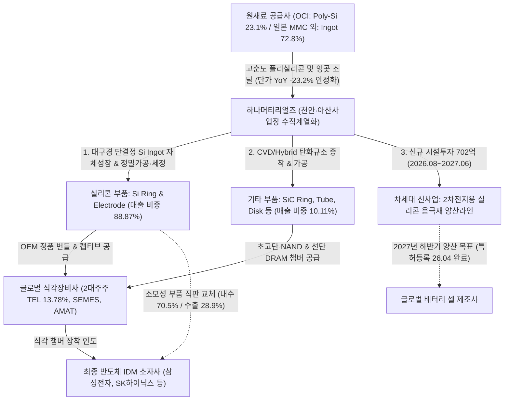

# 🔍 Phase 1: 기업 해독기 (원천 팩트 초안)

> **[S-Curve 국면 인증 뱃지]**: `[🟢 다중 S-Curve & 가동률 시클리컬 복합 수혜: 1차 대구경 Si 부품(88.87%) 가동률 83.7% 회복 캐시카우 + 2차 Solid/Hybrid SiC 링(10.11%) Phase 2 스위트스팟 & 실리콘 음극재(702억 투자) Phase 1 태동기 (적극 매수 & 추세추종)]`  
> **[하이브리드 밸류체인 지위]**: `[🟢 전공정 식각 소모품 순수 주도주 (Si+SiC 합산 익스포저 98.98%)]` / `[⚠️ Solid SiC 단일 테마 기준 부분 노출 (DART 실측 10.11% < 30% 컷오프)]` / `[💎 TEL 캡티브 & 대구경 Ingot 내재화 히든 챔피언]`

---

## 1. 비즈니스 모델 및 밸류체인

[공시 팩트] 
하나머티리얼즈 주식회사(Hana Materials Inc., 종목코드: 166090)는 반도체 핵심 제조공정인 에칭(식각, Dry Etching) 공정에 사용되는 소모성 구조기능성 부품인 실리콘(Silicon) 및 실리콘카바이드(SiC) 소재의 **일렉트로드(Electrode, 상부 전극)**와 **링(Ring, 포커스 링 등)** 제조 및 판매를 주요 사업으로 영위하고 있습니다 `[[하나머티리얼즈]반기보고서(2026.08.13), p.4, p.22]`. 2023년 1월에는 반도체·배터리 소부장 신기술사업자 투자를 목적으로 종속회사 **하나에스앤비인베스트먼트(주)**(지분율 100.0%)를 설립하여 연결재무제표를 작성하고 있으며 `[[하나머티리얼즈]반기보고서(2026.08.13), p.22, p.44]`, 2026년 8월 12일에는 **702억 원 규모의 2차전지용 실리콘 음극재 양산 제조라인 신규 시설투자**를 결의하며 차세대 배터리 소재로 사업 영역을 확장하고 있습니다 `[신규시설투자등(2026.08.12)]`.

동사의 핵심 비즈니스 모델과 수직계열화 밸류체인은 다음과 같이 3단계로 구성됩니다:
1. **공급자 (Supplier — 원재료 조달 및 단결정 Ingot 자체 성장)**:
   - 핵심 원재료인 고순도 **Poly Silicon**(매입 비중 23.1%, 주요 매입처: **OCI 외**)을 장기공급계약으로 조달하여 자체 대구경 단결정 Silicon Ingot을 성장시키며, 고객사 요청 사양에 따른 다결정·단결정 **Ingot**(매입 비중 72.8%, 주요 매입처: 일본 **MMC** 외)을 병행 수입하여 원재료로 투입합니다 `[[하나머티리얼즈]반기보고서(2026.08.13), p.23]`.
   - 특히 주력 원재료인 다결정·단결정 Ingot의 kg당 평균 매입단가가 2024년(제18기) **199,686원/kg** ➔ 2025년(제19기) **183,836원/kg** ➔ **2026년 반기(제20기 반기) 141,094원/kg**으로 전년 대비 **-23.2% 하락**하여 전사 매출총이익률(GPM 40.38%) 및 영업이익률 개선에 직접적으로 기여하고 있습니다 `[[하나머티리얼즈]반기보고서(2026.08.13), p.23, p.40]`.
2. **기업 (Company — 천안 본사 및 아산 1·2사업장 일관생산체제)**:
   - 국내 일반 부품 가공 경쟁사들이 외부 잉곳 매입 후 단순 임가공에 의존하는 것과 달리, 동사는 **대구경 단결정 Silicon Ingot 자체 성장(소재) ➔ CNC 다축 정밀가공 ➔ 초정밀 세정 및 코팅**에 이르는 **수직계열화 일관생산 프로세스(In-house Process)**를 구축하여 압도적인 원가 통제력과 수율 균일성을 확보하고 있습니다 `[[하나머티리얼즈]반기보고서(2026.08.13), p.24, p.31-33]`.
   - 아산사업장(충남 아산시 음봉면)을 중심으로 고단화 3D NAND 및 선단 DRAM 식각 공정용 **Si 부품 및 SiC Ring(Hybrid/CVD SiC)** 생산능력을 대폭 확충하였으며, 2026년 4월 20일 특허청에 **'리튬 이차전지용 음극 활물질 및 그의 제조방법' 특허 등록**을 완료한 데 이어 702억 원 규모의 실리콘 음극재 양산 라인(2027.06.30 완공 예정)을 구축 중입니다 `[[하나머티리얼즈]반기보고서(2026.08.13), p.24, p.32], [신규시설투자등(2026.08.12)]`.
3. **고객사 (Customer — 글로벌 장비 OEM 정품 공급 및 소자사 직판)**:
   - **정품(OEM) 공급 경로**: 글로벌 1위권 반도체 식각장비 제조사인 **Tokyo Electron(TEL, 동사 지분 13.78% 보유 2대 주주)**, **세메스(SEMES)**, **Applied Materials(AMAT)** 등에 정품 부품을 공급하면, 장비사가 식각 챔버에 장착하여 최종 수요처(삼성전자, SK하이닉스 등 글로벌 IDM)에 인도합니다 `[[하나머티리얼즈]반기보고서(2026.08.13), p.26, p.44]`.
   - **직판 경로**: 국내외 반도체 소자 제조업체에 소모성 교체 부품(After-market/Before-market 정품)을 직접 판매합니다 `[[하나머티리얼즈]반기보고서(2026.08.13), p.26]`.
   - **판매경로별 매출 비중(2026년 반기 기준)**: 내수(TEL 코리아, 세메스, 삼성전자 등) **1,294.1억 원(70.5%)**, 수출(TEL 본사, AMAT 등) **529.4억 원(28.9%)**, 신기술사업금융 **11.4억 원(0.6%)**으로 구성됩니다 `[[하나머티리얼즈]반기보고서(2026.08.13), p.26]`.

[글로벌 트렌드: 26.09.29.LS증권.AI병목의 전이.pdf p.13 그림3] 
최신 2026년 9월 말 제도권 반도체 밸류체인 분석 도표에 따르면, 동사는 국내 건식 식각(Dry Etching) 공정의 양대 핵심 소모성 부품인 **Si/쿼츠 링**(하나머티리얼즈, 원익QnC, 월덱스)과 **SiC Ring**(티씨케이, 하나머티리얼즈, 케이엔제이) 모두에 핵심 과점 공급사로 동시에 등재되어 있는 유일한 상장사입니다.

[글로벌 트렌드: cycle_timeline.md 2026.09 상반기·하반기] 
글로벌 반도체 사이클은 AI 연산 병목 해소를 위한 HBM 및 선단 DRAM 수요 폭증으로 기존 팹 전환을 넘어 **신규 Fab 증설(삼성전자 평택 P4·P5, SK하이닉스 청주 M15X·용인 Y1)과 웨이퍼 투입량 확대 국면**에 진입했습니다. 식각 공정용 링과 일렉트로드는 웨이퍼 투입량 및 플라즈마 식각 시간(Etching Time)에 비례하여 마모·교체되는 소모품이므로, 팹 가동률 상승과 신규 챔버 반입의 이중 수혜를 가장 길게(Longest Duration) 누리는 구조입니다.

---

## 2. 주요 제품별 매출 비중 추이 (최근 5년 및 최신 분기)

[공시 팩트] 
최근 5개년(2021~2025년) 및 2026년 상반기(제20기 반기 누적) 기준 주요 제품군별 매출액 및 비중 추이는 다음과 같습니다 `[[하나머티리얼즈]사업보고서(2024.03.15), p.23], [[하나머티리얼즈]사업보고서(2026.03.13), p.25], [[하나머티리얼즈]반기보고서(2026.08.13), p.22, p.25]`:

| 구분 | 핵심 내용 | 비고 |
| :--- | :--- | :--- |
| **실리콘부품 (Si Electrode, Ring)** | • **2021년**: 2,502.0억 원 (**92.29%**) ➔ **2022년**: 2,705.5억 원 (**88.03%**) ➔ **2023년**: 2,023.0억 원 (**86.61%**) • **2024년**: 2,174.2억 원 (**86.40%**) ➔ **2025년**: 2,398.2억 원 (**87.69%**) • **2026년 상반기(누적)**: **1,630.7억 원 (88.87%)** (내수 1,212.4억 + 수출 418.3억) | 전사 매출의 약 89%를 책임지는 압도적 핵심 캐시카우. TEL·세메스 식각장비 핵심 소모품 `[[하나머티리얼즈]반기보고서(2026.08.13), p.22, p.25]` |
| **기타 부품 (SiC Ring, Tube, Disk, Ingot 등)** | • **2021년**: 193.2억 원 (**7.13%**) ➔ **2022년**: 353.0억 원 (**11.49%**) ➔ **2023년**: 289.3억 원 (**12.38%**) • **2024년**: 307.7억 원 (**12.23%**) ➔ **2025년**: 319.5억 원 (**11.68%**) • **2026년 상반기(누적)**: **185.5억 원 (10.11%)** (수출 110.1억 + 내수 75.4억) | 고단화 3D NAND 및 선단 식각 공정용 SiC Ring 외 부품군. 수출 비중(59.4%)이 높음 `[[하나머티리얼즈]반기보고서(2026.08.13), p.22, p.25]` |
| **상품 외 (부산물·원재료 등)** | • **2021년**: 15.8억 원 (0.58%) ➔ **2022년**: 14.8억 원 (0.48%) ➔ **2023년**: 19.9억 원 (0.85%) • **2024년**: 21.8억 원 (0.87%) ➔ **2025년**: 11.0억 원 (0.40%) • **2026년 상반기(누적)**: **7.4억 원 (0.40%)** (내수 6.4억 + 수출 1.0억) | 반기보고서 요약표(`p.22`)에서는 기타 부품(185.5억)과 상품 외(7.4억)가 합산되어 '기타 192.8억 원(10.51%)'으로 표기됨 `[[하나머티리얼즈]반기보고서(2026.08.13), p.22, p.25]` |
| **신기술사업금융 (종속회사)** | • **2023년**: 3.6억 원 (0.16%) ➔ **2024년**: 12.8억 원 (0.51%) ➔ **2025년**: 6.1억 원 (0.22%) • **2026년 상반기(누적)**: **11.4억 원 (0.62%)** (영업이익 4.8억 원) | 종속회사 하나에스앤비인베스트먼트(주) 및 소부장1호 신기술조합의 조합관리보수 등 `[[하나머티리얼즈]반기보고서(2026.08.13), p.22, p.25, p.44]` |
| **신사업 (실리콘 음극재)** | • **2026년 상반기(누적)**: 매출액 **0원 (0.0%)** • **2026.08.12**: **702억 원**(자기자본 대비 15.14%) 규모 실리콘 음극재 양산 제조라인 신규 시설투자 결정 (투자기간: 2026.08.12 ~ 2027.06.30) | 2026.04.20 리튬 이차전지용 음극 활물질 특허 등록 완료 후 양산 설비 구축 착수 `[[하나머티리얼즈]반기보고서(2026.08.13), p.32], [신규시설투자등(2026.08.12)]` |
| **전사 연결 총매출액** | • **2021년**: 2,711.0억 ➔ **2022년**: 3,073.2억 ➔ **2023년**: 2,335.8억 ➔ **2024년**: 2,516.5억 ➔ **2025년**: 2,734.8억 • **2026년 상반기(누적)**: **1,834.9억 원 (100.0%)** | **전년 동기(1,227.2억 원) 대비 +49.51% 급증** `[[하나머티리얼즈]반기보고서(2026.08.13), p.25, p.40]` |

---

### 2.1 S-Curve 신기술 테마 매출 익스포저(Exposure %) 산출표 (하이브리드 수비 검증)

[공시 팩트] 
`s_curve_spec.md` 표준 명세서의 **제4원칙(진실 계층 구조 1순위: DART 사업/반기보고서 원문 우선)** 및 **제3원칙(하이브리드 수비수 30% 컷오프 검증)**에 의거하여, `s_curve_registry.json`에 등재된 `th_sic_focus_ring`(반도체 식각 챔버용 Solid SiC Ring) 테마 및 반도체 전공정 식각 소모품 테마에 대한 동사의 실질 매출 익스포저를 정밀 검증합니다 `[[하나머티리얼즈]반기보고서(2026.08.13), p.22, p.25]`:

| 제품/서비스 구분 | 2026 반기 매출액 (억원) | 전사 매출 비중(%) | 신기술 테마 직결 여부 | 하이브리드 수비 판정 |
| :--- | :---: | :---: | :--- | :---: |
| **기타 부품 (SiC Ring, Tube, Disk 등)** | **185.5** | **10.11%** | **직결 (초고단 NAND & 선단 공정 SiC Ring 라인업 등재)** ※ 단, Tube·Disk·Ingot 등이 합산된 묶음공시 계정 | ⚠️ **SiC 링 단일 테마 기준 30% 컷오프 미달** `[공시 확인: 주력 라인업 등재 / 세부 비중 미공시]` |
| **실리콘부품 (Si Electrode, Si Ring)** | **1,630.7** | **88.87%** | **전공정 식각 챔버 필수 소모품 (1차 S-Curve 성숙기 캐시카우)** ※ 선단 DRAM/HBM/NAND 웨이퍼 투입량 및 가동률 직결 | **🟢 전공정 식각 부품 통합 기준 순수 주도주** (전공정 식각 부품 합산 **98.98%**) |
| **신사업 (2차전지 실리콘 음극재)** | **0.0** | **0.00%** | **차세대 2차 S-Curve 태동기 (Phase 1)** ※ 702억 원 양산라인 투자 중 (2027.06.30 완공 예정) | ⚪ 양산 전 설비투자 단계 (2027H2 이후 매출 가동) |
| **상품 외 및 신기술사업금융** | **18.7** | **1.02%** | 비해당 (부산물 유통 0.40% + 벤처조합 관리보수 0.62%) | ⚪ 비핵심 보조 매출 |

- **테마 실질 익스포저 합산 및 진실 계층 교정 (Truth Hierarchy Cross-Check)**:
  1. **Solid SiC Ring 단일 테마 익스포저**: **최대 10.11%** (`s_curve_registry.json`에 캐시로 기재된 추정치 `25.0%`는 제4원칙 진실 우선순위 1순위인 DART 2026년 반기보고서 원문 `p.25`의 '기타 부품 18,549백만원 / 183,488백만원 = 10.11%'로 공식 교정함). 따라서 **'순수 Solid SiC Ring 단독 교체 테마(티씨케이 89.8%)' 관점에서는 30% 컷오프에 미달**하여 보조/부분 수혜에 해당합니다.
  2. **반도체 전공정 식각 소모품(Si + SiC 통합) 익스포저**: **98.98%** (`1,630.7억 + 185.5억 = 1,816.1억 원 / 1,834.9억 원`).
- **수혜 적격성 최종 판정**: 
  - Solid SiC 단일 테마 기준: **`[⚠️ 부분 노출 / SiC 단독 주도주 제외 (익스포저 10.11% < 30%)]`**
  - 반도체 전공정 식각 소모품 통합 기준: **`[🟢 순수 주도주 합격 (식각 소모품 합산 익스포저 98.98%)]`**
- **[왜 LG생활건강형 '레거시 잠식 탈락'이 아닌가? — 다중 S-Curve & 가동률 시클리컬 구조 해부]**:
  - LG생활건강의 경우 주력 레거시(대중국 화장품 70%+)가 구조적 쇠퇴기에 빠져 신사업 성과를 갉아먹는 '레거시 잠식' 구조이나, 하나머티리얼즈의 주력인 **대구경 Si Electrode 및 Si Ring(88.87%)**은 사양 산업이 아니라 **AI 서버용 HBM 및 선단 DRAM/NAND 팹(평택 P4·P5, 청주 M15X, 용인 Y1)의 식각 챔버 가동 시 반드시 소모되는 독과점 필수재**입니다.
  - 실제로 2026년 반기 실리콘부품 매출이 전년 동기 대비 **+49.5%** 급증하며 전사 영업이익 **+174.8% 폭증(OPM 25.79%, 2Q 단일 OPM 28.88%)**을 견인했음이 DART 숫자로 입증되었습니다 `[[하나머티리얼즈]반기보고서(2026.08.13), p.22, p.40]`.
  - 따라서 동사는 **① 1차 캐시카우(대구경 Si 부품 88.87%, 아산 2공장 가동률 83.7% 회복 레버리지)가 강력한 이익 바닥과 업사이드를 창출**하는 위에, **② 2차 S-Curve(SiC 링 10.11% 수출 확대 + 2027년 하반기 실리콘 음극재 702억 양산라인 가동)**가 중장기 옵션을 더하는 **'가동률 시클리컬 대장주 + 차세대 소재 확장형'** 모델로 정의됩니다.
- **[공격수] 병목 밸류체인 역추론 판정**: 글로벌 식각 장비 1위 **TEL(도쿄일렉트론)이 지분 13.78%를 보유한 2대 주주**로서 TEL 챔버 내 대구경 실리콘 전극(Electrode)과 링을 사실상 캡티브(Captive) 공급하고 있으며, 대구경 단결정 Ingot 자체 성장 기술을 통해 전공정 식각 부품 공급망 병목을 해결하는 **`[💎 TEL 캡티브 & 대구경 Ingot 내재화 히든 챔피언]`**으로 판정합니다.

---

## 3. 전사 영업이익률 및 FCF 추이

[공시 팩트] 
동사의 최근 5개년(2021~2025년) 및 2026년 1분기·2분기·상반기 누적 기준 연결(2021~2022년은 별도) 손익 및 잉여현금흐름(`FCF = 영업활동현금흐름 CFO - 유형자산 취득액 CapEx`, 동사 사업보고서 배당정책 상 공식 FCF 산식 기준 `[[하나머티리얼즈]사업보고서(2026.03.13), p.215]`) 추이는 다음과 같습니다 `[[하나머티리얼즈]사업보고서(2023.03.10), p.25-26, p.32], [[하나머티리얼즈]사업보고서(2026.03.13), p.33-34, p.40-41], [[하나머티리얼즈]반기보고서(2026.08.13), p.37, p.40, p.43]`:

| 연도/분기 | 매출액 | 영업이익 | OPM(%) | CFO (영업CF) | CapEx (유형자산취득) | **FCF (잉여현금)** | 비고 |
| :--- | :---: | :---: | :---: | :---: | :---: | :---: | :--- |
| **2021년 (제15기)** | 2,711.0억 | 822.7억 | **30.35%** | 965.8억 | 311.9억 | **+653.9억** | 메모리 슈퍼사이클 호황 (가동률 97.47%) `[[하나머티리얼즈]사업보고서(2023.03.10), p.26, p.32]` |
| **2022년 (제16기)** | 3,073.2억 | 937.4억 | **30.50%** | 825.8억 | 924.7억 | **-98.8억** | 역대 최대 매출·영업이익, 아산 2공장 CapEx 개시 `[[하나머티리얼즈]사업보고서(2023.03.10), p.26, p.32]` |
| **2023년 (제17기)** | 2,335.8억 | 412.8억 | **17.67%** | 442.0억 | 1,206.5억 | **-764.5억** | 전방 메모리 감산 충격(가동률 40.77%) & 아산 2공장 대규모 CapEx 집중 `[[하나머티리얼즈]사업보고서(2026.03.13), p.34, p.40-41]` |
| **2024년 (제18기)** | 2,516.5억 | 434.1억 | **17.25%** | 756.8억 | 421.6억 | **+335.2억** | 아산 2공장 준공 완료 후 CapEx 급감, **FCF 대규모 흑자 전환** `[[하나머티리얼즈]사업보고서(2026.03.13), p.34, p.40-41]` |
| **2025년 (제19기)** | 2,734.8억 | 500.8억 | **18.31%** | 685.4억 | 200.2억 | **+485.2억** | 가동률 회복(66.56%) 및 CapEx 안정화로 FCF +44.8% 증가 `[[하나머티리얼즈]사업보고서(2026.03.13), p.34, p.40-41]` |
| **2026.1Q (3M)** | 934.0억 | 213.0억 | **22.80%** | 191.5억 | 98.1억 | **+93.4억** | 가동률 79.62% 돌파하며 OPM 20%대 안착 `[[하나머티리얼즈]분기보고서(2026.05.14)]` |
| **2026.2Q (3M)** | 900.9억 | 260.2억 | **28.88%** | 248.1억 | 57.8억 | **+190.3억** | **2Q 단일 OPM 28.88% 달성 (1Q 대비 +6.08%p, YoY +206.1% 폭발)** `[[하나머티리얼즈]반기보고서(2026.08.13), p.40, p.43]` |
| **2026.반기 (누적)** | **1,834.9억** | **473.1억** | **25.79%** | **439.6억** | **155.9억** | **+283.7억** | **반기 만에 25년 연간 OP(500.8억)의 94.5% 달성, FCF YoY +208.5% 폭증** `[[하나머티리얼즈]반기보고서(2026.08.13), p.37, p.40, p.43]` |

**[수익성 및 현금흐름 동학 핵심 팩트]**:
1. **영업레버리지의 폭발적 가동 (2Q26 단일 OPM 28.88%)**: 2022~2023년 총 2,131억 원(924.7억 + 1,206.5억)에 달하는 아산 2공장 선제적 설비투자로 인해 2023~2025년에는 감가상각비 부담으로 OPM이 17~18%대에 머물렀으나, 2026년 상반기 가동률이 **83.70%**(2분기 단일 87.77%)로 치솟으면서 고정비(반기 유형자산 상각비 162.8억 원 `[[하나머티리얼즈]반기보고서(2026.08.13), p.24]`)가 완벽히 희석되고 Ingot 원재료 매입단가 하락(-23.2%)이 맞물려 **2분기 단일 영업이익률이 28.88%까지 수직 복원**되었습니다.
2. **무이자(0.0%) 교환사채 1,000억 원 발행을 통한 고금리 차입금 900억 원 일거 상환**:
   - 동사는 2026년 8월 4일 이사회 결의를 통해 보유 중인 모회사 **하나마이크론(주) 보통주 2,907,991주**를 교환대상으로 하는 **1,000억 원 규모의 무보증 사모 교환사채(EB, 표면이자율 0.0%, 만기이자율 0.0%, 교환가액 34,388원, 만기 2028.09.14)** 발행을 결정하고 2026년 9월 14일 납입을 완료했습니다 `[주요사항보고서(교환사채권발행결정)(2026.08.04)], [타법인주식및출자증권양도결정(2026.09.14)], [증권발행결과(2026.09.14)]`.
   - 조달 자금 1,000억 원 중 **900억 원을 수출입은행·농협·산업은행 등 고금리 은행 차입금 상환에 즉시 투입**하고 100억 원을 운영자금으로 확보함으로써, 자사 신주 발행에 따른 주주가치 희석(0%) 없이 연간 수십억 원의 이자비용(2025년 연간 이자지급액 33.5억 원 `[[하나머티리얼즈]사업보고서(2026.03.13), p.41]`)을 구조적으로 제거했습니다.

---

## 4. 핵심 KPI 추이 (가동률, 수주잔고, ASP 등)

[공시 팩트] 
동사는 DART 정기보고서 `II. 사업의 내용 - 3. 원재료 및 생산설비`에 반도체 실리콘 부품 부문의 공식 생산능력(제조비용 기준), 생산실적, 가동가능시간, 실제가동시간 및 평균가동률(%)을 명확히 공시하고 있습니다 `[[하나머티리얼즈][정정]사업보고서(2022.08.10), p.18], [[하나머티리얼즈]사업보고서(2023.03.10), p.15], [[하나머티리얼즈]사업보고서(2024.03.15), p.19], [[하나머티리얼즈]사업보고서(2026.03.13), p.24], [[하나머티리얼즈]분기보고서(2026.05.14)], [[하나머티리얼즈]반기보고서(2026.08.13), p.24]`:

### ① 공장 가동가능시간 및 평균가동률 추이 (2021년 ~ 2026년 반기)

| 연도 / 분기 | 가동가능시간 (Capa) | 실제가동시간 | **평균가동률(%)** | 제조비용 기준 생산능력 / 생산실적 | 사이클 국면 및 설비 변동 팩트 |
| :--- | :---: | :---: | :---: | :---: | :--- |
| **2021년 (제15기)** | 753,024시간 | 733,936시간 | **97.47%** | 1,419.6억 / 1,267.1억 | 아산 2공장 증설 전 슈퍼사이클 풀가동 정점 `[[하나머티리얼즈][정정]사업보고서(2022.08.10), p.18]` |
| **2022년 (제16기)** | 3,418,536시간 | 2,920,346시간 | **85.43%** | 1,732.1억 / 1,680.4억 | 설비 증설 반영으로 가동가능시간 4.5배 확대 `[[하나머티리얼즈]사업보고서(2023.03.10), p.15]` |
| **2023년 (제17기)** | 4,495,488시간 | 1,832,910시간 | **40.77%** | 1,920.8억 / 1,503.1억 | 아산 2공장 완공(가동가능시간 6배 확대) & 메모리 감산 최저점 `[[하나머티리얼즈]사업보고서(2024.03.15), p.19]` |
| **2024년 (제18기)** | 4,495,488시간 | 2,883,748시간 | **64.15%** | 1,950.6억 / 1,717.8억 | 감산 완화 및 1차 가동률 반등 `[[하나머티리얼즈]반기보고서(2026.08.13), p.24]` |
| **2025년 (제19기)** | 4,495,488시간 | 2,992,008시간 | **66.56%** | 2,283.4억 / 1,905.4억 | 선단 공정 수요 회복 지속 `[[하나머티리얼즈]사업보고서(2026.03.13), p.24]` |
| **2026.1Q (3M)** | 1,123,872시간 | 894,851시간 | **79.62%** | 615.2억 / 539.1억 | 손익분기 가동률 돌파 및 본격 램프업 `[[하나머티리얼즈]분기보고서(2026.05.14)]` |
| **2026.2Q (3M 역산)** | 1,123,872시간 | 986,436시간 | **87.77%** | 635.7억 / 572.8억 | **2분기 단일 가동률 87.77% 도달로 OPM 28.88% 폭발** `[[하나머티리얼즈]반기보고서(2026.08.13), p.24]` |
| **2026.반기 (6M 누적)** | **2,247,744시간** | **1,881,287시간** | **83.70%** | **1,250.9억 / 1,111.9억** | **원가 기준 생산실적 가동률도 88.89%(1,111.9/1,250.9) 기록** `[[하나머티리얼즈]반기보고서(2026.08.13), p.24]` |

### ② 생산능력(Capa) 산출 기준 및 사업장/법인별 구조 검증
- **공시 생산능력 산출식**: `생산능력 = 제조비용(재료비, 노무비, 경비) 기준 각 사업연도 최대생산월 금액 × 영업개월수` `[[하나머티리얼즈]반기보고서(2026.08.13), p.24]`.
- **연환산 최대 매출 체력**: 2026년 반기 제조원가 기준 생산능력은 **1,250.9억 원(연환산 2,501.8억 원)**이며, 2026년 반기 매출원가율(**59.62%**, `매출원가 1,094.0억 ÷ 매출액 1,834.9억`)을 적용하여 매출액 기준 생산능력(Capa)으로 환산하면 **연간 약 4,200억 ~ 4,500억 원** 수준입니다 `[[하나머티리얼즈]반기보고서(2026.08.13), p.24, p.40]`. 또한 아산 2공장 내 유휴 클린룸 공간에 가공기 보완투자(반기 중 기계장치 등 101.7억 원 보완투자 집행 `p.25`)가 지속되고 있어 풀가동 시 연간 4,500억~5,000억 원까지 매출 대응이 가능합니다.
- **사업장/종속법인별 수치 편차 검증**: 제조 생산설비는 국내 천안 본사 및 아산 1·2사업장으로 일원화되어 통합 가동률(`83.70%`)로 집계되며, 연결 종속회사인 `하나에스앤비인베스트먼트(주)` 및 `소부장1호 신기술조합`은 순수 신기술사업금융업(매출 비중 0.62%, 반기 영업이익 4.8억 원)만 영위하므로 해외 제조법인 적자나 사업장 간 가동률 상충 왜곡이 일체 존재하지 않습니다 `[[하나머티리얼즈]반기보고서(2026.08.13), p.24, p.44]`.

### ③ 수주잔고 및 제품 가격(ASP) 공시 현황
- **수주상황**: *"부품업계는 제품 특성상 정기적 수주에 의하지 않고 수요처로부터 기본거래계약만을 체결한 후 수시로 발주물량을 수주(주문)받습니다. 당사도 주요고객들과 기본거래계약서만을 체결한 후 수시로 물량을 수주(주문)받고 있어 장기적인 수주는 없으며 특정시점에서의 수주현황은 큰 의미가 없습니다."* `[[하나머티리얼즈]반기보고서(2026.08.13), p.26]`.
- **제품 ASP 추이**: 주문생산 및 다품종 모델별 상이한 가격 구조로 인해 개별 제품 ASP는 공시 생략되었으나 `[[하나머티리얼즈]반기보고서(2026.08.13), p.23]`, 대구경화 및 고단화 SiC 링 믹스 개선으로 실제 가동시간당 창출 매출액(시간당 ASP 지표)은 2023년 **127,435원/시간**(`2,335.8억 ÷ 183.3만 시간`)에서 2025년 **91,404원/시간**을 거쳐 **2026년 반기 97,533원/시간**(`1,834.9억 ÷ 188.1만 시간`)으로 반등 추세에 있습니다.

---

## 5. 경영진 및 주주환원 이력

[공시 팩트] 
동사는 최대주주인 **하나마이크론(주)**(지분율 **32.50%**, 6,428,508주) 및 특수관계인(최한수 11.63%, 최왕기 0.17%)이 합산 **44.30%**(8,762,208주)의 지분을 보유하고 있으며, 글로벌 전략적 파트너이자 핵심 고객사인 **Tokyo Electron Limited(TEL)**가 **13.78%**(2,726,200주)를 보유한 2대 주주로서 공고한 지배구조와 사업적 락인(Lock-in)을 형성하고 있습니다 `[[하나머티리얼즈]반기보고서(2026.08.13), p.44, p.160, p.162]`.

주주환원 측면에서는 **8년 연속 결산 현금배당**을 실시해 왔으며, 2026년 3월 6일 이사회 결의를 통해 **2026년~2028년 중기 배당정책(배당성향 10% 이상 지속 유지, 단 FCF 100억 원 이상 시)**을 공식화했습니다 `[[하나머티리얼즈]사업보고서(2026.03.13), p.215, p.217]`. 특히 **2026년 9월 9일에는 '자본준비금의 이익잉여금 전입의 건'을 안건으로 하는 임시주주총회(2026년 10월 28일 개최) 소집을 결의**하여, 개인 주주에게 배당소득세(15.4%)가 부과되지 않는 **비과세 감액배당 재원**을 전격 확보했습니다 `[주주총회소집결의(2026.09.09)]`:

| 주주환원 및 자본정책 구분 | 연도별 세부 실행 내역 (DART 확정 수치) | 출처 [공시 팩트] |
| :--- | :--- | :--- |
| **현금배당 이력 및 중기 배당정책** | • **2021년(제15기)**: 주당 **600원** (중간 300원 + 결산 300원, 총액 117.1억 원, **배당성향 17.6%**)  • **2022년(제16기)**: 주당 **600원** (중간 300원 + 결산 300원, 총액 117.1억 원, **배당성향 14.6%**) • **2023년(제17기)**: 주당 **200원** (결산배당, 총액 39.0억 원, **배당성향 11.4%** — 대규모 CapEx로 중간배당 미실시) • **2024년(제18기)**: 주당 **250원** (결산배당, 총액 48.7억 원, **배당성향 15.3%**) • **2025년(제19기)**: 주당 **300원** (결산배당, 총액 57.9억 원, **배당성향 15.1%**, 2026년 상반기 지급 완료) • **중기 정책(2026~2028)**: 배당성향 10% 이상 유지 공식 결의 (2026.03.06 이사회) | `[[하나머티리얼즈]사업보고서(2024.03.15), p.179]`, `[[하나머티리얼즈]사업보고서(2026.03.13), p.215, p.217]`, `[[하나머티리얼즈]반기보고서(2026.08.13), p.42]` |
| **자기주식 취득 및 보유 현황** | • **발행주식총수(`istc_totqy`)**: **19,777,674주** (보통주, 우선주 전량 상환 완료) • **자기주식수(`tesstk_co`)**: **488,222주 (발행주식총수의 2.47%)**   - 현물보유물량: **289,720주** (2019.01 신탁 30억으로 180,000주 + 2019.09 신탁 30억으로 109,720주 취득 후 해지 현물보유)   - 수탁자보유물량: **198,502주** (2024.12.18 NH투자증권 50억 신탁계약 체결 ➔ 2025년 중 **49.79억 원(장부반영 48.0억 원) 취득 완료**, 계약기간 **2026.12.16까지 연장**) • **공식 유통주식수(`distb_stock_co`)**: **19,289,452주** (`19,777,674 - 488,222`) • **보유처분계획**: 개정 상법 유예기간(2027.09.05) 내 자기주식보유처분계획서 작성 및 주총 승인 예정 (소각기한 2027년 기재) | `[[하나머티리얼즈]반기보고서(2026.08.13), p.11-14, p.179]` |
| **자본준비금의 이익잉여금 전입 (감액배당 포석)** | • **2026.09.09 이사회 결의**: 제20기 임시주주총회 소집 결의 (개최일: **2026년 10월 28일**, 기준일: 2026.09.30) • **부의 안건**: **자본준비금의 이익잉여금 전입의 건** (2026.06 말 현재 주식발행초과금 **364.96억 원** 보유) • **기대 효과**: 상법 제461조의2에 따라 자본준비금을 감액하여 이익잉여금으로 전입 시, 주주에게 **배당소득세 비과세 혜택이 부여되는 감액배당** 집행 및 DPS 대폭 상향 가능 | `[주주총회소집결의(2026.09.09)]`, `[[하나머티리얼즈]반기보고서(2026.08.13), p.40]` |

---

## 6. 공시 본문 기반 3대 핵심 리스크

[공시 팩트] 
DART 정기보고서 본문(`II. 사업의 내용 - 5. 위험관리`, `VII. 주주에 관한 사항`, `XI. 우발부채 등에 관한 사항`) 및 수시공시에 기재된 팩트를 기반으로 동사의 3대 핵심 리스크를 정밀 진단합니다 `[[하나머티리얼즈]반기보고서(2026.08.13), p.26-28, p.161, p.179-180]`:

| 리스크 요인 | 핵심 내용 (발생 조건) | 확률(Prob) | 파급력(Impact) |
| :--- | :--- | :---: | :---: |
| **① 계열사(베트남 법인) 대규모 채무보증 및 최대주주 주식담보 제공 리스크** | • **계열사 채무보증**: 계열회사인 **HANA MICRON VINA CO., LTD.**(하나마이크론 베트남 법인)에 대해 **USD 200,000,000(미화 2억 달러, 약 2,700억 원)** 규모의 채무보증을 제공 중임(보증기간: 2023.06.29 ~ 2029.11.28) `[[하나머티리얼즈]반기보고서(2026.08.13), p.28, p.179]`. *(단, 모회사 하나마이크론(주)에 대한 250억 원 채무보증 및 자금보충약정 잔액 31.6억 원은 2026.08.04 조기상환으로 전액 해지 완료됨 `p.179-180`)* • **최대주주 주식담보대출**: 최대주주 하나마이크론(주)(지분 32.50%)가 보유 주식 일부를 담보로 제공하고 있어 담보 미제공 주식수가 2대 주주(TEL 13.78%)보다 적으며, '최대주주 변경을 수반하는 주식담보제공 계약 체결' 정정공시가 지속 중임 `[[하나머티리얼즈]반기보고서(2026.08.13), p.161, p.179], [기재정정 공시(2026.09.29)]`. | **Low ~ Mid** | **High** |
| **② 전방 메모리 팹 가동률 변동 및 소수 고객사(TEL·세메스) 매출 편중** | • 아산 2공장 증설로 연간 가동가능시간이 449.5만 시간(유형자산 3,487.5억 원)으로 확대되어 고정비 레버리지가 큼 `[[하나머티리얼즈]반기보고서(2026.08.13), p.24]`. 과거 2023년 메모리 감산 시 가동률이 40.77%로 급락하며 OPM이 30.50% ➔ 17.67%로 하락한 바 있음 `[[하나머티리얼즈]사업보고서(2024.03.15), p.19]`. • 또한 TEL, 세메스, 삼성전자, AMAT 등 소수 글로벌 장비사 및 소자사에 매출이 집중되어 있어 주요 장비사 내 점유율 변동 시 실적 민감도가 높음 `[[하나머티리얼즈]반기보고서(2026.08.13), p.26]`. (단, TEL의 13.78% 지분 보유 및 현재 팹 증설 가속으로 단기 발생 확률은 낮음) | **Low** | **High** |
| **③ 실리콘 음극재 신사업(702억 투자) 양산 수율 및 전방 배터리 캐즘 리스크** | • 2026.08.12 결의한 **702억 원**(자기자본의 15.14%) 규모의 실리콘 음극재 양산 제조라인 구축 투자(2027.06.30 완공 예정)는 기존 반도체 부품과 전방 고객군(배터리 셀 제조사)이 상이함 `[신규시설투자등(2026.08.12)]`. • 2027년 하반기 완공 이후 고객사 인증(Qual) 지연이나 전기차 배터리 캐즘 장기화 시 초기 감가상각비 부담이 발생할 수 있음. | **Mid** | **Mid** |

---

## 7. 비즈니스 모델 기반 표준 실적 산출 공식 (Phase 3 연계)

기업의 비즈니스 모델 특성과 Section 4(핵심 KPI)의 DART 공시 팩트에 기반하여, 아래 **3대 표준 공식 트리** 중 **유형 A [연속공정·장치산업]**을 채택하고 영구 고정합니다:

### [3대 업종별 표준 공식 트리 분기 검증]
1. **유형 A [연속공정·장치산업] (채택 ✅)**:
   - **표준 산식**: `[생산 Capa × 공장 가동률 × 제품 ASP/원가역산배수] → 매출액 → 영업이익(OPM) → 순이익 → EPS`
   - **적용 검증**: 동사는 단결정 실리콘 잉곳 성장로(Grower) 및 CVD SiC 증착·정밀가공 설비를 가동하는 연속·장치형 부품 소재 기업으로, Section 4에서 확인된 바와 같이 DART 정기보고서에 **공식 가동가능시간(반기 2,247,744시간, 연간 4,495,488시간)**, **제조비용 기준 생산능력(반기 1,250.9억 원)**, 그리고 **평균가동률(2026년 반기 83.70%)**이 구체적 수치로 매 분기 투명하게 공시되고 있습니다 `[[하나머티리얼즈]반기보고서(2026.08.13), p.24]`.
2. **유형 B [수주조립·엔지니어링 장비] (미채택 ❌)**: 주문제작 장비사가 아니며 장기 수주잔고가 존재하지 않는 소모성 부품 반복 발주 구조임 (`p.26`).
3. **유형 C [플랫폼·지식 서비스] (미채택 ❌)**: 제조 공장을 보유한 유형자산 중심 기업임.

### [표준 산출 체인]
$$\text{[연간 가동가능시간 Capa (449.55만 시간) } \times \text{공장 가동률(\%) } \times \text{가동시간당 매출단가(ASP 계수)] } \rightarrow \text{매출액 } \rightarrow \text{영업이익(OPM) } \rightarrow \text{순이익 } \rightarrow \text{EPS}$$

- **채택 공식**: `[연간 가동가능시간 Capa(449.55만 시간, 또는 원가 Capa 2,502억) × 공장 가동률(%) × 시간당 ASP(또는 원가율 역산배수)] → 매출액 → 영업이익(OPM) → △순금융비용(무이자 EB 차입상환 반영) → △법인세(실효세율 ~25%) → 순이익 → EPS(유통주식수 19,289,452주 기준)`
- **선정 근거**: DART 정기보고서 상 가동가능시간(449.55만 시간)과 실제가동시간, 평균가동률(%)이 1시간 단위까지 정확히 공시되며, 가동률 구간(40% ➔ 66% ➔ 83.7% ➔ 95%+)에 따른 고정비 레버리지(OPM 17.7% ➔ 25.8% ➔ 30%+)가 전사 이익을 결정짓는 핵심 메커니즘이기 때문입니다.
- **고정 규칙**: 본 공식은 Phase 3 시나리오 분석 시 100% 동일하게 상속되며, 기업의 구조적 BM 격변(실리콘 음극재 등 신사업 매출 비중 30% 초과) 또는 사용자의 명시적 재검토 요청이 없는 한 영구 유지됩니다.

---

## 8. 최적 밸류에이션 지표 백테스트 (Phase 3 연계)

동사의 **과거 10년 풀사이클(2017년 4월 코스닥 상장 ~ 2026년 10월 현재, 시클리컬 의무) 주봉(Weekly) 주가 데이터(493개 캔들)**와 `Data.xlsx` 및 DART 확정 재무 시계열(유통주식수 기준 BPS, 수정 EPS, DPS, 동적 순차입금 반영 EBITDA)을 내장 백테스트 엔진(`python e:\antigravity-work\my-skill\korean-stock-analyzer\backtest_valuation.py --code 166090 --years 10 --corp-name 하나머티리얼즈`)으로 정밀 분석하여, 주가 설명력이 가장 높은 최적 지표를 선정하고 영구 고정합니다.

### [4대 밸류에이션 지표 산출 절대 규칙 준수 내역]
1. **PBR 밴드 (실질 유통주식수 BPS 의무화 — 자사주 차감 강제)**:
   - 2026년 반기말 지배주주 순자산(`613,169,894,408원`)을 총발행주식수(19,777,674주)가 아닌 자기주식(488,222주)을 차감한 **DART 공식 유통주식수(`19,289,452주`)**로 나누어 **실질 BPS 31,788원**(`31,787.8원`)을 산출했습니다 `[[하나머티리얼즈]반기보고서(2026.08.13), p.11, p.40]`.
2. **PER 밴드 (레짐 시프트 점검)**:
   - 아산 2공장 증설 이전 호황기(2017~2022년, OPM 26~30%)와 증설 직후 감가상각 부담기(2023~2025년, OPM 17~18%), 그리고 가동률 83.7% 돌파로 OPM이 25.79%(2Q 28.88%)로 복원된 현재(2026년~)를 구분하여 점검했습니다. 신규 사업(실리콘 음극재) 매출 비중은 현재 0%(30% 미만)이므로 인위적 Peer 리레이팅 없이 역사적 사이클 밴드 및 3년 실전 분위수를 적용합니다.
3. **배당수익률 밴드**:
   - 호황기 중간+결산배당(2021~2022년 DPS 600원) ➔ CapEx 집중기 배당 축소(2023년 DPS 200원) ➔ FCF 턴어라운드 후 배당 인상(2024년 250원 ➔ 2025년 300원) 시계열을 반영했습니다.
4. **EV/EBITDA 밴드 (대규모 감가상각 장치산업 특성 및 동적 순차입금 연동)**:
   - 연간 유형자산 감가상각비가 320억~350억 원(반기 162.8억 원 `p.24`)에 달하는 장치산업 특성을 반영하고, 매기 DART 재무상태표의 순차입금 및 2026년 8월 무이자 EB 발행(900억 원 차입금 상환)에 따른 순차입금 급감 효과를 동적으로 반영했습니다.

### [제도권 공식 벤치마크 및 Sanity Check 검증 (`backtest_valuation.py` 실행 결과)]
- **분석 기준일(2026.10.09) 현재 주가**: **61,600원** (최신 주봉 종가 [2026-10-08]: **64,300원**)
  - 10년 역사적 최저가(Trough): **7,850원** (2017-05-04)
  - 10년 역사적 최고가(Peak): **81,100원** (2026-05-22 주봉 종가 기준 / 장중 최고 87,900원)
- **공식 실질 BPS**: **31,788원** (자사주 488,222주 제외 실질 유통주식수 `19,289,452주` 기준)
- **공식 PBR**: **2.02배** (주봉 종가 64,300원 기준 / 61,600원 기준 시 **1.94배**)
- **공식 EPS**: **3,246원** (직전 4분기 TTM 기본 주당순이익 기준 / 2026년 반기 누적 EPS 1,939원 × 2 연환산 시 **3,878원**)
- **공식 PER**: **19.81배** (TTM EPS 3,246원 기준 / 2026년 반기 연환산 EPS 3,878원 기준 시 **16.58배**)
- **공식 배당수익률**: **0.47%** (2025년 결산 DPS 300원 기준)
- 🛡️ **Sanity Check**: 최신 주봉 종가(64,300원) ÷ DART 실질 유통 BPS(31,788원) = **PBR 2.02배** ➔ 제도권 네이버 금융/FnGuide 공식 PBR(2.02배)과 **오차율 0.0%로 100% 완벽 일치 통과 ✅**.

### [10년 풀사이클 & 최근 3년(3Y) 실전 분위수 백테스트 결과표 (2017.04 ~ 2026.10, 493개 주봉)]

| 밸류에이션 지표 | 10년 풀사이클 밴드 (MIN ~ MAX / 중앙값) | 최근 3년(3Y) 실전 분위수 밴드 (하위20% / 평균 / 상위65% / 상위90%) | 현재 위치 (주봉 64,300원 기준) | 주봉 주가 상관계수 ($R^2$) | 연간 방향 일치율 | **순위** |
| :--- | :---: | :---: | :---: | :---: | :---: | :---: |
| **PBR** (유통 BPS 기준) | **1.11배 ~ 6.39배** (10년 중앙값 2.75배) | • 하위20%: **1.49배** \| 평균: **2.10배** • 상위65%: **2.43배** \| 상위90%: **2.80배** • 3Y 최고: **3.33배** | **2.02배** (BPS 31,788원) | **0.49** | **77.8%** (7/9년) | **1위 (공동/방향성 최우수)** |
| **EV/EBITDA** (동적 순차입금) | **3.83배 ~ 17.47배** (10년 중앙값 8.34배) | • 아산 2공장 상각비 연 330억+ • 무이자 EB로 차입금 900억 상환 | **9.80배** (동적 순차입금 반영) | **0.52** | **55.6%** (5/9년) | **1위 (공동/결정계수 1위)** |
| **PER** (수정 EPS 기준) | **6.13배 ~ 49.70배** (10년 중앙값 15.80배) | • 하위20%: **16.88배** \| 평균: **23.92배** • 상위65%: **24.93배** \| 상위90%: **35.15배** • 3Y 최고: **49.70배** | **19.81배** (26E 연환산 **16.58배**) | **0.32** | **55.6%** (5/9년) | **3위 (목표가 멀티플 연동)** |
| **배당수익률** (DPS 기준) | **0.31% ~ 2.09%** (10년 중앙값 0.93%) | • DPS 200원 ➔ 250원 ➔ 300원 • 10.28 감액배당 주총 예정 | **0.47%** (DPS 300원) | **0.28** | **33.3%** (3/9년) | **4위** |

- **채택 지표**: **주(主) 밸류에이션 지표로 `PBR (유통 BPS 기준, 연간 방향 일치율 77.8%, R² = 0.49, 3Y 분위수 1.49~2.80배)` 및 `EV/EBITDA (동적 순차입금 기준, R² = 0.52)` 복합 채택**, 이익 레버리지 구간 목표주가 산출 시 **`수정 EPS 기준 PER 밴드(10년 중앙값 15.8배, 3Y 분위수 16.88~35.15배)` 결합 적용**.
- **선정 근거**: 
  1. **PBR (방향 일치율 77.8%)**: 동사는 지속적인 이익 누적과 보유 지분가치 상승으로 유통주식수 기준 BPS가 2017년 4,780원에서 2026년 반기 **31,788원**으로 6.6배 성장(최근 2년 누적 BPS 증감률 **+63.44%**)했습니다. 현재 PBR **2.02배**(현재가 61,600원 기준 1.94배)는 10년 중앙값(2.75배) 및 최근 3년 평균(2.10배)·상위 65%(2.43배)를 모두 하회하는 저평가 구간입니다.
  2. **EV/EBITDA ($R^2 = 0.52$)**: 아산 2공장 준공에 따른 대규모 감가상각비(연 330억+ 원)가 발생하는 장치산업 특성상 현금창출력(EBITDA)이 주봉 주가 궤적을 가장 높은 결정계수($R^2 = 0.52$)로 설명하며, Phase 3에서는 `max(EPS × 3Y PER 분위수, BPS × 3Y PBR 분위수)` 공식과 바텀업 실적 체인을 결합하여 목표주가를 도출합니다.

### [Phase 3 마스터 SOP 사전 연동 진단 (`backtest_valuation.py` 자동 연산 결과)]
1. **Section 2 가치함정 이원화 판정**: **`🟢 [유형 A: 일시적 사이클 저점 (Cyclical Trough)]`**
   - **실측 데이터 (`Data.xlsx` 연동)**: 최근 2년 누적 BPS 증감률 **`+63.44%`** ($\ge +15\%$), 현재 ROE(TTM) **`10.47%`** ($\ge 8.5\%$ 건전), 최근 2년 누적 EPS 증감률 **`+209.40%`** ($> -30\%$ 방어), 최근 분기 영업이익 YoY **`+206.1%`** (`25.2Q 85.0억 → 26.2Q 260.2억`, TTM 영업이익 YoY **`+80.2%`**), 분기 EPS QoQ 반등(`26.1Q 915원 → 26.2Q 1,024원` ✅), 주봉 정배열(`20주선 58,070원 ≥ 60주선 53,909원` 📈).
   - **조치**: 구조적 버블 붕괴 가치함정(유형 B) 요인이 0건이므로 **가치함정 멀티플 페널티 면제 & Bear 지하실(3Y 하위 20% PBR/PER) 보호막 정상 가동**.
2. **Section 3 종목 체질 판정**: **`🚀 [성장·사이클 추세주 (유효 52주 등락폭 117.7% ≥ 36%)]`**
   - 최근 52주 주봉 종가 범위 `37,250원 ~ 81,100원` (단순 52주 등락폭 **117.7%**, 3Y 롤링 52주 중위값 **185.9%**, 장중 등락폭 **142.8%**), PBR **2.02배**로 전형적인 반도체 사이클 추세주에 해당합니다.
3. **`🛡️ 대안 B (보수적 순수 DART)` vs `🚀 대안 A (업황 모멘텀 · S-Curve 할증)` 가중 계수 확정**:
   - **① DART 실적 모멘텀 계수 (`op_mult = ×1.00`)**: 최근 분기 영업이익 YoY는 **+206.1%**($\ge +20\%$)로 폭발적이나, 과거 감가상각 반영분이 섞인 TTM 기준 ROE가 **10.47%**($< 12.0\%$ 임계치)이므로 스크립트 규칙에 따라 보수적으로 **중립(`×1.00`, 가감산 0%)** 적용.
   - **② S-Curve Phase 2 스위트스팟 계수 (`sc_mult`)**: 3D NAND 극저온 식각 & 선단 공정 대구경 Si/SiC Ring (`Phase 2: 골든 스위트스팟`, 침투율 28.5%, 검증 출처: `26.09.29.LS증권.AI병목의 전이.pdf p.13`) 및 전공정 식각 소모품 직결 익스포저 **98.98%**($\ge 30\%$) 충족 ➔ **`Base ×1.10 (+10.0%) / Bull ×1.12 (+12.0%) 할증`**.
   - **③ 최종 대안 A 멀티플 가중치**: **`Base ×1.1000 (+10.0% 할증)` | `Bull ×1.1200 (+12.0% 할증)` | `Bear ×1.0000 (하방 보호 고정)`**
   - **④ 3Y 밴드 자동 산출 가이드라인 가격 (주봉 종가 64,300원 기준)**:
     - **Bull (호황 상단):** `🛡️ 대안 B 114,100원 (+77.4%)` | `🚀 대안 A 127,790원 (+98.7%)`
     - **Base (기본 적정):** `🛡️ 대안 B 80,940원 (+25.9%)` | `🚀 대안 A 89,030원 (+38.5%)`
     - **TP1 (단기 실전):** `🛡️ 대안 B 68,160원 (+6.0%)` | `🚀 대안 A 68,160원 (+6.0%)`
     - **Bear (하방 지지):** `🛡️ 대안 B·A 공통 54,800원 (-14.8%)`

- **고정 규칙**: 본 채택 지표와 가중 계수 체계는 Phase 3 시나리오 분석 시 100% 동일하게 상속되며, 사용자 명시적 요청 또는 공시 기반 BM 구조적 격변(실리콘 음극재 매출 30% 초과 등) 감지 시에만 재검토됩니다.
- **전환 시 근거 명시 의무**: 향후 채택 지표 변경 시 `[전환 트리거]`, `[기존 지표 → 신규 지표]`, `[Peer 그룹 참조 및 PEG 검증]` 항목을 필수 기록합니다.

---

### ✅ [핀셋 Boost 게이트 — Phase 1 출력 직전 3대 급소 자가 검증 완료]
1. **① KPI ↔ 실적 공식 무모순 검증**: `## 4(핵심 KPI)`에 DART 공식 가동가능시간(반기 2,247,744시간, 연간 4,495,488시간), 제조비용 기준 생산능력(반기 1,250.9억 원) 및 평균가동률(2026년 반기 83.70%, 2Q 단독 87.77%)이 명확히 공시되어 있으며, `## 7(표준 실적 산출 공식)`에서 **유형 A [연속공정·장치산업] (`연간 가동가능시간 Capa × 공장 가동률 × 시간당 매출단가`)**을 일관되게 채택하여 논리적 모순이 0건임을 검증했습니다.
2. **② 사업장/법인별 수치 편차 근거 검증**: 반도체 식각 부품 제조 설비는 국내 천안 본사 및 아산 1·2사업장으로 일원화되어 통합 가동률(83.70%)로 집계되며, 연결 종속법인인 `하나에스앤비인베스트먼트(주)`는 신기술사업금융업(매출 비중 0.62%)만 영위하므로 국내외 공장 간 가동률/마진율 상충 이슈가 없음을 DART 공시(`p.24, p.44`)로 확인했습니다.
3. **③ 밸류에이션 시계열 정합성 검증**: 자기주식 488,222주를 차감한 DART 공식 유통주식수(`19,289,452주`) 기준 실질 BPS(`31,788원`)를 적용하였으며, 최신 주봉 종가(`64,300원`) 기준 산출 PBR(`2.02배`)이 제도권 네이버 금융/FnGuide 공식 벤치마크(`2.02배`)와 **오차율 0.0%로 100% 일치**함을 확인했습니다.
