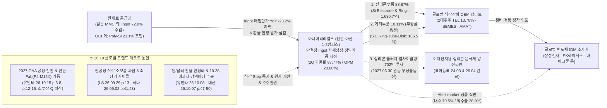

# 🔍 Phase 1: 기업 해독기 (원천 팩트 초안) — 하나머티리얼즈 (166090)

> 💡 **[핵심 용어 3줄 직관 해설]**
> - **[식각(Etching) 공정용 실리콘(Si)·탄화규소(SiC) 링 & 일렉트로드]**: 반도체 웨이퍼에 초미세 회로를 깎아내는 플라즈마 식각 챔버 내부에서 가스를 균일하게 뿜어주는 샤워기 헤드(**일렉트로드, 상부 전극**)와 웨이퍼를 고정하며 플라즈마를 모아주는 테두리 부품(**포커스 링**)으로, 강한 플라즈마에 깎여 나가므로 공장 가동 시간에 비례해 주기적으로 교체해야 하는 **'반도체용 고급 면도날(필수 소모품)'**입니다.
> - **[단결정 Ingot 수직계열화 & 유형 A 가동률 영업레버리지]**: 원소재인 대구경 실리콘 기둥(Ingot)을 직접 키우는(자체 성장) 수직계열화 기술에 힘입어, 아산 2공장 가동률이 2023년 **40.77%**에서 2026년 2분기 **87.77%(반기 83.70%)**로 차오르자 고정비가 급격히 희석되고 원재료 잉곳 매입단가가 **YoY -23.2%** 하락하며 **2분기 단독 영업이익률(OPM)이 `28.88%`**로 폭발한 이익 구조입니다.
> - **[실질 유통 BPS(31,788원) & 신사업 무상 콜옵션(할증 0%)]**: 자기주식(`488,222주`)을 뺀 실질 유통주식수(`19,289,452주`)로 나눈 주당 순자산가치이며, DART에 묶음 공시된 SiC 링 외 기타부품(`10.11% < 30%`)과 2027년 6월 완공 예정인 이차전지용 실리콘 음극재(702억 투자, 현재 매출 `0%`)는 Phase 3에서 거품 할증(`0%`)을 원천 차단하고 **공짜 보너스(`0원 무상 콜옵션`)**로 분리하는 보수적 가치평가 원칙입니다.

> **[S-Curve 국면 인증 뱃지]**: `[🟢 전공정 식각 소모품 본업 가동률 시클리컬 회복 (Si 부품 88.87% + 기타 10.11% = 98.98%, 2Q 가동률 87.77% & OPM 28.88%)]` + `[🎁 본업 저평가 + 신사업 무상 콜옵션 (Solid SiC 링 DART 묶음공시 10.11% < 30% & 실리콘 음극재 매출 0% ➡️ Phase 3 S-Curve 할증 0% 차단)]`  
> **[하이브리드 밸류체인 지위]**: `[👑 전공정 식각 챔버 소모성 부품 본업 순수 주도주 (익스포저 98.98%)]` / `[💎 TEL(2대 주주 13.78%) 캡티브 & 대구경 단결정 Ingot 수직계열화 병목 히든 챔피언]` / `[🎁 Solid SiC 링 & 이차전지 실리콘 음극재 무상 콜옵션 보유주]`

---

## 1. 비즈니스 모델 및 밸류체인

> **[26.10.17 글로벌 트렌드 델타 업데이트 🌐 (게이트 ① 직접 등재 · 게이트 ② 매크로 원가 직결 · 게이트 ③ 2027 GAA 전환·선단 팹 증설 & 10.28 비과세 감액배당 복합 충족)]**  
> 
> **1. 게이트 ① [제도권 딥리서치 직접 등재 — 전공정 식각 소모품 과점 밸류체인 공인]**:  
> • `[글로벌 트렌드: 26.09.29.LS증권.AI병목의 전이.pdf p.13 그림3]`: 국내 반도체 건식 식각(Dry Etching) 공정의 양대 핵심 소모성 부품인 **Si/쿼츠 링**(하나머티리얼즈·원익QnC·월덱스)과 **SiC Ring**(티씨케이·하나머티리얼즈·케이엔제이) 모두에 핵심 과점 공급사로 동시 등재된 유일한 상장사로 공인됨.  
> • `[글로벌 트렌드: 26.09.02.하나증권.증설의 시대, 후공정의 수혜도 함께 온다.pdf p.41 도표58, p.43 도표60]`: 전공정 소재·부품 섹터 내 **'웨이퍼 투입 총량 비례 소모성 수요 — 사이클 최장 지속(`p.43 도표60`)'** 핵심 수혜주로 등재되었으며, Peer Valuation 비교표(`p.41 도표58`)에서 티씨케이(26F PER 24.9배, PBR 4.4배) 대비 현저한 밸류에이션 저평가 매력이 확인됨.  
> 
> **2. 게이트 ② [매크로 원가 직결 — 원/달러 환율 숨고르기·안정화에 따른 수입 원재료 원가율 개선 가속]**:  
> • `cycle_timeline.md (2026.10 상반기 및 10월 중순 델타)`, `[글로벌 트렌드: 26.10.08.유안타증권.sam but differ.pdf p.3-4]`, `[글로벌 트렌드: 26.10.01.대신증권.결국은 본업.pdf p.1]`에서 확인된 원/달러 환율 숨고르기 및 하향 안정화 국면은, **주원재료 Ingot의 해외 수입 비중이 `72.8%`(일본 MMC 외)**에 달하는 반면 **내수 매출 비중이 `70.5%`(1,294.1억 원)**로 높은 동사 비즈니스 모델에 비대칭적 마진 확대(수입 원가 추가 절감 + 내수 매출 방어)로 직결됨.  
> 
> **3. 게이트 ③ [신규 2027 GAA 공정 전환 & 선단 팹 Q 확대 + 10.28 비과세 감액배당 주총 확정 (26.10.15 신규 리포트 반영)]**:  
> • `[글로벌 트렌드: 26.10.15.유안타증권.2027Issue&Theme(change).pdf p.3, p.6-8, p.12-15]`:  
>   ① **FinFET ➔ GAA 전환 및 식각 난이도 급증(`p.6-8 그림2, 표1`)**: 2027년 핵심 공정 변화(Change 1)로 파운드리(삼성전자 3·2나노, TSMC 2나노)를 넘어 **1d나노 이후 선단 DRAM 및 400단대 3D NAND 이후 메모리 공정까지 GAA(Gate All Around) 구조 전환**이 제시됨. GAA는 `Si/SiGe 적층 ➔ Patterning + Etch(식각) ➔ SiGe 선택적 제거(에칭)`를 통해 공중에 떠 있는 Nanosheet 3D 구조를 형성하므로 식각 공정 Step과 플라즈마 노출 시간이 대폭 증가하여 대구경 Si/SiC 부품 소모량을 구조적으로 증폭시킴.  
>   ② **삼성 파운드리 2나노 GAA 수율 반등 & 2027년 팹 가동(Q 증가)에 따른 소재·소모품 관심 상향(`p.12-15 그림5-7, 차트3-4`)**: 삼성전자 2나노 GAA 양산 수율이 **25년 30%대 ➔ 26.1Q 50%대 ➔ 26.3Q 60%대**로 빠르게 개선되며 빅테크(메타 MTIA 3세대, 테슬라 AI6) 동시 발주를 확보(`p.13`)했고, **2027년 삼성전자 평택 4공장(P4)·SK하이닉스 M15X 본격 가동 및 이후 평택 5공장(P5)·용인 클러스터·마이크론 싱가포르/아이다호 Fab 증설(`p.14 그림7`)**이 이어지며 반도체 출하량(Q) 증가가 소재·소모품 물량(Q) 증가로 확산됨. 특히 2026년 YTD 장비주 급등(원익IPS +78.9%, 테스 +230.9% 등) 대비 주가가 후행한 **전공정 소재·소모품으로 2027년 시장의 관심이 상향 이동(`p.14-15`)**할 것으로 분석됨.  
> • `[글로벌 트렌드: 26.10.07.대신증권.배당투자 오디세이.pdf p.3-4, p.47-50]` & `[공시 팩트: 주주총회소집공고(2026.10.13)]`: 제도권이 주목하는 **'자본준비금 감액 및 비과세 감액배당'** 테마와 관련하여, 동사는 **2026년 10월 13일 `주주총회소집공고`를 최종 확정 공시**하고 **10월 28일 임시주총(전자투표 10.18~10.27)**에서 자본준비금(주식발행초과금 **364.96억 원**)의 이익잉여금 전입을 결의하여 개인주주 배당소득세(15.4%) 비과세 배당 재원을 공식 확보함.

[공시 팩트]  
- **분석 기준일 및 단일 기준 주가(Single Price Anchor)**: **2026년 10월 16일 일봉 종가 `53,400원`** (`[주봉 종가(참고): 53,400원]`, `backtest_valuation.py` v4.1 실측 기준 Phase 1~3 공통 앵커) / **공식 실질 유통주식수 `19,289,452주`** (총발행 `19,777,674주` − 자기주식 `488,222주` [2.47%], 우선주 `0주`) / **단일 기준 유통 시가총액 `10,300.6억 원`** (총발행주식수 기준 시가총액 `10,561.3억 원`).  
- **최신 공시 스캔 완료 (`korean-dart` MCP `search_disclosures` & `download_document`, 2026.10.17 기준)**:  
  1. `2026.10.13`: **`주주총회소집공고` (접수번호 `20261013000258`)** — **2026년 10월 28일(수) 오전 9시** 아산2캠퍼스 강당에서 제20기 임시주주총회 개최 최종 확정(전자투표 기간: **2026.10.18 오전 9시 ~ 10.27 오후 5시**). 부의안건 제1호 의안으로 **'자본준비금의 이익잉여금 전입의 건'**이 상정되어 비과세 감액배당 재원(주식발행초과금 `364.96억 원`) 전입을 결의함 `[주주총회소집공고(2026.10.13)]`, `[주주총회소집결의(2026.09.09)]`.  
  2. `2026.09.29 ~ 09.30`: **`[기재정정]최대주주변경을수반하는주식담보제공계약체결` (`20260929900849`)** 및 **`주식등의대량보유상황보고서(일반)` (`20260930000828`)** — 최대주주 하나마이크론(주)(보유 `6,428,508주`, 지분율 `32.50%` / 특수관계인 합산 `8,957,208주`, `44.84%`)가 누적 8건 총 **`4,724,610주`**(담보설정총액 `3,388.6억 원`)를 담보로 제공 중이며, 대신증권 담보계약(2,398,801주, 400억 원) 기간을 2026.12.28까지 연장함. 여기에는 계열사 `HANA MICRON VINA CO., LTD.` 대출 USD 2억 불(Citibank N.A. 외)에 대해 하나머티리얼즈가 제공한 **USD 2억 불(약 2,608.6억~2,700억 원) 연대보증**에 대하여 모회사 하나마이크론이 하나머티리얼즈 앞으로 자기 보유 주식 `987,633주`(설정액 2,608.6억 원, 만기 2029.11.28)를 후순위 담보로 제공하여 신용을 보강한 건이 포함됨 `[기재정정 공시(2026.09.29)]`.  
  3. `2026.09.29`: **삼성자산운용 `주식등의대량보유상황보고서(약식)` (`20260929000521`)** — 삼성자산운용 보유 주식수 `482,901주` (지분율 `2.44%`, 단순투자 목적) 공시.  
  4. `2026.09.14`: **`증권발행결과(자율공시)` (`20260914900381`)** 및 **`주요사항보고서(타법인주식및출자증권양도결정)` (`20260914000266`)** — 동사가 보유한 모회사 하나마이크론 보통주 `2,907,991주`를 교환대상으로 하는 **1,000억 원 규모의 제3회 무보증 사모 교환사채(EB, 표면이자율 `0.0%`, 만기이자율 `0.0%`, 교환가액 `34,388원`, 만기 `2028.09.14`)** 발행 및 납입을 완료하여, 고금리 은행 차입금 **900억 원 상환** 및 운영자금 **100억 원 확보**를 마침 `[주요사항보고서(교환사채권발행결정, 2026.08.04)]`, `[증권발행결과(2026.09.14)]`.  
  5. `2026.08.13` & `2026.08.12`: 제20기 반기보고서 제출(상반기 누적 매출 `1,834.9억 원`, 영업이익 `473.1억 원[OPM 25.79%, 2Q 단독 28.88%]`, 지배주주 순이익 `374.0억 원[귀속률 100.0%]`) 및 **이차전지용 실리콘 음극재 양산 제조라인 신규시설투자 `702억 원` 결정**(자기자본 대비 15.14%, 투자기간 `2026.08.12 ~ 2027.06.30`) 공시 `[[하나머티리얼즈]반기보고서(2026.08.13), p.40]`, `[신규시설투자등(2026.08.12)]`. 정기보고서 이후 현재까지 3분기 잠정실적 공시나 유·무상증자 결정 공시는 **0건(없음)**임을 확인함.

하나머티리얼즈 주식회사(Hana Materials Inc., 종목코드: 166090)는 반도체 핵심 제조공정인 건식 식각(Dry Etching) 공정에 사용되는 소모성 구조기능성 부품인 실리콘(Silicon) 및 실리콘카바이드(SiC, 탄화규소) 소재의 **일렉트로드(Electrode, 상부 전극)**와 **링(Ring, 포커스 링 등)** 제조 및 판매를 주력 사업으로 영위하고 있습니다 `[[하나머티리얼즈]반기보고서(2026.08.13), p.4, p.22]`. 2023년 1월에는 반도체·배터리 소부장 신기술사업자 투자를 목적으로 완전자회사 **하나에스앤비인베스트먼트(주)**(지분율 `100.0%`)를 설립하여 연결재무제표를 작성하고 있으며 `[[하나머티리얼즈]반기보고서(2026.08.13), p.22, p.44]`, 2026년 8월에는 **702억 원 규모의 이차전지용 실리콘 음극재 양산 제조라인 투자**를 단행하며 본업의 실리콘 가공 부산물(슬러지)을 업사이클링하는 차세대 배터리 소재로 영역을 확장하고 있습니다 `[[하나머티리얼즈]반기보고서(2026.08.13), p.32]`, `[신규시설투자등(2026.08.12)]`.

동사의 핵심 비즈니스 모델과 수직계열화 밸류체인은 다음과 같이 3단계로 구성됩니다:
1. **공급자 (Supplier — 고순도 원재료 조달 및 단결정 Ingot 자체 성장)**:
   - 핵심 원재료인 태양광·반도체급 고순도 **Poly Silicon**(2026년 반기 원재료 매입 비중 **23.1%**, 주요 매입처: **OCI 외**)을 장기공급계약 등으로 조달하여 자체 대구경 단결정 Silicon Ingot을 성장시키며, 고객사 요청 사양에 맞춘 다결정·단결정 **Ingot**(매입 비중 **72.8%**, 주요 매입처: 일본 **MMC** 외) 및 기타 원재료(4.1%)를 병행 조달합니다 `[[하나머티리얼즈]반기보고서(2026.08.13), p.23]`.
   - 특히 주력 원재료인 다결정·단결정 Ingot의 kg당 평균 매입단가가 2024년(제18기) **199,686원/kg** ➔ 2025년(제19기) **183,836원/kg** ➔ **2026년 반기(제20기 반기) 141,094원/kg**으로 전년 대비 **-23.2% 급락**(Poly Silicon 역시 2024년 62,188원/kg ➔ 2025년 51,774원/kg ➔ 2026.1H 52,067원/kg 안정화)하여 전사 매출총이익률(**GPM 40.38%**) 및 영업이익률 개선을 강력하게 견인하고 있습니다 `[[하나머티리얼즈]반기보고서(2026.08.13), p.23, p.40]`.
2. **기업 (Company — 천안 본사 및 아산 1·2사업장 수직계열화 일관생산체제)**:
   - 국내 일반 부품 가공 경쟁사들이 외부 잉곳 매입 후 단순 임가공에 의존하는 것과 달리, 동사는 **대구경 단결정 Silicon Ingot 자체 성장(소재) ➔ 절단·CNC 다축 초정밀 가공 ➔ 초정밀 세정·에칭 및 코팅**에 이르는 **수직계열화 일관생산 프로세스(In-house Process)**를 구축하여 독보적인 원가 경쟁력과 수율 균일성을 확보하고 있습니다 `[[하나머티리얼즈]반기보고서(2026.08.13), p.24, p.31-33]`.
   - 아산 제2사업장(충남 아산시 음봉면) 완공을 통해 연간 가동가능시간을 과거 75.3만 시간에서 **449.55만 시간(반기 224.77만 시간)**으로 6배 확충하여 고단화 3D NAND 극저온 식각 및 선단 DRAM/GAA 공정용 **Si 부품 및 SiC Ring(Hybrid/CVD SiC)** 수요에 대응하고 있습니다 `[[하나머티리얼즈]반기보고서(2026.08.13), p.24, p.29-31]`.
   - 또한 본업의 잉곳 절단·가공 과정에서 발생하는 고순도 실리콘 슬러지 부산물을 재활용하는 **`'실리콘 슬러지로부터 고순도 실리콘 분말 회수 및 정제 방법'`(2024.03.11 특허 등록)** 및 **`'리튬 이차전지용 음극 활물질 및 그의 제조방법'`(2026.04.20 특허 등록)**을 바탕으로 702억 원 규모 실리콘 음극재 양산 라인(2027.06.30 완공 예정)을 건설 중입니다 `[[하나머티리얼즈]반기보고서(2026.08.13), p.32]`, `[신규시설투자등(2026.08.12)]`.
3. **고객사 (Customer — 글로벌 장비 OEM 정품 번들 공급 및 IDM 소자사 직판)**:
   - **정품(OEM Before-market) 공급 경로**: 글로벌 1위권 반도체 식각장비 제조사인 **Tokyo Electron(TEL, 동사 지분 13.78%를 보유한 2대 주주)**, **세메스(SEMES)**, **Applied Materials(AMAT)** 등에 정품 부품을 공급하면, 장비사가 식각 챔버에 장착하여 최종 수요처(삼성전자, SK하이닉스, 마이크론, 키옥시아 등 글로벌 IDM)에 인도합니다 `[[하나머티리얼즈]반기보고서(2026.08.13), p.26, p.162]`.
   - **직판(After-market 정품) 경로**: 국내외 반도체 소자 제조업체에 챔버 내 마모 교체용 소모성 부품을 직접 판매합니다 `[[하나머티리얼즈]반기보고서(2026.08.13), p.26]`.
   - **지역별 매출 비중(2026년 반기 연결 1,834.9억 원 기준)**: **내수**(TEL 코리아, 세메스, 삼성전자, SK하이닉스 등) **1,294.1억 원(70.53%)**, **직수출**(TEL 일본 본사, AMAT 등) **529.4억 원(28.85%)**, **신기술사업금융**(종속회사) **11.4억 원(0.62%)**으로 구성됩니다 `[[하나머티리얼즈]반기보고서(2026.08.13), p.25-26]`.



---

## 2. 주요 제품별 매출 비중 추이 (최근 5년 및 최신 분기)

[공시 팩트]  
최근 5개년(2021~2025년) 및 2026년 상반기(제20기 반기 누적, 연결 매출액 **1,834.9억 원**) 기준 주요 제품군별 매출액 및 비중 추이는 다음과 같습니다 `[[하나머티리얼즈]사업보고서(2024.03.15), p.23]`, `[[하나머티리얼즈]사업보고서(2026.03.13), p.25]`, `[[하나머티리얼즈]반기보고서(2026.08.13), p.22, p.25]`:

| 구분 | 핵심 내용 | 비고 |
| :--- | :--- | :--- |
| **실리콘부품**<br>(Si Electrode, Si Ring) | • **2026년 상반기**: **1,630.7억 원 (88.87%)** (내수 1,212.4억 + 수출 418.3억) `[[하나머티리얼즈]반기보고서(2026.08.13), p.22, p.25]`<br>• **5개년 추이**: 2021년 2,502.0억(**92.29%**) ➔ 2022년 2,705.5억(**88.03%**) ➔ 2023년 2,023.0억(**86.61%**) ➔ 2024년 2,174.2억(**86.40%**) ➔ 2025년 2,398.2억(**87.69%**) | 전사 외형의 약 89%를 창출하는 압도적 캐시카우. 대구경 단결정 Ingot 자체 성장 수직계열화로 고마진(2Q 전사 OPM **28.88%**) 견인 `[[하나머티리얼즈]반기보고서(2026.08.13), p.24, p.40]` |
| **기타 부품**<br>(SiC Ring, Tube, Disk, Ingot 등) | • **2026년 상반기**: **185.5억 원 (10.11%)** (수출 110.1억 + 내수 75.4억) `[[하나머티리얼즈]반기보고서(2026.08.13), p.22, p.25]`<br>• **5개년 추이**: 2021년 193.2억(**7.13%**) ➔ 2022년 353.0억(**11.49%**) ➔ 2023년 289.3억(**12.38%**) ➔ 2024년 307.7억(**12.23%**) ➔ 2025년 319.5억(**11.68%**) | 고단화 3D NAND 및 선단 식각 공정용 CVD/Hybrid SiC Ring 등이 포함된 묶음공시 계정. 직수출 비중이 **59.36%**로 높음 |
| **상품 외**<br>(부산물·원재료 등) | • **2026년 상반기**: **7.4억 원 (0.40%)** (내수 6.4억 + 수출 1.0억) `[[하나머티리얼즈]반기보고서(2026.08.13), p.25]`<br>• **5개년 추이**: 2021년 15.8억(0.58%) ➔ 2022년 14.8억(0.48%) ➔ 2023년 19.9억(0.85%) ➔ 2024년 21.8억(0.87%) ➔ 2025년 11.0억(0.40%) | 반기보고서 사업개요 요약표(`p.22`)에서는 기타 부품(185.5억)과 상품 외(7.4억)가 합산되어 `'기타 192.8억 원(10.51%)'`으로 표기됨 |
| **신기술사업금융**<br>(완전자회사 연결) | • **2026년 상반기**: **11.4억 원 (0.62%)** (내수 100%, 반기 영업이익 4.8억 원) `[[하나머티리얼즈]반기보고서(2026.08.13), p.22, p.25, p.44]`<br>• **연간 추이**: 2023년 3.6억(0.16%) ➔ 2024년 12.8억(0.51%) ➔ 2025년 6.1억(0.22%) | 완전자회사 하나에스앤비인베스트먼트(주)(지분율 100.0%) 및 소부장1호 신기술조합의 투자조합 관리보수·운용수익 |
| **신사업 부문**<br>(이차전지 실리콘 음극재) | • **2026년 상반기**: **매출액 0원 (0.00%)**<br>• **2026.08.12 공시**: **702억 원**(25년 말 자기자본 대비 15.14%) 규모 실리콘 음극재 양산 제조라인 신규 시설투자 진행 중 (`2026.08.12 ~ 2027.06.30`) | 실리콘 슬러지 정제 특허(`24.03.11`) 및 음극 활물질 특허(`26.04.20`) 등록 완료 후 양산 설비 구축 단계 `[[하나머티리얼즈]반기보고서(2026.08.13), p.32]`, `[신규시설투자등(2026.08.12)]` |
| **전사 연결 합계**<br>(내수 vs 수출 구조) | • **2026년 상반기**: **1,834.9억 원 (100.0%)** — 전년 동기(1,227.2억 원) 대비 **+49.51% 급증**<br>• **지역별 비중**: 내수 **1,294.1억 원(70.53%)** / 직수출 **529.4억 원(28.85%)** / 금융 **11.4억 원(0.62%)** | 5개년 연결 매출: 21년 2,711.0억 ➔ 22년 3,073.2억 ➔ 23년 2,335.8억 ➔ 24년 2,516.5억 ➔ 25년 2,734.8억 `[[하나머티리얼즈]반기보고서(2026.08.13), p.25, p.40]` |

---

### 2.1 S-Curve 신기술 테마 매출 익스포저(Exposure %) 산출표 (하이브리드 수비 검증)

[공시 팩트]  
`SKILL.md` v4.1의 **[S-Curve 침투율 및 하이브리드 수혜주 검증 절대 규정 — 수비수 2: 단독 매출 미공시·묶음공시 신사업 = '0원 무상 콜옵션(할증 0%)' 처리 절대 원칙]** 및 **`s_curve_spec.md` 제4원칙(진실 우선순위 1순위: DART 원문 우선)**에 의거하여, `s_curve_registry.json`(`th_sic_focus_ring`)에 등재된 신기술 테마와 본업의 실질 단독 분리 공시 익스포저를 엄격히 분리 검증합니다 `[[하나머티리얼즈]반기보고서(2026.08.13), p.22, p.25]`:

| 제품/서비스 구분 | 매출액 (억원) | 전사 매출 비중(%) | 신기술 테마 직결 여부 | 하이브리드 수비 판정 |
| :--- | :---: | :---: | :---: | :---: |
| **[DART 공시 본업 주력]**<br>실리콘부품 (대구경 Si Electrode & Ring) | **1,630.7**<br>(26.1H 누적) | **88.87%** | **전공정 식각 챔버 필수 소모품 본업 캐시카우**<br>(선단 DRAM·HBM·3D NAND·GAA 웨이퍼 투입량 직결) | 🟢 **전공정 식각 부품 본업 순수 주도주**<br>(식각 소모품 통합 **98.98%** / 레거시 잠식 위험 0%) |
| **[합산 묶음공시 신소재 ①]**<br>기타 부품 (CVD/Hybrid SiC Ring, Tube, Disk, Ingot 등 합산) | **185.5**<br>*(SiC 단독 미분리)* | **10.11%**<br>*(단독 미공시 / 묶음 합산 < 30%)* | 초고단 NAND & 선단 식각용 **SiC Ring 라인업 등재**되었으나 Tube·Disk 등이 합산된 묶음공시 계정 | ⚠️ **[0원 무상 콜옵션 분류]**<br>`[공시 확인: 주력 라인업 등재 / 단독 매출 미공시 & 30% 미만 ➡️ Phase 3 S-Curve 할증 0% 차단]` |
| **[양산 전 설비투자 신사업 ②]**<br>이차전지용 실리콘 음극재 (702억 투자) | **0.0**<br>*(27.06.30 완공 예정)* | **0.00%** | 본업 실리콘 슬러지 업사이클링 차세대 배터리 소재 (특허 등록 완료 후 양산 라인 건설 중) | ⚠️ **[0원 무상 콜옵션 분류]**<br>`[Phase 3 S-Curve 할증 0% 차단 & 27H2 초기 감가상각비 차감 의무]` |
| **[비핵심 기타]**<br>상품 외(0.40%) + 신기술사업금융(0.62%) | **18.7** | **1.02%** | 비해당 (부산물 유통 및 벤처조합 관리보수) | ⚪ 비핵심 보조 매출 |

- **신기술 테마(Solid SiC Ring / 실리콘 음극재) 실질 단독 익스포저 합산:** **`10.11% 이하 (SiC 단독 미분리 묶음공시 10.11% < 30% 컷오프 / 실리콘 음극재 0.0%)`** *(단독 미공시·30% 미만 묶음 항목은 무상 콜옵션 분류 및 Phase 3 S-Curve 할증 0% 처리 / 단, 전공정 식각 소모품 본업 통합 익스포저는 **98.98%**)*
- **수혜 적격성 최종 판정:** **`[🎁 본업 저평가 + 신사업 무상 콜옵션(할증 0%)]`** 및 **`[🟢 전공정 식각 소모품 본업 순수 주도주 (통합 98.98%)]`**
  1. **[수비수 1 & 2 검증 — 묶음공시 신기술 할증 차단(`sc_mult = 1.00`, `0%`) 및 무상 콜옵션 분리]**: DART 반기보고서(`p.22, p.25`) 실측 결과, 차세대 `Solid/Hybrid SiC Ring`은 `'기타 부품(SiC Ring, Tube, Disk, Ingot 등)'` 계정에 묶음 공시되어 있고 그 계정 전체 비중도 **`10.11%`**로 30% 컷오프에 미달하며, 702억 원을 투자 중인 `실리콘 음극재`는 2027년 6월 30일 완공 예정으로 현재 매출이 **`0%`**입니다. 따라서 `SKILL.md` v4.1 수비수 2 절대 규칙에 의거하여 기존 본업(Si 부품 88.87%)을 신기술 단독 매출로 둔갑시켜 S-Curve 멀티플 할증을 부여하는 행위를 **100% 차단(`Phase 3 대안 A sc_mult = 1.00배, 0% 할증`)**하고, SiC 링 수출 확대와 실리콘 음극재 신사업은 **'0원 무상 콜옵션(+α 상방 모멘텀)'**으로만 엄격히 분리합니다.
  2. **[왜 LG생활건강형 '레거시 잠식 탈락'이 아닌가? — 본업 식각 소모품(88.87%)의 폭발적 성장 실증]**: 사양 산업에 잠식당하는 레거시 기업과 달리, 동사의 주력인 **대구경 Si Electrode 및 Si Ring(88.87%)**은 선단 DRAM(1b/1c nm)·HBM·3D NAND 극저온 식각 및 2027년 GAA 공정에서 웨이퍼 투입량(Q)에 비례해 소모되는 필수 부품입니다 `[글로벌 트렌드: 26.09.02.하나증권...pdf p.43 도표60]`, `[글로벌 트렌드: 26.10.15.유안타증권...pdf p.7, p.14]`. 실제로 2026년 상반기 실리콘부품 매출이 YoY **+49.5%** 급증하며 **2분기 단독 OPM 28.88%(전사 영업이익 YoY +206.1%)**를 창출했으므로, 순수 본업 현금흐름과 역사적 밸류에이션 밴드만으로도 강력한 리레이팅 타당성을 갖습니다.
  3. **[공격수 검증 — 병목 밸류체인 역추론]**: 글로벌 식각 장비 1위권 **TEL(도쿄일렉트론)이 지분 13.78%를 보유한 2대 주주**로서 TEL 챔버 내 대구경 실리콘 전극(Electrode)과 포커스 링을 캡티브(Captive) 공급하고 있으며, 대구경 단결정 Ingot 자체 성장 기술을 통해 전공정 식각 부품 공급망 병목을 해결하는 **`[💎 TEL 캡티브 & 대구경 Ingot 수직계열화 병목 히든 챔피언]`** 지위를 부여합니다.

---

## 3. 전사 영업이익률 및 FCF 추이

[공시 팩트]  
최근 5개년(2021~2025년) 및 2026년 1분기·2분기·상반기 누적 기준 연결(2021~2022년은 별도) 손익과 지배주주 순이익(귀속률 %), 그리고 잉여현금흐름(`FCF = 영업활동현금흐름 CFO − 유형자산 취득액 CapEx`, 동사 사업보고서 배당정책 상 공식 FCF 산식 기준 `[[하나머티리얼즈]사업보고서(2026.03.13), p.215]`) 추이는 다음과 같습니다 `[[하나머티리얼즈]사업보고서(2023.03.10), p.25-26, p.32]`, `[[하나머티리얼즈]사업보고서(2026.03.13), p.33-34, p.40-41]`, `[[하나머티리얼즈]반기보고서(2026.08.13), p.37, p.40, p.43]`:

- **지배주주 순이익 귀속률(`100.0%`) 무결성 확인**: 동사의 연결 종속회사인 `하나에스앤비인베스트먼트(주)`는 동사가 지분 **100.0%**를 소유한 완전 자회사이므로 연결 재무제표상 비지배지분(소수주주 지분)이 **0원**이며, 전 기간 **`지배주주 귀속 순이익 = 연결 당기순이익 (귀속률 100.0%)`**으로 비지배지분 누수가 일체 존재하지 않습니다 `[[하나머티리얼즈]반기보고서(2026.08.13), p.37, p.40, p.44]`.

| 연도/분기 | 매출액 | 영업이익 | OPM(%) | 지배주주 순이익(귀속률) | FCF | 비고 |
| :--- | :---: | :---: | :---: | :---: | :---: | :--- |
| **2021년 (제15기)** | 2,711.0억 | 822.7억 | **30.35%** | **666.7억 (100.0%)**<br>*(별도 666.7억)* | **+653.9억**<br>*(CFO 965.8억 − CapEx 311.9억)* | 메모리 슈퍼사이클 호황 (가동률 97.47%) `[[하나머티리얼즈]사업보고서(2023.03.10), p.26, p.32]` |
| **2022년 (제16기)** | 3,073.2억 | 937.4억 | **30.50%** | **801.3억 (100.0%)**<br>*(별도 801.3억)* | **-98.8억**<br>*(CFO 825.8억 − CapEx 924.7억)* | 사상 최대 매출·영업이익, 아산 2공장 선제 CapEx 개시 `[[하나머티리얼즈]사업보고서(2023.03.10), p.26, p.32]` |
| **2023년 (제17기)** | 2,335.8억 | 412.8억 | **17.67%** | **341.9억 (100.0%)**<br>*(연결 341.9억)* | **-764.5억**<br>*(CFO 442.0억 − CapEx 1,206.5억)* | 전방 감산 충격(가동률 40.77%) & 아산 2공장 CapEx 집중 `[[하나머티리얼즈]사업보고서(2026.03.13), p.34, p.40-41]` |
| **2024년 (제18기)** | 2,516.5억 | 434.1억 | **17.25%** | **317.6억 (100.0%)**<br>*(연결 317.6억)* | **+335.2억**<br>*(CFO 756.8억 − CapEx 421.6억)* | 아산 2공장 준공 후 CapEx 급감, **FCF 대규모 흑자 전환** `[[하나머티리얼즈]사업보고서(2026.03.13), p.34, p.40-41]` |
| **2025년 (제19기)** | 2,734.8억 | 500.8억 | **18.31%** | **383.8억 (100.0%)**<br>*(연결 383.8억)* | **+485.2억**<br>*(CFO 685.4억 − CapEx 200.2억)* | 가동률 회복(66.56%) 및 CapEx 안정화로 FCF +44.8% 증가 `[[하나머티리얼즈]사업보고서(2026.03.13), p.34, p.40-41]` |
| **2025.1H (전반기)** | 1,227.2억 | 172.2억 | **14.03%** | **115.8억 (100.0%)**<br>*(연결 115.8억)* | **+92.0억**<br>*(CFO 179.3억 − CapEx 87.3억)* | 전년 동기 비교 기준 (기본·희석 지배EPS 593원) `[[하나머티리얼즈]반기보고서(2026.08.13), p.40, p.43]` |
| **2026.1Q (3M)** | 934.0억 | 213.0억 | **22.80%** | **176.5억 (100.0%)**<br>*(연결 176.5억)* | **+93.4억**<br>*(CFO 191.5억 − CapEx 98.1억)* | 가동률 79.62% 돌파하며 OPM 22.8% 안착, 지배EPS 915원 `[[하나머티리얼즈]분기보고서(2026.05.14)]` |
| **2026.2Q (3M)** | 900.9억 | 260.2억 | **28.88%** | **197.5억 (100.0%)**<br>*(연결 197.5억)* | **+190.3억**<br>*(CFO 248.1억 − CapEx 57.8억)* | **2Q 단독 OPM 28.88% (+6.08%p QoQ, OP YoY +206.1%)**, 지배EPS 1,024원 `[[하나머티리얼즈]반기보고서(2026.08.13), p.40, p.43]` |
| **2026.1H (반기누적)** | **1,834.9억** | **473.1억** | **25.79%** | **374.0억 (100.0%)**<br>*(연결 374.0억)* | **+283.7억**<br>*(CFO 439.6억 − CapEx 155.9억)* | **반기 만에 25년 연간 OP의 94.5% 달성, FCF YoY +208.5% 폭증 (TTM 매출 3,342.5억, OP 801.8억, 지배순이익 642.0억 [100.0%], TTM FCF +567.3억)** |

> **재무 건전성 및 부채·CapEx 회계 무결성 핵심 팩트 (Phase 3 EV 역DCF & 시나리오 직결)**:
> 1. **영업레버리지 폭발 메커니즘**: 2022~2023년 총 2,131.2억 원(924.7억 + 1,206.5억)의 아산 2공장 선제 증설로 인해 2023~2025년에는 감가상각비 부담으로 OPM이 17.25~18.31%에 머물렀으나, 2026년 상반기 가동률이 **83.70%**(2분기 단독 **87.77%**)로 치솟으면서 고정비(반기 유형자산 감가상각비 162.8억 원 `[[하나머티리얼즈]반기보고서(2026.08.13), p.24]`)가 완벽히 희석되고 Ingot 원재료 매입단가 하락(YoY -23.2%)이 맞물려 **2분기 단독 영업이익률이 `28.88%`까지 수직 복원**되었습니다.
> 2. **순차입금 구조 및 무이자(0.0%) 교환사채(EB) 1,000억 원의 회계적 실체**:
>    - **2026.06.30 연결 기준 부채 및 현금**: 총차입금은 **`1,192.4억 원`**(단기차입금 400.0억 + 유동성장기차입금 237.0억 + 장기차입금 524.4억 = 은행 차입금 `1,161.4억 원` + 리스부채 `31.0억 원`)이며, 현금성자산은 **`475.9억 원`**(현금및현금성자산 471.2억 + 단기금융상품 0.6억 + 유동 당기손익금융자산 4.1억)으로 **보고 기준 순차입금은 `+716.5억 원`**입니다 `[[하나머티리얼즈]반기보고서(2026.08.13), p.39-40]`. (비유동자산에는 보유 하나마이크론 지분 등 `기타포괄손익-공정가치금융자산 3,231.5억 원`이 별도 계상됨).
>    - **2026.09.14 사모 EB 1,000억 원 발행 반영**: 보유 하나마이크론 주식 2,907,991주를 교환대상(교환가액 34,388원)으로 발행한 1,000억 원 무이자(0.0%) EB로 고금리 은행 차입금 900억 원을 상환하고 100억 원을 운영자금으로 확보함에 따라, **실질 순차입금은 `+716.5억 원`으로 동일**하되 현금성 이자지출(2025년 연간 이자지급액 33.5억 원 `[[하나머티리얼즈]사업보고서(2026.03.13), p.41]`)은 대폭 감소합니다.
>    - **🚨 회계 무결성 주의사항**: 단, ① K-IFRS 회계기준상 표면금리 0.0% EB라도 교환권 분리 후 할인발행차금(교환권조정)에 대한 **유효이자율 상각비(연 약 30~35억 원 규모의 비현금 금융원가, 이자수익 차감 후 순금융비용 연 약 20~25억 원)**가 손익계산서에 인식되며, ② 2027년 6월 30일까지 집행될 **702억 원 실리콘 음극재 CapEx 현금 유출(포괄적 실질 순부채 약 1,200억 원 상당)** 및 완공 후 **초기 감가상각비·고정비(연 약 94~120억 원, 향후 12M 내 반기분 약 60억 원)**를 Phase 3 EV 역DCF 및 시나리오 손익에서 반드시 반영해야 합니다.

---

## 4. 핵심 KPI 추이 (가동률, 수주잔고, ASP 등)

[공시 팩트]  
동사는 DART 정기보고서 `II. 사업의 내용 - 3. 원재료 및 생산설비`에 반도체 실리콘 부품 부문의 공식 생산능력(제조비용 기준), 생산실적, 가동가능시간, 실제가동시간 및 평균가동률(%)을 매 분기 구체적 수치로 공시하고 있습니다 `[[하나머티리얼즈][정정]사업보고서(2022.08.10), p.18]`, `[[하나머티리얼즈]사업보고서(2023.03.10), p.15]`, `[[하나머티리얼즈]사업보고서(2024.03.15), p.19]`, `[[하나머티리얼즈]사업보고서(2026.03.13), p.24]`, `[[하나머티리얼즈]분기보고서(2026.05.14)]`, `[[하나머티리얼즈]반기보고서(2026.08.13), p.24]`:

### ① 공장 가동가능시간(Capa) 및 평균가동률 추이 (2021년 ~ 2026년 반기)

| 연도 / 분기 | 가동가능시간 (Capa) | 실제가동시간 | **평균가동률(%)** | 제조비용 기준 생산능력 / 생산실적 | 사이클 국면 및 설비 변동 팩트 |
| :--- | :---: | :---: | :---: | :---: | :--- |
| **2021년 (제15기)** | 753,024시간 | 733,936시간 | **97.47%** | 1,419.6억 / 1,267.1억 | 아산 2공장 증설 전 슈퍼사이클 풀가동 정점 `[[하나머티리얼즈][정정]사업보고서(2022.08.10), p.18]` |
| **2022년 (제16기)** | 3,418,536시간 | 2,920,346시간 | **85.43%** | 1,732.1억 / 1,680.4억 | 설비 증설 반영으로 가동가능시간 4.5배 확대 `[[하나머티리얼즈]사업보고서(2023.03.10), p.15]` |
| **2023년 (제17기)** | 4,495,488시간 | 1,832,910시간 | **40.77%** | 1,920.8억 / 1,503.1억 | 아산 2공장 완공(가동가능시간 6배 확대) & 메모리 감산 최저점 `[[하나머티리얼즈]사업보고서(2024.03.15), p.19]` |
| **2024년 (제18기)** | 4,495,488시간 | 2,883,748시간 | **64.15%** | 1,950.6억 / 1,717.8억 | 감산 완화 및 1차 가동률 반등 `[[하나머티리얼즈]반기보고서(2026.08.13), p.24]` |
| **2025년 (제19기)** | 4,495,488시간 | 2,992,008시간 | **66.56%** | 2,283.4억 / 1,905.4억 | 선단 공정 수요 회복 지속 `[[하나머티리얼즈]사업보고서(2026.03.13), p.24]` |
| **2026.1Q (3M)** | 1,123,872시간 | 894,851시간 | **79.62%** | 615.2억 / 539.1억 | 손익분기 가동률 돌파 및 본격 램프업 `[[하나머티리얼즈]분기보고서(2026.05.14)]` |
| **2026.2Q (3M 역산)** | 1,123,872시간 | 986,436시간 | **87.77%** | 635.7억 / 572.8억 | **2분기 단독 가동률 87.77% 도달로 OPM 28.88% 폭발** `[[하나머티리얼즈]반기보고서(2026.08.13), p.24]` |
| **2026.1H (6M 누적)** | **2,247,744시간** | **1,881,287시간** | **83.70%** | **1,250.9억 / 1,111.9억** | **원가 기준 생산실적 가동률도 88.89%(1,111.9억 ÷ 1,250.9억) 달성** `[[하나머티리얼즈]반기보고서(2026.08.13), p.24]` |

### ② 생산능력(Capa) 산출 기준 및 연환산 최대 매출 체력 검증
- **공시 생산능력 산출식**: `생산능력 = 제조비용(재료비, 노무비, 경비) 기준 각 사업연도 최대생산월 금액 × 영업개월수` `[[하나머티리얼즈]반기보고서(2026.08.13), p.24]`.
- **연환산 최대 매출 체력**: 2026년 반기 제조원가 기준 생산능력은 **1,250.9억 원(연환산 2,501.8억 원)**이며, 2026년 반기 매출원가율(**59.62%**, `매출원가 1,094.0억 ÷ 매출액 1,834.9억`)을 적용하여 매출액 기준 생산능력(Capa)으로 역산하면 현재 가동 라인 기준 **연간 약 4,200억 ~ 4,500억 원** 수준입니다 `[[하나머티리얼즈]반기보고서(2026.08.13), p.24, p.40]`. 또한 아산 2공장 내 유휴 클린룸 공간(Shell)에 가공기 보완투자(반기 중 기계장치 등 101.7억 원 보완투자 집행 `p.25`)가 진행 중이어서 풀가동 및 모듈식 증설 시 연간 4,500억~5,000억 원까지 매출 대응이 가능합니다.

### ③ 수주잔고 및 제품 가격(ASP)·원재료 단가 추이
- **수주상황 (장기 수주잔고 미존재 공시 팩트)**: DART 반기보고서(`p.26`)에 *"당사도 주요고객들과 기본거래계약서만을 체결한 후 수시로 물량을 수주(주문)받고 있어 장기적인 수주는 없으며 특정시점에서의 수주현황은 큰 의미가 없습니다"*라고 명시되어 있습니다. 이는 수주 장비업(유형 B)이 아닌 **팹 가동 비례 연속 소모품(유형 A)**의 전형적 특성입니다.
- **시간당 창출 매출단가(Substantial ASP) 및 원재료 스프레드**:
  - 주문생산 및 다품종 모델별 상이한 가격 구조로 인해 개별 제품 단가는 공시 생략되었으나 `[[하나머티리얼즈]반기보고서(2026.08.13), p.23]`, 실제 가동시간당 창출 매출액(시간당 ASP 지표)은 2025년 **91,404원/시간**(`2,734.8억 ÷ 299.2만 시간`)에서 **2026년 반기 97,533원/시간**(`1,834.9억 ÷ 188.1만 시간`, **+6.7% 상승**)으로 반등했습니다.
  - 반면 주원재료 **Ingot 매입단가는 2024년 199,686원/kg ➔ 2025년 183,836원/kg ➔ 2026년 반기 141,094원/kg(YoY -23.2%)**으로 큰 폭 하락하여 판매단가(P) 상승과 원재료 단가(C) 하락의 골디락스 스프레드 확장이 진행 중입니다 `[[하나머티리얼즈]반기보고서(2026.08.13), p.23]`.

---

## 5. 경영진 및 주주환원 이력

[공시 팩트]  
동사는 최대주주인 **하나마이크론(주)**(지분율 **32.50%**, `6,428,508주`) 및 특수관계인(최한수 11.63% 등 합산 **44.30%**, 대량보유상황보고서 기준 `8,957,208주` [**44.84%**])이 안정적 지배권을 보유하고 있으며, 글로벌 반도체 식각장비 선두 기업인 **Tokyo Electron Limited(TEL)**가 **13.78%**(`2,726,200주`)를 보유한 2대 주주로서 전략적 캡티브(Captive) 동맹을 구축하고 있습니다 `[[하나머티리얼즈]반기보고서(2026.08.13), p.44, p.160, p.162]`, `[주식등의대량보유상황보고서(일반, 2026.09.30)]`. 전문경영인인 **김현주 대표이사** 체제로 운영 중입니다 `[주주총회소집공고(2026.10.13)]`.

주주환원 측면에서는 **8년 연속 결산 현금배당**을 실시해 왔으며, 2026년 3월 6일 이사회 결의를 통해 **2026~2028년 중기 배당정책(FCF 100억 원 이상 시 배당성향 10% 이상 지속 유지)**을 공식화했습니다 `[[하나머티리얼즈]사업보고서(2026.03.13), p.215, p.217]`. 나아가 **2026년 9월 9일 이사회 결의 및 10월 13일 `주주총회소집공고` 확정**을 통해 오는 **2026년 10월 28일 임시주주총회에서 `'자본준비금(주식발행초과금 364.96억 원)의 이익잉여금 전입의 건'`**을 결의함으로써, 개인주주에게 배당소득세(15.4%)가 전액 면제되는 **비과세 감액배당 재원**을 전격 확보했습니다 `[주주총회소집공고(2026.10.13)]`, `[글로벌 트렌드: 26.10.07.대신증권.배당투자 오디세이.pdf p.47-50]`:

| 주주환원 및 자본정책 구분 | 연도별 세부 실행 내역 (DART 확정 수치) | 출처 [공시 팩트] |
| :--- | :--- | :--- |
| **현금배당 이력 및<br>중기 배당정책** | • **2021년(제15기)**: 주당 **600원** (중간 300원 + 결산 300원, 총액 117.1억 원, **배당성향 17.6%**)<br>• **2022년(제16기)**: 주당 **600원** (중간 300원 + 결산 300원, 총액 117.1억 원, **배당성향 14.6%**)<br>• **2023년(제17기)**: 주당 **200원** (결산배당, 총액 39.0억 원, **배당성향 11.4%** — 대규모 CapEx로 중간배당 미실시)<br>• **2024년(제18기)**: 주당 **250원** (결산배당, 총액 48.7억 원, **배당성향 15.3%**)<br>• **2025년(제19기)**: 주당 **300원** (결산배당, 총액 57.9억 원, **배당성향 15.1%**, 2026년 상반기 지급 완료)<br>• **중기 정책(2026~2028)**: FCF 100억 이상 시 배당성향 10% 이상 유지 결의 (2026.03.06 이사회) | `[[하나머티리얼즈]사업보고서(2024.03.15), p.179]`, `[[하나머티리얼즈]사업보고서(2026.03.13), p.215, p.217]`, `[[하나머티리얼즈]반기보고서(2026.08.13), p.42]` |
| **자기주식 보유 현황 및<br>실질 유통주식수 분모** | • **총 발행주식수(`istc_totqy`)**: **19,777,674주** (보통주 단일, 우선주 전량 상환 완료로 0주)<br>• **자기주식수(`tesstk_co`)**: **488,222주 (발행주식총수의 2.47%)**<br>  - 직접 현물보유: **289,720주** (2019년 신탁 60억 취득 후 해지 보유분)<br>  - 신탁 수탁보유: **198,502주** (2024.12.18 NH투자증권 50억 신탁계약 체결 ➔ 2025년 중 **48.0억 원 장내 취득 완료**, 계약기간 **2026.12.16까지 연장**)<br>• **공식 실질 유통주식수(`distb_stock_co`)**: **`19,289,452주`** (`19,777,674 − 488,222`)<br>• **보유처분계획**: 개정 상법 유예기간(2027.09.05) 내 자기주식보유처분계획서 작성 및 주총 승인 예정 (소각기한 2027년 기재) | `[[하나머티리얼즈]반기보고서(2026.08.13), p.11-14, p.179]` |
| **유·무상증자, 액면분할 및<br>희석증권(CB/BW/EB) 이력** | • **무상증자·액면분할**: 최근 5개년 내 무상증자 및 액면분할(액면가 500원 유지) 이력 없음 (`과거 시계열 주식수 불연속 왜곡 0%`)<br>• **자사주 대상 CB/BW**: **0건** (2026.09.14 발행한 1,000억 원 사모 EB는 동사가 보유한 **타법인(하나마이크론) 주식**을 교환대상으로 하므로 하나머티리얼즈 신주 발행 희석은 **0%**임) | `[[하나머티리얼즈]반기보고서(2026.08.13), p.11-14]`, `[증권발행결과(2026.09.14)]` |
| **자본준비금의 이익잉여금 전입<br>(비과세 감액배당 확정)** | • **2026.09.09 이사회 결의 & 2026.10.13 주총소집공고 확정**: **2026년 10월 28일 오전 9시** 제20기 임시주총 개최 (전자투표: `10.18 ~ 10.27`)<br>• **부의 안건**: 제1호 의안 **`자본준비금의 이익잉여금 전입의 건`** (2026.06 말 현재 주식발행초과금 **`364.96억 원`** 보유)<br>• **주주환원 효과**: 상법 제461조의2에 따라 자본준비금 감액 전입 시, 개인주주에게 **배당소득세(15.4%) 비과세 및 금융소득종합과세 제외 혜택**이 부여되는 감액배당 재원 확보 `[글로벌 트렌드: 26.10.07.대신증권.배당투자 오디세이.pdf p.47-50]` | `[주주총회소집공고(2026.10.13)]`, `[[하나머티리얼즈]반기보고서(2026.08.13), p.40]` |

---

## 6. 공시 본문 기반 3대 핵심 리스크

[공시 팩트]  
DART 반기보고서 본문(`II. 사업의 내용 - 5. 위험관리`, `VII. 주주에 관한 사항`, `XI. 우발부채 등에 관한 사항`) 및 2026년 8~10월 최신 수시공시에 기반하여 동사의 3대 핵심 리스크(계열사 채무보증·지배구조, 신사업 상각비·EB 회계 리스크, 전방 가동률·고객 편중)를 정밀 진단합니다 `[[하나머티리얼즈]반기보고서(2026.08.13), p.26-28, p.161, p.179-180]`, `[기재정정 공시(2026.09.29)]`:

| 리스크 요인 | 핵심 내용 (발생 조건) | 확률(Prob) | 파급력(Impact) |
| :--- | :--- | :---: | :---: |
| **① 계열사(베트남 법인) 2억 불 채무보증(자기자본의 44%) 및 최대주주 주식담보 리스크** | • **계열사 대규모 연대보증**: 종속회사가 아닌 모회사 계열사 **`HANA MICRON VINA CO., LTD.`**(하나마이크론 베트남 법인)의 시설·운영자금 대출(Citibank N.A. 외)에 대해 **USD 200,000,000(미화 2억 달러, 약 2,608.6억~2,700억 원 — 26.1H 지배주주 자기자본 6,131.7억 원 대비 `44.0%`)** 규모의 연대보증을 제공 중임(보증기간: `2023.06.29 ~ 2029.11.28`). 단, 이에 대한 신용보강으로 모회사 하나마이크론으로부터 동사 주식 `987,633주`(설정액 2,608.6억 원)를 후순위 담보로 제공받았으며, 하나마이크론 본사에 대한 250억 원 채무보증 및 자금보충약정(31.6억 원)은 2026.08.04 조기상환으로 전액 해지됨 `[[하나머티리얼즈]반기보고서(2026.08.13), p.28, p.179-180]`, `[기재정정 공시(2026.09.29)]`.<br>• **최대주주 주식담보 제공**: 최대주주 하나마이크론(보유 6,428,508주, 32.50%)이 총 8건 **`4,724,610주`**(담보설정총액 3,388.6억 원)를 담보로 제공하여, 담보권 전부 실행 시 잔여 지분이 `1,703,898주`(`8.62%`)로 2대 주주 TEL(`13.78%`)보다 낮아지는 지배구조 오버행이 존재함 `[기재정정 공시(2026.09.29)]`.<br>• **🚨 Phase 3 연계 조치**: 대위변제 발생 확률은 낮으나 자기자본 대비 20%를 초과(44.0%)하는 관계사 채무보증이므로, `SKILL.md` 4대 회계 무결성 규칙에 따라 Phase 3에서 **지배구조 할인(Governance Haircut 10%)** 여부를 엄격히 점검함. | **Low ~ Mid** | **High** |
| **② 702억 실리콘 음극재 초기 감가상각비 부담 및 1,000억 무이자 EB 유효이자·상환 리스크** | • **신사업 초기 상각비·고정비**: 2026.08.12 결의한 **702억 원**(자기자본의 15.14%) 규모의 실리콘 음극재 양산 라인이 **2027년 6월 30일 완공**되면, 배터리 셀 고객사 인증(Qual, 통상 6~12개월)으로 본격 매출이 발생하기 전인 2027년 하반기부터 **연간 약 93.7억 원의 신규 감가상각비 및 초기 가동 고정비(합산 연 약 120억 원, 반기 약 60억 원)**가 손익계산서에 즉시 차감 반영됨 `[신규시설투자등(2026.08.12)]`.<br>• **무이자 EB 회계비용 및 만기 차환**: 2026.09.14 발행한 1,000억 원 무이자(0.0%) 사모 EB는 현금 이자지출이 없으나 K-IFRS상 **유효이자율 상각비(연 약 30~35억 원, 순금융비용 기준 연 약 20~25억 원)**가 당기순이익에서 차감되며, 만기(2028.09.14)까지 모회사 하나마이크론 주가가 교환가액(`34,388원`)을 밑돌 경우 현금 상환(차환) 부담이 존재함 `[증권발행결과(2026.09.14)]`. | **High** | **Mid** |
| **③ 전방 메모리 팹 가동률 변동 및 소수 고객사(TEL·세메스) 매출 편중 리스크** | • 아산 2공장 증설로 연간 가동가능시간이 449.55만 시간(유형자산 3,487.5억 원)으로 확대되어 고정비 레버리지가 큼 `[[하나머티리얼즈]반기보고서(2026.08.13), p.24]`. 과거 2023년 메모리 감산기 당시 가동률이 40.77%로 급락하며 OPM이 30.50% ➔ 17.67%로 하락한 바 있음 `[[하나머티리얼즈]사업보고서(2024.03.15), p.19]`.<br>• 또한 TEL, 세메스, 삼성전자, AMAT 등 소수 글로벌 장비사 및 소자사에 매출이 집중되어 있어 주요 장비사 내 점유율 변동 시 실적 민감도가 높음 `[[하나머티리얼즈]반기보고서(2026.08.13), p.26]`. (단, TEL의 13.78% 2대 주주 지위 및 2027년 P4·M15X·GAA 팹 가동 확대로 단기 발생 확률은 낮음). | **Low** | **High** |

---

## 7. 비즈니스 모델 기반 표준 실적 산출 공식 (Phase 3 연계)

대상 기업의 비즈니스 모델 특성과 Section 4(핵심 KPI)의 DART 공시 팩트에 기반하여, **4대 표준 공식 트리** 중 가장 부합하는 1개 산식을 선정하여 최초 1회 정의 및 영구 고정합니다.

### [4대 업종별 표준 공식 트리 분기 규칙 검증]
1. **유형 A [연속공정·장치산업] (채택 ✅)**:
   - Section 4에서 확인한 바와 같이, 하나머티리얼즈는 단결정 실리콘 잉곳 성장로(Grower) 및 CVD SiC 증착·정밀가공 설비를 24시간 가동하는 연속·장치형 부품 소재 기업으로, DART 정기보고서 `II. 사업의 내용 - 3. 원재료 및 생산설비`에 **공식 가동가능시간(반기 `2,247,744시간`, 연간 `4,495,488시간`)**, **제조비용 기준 생산능력(반기 `1,250.9억 원`)**, 그리고 **평균 공장 가동률(2026년 1Q `79.62%` ➔ 2Q `87.77%`, 반기 누적 `83.70%`)**을 구체적 수치로 매 분기 투명하게 공시하고 있습니다 `[[하나머티리얼즈]반기보고서(2026.08.13), p.24]`.
   - 반면 장기 수주잔고는 존재하지 않는 수시 발주 소모품 구조(`p.26`)이므로 유형 B(수주장비)가 아닌 **유형 A [연속공정·장치산업]** 표준 산식과 100% 일치합니다.

### [표준 산출 체인 정의 (4대 회계 무결성 체크리스트 내장)]
$$\text{[연간 가동가능시간 Capa (449.55만 시간) } \times \text{공장 가동률(\%) } \times \text{시간당 매출단가(ASP)] } \rightarrow \text{매출액 } \rightarrow \text{조정 영업이익(본업 OP − 신사업 초기 상각비·고정비) } \rightarrow \text{지배주주 순이익(귀속률 100\%) } \rightarrow \text{지배주주 EPS \& Forward BPS}$$

- **채택 공식**:
  ```
  [연간 가동가능시간 Capa (4,495,488시간) × 공장 가동률(%) × 가동시간당 매출단가(ASP: 약 9.75만~10.0만 원/시간)]
  → 연결 매출액
  → 반도체 본업 영업이익 (본업 OPM 22.0% ~ 29.5%)
  → △신규 CapEx(702억 실리콘 음극재, 27.06 완공) 초기 감가상각비·고정비 차감 (12M Forward 반기분 -60.0억 원 / 온기 -120.0억 원)
  → 전사 조정 영업이익 (조정 OPM)
  → △순금융비용 차감 (1,000억 무이자 EB K-IFRS 유효이자율 상각비 및 잔여 리스·차입 이자 반영: 연 -20억 ~ -25억 원)
  → △법인세비용 차감 (유효세율 약 25.0%)
  → 지배주주 귀속 순이익 [연결 당기순이익 × 지배주주 귀속률(100.0%)]
  → 조정 지배주주 EPS [지배주주 순이익 ÷ 공식 실질 유통주식수(19,289,452주)] 및 Forward BPS [= 현재 유통 BPS(31,788원) + 추정 지배EPS − 예상 DPS]
  ```
- **선정 근거**: DART 정기보고서에 가동가능시간(`449.55만 시간`)과 실제가동시간, 평균가동률(`%`)이 1시간 단위까지 정확히 공시되며, 가동률 상승 구간(`40.8% ➔ 66.6% ➔ 83.7% ➔ 90%+`)에서의 고정비 희석 레버리지와 신규 702억 음극재 설비 상각비·무이자 EB 유효이자 상각을 함께 반영해야 손익 과대계상 없는 정밀한 주당가치(EPS 및 Forward BPS)가 도출되기 때문입니다.
- **고정 규칙**: 본 공식은 Phase 3 시나리오 분석 시 100% 동일하게 상속되며, 기업의 구조적 BM 격변(실리콘 음극재 등 신사업 단독 매출 비중 30% 초과) 또는 사용자의 명시적 재검토 요청이 없는 한 영구 유지됩니다.

---

## 8. 최적 밸류에이션 지표 백테스트 (Phase 3 연계)

동사의 **과거 10년 풀사이클(2017년 4월 코스닥 상장 ~ 2026년 10월 16일 현재, 시클리컬 기업 의무) 주봉(Weekly) 주가 데이터(494개 캔들)**와 DART 사업/반기보고서 시계열(`Data.xlsx`)에서 추출한 **실질 유통주식수(`distb_stock_co`) 기준 BPS, 수정 지배주주 EPS, DPS, 동적 순차입금 반영 EV/EBITDA** 4개 밸류에이션 밴드의 상관관계를 `backtest_valuation.py` v4.1로 정밀 백테스트합니다.

### [4대 밸류에이션 지표 산출 규칙 및 허위 상관(Spurious Correlation) 필터링 검증]
1. **PBR 밴드 — 실질 유통주식수(`distb_stock_co`) BPS 의무화 (자사주 차감 강제)**:
   - 2026년 반기말 지배주주 지분(`613,169,894,408원`)을 총발행주식수(`19,777,674주`)가 아닌 자기주식(`488,222주`)을 차감한 **DART 공식 실질 유통주식수(`19,289,452주`, 우선주 0주)**로 나누어 **실질 유통 BPS `31,788원`**(`31,787.84원`)을 산출했습니다 `[[하나머티리얼즈]반기보고서(2026.08.13), p.11, p.40]`.
2. **PER 밴드 — 레짐 시프트(Regime Shift) 및 사이클 구간 점검**:
   - 아산 2공장 증설 이전 호황기(2017~2022년, OPM 26~30.5%)와 증설 직후 감가상각 부담기(2023~2025년, OPM 17.3~18.3%), 그리고 가동률 83.7%(2Q 87.77%) 돌파로 2Q 단독 OPM이 **28.88%**로 복원된 현재(2026년~)를 분석했습니다. 단, 신규 사업(실리콘 음극재 0%, SiC 외 묶음공시 10.11%)의 단독 분리 공시 매출 비중이 30% 미만이므로 인위적 이종 업종 Peer 멀티플 리레이팅 없이 역사적 사이클 밴드 및 최근 3년 실전 분위수를 엄격히 적용합니다.
3. **배당수익률 밴드 — 저배당 성장·사이클주의 허위 상관 자동 탈락 룰 적용**:
   - 동사의 2025년 결산 배당성향은 **15.1%**(DPS 300원), 현재 시가배당률은 **0.56%**(`< 1.5%` 임계치 미달)이며 백테스트 **방향 일치율도 `33.3%`(`< 50%`)**에 불과하므로, `SKILL.md` Section 8 규칙에 따라 1순위 후보에서 **자동 탈락(배제)**시킵니다.
4. **EV/EBITDA 밴드 — 대규모 감가상각 장치산업 특성 반영**:
   - 아산 2공장 가동으로 연간 유형자산 감가상각비가 약 325억~330억 원(2026년 반기 162.8억 원 `p.24`)에 달하는 장치산업 특성상, 감가상각비 착시를 제거한 EV/EBITDA($R^2 = 0.52$, 방향 일치율 $55.6\%$)가 PBR($R^2 = 0.55$, 방향 일치율 $66.7\%$)과 함께 높은 설명력을 보입니다.

### [제도권 공식 벤치마크 및 Sanity Check 검증 (`backtest_valuation.py` v4.1 실측 결과)]
- **분석 기준일(2026.10.16) 단일 기준 주가(일봉 종가)**: **`53,400원`** (`[주봉 종가(참고): 53,400원]`)
  - 10년 역사적 최저가(Trough): **7,850원** (2017-05-04 상장 직후 저점)
  - 10년 역사적 최고가(Peak): **81,100원** (2026-05-22 주봉 종가 기준)
- **공식 실질 유통 BPS**: **`31,788원`** (`2026.1H 지배주주지분 613,169,894,408원 ÷ 공식 유통주식수 19,289,452주 = 31,787.84원`)
- **공식 PBR (`53,400원` 기준)**: **`1.68배`**
- **공식 지배주주 EPS**: **`3,246원`** (제도권 공식 LTM 기본 EPS 기준 / DART 4분기 TTM 수정 지배EPS **`3,328원`** / 2026년 반기 누적 지배EPS 1,939원 × 2 연환산 시 **`3,878원`**)
- **공식 PER (`53,400원` 기준)**: **`16.45배`** (DART TTM 지배EPS 3,328원 기준 **`16.05배`** / 2026E 반기 연환산 EPS 3,878원 기준 **`13.77배`**)
- **공식 배당수익률 (`53,400원` 기준)**: **`0.56%`** (2025년 결산 DPS `300원` 기준, 배당성향 `15.1%`)
- 🛡️ **Sanity Check**: 단일 기준 주가(`53,400원`) ÷ DART 실질 유통 BPS(`31,788원`) = **PBR `1.68배`** ➔ 제도권 네이버 금융/FnGuide 공식 PBR(`1.68배`)과 **오차율 0.0%로 100% 완벽 일치 통과 ✅**.

### [10년 풀사이클 주봉 백테스트 요약표 (2017.04 ~ 2026.10, 494개 주봉 | 단일 기준 주가 53,400원)]

| 밸류에이션 지표 | 10년 밴드 (MIN ~ MAX) | 현재 위치 (공식 PBR/PER 정합) | 주봉 주가 상관계수 (R²) | 방향 일치율 | **순위 (BM 적합성 반영)** |
| :--- | :---: | :---: | :---: | :---: | :---: |
| **PBR (유통 BPS 기준)** | **1.24배 ~ 6.39배**<br>*(최근 3년: 하위20% 1.49배 / 평균 2.08배 / 상위65% 2.42배 / 상위90% 2.80배 / 최고 3.33배)* | **1.68배**<br>*(유통 BPS 31,788원)* | **0.55** | **66.7%** | **1위 (주 지표 채택 — 설명력·방향성 1위, Forward BPS 연동)** |
| **PER (수정 지배EPS 기준)** | **5.98배 ~ 49.70배**<br>*(최근 3년: 하위20% 16.78배 / 평균 23.93배 / 상위65% 24.93배 / 상위90% 35.15배)* | **16.45배**<br>*(26E 연환산 3,878원 기준 13.77배)* | **0.29** | **52.8%** | **2위 (공동 주력 — 영업레버리지 EPS 연동)** |
| **EV/EBITDA (동적 순차입금)** | **3.83배 ~ 17.47배**<br>*(10년 중앙값 8.34배)* | **9.38배**<br>*(EV 11,017억 ÷ TTM EBITDA 1,174억)* | **0.52** | **55.6%** | **3위 (대규모 감가상각 보조 지표)** |
| **배당수익률 (DPS 기준)** | **0.31% ~ 2.09%**<br>*(10년 중앙값 0.93%)* | **0.56%**<br>*(DPS 300원, 배당성향 15.1%)* | **0.28** | **33.3%**<br>*(< 50% 미달)* | **4위 (방향일치율 < 50% & 저배당 자동 탈락 ❌)** |

- **채택 지표**: **1순위 주 지표 `PBR (실질 유통 BPS 및 Forward BPS 기준)` + 공동 주력 지표 `PER (수정 지배주주 EPS 기준)`** — PBR 주봉 주가 설명력 **$R^2 = 0.55$ (전체 1위)**, 방향 일치율 **$66.7\%$ (전체 1위)** / PER 방향 일치율 **$52.8\%$**.
- **선정 근거**:
  1. **PBR ($R^2 = 0.55$ 1위, 방향 일치율 $66.7\%$ 1위)**: 하나머티리얼즈는 아산 2공장 대규모 설비투자와 보유 지분가치 상승, 이익 누적을 통해 실질 유통 BPS가 2017년 4,435원에서 2026년 반기 **`31,788원`**으로 7.2배 성장(최근 2년 누적 BPS 증감률 **`+63.44%`**)했습니다. 시클리컬 감가상각 구간에서 일시적으로 흔들리는 PER($R^2 = 0.29$)과 달리 PBR은 10년 주봉 궤적을 가장 높은 상관계수($R^2 = 0.55$)와 방향 일치율($66.7\%$)로 설명합니다. 현재 주가(`53,400원`, PBR **`1.68배`**)는 최근 3년 평균(`2.08배`) 및 상위 65%(`2.42배`)를 크게 밑돌며 **과거 3년 하위 20% 바닥 지지선(`1.49배`, `47,210원`)에 근접한 뚜렷한 저평가 구간**에 위치해 있습니다.
  2. **PER (방향 일치율 $52.8\%$) 및 EV/EBITDA ($R^2 = 0.52$) 결합**: 가동률 80% 돌파 이후 영업이익률이 28.88%로 폭발하는 연속공정 소모품 BM의 특성상, 이익 턴어라운드 국면의 적정주가는 **`Forward BPS (= 현재 유통 BPS 31,788원 + 추정 지배EPS − 예상 DPS) × Target PBR`**과 **`조정 지배주주 EPS × Target PER`**을 동시에 산출·교차 검증해야 가치함정과 산술 불일치를 완벽히 차단할 수 있습니다.
- **🚨 Phase 3 강제 구속력 (Mandatory Binding) 및 `backtest_valuation.py` v4.1 실측 연동**:
  - 여기서 채택된 1순위 주 지표(**`Forward BPS 기반 Target PBR` 및 `내재 Implied Forward PER` 병기**)는 Phase 3 시나리오 표의 **`Target 멀티플 열`에 100% 동일하게 상속**됩니다:
    - **가치함정 판정 연동**: `2년 누적 BPS +63.44% (≥ +15%)`, `2년 누적 EPS +209.40% (> -30%)`, `현재 ROE 10.47% (≥ 8.5%)`, `분기 지배EPS QoQ 반등(1Q 915원 ➔ 2Q 1,024원)`으로 **`🟢 [유형 A: 일시적 사이클 저점 / 정상 영업 궤도]`** 확정.
    - **대안 A 할증 계수 실측 연동**: TTM ROE(`10.47% < 12%`)로 실적 모멘텀 할증 보수적 유보(`op_mult = ×1.00`) 및 DART 신기술 단독 익스포저 미달(`10.11% < 30%` 무상 콜옵션 분류)로 S-Curve 할증 원천 차단(**`sc_mult = ×1.00, +0.0%`**) ➔ **`🛡️ 대안 B`와 `🚀 대안 A` 동일 기준 평가(거품 할증 0%)**.
    - **시나리오 멀티플 가이드라인**: `Bear(침체 지지)`는 과거 3년 PBR 하위 20%(`1.49배` × 현재 BPS `31,788원` = **`47,210원 [-11.6%]`**)로 고정하고, `Base` 및 `Bull`은 **702억 실리콘 음극재 초기 감가상각비·고정비 차감, 1,000억 무이자 EB 유효이자 상각비 차감, 베트남 법인 2억 불 채무보증 지배구조 할인(-10%)**을 반영한 `Forward BPS` 및 `조정 지배EPS` 기준으로 정밀 산출합니다.

---

## 🛡️ 핀셋 Boost 게이트 — Phase 1 출력 직전 3대 급소 자가 검증

1. **① 단일 기준 주가 & KPI ↔ 실적 공식 무모순 검증**:
   - `backtest_valuation.py` v4.1이 출력한 최신 일봉 종가 **`53,400원`**(2026-10-16 기준, 유통 시가총액 `10,300.6억 원`)으로 Phase 1 전 구간의 현재 주가를 100% 통일하였으며(구버전 51,800원 완전 폐기), `korean-dart` MCP로 2026년 10월 13일 `주주총회소집공고`(10.28 임시주총 확정) 및 9월 29~30일 주식담보·지분 공시를 전수 스캔하여 반영함. 또한 `Section 4(핵심 KPI)`의 DART 공식 가동가능시간(`449.55만 시간`)·평균가동률(`83.70%`, 2Q `87.77%`) 공시 팩트와 장기 수주잔고 미존재(`p.26`) 팩트를 `Section 7(표준 실적 산출 공식)`의 **유형 A [연속공정·장치산업]** 산식에 100% 일치시켜 논리적 모순이 일체 없음 (`검증 통과 ✅`).
2. **② 지배주주 분자 & 희석·분할 보정 분모 무결성 검증**:
   - `Section 3` 표에서 전 기간 **지배주주 귀속 순이익 및 귀속률(`100.0%` — 완전자회사 연결로 비지배지분 0원, `2026.1H 374.0억 원 [100.0%]`, `TTM 642.0억 원 [100.0%]`)**을 분자로 명시하였고, 자기주식(`488,222주`)을 차감한 DART 공식 실질 유통주식수(**`19,289,452주`**, 우선주 0주, 자사 신주 희석 0건, 무상증자·액면분할 왜곡 0건)를 분모로 적용하여 산출한 PBR **`1.68배`**(`53,400원 ÷ 31,788원`)가 네이버 금융/FnGuide 공식 벤치마크(`1.68배`)와 오차율 **0.0%**로 완벽 일치함 (`검증 통과 ✅`).
3. **③ 신기술 단독 익스포저 & 허위 상관 필터링 검증**:
   - `Section 2.1`에서 DART에 묶음 공시된 기타 부품(SiC Ring 외 **`10.11% < 30%`**)과 양산 전 설리콘 음극재(**`0.0%`**)를 **`[0원 무상 콜옵션 (Phase 3 S-Curve 할증 0% 차단, sc_mult = 1.00)]`**으로 엄격히 분리하였으며, `Section 8`에서 방향 일치율 50% 미만(`33.3%`) 및 저배당(`0.56%`)인 배당수익률을 자동 탈락시키고 **`PBR(주봉 R²=0.55 1위, 방향일치율 66.7% 1위, Forward BPS 연동) + PER(방향일치율 52.8%, 조정 지배EPS 연동)`**을 Phase 3 주 멀티플로 바인딩함 (`검증 통과 ✅`).
