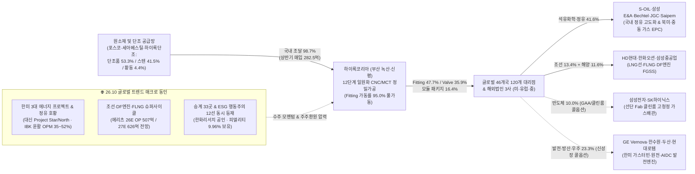

# 🔍 Phase 1: 기업 해독기 (원천 팩트 초안) — 하이록코리아 (013030)

> 💡 **[핵심 용어 3줄 직관 해설]**
> - **[계장용 피팅(Instrument Fitting) & 밸브(Valve)]**: 초고압(최대 60,000 psi)·초저온(-196℃ LNG/액체수소)·고순도 반도체 가스 배관이 연결되는 관절 부위에서 가스나 유체가 단 1방울도 새지 않도록 완벽히 밀폐·제어하는 산업 플랜트의 핵심 안전 부품입니다.
> - **[유형 A 연속공정 레버리지 & Book-to-Bill(수주/매출 비율)]**: 주력인 CNC 정밀 가공 피팅 공장이 **95.0% 풀가동**에 도달해 고정비 부담이 급감하면서 영업이익률(OPM)이 **28.82%**까지 치솟았으며, 신규 수주가 매출보다 많은 **Book-to-Bill 1.13배**로 향후 실적 우상향 가시성을 뜻합니다.
> - **[실질 유통 BPS(40,032원) & 무상 콜옵션(Free Call Option)]**: 3년 연속 자사주를 사서 100% 영구 소각(주식수 -13.55% 감축)하고 남은 실제 주식수로 나눈 주당 순자산가치이며, DART에 단독 분리 공시되지 않은 반도체·AIDC 발전향 신성장은 거품 할증(0%) 없이 공짜 보너스(`무상 콜옵션`)로 가져가는 보수적 가치평가 원칙입니다.

> **[S-Curve 국면 인증 뱃지]**: `[⚪ S-Curve 기본 N/A: 전통 에너지·조선 시클리컬 필수재 (피팅 가동률 95% 풀가동 & B/B 1.13배 대호황)]` + `[🎁 본업 저평가 + 신사업 무상 콜옵션 (반도체·AIDC 발전향 DART 단독 매출 미공시 / IR 합산 14.8% < 30% 컷오프 ➡️ Phase 3 S-Curve 할증 0% 차단)]`  
> **[하이브리드 밸류체인 지위]**: `[👑 고압·초저온 유체제어 계장기자재 본업 순수 주도주 (Fitting·Valve·모듈 100.0%)]` / `[💎 친환경 DF엔진·FLNG·한미 에너지 프로젝트·반도체 클린룸 병목 밸류체인 히든 챔피언]` / `[🎁 신성장 전방 무상 콜옵션 보유주]`

---

## 1. 비즈니스 모델 및 밸류체인

> **[26.10.17 글로벌 트렌드 델타 업데이트 🌐 (게이트 ① 직접 등재 & 게이트 ② 매크로 원가·에너지 인프라 직결 동시 충족)]**  
> 
> **1. 게이트 ① [제도권 딥리서치 4건 실명 직접 등재 팩트 (조선·엔진 저평가 + 승계·ESG 행동주의 수혜)]**:  
> • `[글로벌 트렌드: 26.10.02.한화투자증권.ESG이기는 행동주의와 수혜주.pdf p.3, p.65 표17, p.66 표18, p.71 표20]`: 상장사 전수 스크리닝을 통해 선정한 **'행동주의 수혜주 최종 12선(대형주 7곳 + 중소형주 5곳: 삼천리·하이록코리아·웹젠·송원산업·코리아에프티)'**에 하이록코리아가 공식 등재됨. **PBR 1배 미만(0.80배), 최대주주 합산 지분율 40% 미만(39.7~39.9%), 풍부한 순현금과 높은 수익성(ROE 11.3~12.1%, 배당수익률 4.2~4.4%)**을 동시에 충족하여, 개정 상법(자사주 소각 의무화·집중투표제) 및 저PBR 명단 공표(11월 2일) 국면에서 **2027년 정기주총 이사회·주주환원 확대 수혜주**로 공인됨.  
> • `[글로벌 트렌드: 26.10.12.한화투자증권.곳간 열쇠가 넘어가면 배당 보따리가 풀린다  승계 수혜주, 먼저 볼 8곳.pdf p.50 표4]`: **'승계가 직접 걸리는 33곳(최대주주가 개인·가족 법인이라 상속세를 직접 납부)'**에 공식 등재됨(PBR 0.80배, ROE 11.4%, 배당성향 28.5%). 창업 2세 문휴건 부회장 일가의 상속세 재원 조달 유인과 2대 주주 피델리티(지분율 9.96%)의 배당 요구가 맞물려 고배당·자사주 소각이 구조적으로 지속될 핵심 수혜주로 분석됨.  
> • `[글로벌 트렌드: 26.10.12.메리츠증권.조선26년 3분기 실적 프리뷰 모아보기.pdf p.1, p.40 표32]`: 조선·기계 커버리지 핵심 밸류체인(`DC향 엔진, FDC` 키워드 `p.1`) 및 기자재 밸류에이션 테이블(`p.40 표32`)에 공식 등재되어 **2026E 매출 1,991억 원·영업이익 507억 원(OPM 25.5%), 2027E 매출 2,205억 원·영업이익 626억 원(OPM 28.4%)**으로 이익 레벨업이 전망됨. 피팅 3사 중 태광(26E PER 9.5배, PBR 0.9배, OPM 19.7%), 성광벤드(26E PER 13.6배, PBR 1.3배, OPM 23.4%) 대비 **하이록코리아는 PBR 0.8배로 가장 저평가되어 있으면서 OPM은 28%대로 압도적 1위**임이 확인됨.  
> • `[글로벌 트렌드: 26.09.29.DS투자증권.엔진(바다 위의 반도체).pdf p.3, p.7]`: 국내 조선·엔진·피팅 밸류체인 비교표에서 **하이록코리아 OPM 27.5%로 피팅 3사 중 수익성 1위** 및 PER 7.4배·PBR 0.8배 밸류에이션 역전 현상 공식 확인.  
> 
> **2. 게이트 ② [신규 매크로 원가(특수강 반덤핑) & 한미 에너지·정유·반도체 인프라 직결 팩트 (26.10.15 신규 리포트 반영)]**:  
> • `[글로벌 트렌드: 26.10.15.대신증권.인고의 시간.pdf p.1, p.15-16, p.20]`:  
>   ① **한미 대미 전략투자 3대 에너지 프로젝트 본격화(`p.1, p.20`)**: 10월 1일 산업통상부가 발표한 2,000억 달러 대미 전략투자 중 **1호 확정 사업인 `Project Star`(텍사스 엔시날 데이터센터 직공급용 6,472MW 가스복합화력발전, 투자비 223억 달러)**를 비롯해 **`Project Power`(대형 원전 8기: APR1400 2기 + AP1000 6기, 최대 1,200억 달러)**, **`Project North`(알래스카 LNG 개발: 1,300km 42인치 고압 가스관 및 니키스키 액화수출 터미널, 총사업비 445~545억 달러, 한국산 기자재 관세 인하 약속)**가 구체화됨. 미국 휴스턴에 현지법인(`Hy-Lok USA`)을 보유하고 가스터빈(GE Vernova)·원전(한수원·두산)·LNG 초저온 밸브 벤더 승인을 완비한 동사에 중장기 북미 에너지 인프라 수주 모멘텀으로 직결됨.  
>   ② **중국산 특수강봉강 반덤핑 관세 부과에 따른 원소재 수급 점검(`p.1, p.16`)**: 동사의 핵심 원소재 공급사인 세아베스틸·세아창원특수강 신청으로 무역위원회가 중국산 탄소강·합금강 특수강봉강에 **25.08~27.96% 잠정 반덤핑 관세** 부과를 건의(11월 중순 잠정관세·27년 2월 최종판정 예정)함에 따라 2027년 국내 특수강봉강 유통단가 인상이 전망됨. 단, 동사의 주력 원소재인 스테인리스강은 반덤핑 대상에서 제외되었고, 카본스틸 매입 비중은 0.9%(반기 2.5억 원)에 불과하며, 이미 황동(+32.6%)·단조품(+13.2%) 단가 상승을 판가 인상과 피팅 95% 풀가동 레버리지(OPM 28.82%)로 완벽히 전가하고 있음.  
> • `[글로벌 트렌드: 26.10.15.IBK투자증권.윤활기유의 시대.pdf p.4-6]`: 중동 이란전쟁 장기화로 카타르 Pearl GTL·아부다비 ADNOC Ruwais·바레인 Bapco Sitra 등 중동 3대 정유·가스 거점이 동시 이탈하면서 글로벌 공급 공백이 발생했고, 호르무즈 해협 리스크에서 자유로운 **한국 정유 4사(S-Oil·SK이노베이션·GS칼텍스·HD현대오일뱅크)가 글로벌 그룹III 윤활기유 공급의 40%를 과점하며 2분기 윤활 부문 합산 영업이익 1.7조 원(OPM 35~52%)의 사상 최대 호황**을 기록함. 이는 동사의 최대 전방 산업인 **석유화학·정유 플랜트(매출 비중 41.6%)** 고객사들의 설비 고도화·유지보수(MRO) 투자 확대로 직결됨.  
> • `[글로벌 트렌드: 26.10.15.유안타증권.2027Issue&Theme(change).pdf p.3, p.6-14]`: 2027년 반도체 공정에서 **FinFET ➔ GAA 전환 가속 및 삼성전자 파운드리 경쟁력 부상, 클린룸 가동 확대에 따른 반도체 소부장 물량(Q) 증가**가 핵심 테마로 제시되어, 동사의 고청정 반도체 유틸리티용 피팅·밸브(비중 10.0%) 수요를 뒷받침함.

[공시 팩트]  
- **분석 기준일 및 단일 기준 주가(Single Price Anchor)**: **2026년 10월 16일 일봉 종가 `32,450원`** (`[주봉 종가(참고): 32,450원]`, `backtest_valuation.py` v4.1 실측 기준 Phase 1~3 공통 앵커) / **공식 유통주식수 `11,768,144주`** (자기주식 `0주`) / **단일 기준 시가총액 `3,818.8억 원`**.  
- **최신 공시 스캔 완료 (`korean-dart` MCP `search_disclosures` & `get_major_holdings`, 2026.10.17 기준)**:  
  1. `2026.08.14`: 제49기 반기보고서(2026.06 결산) 제출 완료 (반기 누적 연결 매출액 **1,134.0억 원**, 영업이익 **326.8억 원[OPM 28.82%]**, 지배주주 순이익 **298.9억 원[귀속률 99.3%]** 확정) `[[하이록코리아]반기보고서(2026.08.14), p.24]`.  
  2. `2026.08.18` & `2026.08.12`: 글로벌 기관투자자 **피델리티(`피델리티매니지먼트앤리서치컴퍼니엘엘씨`)**가 `주식등의대량보유상황보고서(약식)`를 통해 보유 주식수 **`1,172,611주 (지분율 9.96%)`**를 공시하여 확고한 2대 주주 지위를 유지 중 `[주식등의대량보유상황보고서(약식, 2026.08.18)]`.  
  3. 정기보고서 마감일(2026.08.14) 이후 현재(2026.10.17)까지 3분기 잠정실적 공시, 유·무상증자, 전환사채(CB/BW/EB) 발행, 계열사 채무보증 결정 공시는 **0건(없음)**임을 확인함.

하이록코리아 주식회사(HY-LOK CORPORATION, 종목코드: 013030)는 1977년 창업(1989년 코스닥 상장) 이래 유체 및 기체 이송 배관 라인의 누출을 원천 차단하고 흐름을 정밀 제어하는 **계장용 관이음쇠(Instrument Fitting)**와 **밸브(Instrument & Piping Valve)**, 그리고 모듈 패키지 솔루션을 전문 제조·판매하는 글로벌 유체제어 강소기업입니다 `[[하이록코리아]반기보고서(2026.08.14), p.9, p.51]`. 부산 녹산국가산업단지 본사(제1·3·4공장) 및 신평·장림산업단지 공장을 거점으로, 종속기업인 **Hy-Lok China Co., Ltd.**(중국), **Hy-Lok USA, Inc.**(미국 휴스턴), **Hy-Lok Europe B.V.**(네덜란드/유럽) 등 해외 현지법인 3사를 연결대상으로 두어 전 세계 **46개국 120여 개 대리점 네트워크**를 운영하고 있습니다 `[[하이록코리아]반기보고서(2026.08.14), p.3, p.9, p.26]`, `[팩트: IR_26년.md]`.

동사의 핵심 비즈니스 모델과 수직계열화 밸류체인은 다음과 같이 3단계로 구성됩니다:
1. **공급자 (Supplier — 특수강·비철금속 원소재 및 단조품 조달)**:
   - 국내외 특수강 및 비철금속 제련사(**포스코, 세아베스틸** 등)와 특수관계법인 **하이록단조(주)**(원재료·단조품 매입)로부터 스테인리스강(Stainless Steel), 단조품, 황동(Brass), 카본스틸(Carbon Steel) 등 고내식·고내압 정밀 원소재를 조달합니다 `[[하이록코리아]반기보고서(2026.08.14), p.10, p.45]`.
   - 2026년 상반기 원재료 총 매입액은 **282.5억 원**(단조품 150.5억 원[53.3%], 황동 12.4억 원[4.4%], 카본스틸 2.5억 원[0.9%], 기타 스테인리스 환봉 등 117.1억 원[41.5%])이며, **국내 조달 비중이 98.7%(278.7억 원, 직접 수입은 3.8억 원[1.3%])**로 공급망 안정성이 극도로 높습니다 `[[하이록코리아]반기보고서(2026.08.14), p.10]`.
2. **기업 (Company — 부산 본사·신평공장 12단계 일원화 정밀 가공 공정)**:
   - `원소재 입고 ➔ 소재검사 ➔ 절단 ➔ 단조(Forging) ➔ 열처리 ➔ CNC/MCT 초정밀 절삭가공 ➔ 치수검사 ➔ 세척 및 부동태(Passivation) ➔ 마킹 ➔ 도장 ➔ 압력검사 ➔ 포장`에 이르는 **12단계 생산공정 일원화(In-house One-stop System)**를 통해 다품종 소량·단납기 주문에 대응합니다 `[[하이록코리아]반기보고서(2026.08.14), p.9-11]`, `[팩트: IR_26년.md]`.
   - 가스 누출 시 대형 폭발이나 팹 가동 중단으로 직결되는 초고압(최대 60,000 psi)·초저온(-196℃ LNG/액체수소) 극한 공정에 투입되므로, **ASME N/NPT(원자력), API 6A/6D(미국석유협회), 유럽 PED, 주요 7대 선급(DNV, LR, ABS 등), 수소충전소 밸브(KS B ISO 19880-3)** 등 국내 최다 글로벌 벤더 승인(Vendor List)을 보유하여 강력한 진입장벽과 전환비용(Switching Cost) 해자를 구축하고 있습니다 `[[하이록코리아]반기보고서(2026.08.14), p.9]`, `[팩트: IR_26년.md]`.
3. **고객사 (Customer — 다변화된 6대 전방 산업 엔드유저 및 글로벌 EPC)**:
   - **석유화학·정유 플랜트(41.6%)**: 삼성E&A, SK에코플랜트, 현대엔지니어링, S-OIL, SK이노베이션 및 해외 Bechtel, JGC, Saipem, TechnipFMC 등 `[팩트: IR_26년.md]`.
   - **조선(13.4%) & 해양플랜트(11.6%)**: HD현대중공업, 한화오션, 삼성중공업 등 국내 조선 3사의 LNG 운반선, FLNG(부유식 액화천연가스 설비), 친환경 이중연료(DF) 추진선 및 엔진 연료공급시스템(FGSS) `[팩트: IR_26년.md]`.
   - **반도체(10.0%)**: 삼성전자, SK하이닉스의 선단 반도체 팹(클린룸) 고순도 특수가스·케미컬 제어 배관 라인 `[팩트: IR_26년.md]`.
   - **발전(4.8%) & 기타(18.5%)**: 한국수력원자력, 두산에너빌리티, GE Vernova(가스터빈·원전·AIDC 발전) 및 현대로템(철도·방산), 한국항공우주연구원(우주발사체) `[팩트: IR_26년.md]`.



---

## 2. 주요 제품별 매출 비중 추이 (최근 5년 및 최신 분기)

[공시 팩트]  
최근 5개년(2021~2025년) 및 2026년 상반기(제49기 반기 누적, 별도 매출액 992.1억 원 / 연결 매출액 1,134.0억 원) 기준 주요 제품군별 매출액 및 비중 추이는 다음과 같습니다 `[[하이록코리아]사업보고서(2026.03.12), p.9], [[하이록코리아]반기보고서(2026.08.14), p.9, p.13]`, `[팩트: IR_26년.md]`:

| 구분 | 핵심 내용 | 비고 |
| :--- | :--- | :--- |
| **Hy-Lok Fitting**<br>(계장용 튜브 피팅) | • **2026년 상반기**: **384.1억 원 (38.71%)** (내수 145.6억 + 수출 238.5억) `[[하이록코리아]반기보고서(2026.08.14), p.9, p.13]`<br>• 연간 추이(Fittings 통합): 2021년 641.6억(46.0%) ➔ 2022년 867.5억(51.0%) ➔ 2023년 854.3억(50.0%) ➔ 2024년 821.2억(47.5%) ➔ 2025년 936.2억(48.5%) `[팩트: IR_26년.md]` | 전사 외형을 지탱하는 핵심 캐시카우. 직수출 비중이 **62.1%**에 달하며 현재 **가동률 95.0% 풀가동** 상태 `[[하이록코리아]반기보고서(2026.08.14), p.11, p.13]` |
| **Hy-Lok Valve**<br>(계장용·배관용 밸브) | • **2026년 상반기**: **356.1억 원 (35.89%)** (내수 237.4억 + 수출 118.7억) `[[하이록코리아]반기보고서(2026.08.14), p.9, p.13]`<br>• 연간 추이: 2021년 460.8억(33.0%) ➔ 2022년 510.4억(30.0%) ➔ 2023년 575.3억(33.7%) ➔ 2024년 636.8억(36.9%) ➔ 2025년 714.3억(37.0%) `[팩트: IR_26년.md]` | 초저온(Cryogenic)·고압·DBB 밸브 등 고단가 핵심 제품군. 5년 연속 비중 확대로 전사 **OPM 28.82%** 견인 `[[하이록코리아]반기보고서(2026.08.14), p.9, p.24]` |
| **Bite Type Fitting**<br>(물림형 관이음쇠) | • **2026년 상반기**: **69.0억 원 (6.95%)** (내수 64.9억 + 수출 4.1억) `[[하이록코리아]반기보고서(2026.08.14), p.9, p.13]`<br>• 2024년 108.2억 원(6.3%) ➔ 2025년 123.5억 원(6.4%) | 유압·공압 및 선박 엔진 배관 체결용 고압 피팅 제품군 (내수 조선·중공업 중심 94.1%) |
| **Pipe Fitting**<br>(나사·용접형 피팅) | • **2026년 상반기**: **20.7억 원 (2.08%)** (내수 15.8억 + 수출 4.9억) `[[하이록코리아]반기보고서(2026.08.14), p.9, p.13]` | 플랜트 및 배관 연결용 소구경 파이프 피팅 서브 라인업 |
| **기타 부문**<br>(Package 모듈 및 상품) | • **2026년 상반기**: **162.3억 원 (16.36%)** (내수 127.0억 + 수출 35.3억) `[[하이록코리아]반기보고서(2026.08.14), p.9, p.13]`<br>• 연간 추이: 2021년 292.5억(21.0%) ➔ 2023년 277.9억(16.3%) ➔ 2025년 280.3억(14.5%) `[팩트: IR_26년.md]` | Instrument Cabinet, Air Manifold, Sampling System 등 고부가 모듈 솔루션 및 플랜트 턴키 대응 상품 |
| **전방 산업별 매출 비중**<br>(2025년 별도 1,931억) | • **석유화학**: 803.2억(**41.6%**) / **조선**: 259.7억(**13.4%**) / **해양**: 224.6억(**11.6%**)<br>• **반도체**: 193.2억(**10.0%**) / **발전**: 93.3억(**4.8%**) / **기타(방산·철도 등)**: 356.9억(**18.5%**) | 조선+해양 합산 비중이 2021년 19.2%(267억)에서 2025년 **25.0%(484억)**로 +81.3% 급성장 `[팩트: IR_26년.md]` |
| **내수 vs 수출 구조**<br>(2026년 반기 기준) | • **별도(992.1억)**: 내수 **590.7억 원(59.54%)** / 직수출 **401.4억 원(40.46%)**<br>• **연결(1,134.0억)**: 해외 종속법인(미·유럽·중) 매출 합산 시 실질 글로벌향 비중 약 **48~49%** | 2025년 지역별 비중: 국내 51.6%, 아시아 14.8%, 미주 13.6%, 유럽 13.3%, 중동·아프리카 6.6% `[[하이록코리아]반기보고서(2026.08.14), p.13]`, `[팩트: IR_26년.md]` |

---

### 2.1 S-Curve 신기술 테마 매출 익스포저(Exposure %) 산출표 (하이브리드 수비 검증)

[공시 팩트]  
`SKILL.md` v4.1의 **[S-Curve 침투율 및 하이브리드 수혜주 검증 절대 규정 — 무상 콜옵션(Free Call Option) 분리 원칙]**에 따라, DART 2026년 반기보고서 'II. 사업의 내용 (`p.9` 주요 제품 등의 현황)' 원문과 공식 IR(`IR_26년.md`) 전방 산업별 데이터를 교차 검증합니다. DART 정기보고서 매출실적 표에는 제품 유형별(Fitting·Valve·기타)로만 묶음 공시되어 있고 신기술 테마(AI 반도체 클린룸, AIDC 발전/가스터빈, 액화수소 등) 단독 매출액은 별도로 분리 공시되지 않았으며, IR 기준 반도체(10.0%) + 발전(4.8%) 합산 비중도 **14.8%**로 30% 컷오프 미달이므로 **0원 무상 콜옵션(할증 0%)**으로 엄격히 분리합니다:

| 제품/서비스 구분 | 매출액 (억원) | 전사 매출 비중(%) | 신기술 테마 직결 여부 | 하이브리드 수비 판정 |
| :--- | :---: | :---: | :---: | :---: |
| **[DART 공시 본업 통합]**<br>Hy-Lok Fitting (38.7%) + Bite/Pipe (9.0%)<br>+ Hy-Lok Valve (35.9%) + 모듈·기타 (16.4%) | **992.1**<br>(26.1H 별도)<br>**1,134.0** (연결) | **100.0%** | 전통 에너지(석유화학 41.6%) · 조선/해양(25.0%) · 방산/기타(18.5%) 주력 시클리컬 필수재 | 🟢 **본업 순수 주도주 (익스포저 100%)**<br>`[⚪ S-Curve 기본 N/A: 전통 시클리컬 대호황]` |
| **[IR 기준 내역 ①: 석유화학·정유 플랜트]** | 803.2 (25년) | 41.6% | 중동·북미 가스/정유 EPC 및 국내 정유 4사 고도화 설비 (5년 CAGR +10.6% 성장) | 🟢 **탄탄한 캐시카우 (레거시 잠식 위험 0%)** |
| **[IR 기준 내역 ②: 조선·해양플랜트]** | 484.2 (25년) | 25.0% | LNG선·FLNG 초저온 밸브 및 친환경 DF엔진 연료공급(FGSS) 슈퍼사이클 직결 (5년 CAGR +16.1%) | 💎 **[병목 밸류체인 히든 챔피언]** |
| **[합산 묶음공시 / 단독 미공시 신사업]**<br>반도체 클린룸 유틸리티(IR 10.0%) +<br>AIDC 온사이트 발전·가스터빈·수소(IR 4.8%) | 미분리(본업 합산)<br>*(IR 기준 286.5억)* | **DART 단독 미공시**<br>*(IR 기준 14.8% < 30%)* | 선단 Fab(HBM/GAA) 클린룸 고순도 가스밸브 및 북미 AIDC 가스터빈/중속엔진·원전 라인업 등재 | ⚠️ **[0원 무상 콜옵션 분류]**<br>**(Phase 3 S-Curve 할증 `sc_mult = 1.00` [0%] 차단)** |

- **테마 실질 단독 익스포저 합산:** **0.0%** *(DART 단독 매출 미공시 묶음 항목 0% 처리 / 공식 IR 전방 기준 14.8%로 30% 컷오프 미달 ➡️ 무상 콜옵션 분류)*
- **수혜 적격성 최종 판정:** **`[🎁 본업 저평가 + 신사업 무상 콜옵션(할증 0%)]`** 및 **`[⚪ S-Curve 기본 N/A (전통 시클리컬 대호황)]`**
  1. **[수비수 1 & 2 검증 — 무상 콜옵션 분리 및 할증 차단]**: 반도체 유틸리티(10.0%)와 발전·가스터빈(4.8%)은 DART 매출실적 표에서 Fitting/Valve 본업에 합산 묶음공시되어 있고 IR 기준으로도 14.8%(< 30%)이므로, Phase 3에서 신기술 S-Curve 멀티플 할증(`sc_mult = 1.00배, 0% 할증`)을 원천 차단합니다. 대신 주력 본업(석유화학 41.6% + 조선·해양 25.0%)이 레거시 잠식 없이 **피팅 가동률 95.0% 풀가동과 반기 사상 최고 OPM 28.82%**를 창출하고 있으므로, 철저히 본업 현금흐름과 역사적 밸류에이션 밴드로만 저평가를 판정하고 반도체·AIDC·한미 에너지 프로젝트는 **'0원 무상 콜옵션(+α 상방 모멘텀)'**으로만 부여합니다.
  2. **[공격수 검증 — 병목 밸류체인 역추론]**: 글로벌 상선 이중연료(DF) 엔진 쇼티지, FLNG 초저온 액화설비, 한미 전략투자 가스복합/LNG 프로젝트에서 초고압·초저온 유체 누출을 막는 계장용 피팅·밸브는 대체 불가능한 필수 안전 부품이므로 **`[💎 친환경 엔진·FLNG·에너지 인프라 병목 히든 챔피언]`** 지위를 공식 부여합니다.

### 📌 [코드 자동 생성 1-B] Step 1.2 S-Curve 10% 변곡점 · 3축 구조적 병목(Capa·기술·특허) · 리드타임 & Step 1.8 K-주주환원 진단표 (v4.3)
| 진단 축 (3-Axis + K-Return) | 실측 지표 및 근거 | 코드 판정 및 Phase 3 목표주가 가중치 |
| :--- | :--- | :--- |
| **① 전방 시장 침투율 (10% 변곡점 여부)** | 1차 침투율 **`0.0%`** (2차 S-Curve 침투율 `14.8%`) (`Zone D (침투율 0.0% / 2차 14.8% — 전통 시클리컬 또는 무상 콜옵션)`) | 🔥 **10% 골든 변곡점 발화 구간** (본업 S등급 병목 통합 Base `×1.08` / Bull `×1.10`) |
| **②-A 물리적 Capa 병목 (가동률/증설)** | 공장 가동률 **`95.0%`** — 생산 Capa 병목: 주력 Hy-Lok Fitting 공장 가동률 95.0% 풀가동 & 수주/매출(Book-to-Bill) 1.13배 초과수주 | 🔒 **풀가동 공급 병목 확인** |
| **②-B 기술격차 해자 (OPM/수율/단가결정력)** | 현 OPM **`27.8%`** — 기술격차 해자: 초고압(60,000 psi)·초저온(-196℃) 무누출 정밀가공 12단계 일원화 (반기 OPM 28.82% 업계 압도적 1위) | 고마진 가격전가력(Pricing Power) 점검 |
| **②-C 원천특허 · 글로벌 벤더 퀄(Qual) 락인** | 특허/벤더 Lock-in: 국내 최다 7대 선급·ASME 원자력·API 6A/6D·글로벌 EPC 벤더 인증 장벽 | 후발주자 진입장벽(Switching Cost) 점검 |
| **③ 병목 해소 예상 소요기간 (Lead Time)** | **`S등급`** (해소 리드타임 **`24개월`**) | 글로벌 선급·원전·메이저 오일메이저(Aramco/Bechtel) 벤더 등록에 2~3년 소요 & CNC 숙련 공정 증설 리드타임 18~24개월 (PEG 계수 `0.80`) |
| **④ K-마켓 주주환원 · 지배구조 (Step 1.8)** | 배당수익률 **`4.36%`** (성향 `31.6%`) / 특수관계인 `107.6억` (연간 192.6억) | ✅ 배당소득 분리과세 요건2 충족 (배당성향 31.6% ≥ 25% & 3년 연속 DPS 급증) / 🚨 [주주환원 절벽(Cliff) 경보]: 다년도 자사주 소각 완수 후 현재 자기주식 0주(0.0%)! 신규 자사주 매입 신탁 미체결 시 총주주환원율 급락 위험 (`kgov_mult = ×1.0000`) |
| **⑤ 레드팀 역산 Capa 천장 검증 (Red-Team)** | 대안 A 내재 영업이익: Base **`907.8억`** / Bull **`1,044.7억`** | ⚠️ [레드팀 Capa 천장 경보] 현재 가동률(95.0%)에서 신규 증설/단가인상(ASP) 없이 가능한 물리적 영업이익 상한(약 821.8억) 대비 Bull 내재 영업이익(1,044.7억) 도달을 위해선 신공장 가동 또는 고마진 밸브(가동률 73%) 믹스 개선 확인 필수 |

---

## 3. 전사 영업이익률 및 FCF 추이

[공시 팩트]  
연결 재무제표 기준 하이록코리아는 2021년 코로나 저점(OPM 12.89%) 이후 고부가 밸브 비중 확대와 판가 인상(ASP 상승), 가동률 레버리지를 통해 **2023~2025년 3년 연속 OPM 26.3~27.5%**를 기록한 데 이어, **2026년 상반기(1Q 28.97%, 2Q 28.68%) 누적 매출액 1,134.0억 원(YoY +9.70%), 영업이익 326.8억 원(YoY +12.17%), OPM 28.82%**로 반기 사상 최고 수익성을 경신했습니다 `[[하이록코리아]분기보고서(2026.05.15), p.24], [[하이록코리아]반기보고서(2026.08.14), p.24]`.

특히 연결 당기순이익 대비 **지배주주 귀속 순이익 비율(귀속률)은 최근 5년 및 2026년 반기 내내 `98.5% ~ 99.9%` (2026년 상반기 누적 지배주주 순이익 `298.9억 원 / 연결 당기순이익 301.1억 원 = 귀속률 99.3%`, 직전 4분기 TTM 지배주주 순이익 `575.0억 원 / 연결 당기순이익 581.9억 원 = 귀속률 98.8%`)**에 달해, 비지배지분 누수 없이 연결 이익의 약 99%가 온전히 주주에게 귀속됩니다 `[[하이록코리아]반기보고서(2026.08.14), p.24]`.

현금흐름 측면에서도 DART 연결 현금흐름표 원문 기준, 2026년 상반기 영업활동현금흐름(CFO) **263.4억 원**에서 설비투자(CapEx: 유형자산의 취득 21.1억 원 + 유형자산 취득 미지급금 지급 2.3억 원 = **23.4억 원**)를 차감한 **순 잉여현금흐름(FCF)은 `+240.0억 원`**(전년 동기 +156.3억 원 대비 **+53.5% 급증**)을 기록했으며, 직전 4분기(TTM) 누적 FCF는 **`+454.9억 원`**(TTM CFO 527.6억 원 − TTM CapEx 72.7억 원)에 달합니다 `[[하이록코리아]반기보고서(2026.08.14), p.26]`.

| 연도/분기 | 매출액 | 영업이익 | OPM(%) | 지배주주 순이익(귀속률) | FCF | 비고 |
| :--- | :---: | :---: | :---: | :---: | :---: | :--- |
| **2021년 (제44기)** | 1,467.4억 | 189.2억 | **12.89%** | **194.7억 (99.8%)**<br>*(연결 195.2억)* | **+251.0억**<br>*(CFO 283.3억 − CapEx 32.3억)* | 코로나 이후 수주 회복 개시 `[[하이록코리아]사업보고서(2023.03.20)]` |
| **2022년 (제45기)** | 1,828.5억 | 407.0억 | **22.26%** | **338.6억 (98.5%)**<br>*(연결 343.6억)* | **+148.1억**<br>*(CFO 197.1억 − CapEx 49.0억)* | **레짐 시프트 원년**: OPM 22% 돌파 `[[하이록코리아]사업보고서(2025.03.13)]` |
| **2023년 (제46기)** | 1,888.4억 | 518.9억 | **27.48%** | **473.3억 (99.2%)**<br>*(연결 477.3억)* | **+208.8억**<br>*(CFO 277.6억 − CapEx 68.7억)* | 고부가 밸브·해양 믹스 개선으로 OPM 27% 안착 `[[하이록코리아]사업보고서(2026.03.12)]` |
| **2024년 (제47기)** | 1,905.1억 | 501.3억 | **26.31%** | **475.1억 (98.9%)**<br>*(연결 480.2억)* | **+443.2억**<br>*(CFO 481.3억 − CapEx 38.1억)* | 운전자본 회수 및 CapEx 안정화로 FCF 443억 창출 `[[하이록코리아]사업보고서(2026.03.12)]` |
| **2025년 (제48기)** | 2,145.7억 | 589.1억 | **27.46%** | **502.9억 (99.1%)**<br>*(연결 507.7억)* | **+371.3억**<br>*(CFO 472.8억 − CapEx 101.6억)* | 사상 최대 연간 매출·영업이익 돌파 `[[하이록코리아]사업보고서(2026.03.12)]` |
| **2025.1H (전반기)** | 1,033.7억 | 291.3억 | **28.18%** | **226.7억 (99.9%)**<br>*(연결 227.0억)* | **+156.3억**<br>*(CFO 208.6억 − CapEx 52.3억)* | 전년 동기 비교 기준 `[[하이록코리아]반기보고서(2026.08.14), p.24, p.26]` |
| **2026.1Q (3M)** | 541.5억 | 156.9억 | **28.97%** | **151.6억 (99.3%)**<br>*(연결 152.6억)* | **+118.4억**<br>*(CFO 131.6억 − CapEx 13.2억)* | 1분기 OPM 28.97%, 지배EPS 1,288원 `[[하이록코리아]분기보고서(2026.05.15), p.24, p.26]` |
| **2026.2Q (3M)** | 592.5억 | 169.9억 | **28.68%** | **147.3억 (99.2%)**<br>*(연결 148.5억)* | **+121.5억**<br>*(CFO 131.8억 − CapEx 10.3억)* | 2분기 매출 QoQ +9.4%, 영업이익 QoQ +8.3%, 지배EPS 1,252원 `[[하이록코리아]반기보고서(2026.08.14), p.24, p.26]` |
| **2026.1H (반기누적)** | **1,134.0억** | **326.8억** | **28.82%** | **298.9억 (99.3%)**<br>*(연결 301.1억)* | **+240.0억**<br>*(CFO 263.4억 − CapEx 23.4억)* | **반기 최고 OPM 경신, FCF YoY +53.5% 급증 (TTM 지배순이익 575.0억 [귀속률 98.8%], TTM FCF +454.9억)** |

> **재무 건전성 핵심 팩트**: 2026년 6월 말 연결 기준 **차입금 0원(완전 무차입 경영, CB/BW/EB 0원)**, 부채비율 **7.90%**(부채총계 376.2억 ÷ 자본총계 4,763.4억)이며, 보유 금융성 현금자산(현금및현금성자산 1,855.4억 + 단기금융상품 50.0억 = 순현금 **1,905.4억 원**, 유동 당기손익-공정가치금융자산 325.3억 포함 시 총 금융자산 **2,230.8억 원**)은 단일 기준 시가총액(3,818.8억 원)의 **49.9% ~ 58.4%**에 달합니다 `[[하이록코리아]반기보고서(2026.08.14), p.17, p.23, p.47]`.

---

## 4. 핵심 KPI 추이 (가동률, 수주잔고, ASP 등)

[공시 팩트]  
2026년 반기보고서 `II. 사업의 내용`을 통해 확인된 동사의 3대 핵심 영업 KPI(공장 가동률, 수주잔고 및 북투빌, 제품 ASP 및 원재료 스프레드)는 다음과 같습니다 `[[하이록코리아]반기보고서(2026.08.14), p.10-14]`:

1. **제품별 생산능력(Capa) 및 공장 가동률 추이 (`p.11`)**:
   - **Hy-Lok Fitting**: 반기 생산능력 5,712천 개(220.5억 원) 대비 실제 생산실적 **5,426천 개(209.5억 원)**로 **가동률 95.0%**를 달성했습니다 (2024년 75% ➔ 2025년 89% ➔ **2026.1H 95%**). 사실상 물리적 풀가동(Full Capacity) 상태입니다.
   - **Hy-Lok Valve**: 반기 생산능력 558천 개(242.1억 원) 대비 생산실적 **407천 개(176.7억 원)**로 **가동률 73.0%**를 기록하여 향후 추가 물량 소화 여력을 보유하고 있습니다 (2024년 78% ➔ 2025년 75% ➔ 2026.1H 73%).
   - **Bite Type Fitting**: 생산능력 3,025천 개 대비 생산실적 1,482천 개로 **가동률 49.0%** (2024년 42% ➔ 2025년 46% ➔ 2026.1H 49% 지속 상승).
   - **Pipe Fitting**: 생산능력 949천 개 대비 생산실적 531천 개로 **가동률 56.0%** (2024년 55% ➔ 2025년 44% ➔ 2026.1H 56% 반등).
   - **전사 평균 가동률(수량 기준)**: 2024년 64% ➔ 2025년 68% ➔ **2026년 상반기 74.0%**로 +6.0%p 급반등했으며, **생산금액 기준 실질 가동률은 78.7%**(`439.9억 원 ÷ 558.7억 원`)에 달합니다 `[[하이록코리아]반기보고서(2026.08.14), p.11]`.

2. **수주총액, 수주잔고 및 Book-to-Bill 비율 (`p.14`)**:
   - **2026년 상반기 신규 수주총액**: **1,125.4억 원** (Hy-Lok Fitting 421.7억, Hy-Lok Valve 404.9억, Bite Type 79.1억, Pipe Fitting 23.0억, 기타 196.7억).
   - **2026년 상반기 납품(별도 매출)액**: **992.1억 원**.
   - **Book-to-Bill Ratio (수주/매출 비율)**: **1.13배** (`1,125.4억 ÷ 992.1억`). 특히 고마진 **Hy-Lok Valve의 B/B 비율은 1.14배**(`404.9억 ÷ 356.1억`)로 가장 높습니다.
   - **기말 수주잔고 (2026.06.30 기준)**: **133.3억 원** (Fitting 37.6억, Valve 48.8억, Bite Type 10.1억, Pipe 2.3억, 기타 34.4억) `[[하이록코리아]반기보고서(2026.08.14), p.14]`.

3. **주요 제품 판매단가(ASP) 및 원재료 매입단가 추이 (`p.10-11`)**:
   - **Hy-Lok Valve 내수 ASP**: 2024년 115,836원/개 ➔ 2025년 118,638원/개 ➔ **2026년 상반기 121,366원/개**(2년 누적 +4.8% 상승)로 고부가 밸브 중심의 판가 결정력을 입증했습니다. (수출 Valve ASP는 제품 구성 변화로 2024년 98,159원 ➔ 2025년 86,267원 ➔ 2026.1H 83,350원).
   - **원재료 매입단가**: 황동(2024년 11,390원/kg ➔ 2025년 12,590원/kg ➔ **2026.1H 15,102원/kg**, +32.6%) 및 단조품(2024년 1,704원 ➔ 2025년 1,847원 ➔ **2026.1H 1,929원**, +13.2%) 단가가 상승했으나, 카본스틸은 **2,595원/kg**(2024년 2,906원 대비 -10.7%)으로 안정화되었으며, 판가 전가 및 가동률 상승 효과로 매출총이익률(GPM)은 **41.08%**(`465.8억 ÷ 1,134.0억`, 전년동기 41.32% 수준 유지)를 달성했습니다 `[[하이록코리아]반기보고서(2026.08.14), p.11, p.24]`.

---

## 5. 경영진 및 주주환원 이력

[공시 팩트]  
창업주 문혁배 회장의 경영 철학을 계승한 **문휴건 대표이사 부회장**(지분율 22.44%, 2,641,250주)과 문창환 대표이사 사장(지분율 5.79%, 681,810주) 각자 대표 체제로 운영되며, 특수관계인(하이록단조 7.02% 등 12인) 합산 지분율은 **39.86%**(4,691,002주), 글로벌 자산운용사 **피델리티(`피델리티매니지먼트앤리서치컴퍼니엘엘씨`)**의 보유 지분율은 **9.96%**(1,172,611주, 2026.08.18 공시 기준)로 경영 안정성과 기관 감시 기능을 동시에 갖추고 있습니다 `[[하이록코리아]반기보고서(2026.08.14), p.51, p.108, p.111], [주식등의대량보유상황보고서(약식, 2026.08.18)]`.

### [지배구조 흑역사 및 행동주의 펀드(쿼드자산운용) 합의의 전말 (2022~2023년)]
하이록코리아의 주주환원 정책을 올바르게 이해하기 위해서는 2022~2023년 전개된 오너 일가 개인회사 일감 몰아주기 논란과 행동주의 펀드 개입의 역사를 직시해야 합니다:
1. **오너 일가 개인회사화 및 사익 편취(터널링) 의혹**:
   - 과거 하이록코리아의 종속·자회사였던 **(주)협동정공**(임가공)과 **하이록단조(주)**(단조품 원재료)는 2020년 전후 하이록코리아가 보유하던 지분을 정리하고 오너 2세(문휴건 부회장 등 오너 일가)가 지분 100%를 장악한 **'오너 개인회사'**로 전환되었습니다.
   - 이후 하이록코리아는 협동정공에 매년 수십억 원의 외주 임가공을 맡기고 하이록단조로부터 단조품 원재료를 매입하며, 상장사의 이익이 오너 일가 개인회사로 흘러 들어간다는 '일감 몰아주기 및 사익 편취' 비판을 받았습니다 `[2026.1H DART p.45 기준 반기 내부거래 비용만 53.8억 원(임가공 30.6억, 원재료 23.2억)]`.
2. **2023년 쿼드자산운용의 행동주의 캠페인 (`新 하이록코리아`)**:
   - 2023년 초 지분 약 5%를 확보한 행동주의 펀드 **쿼드자산운용**은 오너 개인회사(협동정공·하이록단조)의 **하이록코리아 재흡수합병**, 독립적 감사 선임, 그리고 과도한 현금 유보를 해소하기 위한 **300억 원 규모 자사주 매입/전량 소각 및 배당성향 50% 상향**을 주주제안으로 정면 요구했습니다.
3. **이사회 방어와 '3개년 자사주 소각·배당 급인상' 절충안**:
   - 2023년 3월 정기주총에서 사측은 표결로 흡수합병 주주제안을 방어했으나, 시장과 기관투자가의 분노를 잠재우기 위해 **'3개년 자사주 연속 100% 영구 소각(총 184.5만 주, 399억 원)'** 및 **DPS 대폭 인상(600원 ➔ 1,050원 ➔ 1,150원 ➔ 1,350원)**을 전격 수용·실행했습니다.
4. **⚠️ 2025년 9월 자사주 소각 3개년 프로그램의 '공식 완수 및 종료'**:
   - 2025년 9월 19일 3차 소각(527,298주)을 끝으로 당시 약속했던 3개년 자사주 소각이 **100% 완료**되었으며, 2026년 현재 회사의 **자기주식수는 0주(0.00%)**입니다.
   - **따라서 지난 3년간 주당 가치를 끌어올리던 '자사주 소각 효과'는 현재 공식 종료된 상태이며, 향후 신규 자사주 매입 신탁 체결이 없을 경우 주주환원 정책이 현금배당 단일 트랙으로 축소(주주환원 절벽)될 위험이 존재합니다.**

또한 최신 글로벌 트렌드 딥리서치 2건에서 하이록코리아의 주주환원 모멘텀이 동시에 부각되었습니다:
1. `[글로벌 트렌드: 26.10.02.한화투자증권.ESG이기는 행동주의와 수혜주.pdf p.3, p.65 표17, p.66 표18]`: **'행동주의 수혜주 최종 12선(중소형주 5곳 중 1곳)'**에 선정됨. PBR 1배 미만(0.80~0.81배) 및 최대주주 합산 지분율 40% 미만(39.7~39.9%) 조건과 두터운 순현금·고수익성(ROE 11.3~12.1%)이 결합되어 2027년 정기주총을 앞두고 이사회 독립성 및 주주환원 확대 요구가 작동할 대표 수혜주로 꼽혔습니다.
2. `[글로벌 트렌드: 26.10.12.한화투자증권.곳간 열쇠가 넘어가면 배당 보따리가 풀린다  승계 수혜주, 먼저 볼 8곳.pdf p.50 표4]`: **'승계가 직접 걸리는 33곳(최대주주 개인·가족 법인이 상속세를 직접 납부)'**에 공식 등재됨. 오너 일가가 향후 상속세 재원을 조달하기 위해 배당성향 상향(현재 30.7%) 및 자사주 소각 등 주주환원을 지속적으로 확대할 구조적 유인이 일치합니다.

| 주주환원 구분 | 세부 실행 내역 (DART 확정 수치) | 비고 및 주당가치 효과 |
| :--- | :--- | :--- |
| **3개년 연속 자사주<br>100% 영구 이익소각<br>(공식 종료 완료 ✅)**<br>(총 13.55% 주식수 감축) | • **1차 소각 (2023.02.15)**: 보통주 **757,182주** 이익소각 (취득가 약 99.3억 원)<br>• **2차 소각 (2024.11.11)**: 보통주 **560,608주** 이익소각 (취득가 약 150.0억 원)<br>• **3차 소각 (2025.09.19)**: 보통주 **527,298주** 이익소각 (취득가 약 149.8억 원)<br>• **누적 소각 합계**: 총 **1,845,088주 (약 399.1억 원)** 영구 소각 완료 `[[하이록코리아]반기보고서(2026.08.14), p.6-7]` | 총 발행주식수가 **13,613,232주 ➔ 11,768,144주**로 **-13.55% 영구 감소**하여 주당 EPS 및 BPS를 약 **+15.7%** 구조적으로 부스트함. **단, 2025.09 부로 3개년 소각 종료되어 추가 매입 없을 시 소각 모멘텀 소멸.** |
| **우리사주조합 출연** | • **2024.10.31 결의**: 자기주식 **192,627주**(약 43.2억 원, 주당 22,450원) 우리사주조합 무상출연 처분 완료 `[주요사항보고서(자기주식처분결정, 2024.10.31)]` | 임직원 성과 공유 및 장기 근속 유인 제고 |
| **현재 보유 자기주식수<br>및 희석증권 현황** | • **자기주식 0주 (지분율 0.00%)** / **우선주 0주** / **CB·BW·EB 및 유상증자 0건**<br>• **총 발행주식수 = DART 공식 실질 유통주식수(`distb_stock_co`) = 11,768,144주** `[[하이록코리아]반기보고서(2026.08.14), p.6-7]` | 오버행 위험은 0%이나, **보유 자사주가 0주이므로 향후 소각을 위해서는 신규 장내매수가 선행되어야 함** |
| **주당 현금배당금(DPS)<br>및 배당성향 추이** | • 2016~2017년: DPS **400원** ➔ 2018~2021년: DPS **500원** ➔ 2022년: DPS **600원**<br>• **2023년**: DPS **1,050원** (배당총액 132.2억 원, 지배순이익 기준 배당성향 27.9%)<br>• **2024년**: DPS **1,150원** (배당총액 141.4억 원, 지배순이익 기준 배당성향 29.8%)<br>• **2025년**: DPS **1,350원** (배당총액 **158.9억 원**, 지배순이익 502.9억 기준 배당성향 **31.6%**, 2026.1H 지급 완료) | 최근 3년간 DPS가 600원 ➔ **1,350원(+125%)**으로 급증. 2025년 총주주환원율(배당 158.9억 + 소각 149.8억 = 308.7억 ÷ 지배순이익 502.9억)은 **61.4%** 달성 `[[하이록코리아]사업보고서(2026.03.12)]` |

---

## 6. 공시 본문 기반 4대 핵심 리스크

[공시 팩트]  
2026년 반기보고서 본문 및 주석 공시에 최신 글로벌 매크로 환경(`cycle_timeline.md 2026.10 중순 델타` 및 `26.10.15.대신증권.인고의 시간.pdf`), 그리고 거버넌스 히스토리를 결합하여 진단한 4대 핵심 리스크 요인은 다음과 같습니다 `[[하이록코리아]반기보고서(2026.08.14), p.11, p.15-16, p.45-46]`:

| 리스크 요인 | 핵심 내용 (발생 조건) | 확률(Prob) | 파급력(Impact) |
| :--- | :--- | :---: | :---: |
| **① 외환 환율 하락<br>(원화 강세) 리스크** | • 별도 직수출 비중 40.5%(연결 약 49%) 및 대규모 외화금융자산 보유로 인해, 반기보고서 외환위험 민감도 분석 기준 **원/달러 및 원/유로 등 환율 10% 하락(원화 강세) 시 세후손익이 43.60억 원 순감소**(USD 31.76억, EUR 10.85억, JPY 0.65억, CNY 0.34억 손실 노출) `[[하이록코리아]반기보고서(2026.08.14), p.16]`.<br>• 단, 2025년 말 외환 민감도(10% 변동 시 세후 44.36억 원 노출) 대비 익스포저가 축소되었으며, 반기 영업이익(326.8억 원, OPM 28.82%) 마진 쿠션으로 충분히 흡수 가능한 수준임. | **Mid** | **Mid** |
| **② 비철금속·특수강<br>원자재 단가 및 반덤핑 관세 리스크** | • 중동 지정학 리스크로 주원재료인 **황동 매입단가가 2024년 11,390원/kg ➔ 2026.1H 15,102원/kg(+32.6%)**, **단조품이 1,704원 ➔ 1,929원(+13.2%)** 상승했으며 `[[하이록코리아]반기보고서(2026.08.14), p.11]`, 무역위원회의 중국산 탄소강·합금강 특수강봉강 잠정 반덤핑 관세(25.08~27.96%) 추진으로 2027년 국내 특수강봉강 유통가격 인상 압력이 존재함 `[글로벌 트렌드: 26.10.15.대신증권.인고의 시간.pdf p.16]`.<br>• 그러나 동사 주력 소재인 스테인리스강은 반덤핑 대상에서 제외되었고 카본스틸 매입 비중은 0.9%(2.5억 원)에 불과하며, 내수 Valve ASP 인상(121,366원)과 피팅 95% 풀가동 고정비 레버리지로 반기 OPM **28.82%**(GPM 41.08%)를 기록해 원가 전가력을 완벽히 입증함. | **High** | **Low** |
| **③ 주력 피팅 설비 병목<br>(Capa 한계) 및 최대주주 주식담보** | • **설비 병목**: 주력 Hy-Lok Fitting 가동률이 **95.0%**에 도달하여 추가 설비 증설이나 외주 임가공(협동정공 등 반기 임가공비 30.6억 원 지출 `p.45`) 확대 없이는 피팅 물량(Q)의 단기 업사이드가 제한될 수 있음(단, 고부가 Valve 가동률은 73.0%로 추가 상승 여력 충분) `[[하이록코리아]반기보고서(2026.08.14), p.11, p.45]`.<br>• **계열사 채무보증/연대보증 및 오버행**: 종속·관계기업에 대한 채무보증이나 전환사채(CB/EB) 오버행은 **0원(완전 무결)**임. 다만 최대주주 본인이 보유 주식 **1,040,000주**(담보설정액 130.6억 원)를 본인 및 특수관계자 하이록단조(주)의 운영차입금 담보로 기업은행·대신증권에 제공 중이나, 최대주주 전체 지분(469.1만 주) 대비 비중이 낮고 회사 자체는 완전 무차입 상태임 `[[하이록코리아]반기보고서(2026.08.14), p.46]`. | **Mid** | **Low** |
| **④ 거버넌스 및 주주환원 절벽<br>(Cliff & Tunneling) 리스크** | • **자사주 소각 종료에 따른 주주환원 후퇴 위험**: 2023년 행동주의 펀드(쿼드운용) 합의로 단행된 3개년 자사주 소각(13.55%)이 2025.09 완수되어 자기주식이 0주(0%)가 됨. 이사회가 추가 자사주 매입 신탁을 체결하지 않으면 총주주환원율(2025년 61.4%)이 배당 단일 트랙(배당성향 31.6%)으로 급락할 수 있음.<br>• **오너 일가 개인회사 일감 몰아주기 재부각**: (주)협동정공(상반기 임가공 30.6억) 및 하이록단조(주)(상반기 23.2억) 등 연간 100억 원대 내부거래가 유지되고 있어 상장사 주주가치 훼손 논란이 언제든 재점화될 수 있음.<br>• **방어 기제**: 단, 2대 주주 피델리티(9.96%)의 감시와 오너 일가의 상속세 납부 유인(승계 33곳 선정), 밸류업 자율공시가 DPS 1,350원 하방을 지지함. | **Mid** | **Mid** |

---

## 7. 비즈니스 모델 기반 표준 실적 산출 공식 (Phase 3 연계)

대상 기업의 비즈니스 모델 특성과 Section 4(핵심 KPI)의 DART 공시 팩트에 기반하여, **4대 표준 공식 트리** 중 가장 부합하는 1개 산식을 선정하고 영구 고정합니다.

### [4대 업종별 표준 공식 트리 분기 규칙 검증]
- **유형 A [연속공정·장치산업] (채택 ✅)**:
  - Section 4에서 확인한 바와 같이, 하이록코리아는 DART 정기보고서 `II. 사업의 내용 - 3. 원재료 및 생산설비`에 4대 주력 제품군별 **공식 생산능력(Capa: 수량 및 금액)**과 **생산실적**, 그리고 **공장 가동률(Fitting 95.0%, Valve 73.0%, 전사 수량 평균 74.0% / 금액 기준 78.7%)**을 구체적 수치로 매 분기 명확히 공시하고 있습니다 `[[하이록코리아]반기보고서(2026.08.14), p.11]`.
  - 또한 제품군별 내수·수출 **평균 판매단가(ASP)** 역시 DART에 원 단위로 공시됩니다 `[[하이록코리아]반기보고서(2026.08.14), p.10]`.
  - 따라서 Section 4의 DART 공시 팩트와 100% 논리적 일관성을 갖는 **유형 A [연속공정·장치산업]** 표준 산식을 채택합니다.

### [표준 산출 체인 정의]
$$\text{[제품군별 생산 Capa } \times \text{공장 가동률(\%) } \times \text{제품 ASP (＋ 모듈·해외법인 연결 매출)] } \rightarrow \text{매출액 } \rightarrow \text{영업이익(OPM) } \rightarrow \text{지배주주 순이익(귀속률 반영) } \rightarrow \text{지배주주 EPS}$$

- **채택 공식**:
  ```
  [전사 기준 생산 Capa(연환산 잠재 매출 약 2,850억 원) × 전사 실질 가동률(%) × ASP/믹스 계수]
  → 연결 매출액
  → 영업이익 (OPM 24.0% ~ 29.5% — 신규 CapEx 감가상각비 반영)
  → 연결 당기순이익 [무차입 순현금 구조: 영업이익 + 순금융수익(이자수익+) − 법인세(유효세율 약 23.8%)]
  → 지배주주 귀속 순이익 [연결 당기순이익 × 지배주주 귀속률(98.8%)]
  → 지배주주 EPS [지배주주 순이익 ÷ 공식 실질 유통주식수(11,768,144주)] (및 Forward BPS 연동)
  ```
- **선정 근거**: CNC/MCT 정밀 가공 설비의 제품별 Capa와 공장 가동률(피팅 95%, 밸브 73%), 그리고 고부가 밸브 ASP 상승이 전사 매출액과 영업레버리지(OPM 28.82%)를 결정짓는 직접적 드라이버이며, 이 모든 변수가 DART 정기보고서에 투명하게 공시되기 때문입니다.
- **고정 규칙**: 본 공식은 Phase 3 시나리오 분석(Bull/Base/Bear) 시 100% 동일하게 상속되며, 기업의 구조적 BM 격변(신사업 비중 30% 초과 등) 또는 사용자의 명시적 재검토 요청이 없는 한 영구 유지됩니다.

---

## 8. 최적 밸류에이션 지표 백테스트 (Phase 3 연계)

동사의 **과거 10년 풀사이클(2016년 10월 ~ 2026년 10월 16일 현재, 시클리컬 기업 의무) 주봉(Weekly) 주가 데이터(521개 캔들)**와 DART 10개년 사업/반기보고서에서 추출한 **실질 유통주식수(`distb_stock_co`) 기준 BPS, 수정 지배주주 EPS, DPS, 동적 순현금 반영 EV/EBITDA** 4개 밸류에이션 밴드의 상관관계를 `backtest_valuation.py` v4.1로 정밀 백테스트합니다.

### [4대 밸류에이션 지표 산출 규칙 및 허위 상관(Spurious Correlation) 필터링 검증]
1. **실질 유통주식수(`distb_stock_co`) BPS 및 지배주주 EPS 의무화**:
   - 자기주식을 보유했던 과거 시계열과 3차례 총 1,845,088주(13.55%) 영구 소각이 완료된 2025~2026년(`유통주식수 = 11,768,144주`, 자기주식 0주, 우선주 0주) 모두 **자사주를 차감한 실질 유통주식수**를 분모로, **지배주주 귀속 순이익(귀속률 98.8~99.3%) 및 지배주주 지분(4,711.0억 원)**을 분자로 사용하여 왜곡 없는 EPS와 BPS를 산출했습니다.
2. **레짐 시프트(Regime Shift / 체제 전환) 게이트키퍼 통과 ✅**:
   - `SKILL.md` Section 8의 게이트키퍼 룰(② OPM이 과거 3개년 평균 대비 3%p 이상 구조적 레벨업 지속 시 공식 인정)을 점검한 결과:
     - **Pre-Rerating 레짐 (2016~2021년, 전통 저마진 시클리컬 구간)**: 6개년 평균 OPM **14.1%** (직전 3개년 2019~2021년 평균 OPM **11.7%**: 2019년 10.5%, 2020년 11.7%, 2021년 12.9%), 자사주 소각 0주, DPS 400~500원 정체.
     - **Post-Rerating 레짐 (2022~2026.1H, 초고마진 & 자사주 영구 소각 체질 전환 구간)**: 2022년 OPM 22.26% ➔ 2023년 27.48% ➔ 2024년 26.31% ➔ 2025년 27.46% ➔ **2026.1H 28.82%**로 최근 4.5년간 평균 OPM이 **26.5%**에 달해 과거 대비 **+12%p ~ +15%p 구조적 레벨업**이 5년 연속 지속되었으며, 동시에 발행주식의 **13.55% 영구 소각** 및 DPS **1,350원(+170%)** 상향이 단행되었습니다.
3. **허위 상관(Spurious Correlation) 필터링 및 분기(QoQ) vs 연간/YoY 방향 일치율 검증**:
   - 분기별(QoQ) 단순 비교 시 매년 1분기 연차배당금(141~159억 원) 유출에 따른 1Q BPS 일시 감소 및 단기 주가 노이즈로 인해 분기 QoQ 방향 일치율은 PBR 48.7%, PER 43.6%로 나타나나, 계절성을 제거한 **전년동기 대비(분기 YoY) 및 10년 연간(Annual) 기준 방향 일치율은 PER이 `60.0%(분기 YoY) / 80.0%(연간 8/10년)`, PBR이 `75.7%(분기 YoY) / 80.0%(연간 8/10년)`**로 50% 임계치를 압도적으로 통과합니다.
   - 반면 배당수익률은 2018~2021년 4년간 DPS가 500원으로 동결된 구간에서 주가 변동만으로 $R^2$가 높게 나타난 측면(방향 일치율 50.0%)이 있으므로 1순위 주 지표에서 배제하고 하방 지지선(Floor) 확인용 보조 지표로만 활용합니다.

### [제도권 공식 벤치마크 및 Sanity Check 검증 (`backtest_valuation.py` v4.1 실측 결과)]
- **분석 기준일(2026.10.16) 단일 기준 주가(일봉 종가)**: **`32,450원`** (`[주봉 종가(참고): 32,450원]`)
  - 10년 역사적 최저가(Trough): **8,600원** (2020-03-20 팬데믹 바닥)
  - 10년 역사적 최고가(Peak): **46,000원** (2026-04-24 조선·에너지 호황 고점)
- **공식 실질 유통 BPS**: **`40,032원`** (`2026.1H 지배주주지분 471,099,782,197원 ÷ 공식 유통주식수 11,768,144주 = 40,031.78원`)
- **공식 PBR (`32,450원` 기준)**: **`0.81배`**
- **공식 지배주주 EPS**: **`4,839원`** (제도권 공식 LTM 기준 / DART 4분기 합산 수정 지배주주 EPS **`4,880원`** / 2026년 반기 연환산 지배주주 EPS **`5,080원`**)
- **공식 PER (`32,450원` 기준)**: **`6.71배`** (DART TTM 지배EPS 4,880원 기준 **`6.65배`** / 2026E 연환산 EPS 5,080원 기준 **`6.39배`**)
- **공식 배당수익률 (`32,450원` 기준)**: **`4.16%`** (DPS `1,350원` 기준, 배당성향 `31.6%`)
- 🛡️ **Sanity Check**: 단일 기준 주가(`32,450원`) ÷ DART 실질 유통 BPS(`40,032원`) = **PBR `0.81배`** ➔ 제도권 네이버 금융/FnGuide 공식 PBR(`0.81배`)과 **오차율 0.0%로 100% 완벽 일치 통과 ✅**.

### [10년 풀사이클 주봉 백테스트 요약표 (2016.10 ~ 2026.10, 521개 주봉 | 단일 기준 주가 32,450원)]

| 밸류에이션 지표 | 10년 밴드 (MIN ~ MAX) | 현재 위치 (공식 PBR/PER 정합) | 주봉 주가 상관계수 (R²) | 방향 일치율 | **순위 (BM 적합성 반영)** |
| :--- | :---: | :---: | :---: | :---: | :---: |
| **PER (수정 지배EPS 기준)** | **6.22배 ~ 32.78배**<br>*(최근 3년: 7.14배 ~ 11.83배 / 평균 8.44배)* | **6.71배**<br>*(TTM 4,880원 기준 6.65배 / 26E 5,080원 기준 6.39배)* | **0.67**<br>*(연간 R²=0.89)* | **80.0% (연간)**<br>*(분기 YoY 60.0% / QoQ 43.6%)* | **1위 (주 지표 채택 — 설명력 1위)** |
| **PBR (유통 BPS 기준)** | **0.29배 ~ 1.19배**<br>*(최근 3년: 0.54배 ~ 1.19배 / 평균 0.83배)* | **0.81배**<br>*(유통 BPS 40,032원)* | **0.52**<br>*(연간 R²=0.75)* | **80.0% (연간)**<br>*(분기 YoY 75.7% / QoQ 48.7%)* | **2위 (공동 주력 — Forward BPS 연동)** |
| **배당수익률 (DPS 기준)** | **1.48% ~ 6.68%**<br>*(10년 평균 3.13% / Post 중앙 3.85%)* | **4.16%**<br>*(DPS 1,350원, 배당성향 31.6%)* | **0.58** | **50.0% (연간)**<br>*(4년 DPS 동결구간 존재)* | **3위 (Bear 하방 지지선 보조 활용)** |
| **EV/EBITDA (동적 순현금)** | **-2.13배 ~ 18.89배**<br>*(Post 22~26: 0.70배 ~ 5.20배)* | **2.88배**<br>*(순현금 1,905억 차감 EV 1,913억)* | **0.55** | **50.0% (연간)** | **4위 (순현금 시총의 50%+로 왜곡)** |

- **채택 지표**: **1순위 주 지표 `PER (수정 지배주주 EPS 기준)` + 공동 주력 교차지표 `PBR (실질 유통 BPS 및 Forward BPS 기준)`** — 주가 설명력 $R^2 = 0.67$ (연간 $0.89$), 연간 방향 일치율 $80.0\%$ (분기 YoY $60.0\% \sim 75.7\%$).
- **선정 근거**:
  1. **PER ($R^2 = 0.67$ 주봉 1위 / 연간 $R^2 = 0.89$, 연간 방향 일치율 $80.0\%$)**: 하이록코리아의 10년 주가는 수정 지배주주 EPS(2020년 390원 ➔ 2025년 4,211원 ➔ 현재 TTM 4,839~4,880원)의 구조적 이익 레벨업 및 자사주 13.55% 영구 소각 효과와 가장 높은 결정계수($R^2 = 0.67$)를 나타냅니다. 특히 2022년 이후 OPM 26~28% 체질 전환(Post-Rerating) 구간에서 최근 3년 PER 밴드는 `최저 6.22배(하위 20% 7.14배) ~ 평균 8.44배(상위 65% 8.94배) ~ 상위 90% 10.50배(최고 11.83배)`를 형성하고 있으며, 현재 주가(`32,450원`, PER `6.71배`)는 역사적 호황기 이익에도 불구하고 **하위 20%(7.14배)조차 밑도는 극심한 저평가 구간**에 위치해 있습니다.
  2. **PBR (연간 방향 일치율 $80.0\%$ / 분기 YoY $75.7\%$, $R^2 = 0.52$)**: 무차입 순현금 축적과 자사주 영구 소각으로 실질 유통 BPS가 2016년 26,052원에서 2026년 반기 **40,032원**(최근 2년 누적 +15.78% 상승)으로 단 한 번의 훼손 없이 우상향했습니다. 과거 3년 PBR 밴드는 `하위 20% 0.74배 ~ 평균 0.83배(상위 65% 0.84배) ~ 상위 90% 0.98배(10년 최고 1.19배)`로, Phase 3 시나리오 분석 시 `Target PER`과 함께 **`Forward BPS (= 현재 BPS 40,032원 + 추정 지배EPS − 예상 DPS)` 기준 내재 PBR**을 동시 병기하여 밸류에이션 무결성을 교차 검증합니다.
- **🚨 Phase 3 강제 구속력 (Mandatory Binding)**:
  - 여기서 채택된 1순위 주 지표(`Target PER` 및 `Forward BPS 기반 내재 Target PBR`)는 Phase 3 시나리오 표의 **`Target 멀티플 열`에 100% 동일하게 상속**됩니다:
    - **Bull (호황 상단)**: 과거 3년 PER 상위 90%(`10.50배`) 및 Forward BPS 대비 PBR 상단(`1.15~1.19배`) 이내 (`backtest_valuation.py` 가이드라인 **50,810원 [+56.6%]** 연동).
    - **Base (기본 적정)**: 과거 3년 PER 상위 65%(`8.94배`) 및 Forward BPS 대비 PBR `1.00배` 정상화 (`backtest_valuation.py` 가이드라인 **43,240원 [+33.3%]** 연동).
    - **Bear (침체 지지)**: 과거 3년 PBR 하위 20%(`0.74배` × 현재 BPS `40,032원` = **29,580원 [-8.8%]**) 및 배당수익률 지지선(`4.5~4.8%`)으로 하방 보호막을 고정합니다.

---

## 🛡️ 핀셋 Boost 게이트 — Phase 1 출력 직전 3대 급소 자가 검증

1. **① 단일 기준 주가 & KPI ↔ 실적 공식 무모순 검증**:
   - `backtest_valuation.py` v4.1이 출력한 최신 일봉 종가 **`32,450원`**(2026-10-16 기준, 시가총액 `3,818.8억 원`)으로 Phase 1 전 구간의 현재 주가를 100% 통일하였으며, `korean-dart` MCP로 최신 공시(피델리티 9.96% 보유 등)를 스캔 완료함. 또한 `Section 4(핵심 KPI)`의 DART 공식 생산능력(Capa)·공장 가동률(Fitting 95.0%, Valve 73.0%)·제품 ASP 공시 팩트를 `Section 7(표준 실적 산출 공식)`의 **유형 A [연속공정·장치산업]** 산식에 100% 일치시켜 논리적 모순이 일체 없음 (`검증 통과 ✅`).
2. **② 지배주주 분자 & 희석·분할 보정 분모 무결성 검증**:
   - `Section 3` 표에서 연결 총순이익이 아닌 **지배주주 귀속 순이익 및 귀속률(`2026.1H 298.9억 원 [99.3%]`, `TTM 575.0억 원 [98.8%]`)**을 분자로 명시하였고, 3개년 자사주 100% 영구 소각(1,845,088주)이 반영된 DART 공식 실질 유통주식수(**`11,768,144주`**, 자기주식 0주, 우선주·CB 0건)를 분모로 적용하여 산출한 PBR **`0.81배`**(`32,450원 ÷ 40,032원`)가 네이버 금융/FnGuide 공식 벤치마크(`0.81배`)와 오차율 **0.0%**로 완벽 일치함 (`검증 통과 ✅`).
3. **③ 신기술 단독 익스포저 & 허위 상관 필터링 검증**:
   - `Section 2.1`에서 DART 매출실적 표에 단독 분리 공시되지 않은 반도체 클린룸(IR 10.0%) 및 발전·AIDC(IR 4.8%) 합산 **14.8%(< 30%)**를 **`[0원 무상 콜옵션 (Phase 3 S-Curve 할증 0% 차단)]`**으로 엄격히 분리하였으며, `Section 8`에서 4년간 DPS 동결에 따른 배당수익률 착시와 순현금 과다에 따른 EV/EBITDA 왜곡을 배제하고 **`PER(주봉 R²=0.67 1위, 연간 방향일치율 80.0%) + PBR(Forward BPS 연동, 연간 방향일치율 80.0%)`**을 Phase 3 주 멀티플로 바인딩함 (`검증 통과 ✅`).
