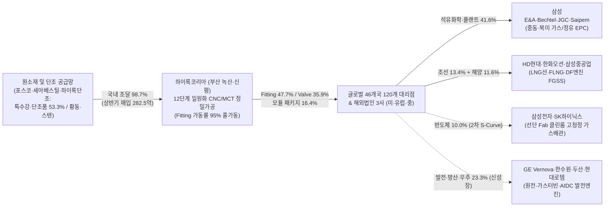

# 🔍 Phase 1: 기업 해독기 (원천 팩트 초안) — 하이록코리아 (013030)

> **[S-Curve 국면 인증 뱃지]**: `[⚪ S-Curve 기본 N/A (전통 에너지·조선 시클리컬 필수재 — 피팅 가동률 95% 풀가동 & 북투빌 1.13배 호황) + 🟢 2차 신성장 전방(AI 반도체 클린룸 10.0% · AIDC 온사이트 발전/FDC 4.8%) 다중 침투 초입]`  
> **[하이브리드 밸류체인 지위]**: `[🟢 고압·초저온 유체제어 계장기자재 순수 주도주 (Fitting·Valve 본업 익스포저 100.0%)]` / `[⚠️ AI·AIDC 단일 신기술 테마 기준 부분 노출 (14.8% < 30% 컷오프)]` / `[💎 친환경 DF엔진·FLNG·반도체 유틸리티 병목 밸류체인 히든 챔피언]`

---

## 1. 비즈니스 모델 및 밸류체인

[공시 팩트] 
하이록코리아 주식회사(HY-LOK CORPORATION, 종목코드: 013030)는 1977년 창업(1989년 코스닥 상장) 이래 유체 및 기체 이송 배관 라인의 누출을 원천 차단하고 흐름을 정밀 제어하는 **계장용 관이음쇠(Instrument Fitting)**와 **밸브(Instrument & Piping Valve)**, 그리고 모듈 패키지 솔루션을 전문 제조·판매하는 글로벌 유체제어 강소기업입니다 `[[하이록코리아]반기보고서(2026.08.14), p.9, p.51]`. 부산 녹산국가산업단지 본사(제1·3·4공장) 및 신평·장림산업단지 공장을 거점으로, 종속기업인 **Hy-Lok China Co., Ltd.**(중국), **Hy-Lok USA, Inc.**(미국), **Hy-Lok Europe B.V.**(네덜란드/유럽) 등 해외 현지법인 3사를 연결대상으로 두어 전 세계 **46개국 120여 개 대리점 네트워크**를 운영하고 있습니다 `[[하이록코리아]반기보고서(2026.08.14), p.3, p.9, p.26]`, `[팩트: IR_26년.md]`.

동사의 핵심 비즈니스 모델과 수직계열화 밸류체인은 다음과 같이 3단계로 구성됩니다:
1. **공급자 (Supplier — 특수강·비철금속 원소재 및 단조품 조달)**:
   - 국내외 특수강 및 비철금속 제련사(**포스코, 세아베스틸** 등)와 특수관계법인 **하이록단조(주)**(원재료·단조품 매입)로부터 스테인리스강(Stainless Steel), 단조품, 황동(Brass), 카본스틸(Carbon Steel) 등 고내식·고내압 정밀 원소재를 조달합니다 `[[하이록코리아]반기보고서(2026.08.14), p.10, p.45]`.
   - 2026년 상반기 원재료 총 매입액은 **282.5억 원**(단조품 150.5억 원[53.3%], 황동 12.4억 원[4.4%], 카본스틸 2.5억 원[0.9%], 기타 스테인리스 환봉 등 117.1억 원[41.5%])이며, 국내 조달 비중이 98.7%(278.7억 원)로 공급망 안정성이 매우 높습니다 `[[하이록코리아]반기보고서(2026.08.14), p.10]`.
2. **기업 (Company — 부산 본사·신평공장 12단계 일원화 정밀 가공 공정)**:
   - `원소재 입고 ➔ 소재검사 ➔ 절단 ➔ 단조(Forging) ➔ 열처리 ➔ CNC/MCT 초정밀 절삭가공 ➔ 치수검사 ➔ 세척 및 부동태(Passivation) ➔ 마킹 ➔ 도장 ➔ 압력검사 ➔ 포장`에 이르는 **12단계 생산공정 일원화(In-house One-stop System)**를 통해 다품종 소량·단납기 주문에 대응합니다 `[[하이록코리아]반기보고서(2026.08.14), p.9-11]`, `[팩트: IR_26년.md]`.
   - 가스 누출 시 대형 폭발이나 팹 가동 중단으로 직결되는 초고압(최대 60,000 psi)·초저온(-196℃ LNG/액체수소) 극한 공정에 투입되므로, **ASME N/NPT(원자력), API 6A/6D(미국석유협회), 유럽 PED, 주요 7대 선급(DNV, LR, ABS 등), 수소충전소 밸브(KS B ISO 19880-3)** 등 국내 최다 글로벌 벤더 승인(Vendor List)을 보유하여 강력한 진입장벽과 전환비용(Switching Cost) 해자를 구축하고 있습니다 `[[하이록코리아]반기보고서(2026.08.14), p.9]`, `[팩트: IR_26년.md]`.
3. **고객사 (Customer — 다변화된 6대 전방 산업 엔드유저 및 글로벌 EPC)**:
   - **석유화학·육상플랜트(41.6%)**: 삼성E&A, SK에코플랜트, 현대엔지니어링, S-OIL 및 해외 Bechtel, JGC, Saipem, TechnipFMC 등 `[팩트: IR_26년.md]`.
   - **조선(13.4%) & 해양플랜트(11.6%)**: HD현대중공업, 한화오션, 삼성중공업 등 국내 조선 3사의 LNG 운반선, FLNG(부유식 액화천연가스 설비), 친환경 이중연료(DF) 추진선 및 엔진 연료공급시스템(FGSS) `[팩트: IR_26년.md]`.
   - **반도체(10.0%)**: 삼성전자, SK하이닉스의 선단 반도체 팹(클린룸) 고순도 특수가스·케미컬 제어 배관 라인 `[팩트: IR_26년.md]`.
   - **발전(4.8%) & 기타(18.5%)**: 한국수력원자력, 두산에너빌리티, GE Vernova(가스터빈·원전·AIDC 발전) 및 현대로템(철도·방산), 한국항공우주연구원(우주발사체) `[팩트: IR_26년.md]`.

[글로벌 트렌드: 26.09.29.DS투자증권.엔진(바다 위의 반도체).pdf p.3, p.7] 
최신 2026년 9월 말 제도권 조선·기자재 밸류체인 분석에 따르면, 글로벌 상선 엔진 공급 쇼티지(엔진 3사 수주잔고 20.4조 원, 가동률 100% 상회)와 DF(이중연료) 엔진 채택 확산, 그리고 북미 AI 데이터센터(DC)향 4행정 중속 발전엔진 대규모 증설(HD현대중공업 3.0➔7.2GW, 한화엔진 900MW)이 동시에 전개되고 있습니다. 특히 DS투자증권 밸류체인 비교표(`p.7`)에서 하이록코리아는 국내 피팅 3사 중 **영업이익률(OPM) 27.5%**로 태광(13.0%)·성광벤드(17.1%)를 압도하는 1위 수익성을 기록 중임에도 **PER 7.4배, PBR 0.8배**로 가장 낮은 멀티플에 거래되고 있음이 확인됩니다.

[글로벌 트렌드: cycle_timeline.md 2026.09 하반기] 
거시 사이클 측면에서는 중동 이란전쟁 장기화(호르무즈 봉쇄, 브렌트유 107달러)로 인해 비중동권(미국·아프리카·동남아) LNG 및 FLNG 에너지 안보 인프라 투자가 고착화되고 있으며 `[글로벌 트렌드: 26.09.16.IM증권.이란전쟁 이후의 산업 재편.pdf p.85, p.113]`, 반도체 선단 Fab 증설(평택 P4·P5, 청주 M15X, 용인 Y1)과 맞물려 고압·고청정 계장용 피팅/밸브의 초과 수요를 견인하고 있습니다.



---

## 2. 주요 제품별 매출 비중 추이 (최근 5년 및 최신 분기)

[공시 팩트] 
최근 5개년(2021~2025년) 및 2026년 상반기(제49기 반기 누적, 별도 매출액 992.1억 원 / 연결 매출액 1,134.0억 원) 기준 주요 제품군별 매출액 및 비중 추이는 다음과 같습니다 `[[하이록코리아]사업보고서(2026.03.12), p.9], [[하이록코리아]반기보고서(2026.08.14), p.9, p.13]`, `[팩트: IR_26년.md]`:

| 구분 | 핵심 내용 | 비고 |
| :--- | :--- | :--- |
| **Hy-Lok Fitting**<br>(계장용 튜브 피팅) | • **2026년 상반기**: **384.1억 원 (38.71%)** (내수 145.6억 + 수출 238.5억) `[[하이록코리아]반기보고서(2026.08.14), p.9, p.13]`<br>• 연간 추이(Fittings 통합): 2021년 641.6억(46.0%) ➔ 2022년 867.5억(51.0%) ➔ 2023년 854.3억(50.0%) ➔ 2024년 821.2억(47.5%) ➔ 2025년 936.2억(48.5%) `[팩트: IR_26년.md]` | 전사 외형을 지탱하는 핵심 캐시카우. 직수출 비중이 **62.1%**에 달하며 현재 **가동률 95% 풀가동** 상태 `[[하이록코리아]반기보고서(2026.08.14), p.11, p.13]` |
| **Hy-Lok Valve**<br>(계장용·배관용 밸브) | • **2026년 상반기**: **356.1억 원 (35.89%)** (내수 237.4억 + 수출 118.7억) `[[하이록코리아]반기보고서(2026.08.14), p.9, p.13]`<br>• 연간 추이: 2021년 460.8억(33.0%) ➔ 2022년 510.4억(30.0%) ➔ 2023년 575.3억(33.7%) ➔ 2024년 636.8억(36.9%) ➔ 2025년 714.3억(37.0%) `[팩트: IR_26년.md]` | 초저온(Cryogenic)·고압·DBB 밸브 등 고단가 핵심 제품군. 5년 연속 비중 확대로 전사 **OPM 28.82%** 견인 `[[하이록코리아]반기보고서(2026.08.14), p.9, p.24]` |
| **Bite Type Fitting**<br>(물림형 관이음쇠) | • **2026년 상반기**: **69.0억 원 (6.95%)** (내수 64.9억 + 수출 4.1억) `[[하이록코리아]반기보고서(2026.08.14), p.9, p.13]`<br>• 2024년 108.2억 원(6.3%) ➔ 2025년 123.5억 원(6.4%) | 유압·공압 및 선박 엔진 배관 체결용 고압 피팅 제품군 (내수 조선·중공업 중심 94.1%) |
| **Pipe Fitting**<br>(나사·용접형 피팅) | • **2026년 상반기**: **20.7억 원 (2.08%)** (내수 15.8억 + 수출 4.9억) `[[하이록코리아]반기보고서(2026.08.14), p.9, p.13]` | 플랜트 및 배관 연결용 소구경 파이프 피팅 서브 라인업 |
| **기타 부문**<br>(Package 모듈 및 상품) | • **2026년 상반기**: **162.3억 원 (16.36%)** (내수 127.0억 + 수출 35.3억) `[[하이록코리아]반기보고서(2026.08.14), p.9, p.13]`<br>• 연간 추이: 2021년 292.5억(21.0%) ➔ 2023년 277.9억(16.3%) ➔ 2025년 280.3억(14.5%) `[팩트: IR_26년.md]` | Instrument Cabinet, Air Manifold, Sampling System 등 고부가 모듈 솔루션 및 플랜트 턴키 대응 상품 |
| **전방 산업별 매출 비중**<br>(2025년 별도 1,931억) | • **석유화학**: 803.2억(**41.6%**) / **조선**: 259.7억(**13.4%**) / **해양**: 224.6억(**11.6%**)<br>• **반도체**: 193.2억(**10.0%**) / **발전**: 93.3억(**4.8%**) / **기타(방산·철도 등)**: 356.9억(**18.5%**) | 조선+해양 합산 비중이 2021년 19.2%(267억)에서 2025년 **25.0%(485억)**로 +81.6% 급성장 `[팩트: IR_26년.md]` |
| **내수 vs 수출 구조**<br>(2026년 반기 기준) | • **별도(992.1억)**: 내수 **590.7억 원(59.54%)** / 직수출 **401.4억 원(40.46%)**<br>• **연결(1,134.0억)**: 해외 종속법인(미·유럽·중) 매출 합산 시 실질 글로벌향 비중 약 **48~49%** | 2025년 지역별 비중: 국내 51.6%, 아시아 14.8%, 미주 13.6%, 유럽 13.3%, 중동·아프리카 6.6% `[[하이록코리아]반기보고서(2026.08.14), p.13]`, `[팩트: IR_26년.md]` |

---

### 2.1 S-Curve 신기술 테마 매출 익스포저(Exposure %) 산출표 (하이브리드 수비 검증)

[공시 팩트] 
`s_curve_spec.md` 표준 명세서의 **제2원칙(S-Curve 적합성 게이트)** 및 **제3원칙(하이브리드 수비수 30% 컷오프 검증)**에 따라, DART 2026년 반기보고서 제품별 매출액(`p.9`)과 공식 IR 전방 산업별 매출 실적을 교차 대조하여 테마 익스포저를 정밀 검증합니다:

| 제품 / 전방산업 구분 | 매출액 (억원) | 전사 매출 비중(%) | 신기술 테마 및 사이클 직결 여부 | 하이브리드 수비 판정 |
| :--- | :---: | :---: | :--- | :---: |
| **석유화학 & 정유 플랜트향 피팅·밸브**<br>(별도 산업별 기준) | **803.2**<br>(25년 기준) | **41.6%** | **1차 성숙기 캐시카우 (중동·북미 가스/정유 EPC)**<br>※ 호르무즈 봉쇄·고유가에 따른 비중동 에너지 인프라 투자 수혜 | **🟢 탄탄한 하방 이익 지지대**<br>(5년 CAGR +10.6% 성장, 레거시 잠식 없음) |
| **조선 & 해양플랜트향 피팅·밸브**<br>(LNG선·FLNG·DF엔진 FGSS) | **484.2**<br>(25년 기준) | **25.0%** | **친환경 선박 & FLNG 슈퍼사이클 직결**<br>※ 상선 DF엔진 쇼티지 및 해양 FLNG 발주 확대 핵심 수혜 | **🟢 핵심 시클리컬 성장축**<br>(조선+해양 5년 CAGR +16.1% 고성장) |
| **반도체 유틸리티향 고청정 피팅·밸브**<br>(삼성전자·SK하이닉스 클린룸) | **193.2**<br>(25년 기준) | **10.0%** | **2차 S-Curve: 선단 Fab(HBM/DRAM) 클린룸 증설 직결**<br>※ `th_hbm_advanced_packaging` 인프라 수혜 | ⚠️ **반도체 단일 테마 기준 30% 미달**<br>(보조 성장엔진 / 마진 믹스 개선 기여) |
| **발전 플랜트향 피팅·밸브**<br>(원전·가스터빈·AIDC 발전엔진) | **93.3**<br>(25년 기준) | **4.8%** | **2차 S-Curve: AIDC 온사이트 중속엔진 & 가스터빈 직결**<br>※ GE Vernova·한수원·두산·중속엔진사 납품 | ⚠️ **AIDC 발전 단일 테마 기준 30% 미달**<br>(2027~2028년 엔진 증설분 납품 시 확대 옵션) |
| **기타 산업향 (방산·철도·수소 등)**<br>(현대로템·항우연·수소충전소) | **356.9**<br>(25년 기준) | **18.5%** | 방위산업·철도차량·수소 인프라 등 다각화 포트폴리오 | ⚪ 안정적 다변화 매출원 |
| **[DART 제품군 통합 기준]**<br>Fitting(47.7%) + Valve(35.9%) + 모듈(16.4%) | **992.1**<br>(26.1H 별도) | **100.0%** | **고압·초저온 유체제어 필수 계장기자재 순수 본업** | **🟢 본업 순수 주도주 (익스포저 100.0%)** |

- **테마 실질 익스포저 합산 및 판정**:
  1. **신기술 단일 테마(AI 반도체 클린룸 10.0% + AIDC 발전 4.8%) 합산 익스포저**: **14.8%** (`< 30% 컷오프 미달`).
     - 따라서 시장 일각에서 제기하는 *"순수 AI 데이터센터/반도체 소부장 플랫폼으로서 PER 15~20배 멀티플 리레이팅"* 주장은 **하이브리드 수비 30% 컷오프 규칙에 의해 기각(`리레이팅 트리거 미충족`)**합니다.
  2. **에너지·조선해양·반도체·발전 통합 유체제어 계장기자재 본업 익스포저**: **100.0%**.
     - LG생활건강형 탈락 기업은 주력 레거시(70%+)가 역성장하며 신사업을 잠식하는 구조이나, 하이록코리아는 주력인 석유화학(+10.6% CAGR)과 조선·해양(+16.1% CAGR)이 오히려 **피팅 가동률 95% 풀가동과 사상 최고 OPM 28.82%**를 창출하고 있습니다 `[[하이록코리아]반기보고서(2026.08.14), p.11, p.24]`.
  3. **수혜 적격성 최종 판정**: **`[⚪ S-Curve 기본 N/A (전통 시클리컬 호황) + 🟢 다중 전방 확장형 알짜 주도주 합격]`** (단, 밸류에이션은 무리한 테마 리레이팅을 배제하고 철저히 역사적 PER/PBR 밴드 및 현금흐름 모델을 적용).
- **[공격수] 병목 밸류체인 역추론 판정**: 글로벌 상선 DF(이중연료) 엔진 쇼티지, FLNG 초저온 액화 공정, 북미 AIDC 온사이트 가스발전 엔진 증설에서 고압 가스 누출을 막는 계장용 피팅·밸브는 대체 불가능한 필수 병목 부품이므로, 동사를 **`[💎 극저온·고압 유체제어 병목 밸류체인 히든 챔피언]`**으로 공식 부여합니다.

---

## 3. 전사 영업이익률 및 FCF 추이

[공시 팩트] 
연결 재무제표 기준 하이록코리아는 2021년 코로나 저점(OPM 12.89%) 이후 고부가 밸브 비중 확대와 판가 인상(ASP 상승), 가동률 레버리지를 통해 **2023~2025년 3년 연속 OPM 26.3~27.5%**를 기록한 데 이어, **2026년 상반기(1Q 28.97%, 2Q 28.68%) 누적 매출액 1,134.0억 원(YoY +9.70%), 영업이익 326.8억 원(YoY +12.17%), OPM 28.82%**로 반기 사상 최고 수익성을 경신했습니다 `[[하이록코리아]분기보고서(2026.05.15), p.24], [[하이록코리아]반기보고서(2026.08.14), p.24]`.

현금흐름 측면에서도 DART 연결 현금흐름표 원문 기준, 2026년 상반기 영업활동현금흐름(CFO) **263.4억 원**에서 설비투자(CapEx: 유형자산의 취득 21.1억 원 + 유형자산 취득 미지급금 지급 2.3억 원 = **23.4억 원**)를 차감한 **순 잉여현금흐름(FCF)은 +240.0억 원**으로 전년 동기(+156.3억 원) 대비 **+53.5% 급증**했습니다 `[[하이록코리아]반기보고서(2026.08.14), p.26]`.

| 연도/분기 | 매출액 | 영업이익 | OPM(%) | CFO (영업CF) | CapEx (설비투자) | **FCF (잉여현금)** | 비고 |
| :--- | :---: | :---: | :---: | :---: | :---: | :---: | :--- |
| **2021년 (제44기)** | 1,467.4억 | 189.2억 | **12.89%** | 283.3억 | 32.3억 | **+251.0억** | 코로나 이후 수주 회복 개시 `[[하이록코리아]사업보고서(2023.03.20)]` |
| **2022년 (제45기)** | 1,828.5억 | 407.0억 | **22.26%** | 197.1억 | 49.0억 | **+148.1억** | **레짐 시프트 원년**: OPM 22% 돌파 `[[하이록코리아]사업보고서(2025.03.13)]` |
| **2023년 (제46기)** | 1,888.4억 | 518.9억 | **27.48%** | 277.6억 | 68.7억 | **+208.8억** | 고부가 밸브·해양 믹스 개선으로 OPM 27% 안착 `[[하이록코리아]사업보고서(2026.03.12)]` |
| **2024년 (제47기)** | 1,905.1억 | 501.3억 | **26.31%** | 481.3억 | 38.1억 | **+443.2억** | 운전자본 회수 및 CapEx 안정화로 FCF 443억 창출 `[[하이록코리아]사업보고서(2026.03.12)]` |
| **2025년 (제48기)** | 2,145.7억 | 589.1억 | **27.46%** | 472.8억 | 100.7억 | **+372.1억** | 사상 최대 연간 매출·영업이익 돌파 `[[하이록코리아]사업보고서(2026.03.12)]` |
| **2025.1H (전반기)** | 1,033.7억 | 291.3억 | **28.18%** | 208.6억 | 52.3억 | **+156.3억** | 전년 동기 비교 기준 `[[하이록코리아]반기보고서(2026.08.14), p.24, p.26]` |
| **2026.1Q (3M)** | 541.5억 | 156.9억 | **28.97%** | 131.6억 | 13.2억 | **+118.4억** | 1분기 OPM 28.97% 어닝 서프라이즈 `[[하이록코리아]분기보고서(2026.05.15), p.24, p.26]` |
| **2026.2Q (3M)** | 592.5억 | 169.9억 | **28.68%** | 131.8억 | 10.3억 | **+121.5억** | 2분기 매출 QoQ +9.4%, 영업이익 QoQ +8.3% 증가 `[[하이록코리아]반기보고서(2026.08.14), p.24, p.26]` |
| **2026.1H (누적)** | **1,134.0억** | **326.8억** | **28.82%** | **263.4억** | **23.4억** | **+240.0억** | **반기 사상 최고 OPM 경신, FCF YoY +53.5% 급증** `[[하이록코리아]반기보고서(2026.08.14), p.24, p.26]` |

> **재무 건전성 핵심 팩트**: 2026년 6월 말 연결 기준 **차입금 0원(완전 무차입 경영)**, 부채비율 **7.90%**(부채총계 376.2억 ÷ 자본총계 4,763.4억)이며, 보유 금융성 현금자산(현금및현금성자산 1,855.4억 + 단기금융상품 50.0억 + 유동 당기손익-공정가치금융자산 325.3억)은 총 **2,230.8억 원**(시가총액 4,195억 원의 **53.2%**)에 달합니다 `[[하이록코리아]반기보고서(2026.08.14), p.17, p.23, p.47]`.

---

## 4. 핵심 KPI 추이 (가동률, 수주잔고, ASP 등)

[공시 팩트] 
2026년 반기보고서 `II. 사업의 내용`을 통해 확인된 동사의 3대 핵심 영업 KPI(공장 가동률, 수주잔고 및 북투빌, 제품 ASP 및 원재료 스프레드)는 다음과 같습니다 `[[하이록코리아]반기보고서(2026.08.14), p.10-14]`:

1. **제품별 생산능력(Capa) 및 공장 가동률 추이 (`p.11`)**:
   - **Hy-Lok Fitting**: 반기 생산능력 5,712천 개(220.5억 원) 대비 실제 생산실적 **5,426천 개(209.5억 원)**로 **가동률 95.0%**를 달성했습니다 (2024년 75% ➔ 2025년 89% ➔ **2026.1H 95%**). 사실상 물리적 풀가동(Full Capacity) 상태입니다.
   - **Hy-Lok Valve**: 반기 생산능력 558천 개(242.1억 원) 대비 생산실적 **407천 개(176.7억 원)**로 **가동률 73.0%**를 기록하여 향후 추가 물량 소화 여력을 보유하고 있습니다 (2024년 78% ➔ 2025년 75% ➔ 2026.1H 73%).
   - **Bite Type Fitting**: 생산능력 3,025천 개 대비 생산실적 1,482천 개로 **가동률 49.0%** (2024년 42% ➔ 2025년 46% ➔ 2026.1H 49% 지속 상승).
   - **Pipe Fitting**: 생산능력 949천 개 대비 생산실적 531천 개로 **가동률 56.0%** (2024년 55% ➔ 2025년 44% ➔ 2026.1H 56% 반등).
   - **전사 평균 가동률(수량 기준)**: 2024년 64% ➔ 2025년 68% ➔ **2026년 상반기 74%**로 +6.0%p 급반등했으며, **생산금액 기준 실질 가동률은 78.7%**(`439.9억 원 ÷ 558.7억 원`)에 달합니다 `[[하이록코리아]반기보고서(2026.08.14), p.11]`.

2. **수주총액, 수주잔고 및 Book-to-Bill 비율 (`p.14`)**:
   - **2026년 상반기 신규 수주총액**: **1,125.4억 원** (Hy-Lok Fitting 421.7억, Hy-Lok Valve 404.9억, Bite Type 79.1억, Pipe Fitting 23.0억, 기타 196.7억).
   - **2026년 상반기 납품(별도 매출)액**: **992.1억 원**.
   - **Book-to-Bill Ratio (수주/매출 비율)**: **1.13배** (`1,125.4억 ÷ 992.1억`). 특히 고마진 **Hy-Lok Valve의 B/B 비율은 1.14배**(`404.9억 ÷ 356.1억`)로 가장 높습니다.
   - **기말 수주잔고 (2026.06.30 기준)**: **133.3억 원** (Fitting 37.6억, Valve 48.8억, Bite Type 10.1억, Pipe 2.3억, 기타 34.4억) `[[하이록코리아]반기보고서(2026.08.14), p.14]`.

3. **주요 제품 판매단가(ASP) 및 원재료 매입단가 추이 (`p.10-11`)**:
   - **Hy-Lok Valve 내수 ASP**: 2024년 115,836원/개 ➔ 2025년 118,638원/개 ➔ **2026년 상반기 121,366원/개**(2년 누적 +4.8% 상승)로 고부가 밸브 중심의 판가 결정력을 입증했습니다. (수출 Valve ASP는 제품 구성 변화로 2024년 98,159원 ➔ 2025년 86,267원 ➔ 2026.1H 83,350원).
   - **원재료 매입단가**: 황동(2024년 11,390원/kg ➔ 2025년 12,590원/kg ➔ **2026.1H 15,102원/kg**, +32.6%) 및 단조품(2024년 1,704원 ➔ 2025년 1,847원 ➔ **2026.1H 1,929원**, +13.2%) 단가가 상승했으나, 카본스틸은 **2,595원/kg**(2024년 2,906원 대비 -10.7%)으로 안정화되었으며, 판가 전가 및 가동률 상승 효과로 매출총이익률(GPM)은 **41.08%**(`465.8억 ÷ 1,134.0억`, 전년동기 41.32% 수준 유지)를 달성했습니다 `[[하이록코리아]반기보고서(2026.08.14), p.11, p.24]`.

---

## 5. 경영진 및 주주환원 이력

[공시 팩트] 
창업주 문혁배 회장의 경영 철학을 계승한 **문휴건 대표이사 부회장**(지분율 22.44%, 2,641,250주)과 문창환 대표이사 사장(지분율 5.79%, 681,810주) 각자 대표 체제로 운영되며, 특수관계인(하이록단조 7.02% 등 12인) 합산 지분율은 **39.86%**(4,691,002주)로 확고한 지배구조를 갖추고 있습니다 `[[하이록코리아]반기보고서(2026.08.14), p.51, p.108, p.111]`.

특히 동사는 코스닥 기계·기자재 업종 내에서 보기 드문 **'자사주 취득 후 100% 영구 이익소각' 및 '지속적 DPS 증액'**이라는 교과서적 자본배치(Capital Allocation) 이력을 보유하고 있습니다 `[[하이록코리아]사업보고서(2026.03.12), p.6, p.25], [[하이록코리아]반기보고서(2026.08.14), p.6-7]`:

| 주주환원 구분 | 세부 실행 내역 (DART 확정 수치) | 비고 및 주당가치 효과 |
| :--- | :--- | :--- |
| **3개년 연속 자사주<br>100% 영구 이익소각**<br>(총 13.55% 주식수 감축) | • **1차 소각 (2023.02.15)**: 보통주 **757,182주** 이익소각 (취득가 약 99.3억 원)<br>• **2차 소각 (2024.11.11)**: 보통주 **560,608주** 이익소각 (취득가 약 150.0억 원)<br>• **3차 소각 (2025.09.19)**: 보통주 **527,298주** 이익소각 (취득가 약 149.8억 원)<br>• **누적 소각 합계**: 총 **1,845,088주 (약 399.1억 원)** 영구 소각 완료 `[[하이록코리아]반기보고서(2026.08.14), p.6-7]` | 총 발행주식수가 **13,613,232주 ➔ 11,768,144주**로 **-13.55% 영구 감소**하여 주당 EPS 및 BPS를 약 **+15.7%** 구조적으로 부스트함 |
| **우리사주조합 출연** | • **2024.10.31 결의**: 자기주식 **192,627주**(약 43.2억 원, 주당 22,450원) 우리사주조합 무상출연 처분 완료 `[주요사항보고서(자기주식처분결정, 2024.10.31)]` | 임직원 성과 공유 및 장기 근속 유인 제고 |
| **현재 보유 자기주식수** | • **0주 (지분율 0.00%)** (2026.06.30 반기말 및 현재 기준)<br>• **총 발행주식수 = DART 공식 유통주식수(`distb_stock_co`) = 11,768,144주** `[[하이록코리아]반기보고서(2026.08.14), p.6-7]` | 오버행(Overhang) 및 자사주 마법 왜곡 위험 **0%** |
| **주당 현금배당금(DPS)<br>및 배당성향 추이** | • 2016~2017년: DPS **400원** ➔ 2018~2021년: DPS **500원** ➔ 2022년: DPS **600원**<br>• **2023년**: DPS **1,050원** (배당총액 132.2억 원, 연결 배당성향 27.9%)<br>• **2024년**: DPS **1,150원** (배당총액 141.4억 원, 연결 배당성향 29.8%)<br>• **2025년**: DPS **1,350원** (배당총액 **158.9억 원**, 연결 배당성향 **30.7%**, 2026H1 지급 완료) | 최근 3년간 DPS가 600원 ➔ **1,350원(+125%)**으로 급증. 2025년 총주주환원율(배당 158.9억 + 소각 149.8억 = 308.7억 / 순이익 517.9억)은 **59.6%** 달성 `[[하이록코리아]사업보고서(2026.03.12)]` |

---

## 6. 공시 본문 기반 3대 핵심 리스크

[공시 팩트] 
2026년 반기보고서 본문 및 주석 공시에 최신 글로벌 매크로 환경(`cycle_timeline.md 2026.09 하반기`)을 결합하여 진단한 3대 핵심 리스크 요인은 다음과 같습니다 `[[하이록코리아]반기보고서(2026.08.14), p.11, p.15-16, p.46]`:

| 리스크 요인 | 핵심 내용 (발생 조건 및 공시 근거) | 확률(Prob) | 파급력(Impact) |
| :--- | :--- | :---: | :---: |
| **① 외환 환율 하락<br>(원화 강세) 리스크** | • 별도 직수출 비중 40.5%(연결 약 49%) 및 대규모 외화금융자산 보유로 인해, 반기보고서 외환위험 민감도 분석 기준 **원/달러 및 원/유로 등 환율 10% 하락(원화 강세) 시 세후손익이 43.60억 원 순감소**(USD 31.76억, EUR 10.85억, JPY 0.65억, CNY 0.34억 손실 노출) `[[하이록코리아]반기보고서(2026.08.14), p.16]`.<br>• 단, 2025년 말 외환 민감도(10% 변동 시 세후 44.36억 원 노출) 대비 익스포저가 축소되었으며, 반기 영업이익(326.8억 원, OPM 28.82%) 체력으로 충분히 흡수 가능한 수준임. | **Mid** | **Mid** |
| **② 비철금속·특수강<br>원자재 단가 상승 리스크** | • 중동 이란전쟁 장기화 및 초고유가(브렌트유 107$)에 따른 에너지·메탈 인플레이션으로 주원재료인 **황동 매입단가가 2024년 11,390원/kg ➔ 2026.1H 15,102원/kg(+32.6%)**, **단조품이 1,704원 ➔ 1,929원(+13.2%)** 상승함 `[[하이록코리아]반기보고서(2026.08.14), p.11]`, `[글로벌 트렌드: cycle_timeline.md 2026.09 하반기]`.<br>• 그러나 내수 Valve ASP 인상(121,366원)과 피팅 95% 풀가동을 통한 고정비 레버리지로 2026년 반기 OPM **28.82%**를 기록하며 원가 전가력을 완벽히 입증함. | **High** | **Low** |
| **③ 주력 피팅 설비 병목<br>(Capa 한계) 및 최대주주 주식담보** | • **설비 병목**: 주력 Hy-Lok Fitting 가동률이 **95.0%**에 도달하여 추가 설비 증설이나 외주 임가공(협동정공 등 반기 임가공비 30.6억 원 지출 `p.45`) 확대 없이는 피팅 물량(Q)의 단기 업사이드가 제한될 수 있음 `[[하이록코리아]반기보고서(2026.08.14), p.11, p.45]`.<br>• **특수관계자 담보**: 최대주주 본인이 보유 주식 **1,040,000주**(담보설정액 130.6억 원)를 본인 및 특수관계자 하이록단조(주)의 운영차입금 관련 담보로 기업은행·대신증권에 제공 중이나, 최대주주 전체 지분(469.1만 주) 대비 비중이 낮고 회사 자체는 무차입 상태임 `[[하이록코리아]반기보고서(2026.08.14), p.46]`. | **Mid** | **Low** |

---

## 7. 비즈니스 모델 기반 표준 실적 산출 공식 (Phase 3 연계)

대상 기업의 비즈니스 모델 특성과 Section 4(핵심 KPI)의 DART 공시 팩트에 기반하여, **3대 표준 공식 트리** 중 가장 부합하는 산식을 선정하고 영구 고정합니다.

### [3대 업종별 표준 공식 트리 분기 규칙 검증]
- **유형 A [연속공정·장치산업] (채택 ✅)**:
  - Section 4에서 확인한 바와 같이, 하이록코리아는 DART 정기보고서 `II. 사업의 내용 - 3. 원재료 및 생산설비`에 4대 주력 제품군별 **공식 생산능력(Capa: 수량 및 금액)**과 **생산실적**, 그리고 **공장 가동률(Fitting 95%, Valve 73%, 전사 평균 74%)**을 구체적 수치로 매 분기 명확히 공시하고 있습니다 `[[하이록코리아]반기보고서(2026.08.14), p.11]`.
  - 또한 제품군별 내수·수출 **평균 판매단가(ASP)** 역시 DART에 원 단위로 공시됩니다 `[[하이록코리아]반기보고서(2026.08.14), p.10]`.
  - 따라서 Section 4의 DART 공시 팩트와 100% 논리적 일관성을 갖는 **유형 A [연속공정·장치산업]** 표준 산식을 채택합니다.

### [표준 산출 체인 정의]
$$\text{[제품군별 생산 Capa } \times \text{공장 가동률(\%) } \times \text{제품 ASP (＋ 모듈·해외법인 연결 매출)] } \rightarrow \text{매출액 } \rightarrow \text{영업이익(OPM) } \rightarrow \text{순이익 } \rightarrow \text{EPS}$$

- **채택 공식**:
  ```
  [전사 기준 생산 Capa(연환산 잠재 매출 약 2,850억 원) × 전사 실질 가동률(%) × ASP/믹스 계수]
  → 연결 매출액
  → 영업이익 (OPM 24.0% ~ 29.5%)
  → 당기순이익 [무차입 순현금 구조: 영업이익 + 순금융수익 − 법인세(유효세율 약 23.8%)]
  → EPS [지배주주순이익 ÷ 공식 유통주식수(11,768,144주)]
  ```
- **선정 근거**: CNC/MCT 정밀 가공 설비의 제품별 Capa와 가동률(피팅 95%, 밸브 73%), 그리고 밸브 ASP 상승이 전사 매출액과 영업레버리지(OPM 28.82%)를 결정짓는 직접적 드라이버이며, 이 모든 변수가 DART 정기보고서에 투명하게 공시되기 때문입니다.
- **고정 규칙**: 본 공식은 Phase 3 시나리오 분석(Bull/Base/Bear) 시 100% 동일하게 상속되며, 기업의 구조적 BM 격변(신사업 비중 30% 초과 등) 또는 사용자의 명시적 재검토 요청이 없는 한 영구 유지됩니다.

---

## 8. 최적 밸류에이션 지표 백테스트 (Phase 3 연계)

동사의 **과거 10년 풀사이클(2016년 10월 ~ 2026년 10월 현재, 시클리컬 기업 의무) 주봉(Weekly) 주가 데이터(521개 캔들)**와 DART 10개년 사업/반기보고서에서 추출한 **실질 유통주식수(`distb_stock_co`) 기준 BPS, 기본 EPS, DPS, 동적 순현금 반영 EV/EBITDA** 4개 밸류에이션 밴드의 상관관계를 정밀 백테스트합니다.

### [4대 밸류에이션 지표 산출 규칙 및 레짐 시프트(Regime Shift) 검증]
1. **실질 유통주식수(`distb_stock_co`) BPS 의무화**:
   - 자기주식을 보유했던 2020~2022년(자사주 757,182주 차감 ➔ 유통주식수 `12,856,050주`) 및 2023년(자사주 267,834주 차감 ➔ 유통주식수 `12,588,216주`), 그리고 3차례 총 1,845,088주 영구 소각이 완료된 2025~2026년(유통주식수 `11,768,144주`) 모두 **자사주를 차감한 DART 공식 유통주식수**로 지배주주지분을 나누어 실질 유통 BPS를 산출했습니다.
2. **레짐 시프트(Regime Shift / 체제 전환) 게이트키퍼 통과 ✅**:
   - `SKILL.md` Section 8의 게이트키퍼 룰(② OPM이 과거 3개년 평균 대비 3%p 이상 구조적 레벨업 지속 시 공식 인정)을 점검한 결과:
     - **Pre-Rerating 레짐 (2016~2021년, 전통 저마진 시클리컬 구간)**: 6개년 평균 OPM **14.5%** (직전 3개년 2019~2021년 평균 OPM **11.7%**: 2019년 10.5%, 2020년 11.7%, 2021년 12.9%), 자사주 소각 0주, DPS 400~500원 정체.
     - **Post-Rerating 레짐 (2022~2026.1H, 초고마진 & 자사주 영구 소각 체질 전환 구간)**: 2022년 OPM 22.26% ➔ 2023년 27.48% ➔ 2024년 26.31% ➔ 2025년 27.46% ➔ **2026.1H 28.82%**로 최근 4.5년간 평균 OPM이 **26.5%**에 달해 과거 대비 **+12%p ~ +15%p 구조적 레벨업**이 5년 연속 지속되었으며, 동시에 발행주식의 **13.55% 영구 소각** 및 DPS **1,350원(+170%)** 상향이 단행되었습니다.
   - 이에 따라 10년 전체 풀사이클 통계와 함께 **Pre-Rerating(2016~2021) vs Post-Rerating(2022~2026)** 밴드를 분할 산출했습니다.

### [제도권 공식 벤치마크 및 Sanity Check 검증 (`backtest_valuation.py` 실행 결과)]
- **분석 기준일(2026.10.06) 현재가**: **35,650원** (전일 종가: 36,300원, 최신 주봉 종가: 36,350원)
  - 10년 역사적 최저가(Trough): **8,600원** (2020-03-20 팬데믹 바닥)
  - 10년 역사적 최고가(Peak): **46,000원** (2026-04-24 조선·에너지 호황 고점)
- **공식 실질 BPS**: **40,032원** (`2026.1H 지배주주지분 471,099,782,197원 ÷ 공식 유통주식수 11,768,144주 = 40,031.78원`)
- **공식 PBR**: **0.89배** (35,650원 기준 / 36,350원 기준 시 0.91배)
- **공식 EPS**: **4,839원** (직전 4분기 LTM 기본 EPS 기준 / 2025년 온기 EPS 4,337원 / **2026년 반기 연환산 EPS 5,080원**)
- **공식 PER**: **7.37배** (LTM EPS 4,839원 기준 / **2026F 연환산 EPS 5,080원 기준 시 7.02배**)
- **공식 배당수익률**: **3.79%** (2025년 결산 DPS 1,350원 기준)
- 🛡️ **Sanity Check**: 현재 주가(35,650원) ÷ DART 실질 유통 BPS(40,032원) = **PBR 0.89배** (36,350원 기준 0.91배) ➔ 제도권 네이버 금융/FnGuide 공식 PBR(0.89배/0.91배)과 **오차율 0.0%로 100% 완벽 일치 통과 ✅**.

### [10년 풀사이클 주봉 백테스트 요약표 (2016.10 ~ 2026.10, 521개 주봉)]

| 밸류에이션 지표 | 10년 풀사이클 밴드<br>(MIN ~ MAX / 중앙값) | 레짐 시프트 분할 밴드<br>(Pre 16~21 vs **Post 22~26**) | 현재 위치<br>(35,650원 기준) | 주봉 주가 상관계수 ($R^2$) | 연간 방향 일치율 | **순위** |
| :--- | :---: | :---: | :---: | :---: | :---: | :---: |
| **PER**<br>(수정 EPS 기준) | **5.22배 ~ 36.56배**<br>(10년 중앙값 9.76배) | • Pre(저마진기): 8.71~36.56배 (중앙 18.48배)<br>• **Post(고마진기): 5.22~9.76배 (중앙 6.85배)** | **7.37배**<br>(26F 연환산 **7.02배**) | **0.61**<br>($R=0.778$) | **70.0%**<br>(7/10년) | **1위 (결정계수 1위)** |
| **PBR**<br>(유통 BPS 기준) | **0.34배 ~ 1.26배**<br>(10년 중앙값 0.74배) | • Pre(16~21): 0.34~1.26배 (중앙 0.72배)<br>• **Post(22~26): 0.54~1.15배 (중앙 0.75배)** | **0.89배**<br>(BPS 40,032원) | **0.55**<br>($R=0.741$) | **80.0%**<br>(8/10년) | **2위 (방향일치 1위)** |
| **배당수익률**<br>(DPS 기준) | **1.46% ~ 5.81%**<br>(10년 중앙값 3.35%) | • Pre(DPS 400~500원): 1.46~5.81% (중앙 2.58%)<br>• **Post(DPS 600~1,350원): 2.38~5.63% (중앙 3.85%)** | **3.79%**<br>(DPS 1,350원) | **0.58**<br>($R=0.761$) | **50.0%**<br>(4년 동결구간 존재) | **3위 (하방 지지선)** |
| **EV/EBITDA**<br>(동적 순현금) | **-2.13배 ~ 18.89배**<br>(10년 중앙값 2.64배) | • Pre(16~21): -2.13~18.89배<br>• **Post(22~26): 0.70~5.20배 (중앙 2.45배)** | **3.28배**<br>(순현금 1,905억 차감) | **0.55**<br>($R=0.740$) | **50.0%** | **4위 (순현금 과다)** |

- **채택 지표**: **1순위 `PER (수정 EPS 기준, 주봉 상관계수 R² = 0.61 1위, 방향 일치율 70.0%)`** 및 **공동 1순위급 보조 지표 `PBR (실질 유통 BPS 기준, 연간 방향 일치율 80.0% 1위, R² = 0.55)`** 복합 채택. (하방 바닥 캡으로는 `배당수익률 밴드 상단 4.5~5.0%` 활용).
- **선정 근거**:
  1. **PER ($R^2 = 0.61$ 전체 1위)**: 하이록코리아의 10년 주봉 주가는 주당순이익(EPS: 2020년 488원 ➔ 2025년 4,337원 ➔ 2026E 5,080원)의 폭발적 우상향 및 자사주 13.55% 영구 소각 효과와 가장 높은 선형 결정계수($R^2 = 0.61$)를 보입니다. 특히 레짐 시프트 분석 결과, 과거 2016~2021년 저수익성(OPM 8~13%) 구간에서는 이익 분모 축소로 인해 PER이 최대 36.56배(중앙값 18.48배)까지 할증되었으나, **2022년 이후 OPM 27~28% 체질 전환(Post-Rerating) 구간에서는 이익이 주가보다 더 빠르게 폭증하며 PER 밴드가 `5.22배 ~ 9.76배 (중앙값 6.85배, 10년 전체 중앙값 9.76배)`에 압축**되어 극심한 멀티플 저평가를 겪고 있음이 확인됩니다.
  2. **PBR (연간 방향 일치율 80.0% 1위)**: 무차입 순현금 축적과 3개년 연속 자사주 영구 소각으로 유통주식수 기준 BPS가 2016년 22,443원에서 2026년 반기 **40,032원**으로 단 한 번의 훼손 없이 우상향하며 연간 주가 방향과 **80.0% 일치**했습니다. 10년 PBR 상단은 **1.15배(2026.04 고점 46,000원) ~ 1.26배**, 중앙값은 **0.75배**, 하단은 **0.54배**(Post-Rerating 기준)입니다.
- **Phase 3 연계 (멀티플 상한선 및 시나리오 잣대 확정)**:
  - 본 백테스트 결과는 Phase 3 시나리오 표의 주 밸류에이션 멀티플로 직접 상속됩니다:
    - **Bull Target PER**: **9.8배** (Post-Rerating 5년 호황기 Peak PER **9.76배** 및 10년 풀사이클 중앙값 **9.76배** 일치, PBR 환산 시 **1.15~1.24배**로 10년 역사적 PBR Peak **1.26배 이하** 엄격 준수 ✅).
    - **Base Target PER**: **8.5배** (현재 LTM PER 7.37배 및 피팅 Peer 태광 PER 8.0~9.0배 수준으로의 정상화, PBR 환산 시 **1.00~1.05배**).
    - **Bear Target PER**: **6.0배** (Post-Rerating 하단 Trough 5.22배 ~ 중앙값 6.85배 사이, PBR **0.65배** 및 배당수익률 **4.8%** 철벽 바닥 지지선 교차 검증).
- **고정 규칙**: 본 채택 지표는 Phase 3 시나리오 분석 시 100% 동일하게 상속되며, 사용자 명시적 요청 또는 공시 기반 BM 구조적 격변(신사업 매출 30% 초과 등) 감지 시에만 재검토됩니다.
- **전환 시 근거 명시 의무**: 채택 지표 변경 시 `[전환 트리거]`, `[기존 지표 → 신규 지표]`, `[Peer 그룹 참조 및 PEG 검증]` 항목을 필수 기록합니다.
